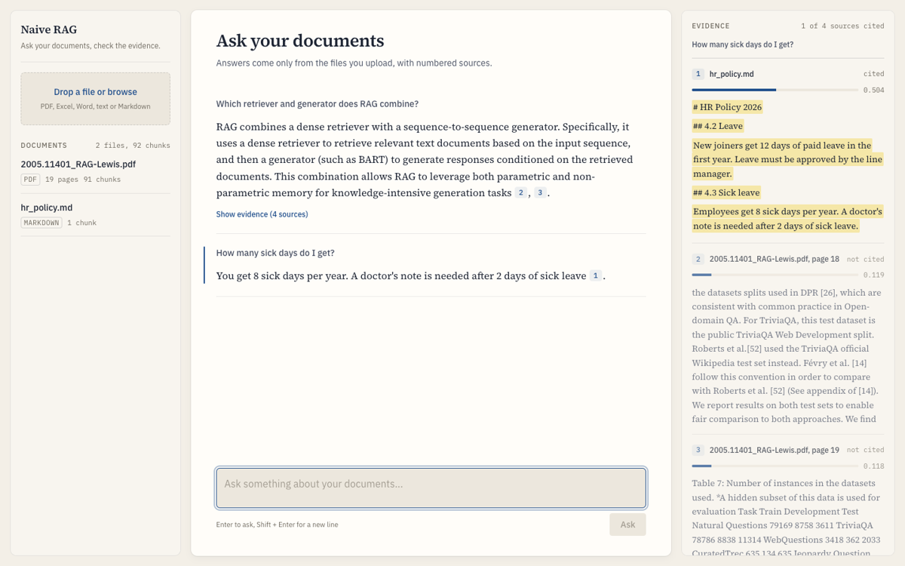

# Naive RAG UI

A React interface for the Naive RAG API: upload documents, ask questions, and check every answer against the highlighted chunks it was built from.

Start with [docs/10. UI Architecture Overview](docs/10.%20UI%20Architecture%20Overview.md) for the big picture.



## Run

1. Start the API (from `01. Naive RAG/03. API`, see its README for setup):

```bash
.venv/bin/uvicorn app.main:app --reload
```

2. Start the UI (from this folder):

```bash
npm install
npm run dev
```

3. Open http://localhost:5173.

## Commands

<table width="100%">
<thead><tr><th>Command</th><th>What it does</th></tr></thead>
<tbody>
<tr><td>npm run dev</td><td>Dev server with hot reload; /api is proxied to FastAPI on port 8000</td></tr>
<tr><td>npm test</td><td>Unit tests (Vitest)</td></tr>
<tr><td>npm run lint</td><td>Lint (oxlint)</td></tr>
<tr><td>npm run build</td><td>Production build into dist/</td></tr>
</tbody>
</table>

## Features

<table width="100%">
<thead><tr><th>Feature</th><th>Where</th><th>Doc</th></tr></thead>
<tbody>
<tr><td>API status line</td><td>Rail, under the app name</td><td>09</td></tr>
<tr><td>Upload by drop or file picker</td><td>Rail</td><td>06</td></tr>
<tr><td>Indexed documents with pages and chunks</td><td>Rail</td><td>05</td></tr>
<tr><td>Questions and grounded answers</td><td>Conversation sheet</td><td>07</td></tr>
<tr><td>Clickable citations, highlighted evidence, score bars</td><td>Sheet and evidence panel</td><td>08</td></tr>
</tbody>
</table>

## Docs

<table width="100%">
<thead><tr><th>Step</th><th>Doc</th></tr></thead>
<tbody>
<tr><td>01</td><td><a href="docs/01.%20UI%20Project%20Setup%20and%20Folder%20Structure.md">UI Project Setup and Folder Structure</a></td></tr>
<tr><td>02</td><td><a href="docs/02.%20API%20Client.md">API Client</a></td></tr>
<tr><td>03</td><td><a href="docs/03.%20Design%20System.md">Design System</a></td></tr>
<tr><td>04</td><td><a href="docs/04.%20App%20Layout.md">App Layout</a></td></tr>
<tr><td>05</td><td><a href="docs/05.%20Document%20List.md">Document List</a></td></tr>
<tr><td>06</td><td><a href="docs/06.%20Upload%20Zone.md">Upload Zone</a></td></tr>
<tr><td>07</td><td><a href="docs/07.%20Conversation.md">Conversation</a></td></tr>
<tr><td>08</td><td><a href="docs/08.%20Citations%20and%20Evidence.md">Citations and Evidence</a></td></tr>
<tr><td>09</td><td><a href="docs/09.%20API%20Status.md">API Status</a></td></tr>
<tr><td>10</td><td><a href="docs/10.%20UI%20Architecture%20Overview.md">UI Architecture Overview</a></td></tr>
</tbody>
</table>
