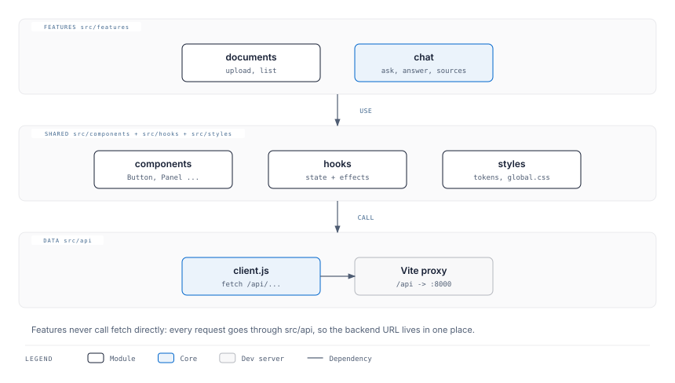
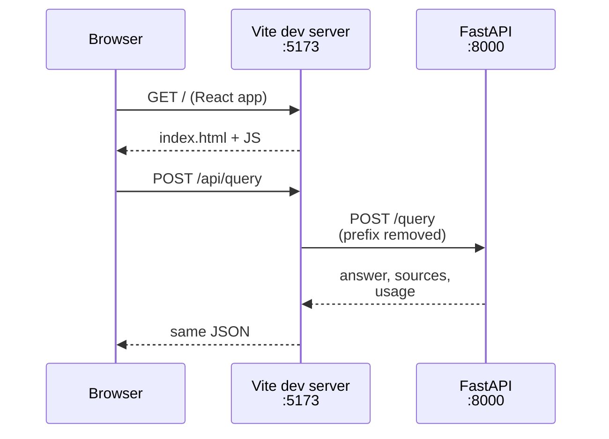

# 01. UI Project Setup and Folder Structure

In this doc:

- The stack and why each library was chosen
- The folder structure and the rules between folders
- How the UI talks to the FastAPI backend (Vite proxy)
- How to install, run, test, lint and build
- Code style rules for the UI

## The stack

The first version of this UI was hand-written CSS with a few components. It worked, but it looked like a demo. The rebuild uses the libraries that production React apps use, so the result looks and behaves like a real product (accessible menus and dialogs, cached server data, proper charts and a real PDF viewer) while the code stays small.

<table width="100%">
<thead><tr><th>Library</th><th>Version</th><th>Role</th><th>Why</th></tr></thead>
<tbody>
<tr><td>react, react-dom</td><td>19.3.1</td><td>UI library</td><td>Project decision ("React JS")</td></tr>
<tr><td>vite</td><td>8.3.8</td><td>Dev server and bundler</td><td>Instant start, fast builds, the /api proxy; no server rendering needed because FastAPI is the backend</td></tr>
<tr><td>tailwindcss (+ @tailwindcss/vite)</td><td>4.3.5</td><td>Styling</td><td>Design tokens as CSS variables, utility classes next to the markup, dark mode with one class (doc 03)</td></tr>
<tr><td>radix-ui</td><td>1.8.1</td><td>Accessible primitives</td><td>Dialogs, sheets, menus, tooltips, hover cards and tabs with keyboard and screen reader support built in</td></tr>
<tr><td>class-variance-authority, clsx, tailwind-merge</td><td>-</td><td>Component variants</td><td>Button and badge variants without long conditional class strings</td></tr>
<tr><td>@tanstack/react-query</td><td>5.108.1</td><td>Server data</td><td>Caching, loading and error states, refetching and invalidation after mutations (doc 04)</td></tr>
<tr><td>react-router</td><td>7.18.6</td><td>Pages</td><td>Chat, Documents and Analytics as real URLs</td></tr>
<tr><td>react-pdf</td><td>11.1.0</td><td>PDF viewer</td><td>pdf.js rendering with a text layer, needed to highlight cited passages (doc 06)</td></tr>
<tr><td>react-markdown, remark-gfm</td><td>10.1.0</td><td>Answers</td><td>Markdown answers with lists and tables; citation chips are rendered through its link renderer (doc 07)</td></tr>
<tr><td>recharts</td><td>3.11.0</td><td>Charts</td><td>Bar charts with custom tooltips on the Analytics page (doc 08)</td></tr>
<tr><td>react-dropzone</td><td>20.2.1</td><td>Upload</td><td>Drag and drop with file type and size checks (doc 05)</td></tr>
<tr><td>motion</td><td>14.14.0</td><td>Animation</td><td>Message entrance and the thinking state</td></tr>
<tr><td>sonner</td><td>2.0.8</td><td>Toasts</td><td>Upload and delete feedback</td></tr>
<tr><td>lucide-react</td><td>1.77.0</td><td>Icons</td><td>One consistent line icon set</td></tr>
<tr><td>Geist, Geist Mono (fontsource)</td><td>5.3</td><td>Fonts</td><td>Clean UI font and a mono font for numbers; bundled, no external font request</td></tr>
<tr><td>vitest (dev)</td><td>3.2.4</td><td>Tests</td><td>Uses the same Vite setup</td></tr>
<tr><td>oxlint (dev)</td><td>1.94.0</td><td>Linter</td><td>Very fast; catches React hook and fast refresh mistakes</td></tr>
</tbody>
</table>

The code is plain JavaScript (JSX), not TypeScript, to keep it simple to read; response shapes are documented in the backend schemas and in doc 02.

## Folder structure



```text
01. Naive RAG/04. UI/
    index.html                  page shell, loads src/main.jsx
    vite.config.js              React and Tailwind plugins, @ alias, /api proxy
    package.json                scripts and dependencies
    src/
        main.jsx                entry: fonts, styles, QueryClient, Router, Toaster
        App.jsx                 routes inside the app shell, chat state provider
        api/
            client.js           one function per backend endpoint (doc 02)
            queries.js          TanStack Query hooks (doc 04)
        components/
            ui/                 button, badge, card, overlays, skeleton (doc 03)
            layout/             AppShell, Sidebar, PageHeader (doc 04)
        features/
            documents/          upload queue, table, drawer, chunk list (doc 05)
            pdf/                PDF viewer and highlight matching (doc 06)
            chat/               conversation, citations, source panel (doc 07)
            analytics/          KPI tiles, charts, recent runs (doc 08)
        lib/                    format helpers, theme, utils, media query
        styles/globals.css      design tokens for light and dark mode
    docs/                       numbered docs like this one
        images/                 diagrams and screenshots
```

<table width="100%">
<thead><tr><th>Folder</th><th>Holds</th><th>May use</th><th>Must not</th></tr></thead>
<tbody>
<tr><td>src/features</td><td>Pages and parts of pages for one task</td><td>components, lib, api hooks</td><td>Call fetch or client.js directly for cached data</td></tr>
<tr><td>src/components</td><td>Generic pieces with no API knowledge (layout may read health and document count)</td><td>lib, styles</td><td>Import from features</td></tr>
<tr><td>src/api</td><td>Endpoint functions and query hooks</td><td>fetch, TanStack Query</td><td>Render UI</td></tr>
<tr><td>src/lib</td><td>Small pure helpers and hooks</td><td>nothing app-specific</td><td>Know about pages</td></tr>
<tr><td>src/styles</td><td>Tokens and global CSS</td><td>nothing</td><td>Hold component rules</td></tr>
</tbody>
</table>

The `@` alias points at `src`, so imports read `@/components/ui/button` instead of long relative paths.

## How the UI talks to the backend



The browser only talks to the Vite server. Vite forwards every `/api/...` request to FastAPI and removes the `/api` prefix. The browser sees one origin, so there are no CORS errors and the backend needs no CORS setup. The prefix also keeps UI routes (`/documents`) and backend routes (`/api/documents`) apart.

## Install and run

Start the backend first (from `01. Naive RAG/03. API`):

```bash
.venv/bin/uvicorn app.main:app --reload
```

Then the UI (from `01. Naive RAG/04. UI`):

```bash
npm install
npm run dev
```

Open http://localhost:5173.

<table width="100%">
<thead><tr><th>Command</th><th>What it does</th></tr></thead>
<tbody>
<tr><td>npm run dev</td><td>Dev server with hot reload and the /api proxy</td></tr>
<tr><td>npm test</td><td>Unit tests (Vitest)</td></tr>
<tr><td>npm run lint</td><td>oxlint</td></tr>
<tr><td>npm run build</td><td>Production build into dist/</td></tr>
<tr><td>npm run preview</td><td>Serve the dist/ build locally</td></tr>
</tbody>
</table>

The PDF viewer needs a current browser (pdf.js 6); see doc 06.

## Code style for the UI

The same rules as the Python code, adapted to JavaScript:

1. Every file starts with a block comment (`/** ... */`) that explains what the file does.
2. Imports come next under one `// Imports` comment, longest line first, shortest last, with no other comments in the block.
3. A short comment above each logical block, then the code, then a blank line.
4. Simple, readable code over clever code.

```jsx
// Headline number tile
export default function KpiTile({ icon: Icon, label, value }) {
  return (
    <div className="rounded-xl border bg-card p-4">
      <p className="text-[12.5px] text-muted-foreground">{label}</p>
      <p className="font-mono text-[22px] font-semibold">{value}</p>
    </div>
  )
}
```
