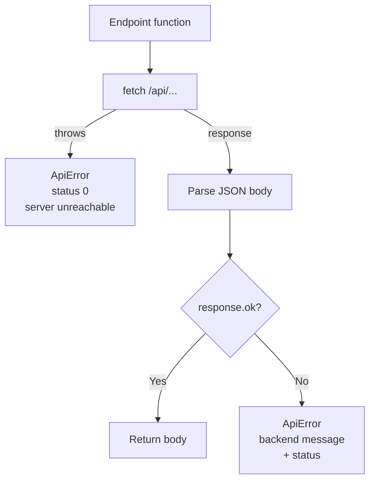

# 02. API Client

In this doc:

- Why all backend calls live in one file
- The three endpoint functions
- How request() works, step by step
- Error handling: ApiError and readable messages
- Tests with a fake fetch

Files:

- [src/api/client.js](../src/api/client.js)
- [src/api/client.test.js](../src/api/client.test.js)

## Why one file

<table width="100%">
<thead><tr><th>Without a client module</th><th>With src/api/client.js</th></tr></thead>
<tbody>
<tr><td>fetch calls spread across components, each with its own URL and error handling</td><td>One function per endpoint, one place for URLs and errors</td></tr>
<tr><td>Changing the backend address means editing many files</td><td>Change API_BASE once</td></tr>
<tr><td>Components must know about status codes and JSON parsing</td><td>Components get data or an ApiError with a ready-to-show message</td></tr>
</tbody>
</table>

## The endpoint functions

<table width="100%">
<thead><tr><th>Function</th><th>Request</th><th>Returns</th><th>Backend doc</th></tr></thead>
<tbody>
<tr><td>getHealth()</td><td>GET /api/health</td><td>status, app_name, version, config</td><td>implementation 03</td></tr>
<tr><td>uploadDocument(file)</td><td>POST /api/documents, multipart field "file"</td><td>source, documents, chunks, total_chunks</td><td>implementation 13</td></tr>
<tr><td>askQuestion(question, topK)</td><td>POST /api/query, JSON {question, top_k}</td><td>answer, sources</td><td>implementation 18</td></tr>
</tbody>
</table>

Notes:

- `uploadDocument` uses `FormData`. The browser sets the `multipart/form-data` header and boundary itself, so no `Content-Type` is set by hand.
- `askQuestion` sends `top_k` (snake_case) because that is the field name in the FastAPI schema. `null` means "use TOP_K from the backend settings".

## How request() works


### Step by step

1. Build the URL: `API_BASE + path`, for example `/api/query`. The Vite proxy (UI doc 01) forwards it to FastAPI as `/query`.
2. Call `fetch`. If fetch itself throws, the server could not be reached (not started, wrong port): throw `ApiError` with status `0` and a message that says so.
3. Parse the JSON body. FastAPI always returns JSON; `.catch(() => null)` keeps the code safe if a body is empty.
4. If the status is not 2xx, throw `ApiError` with the backend's message (`readDetail`) or a generic message with the status.
5. Otherwise return the parsed body.



## Error messages

FastAPI uses two shapes for errors. `readDetail` turns both into one sentence:

<table width="100%">
<thead><tr><th>Backend response</th><th>Body shape</th><th>Message shown</th></tr></thead>
<tbody>
<tr><td>409 duplicate upload</td><td>{"detail": "'a.txt' is already indexed"}</td><td>'a.txt' is already indexed</td></tr>
<tr><td>400 unsupported type</td><td>{"detail": "Unsupported file type. Allowed: ..."}</td><td>Unsupported file type. Allowed: ...</td></tr>
<tr><td>422 validation</td><td>{"detail": [{"msg": "..."}, ...]}</td><td>All msg values joined with ". "</td></tr>
<tr><td>Server not running</td><td>No response</td><td>Cannot reach the API server. Is it running on port 8000?</td></tr>
<tr><td>Server not running, through the Vite proxy</td><td>502, 503 or 504 with no detail</td><td>Same message, status 0 (added in doc 09)</td></tr>
</tbody>
</table>

`ApiError.status` lets components react differently when needed, for example showing "already uploaded" for 409.

## Tests

[Vitest](https://vitest.dev) runs the tests. `vi.stubGlobal('fetch', ...)` replaces the browser `fetch` with a fake, so no server is needed.

<table width="100%">
<thead><tr><th>Test</th><th>Checks</th></tr></thead>
<tbody>
<tr><td>getHealth calls GET /api/health</td><td>URL and returned body</td></tr>
<tr><td>uploadDocument sends the file as form data</td><td>POST to /api/documents, file in the "file" field</td></tr>
<tr><td>askQuestion sends question and top_k as JSON</td><td>URL and exact JSON body</td></tr>
<tr><td>backend errors become ApiError with the detail message</td><td>409 gives name, status and message from the backend</td></tr>
<tr><td>a network failure becomes ApiError with status 0</td><td>Unreachable server is reported clearly</td></tr>
<tr><td>readDetail joins validation messages</td><td>422 list becomes one sentence</td></tr>
</tbody>
</table>

```bash
npm test
```

## Dependencies added

<table width="100%">
<thead><tr><th>Package</th><th>Version</th><th>Why</th></tr></thead>
<tbody>
<tr><td>vitest (dev)</td><td>3.2.4</td><td>Test runner that uses the same Vite setup</td></tr>
</tbody>
</table>
