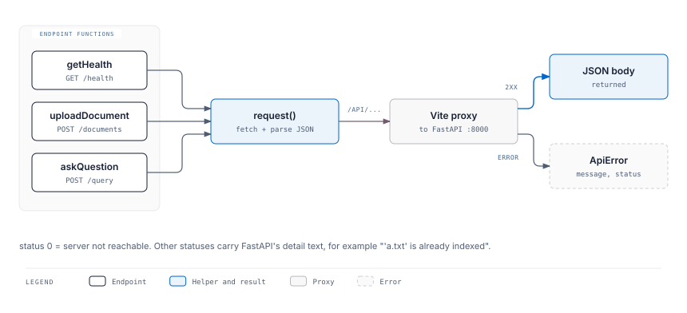
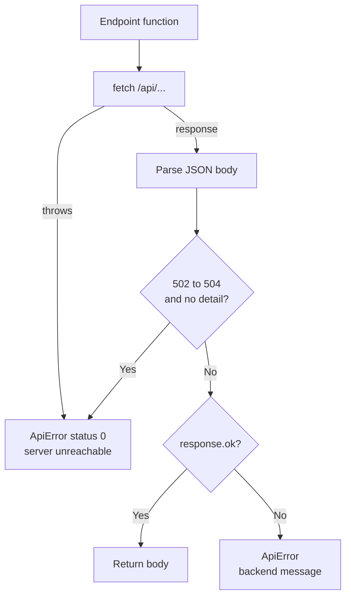

# 02. API Client

In this doc:

- Why all backend calls live in one file
- Every endpoint function
- How request() works, step by step
- Upload progress with XMLHttpRequest
- Error handling: ApiError and readable messages
- Tests with a fake fetch

Files:

- [src/api/client.js](../src/api/client.js)
- [src/api/client.test.js](../src/api/client.test.js)

Components do not call these functions directly for cached data; they use the TanStack Query hooks in `src/api/queries.js` (doc 04), which call this client.

## Why one file

<table width="100%">
<thead><tr><th>Without a client module</th><th>With src/api/client.js</th></tr></thead>
<tbody>
<tr><td>fetch calls spread across components, each with its own URL and error handling</td><td>One function per endpoint, one place for URLs and errors</td></tr>
<tr><td>Changing the backend address means editing many files</td><td>Change API_BASE once</td></tr>
<tr><td>Components must know about status codes and JSON parsing</td><td>Components get data or an ApiError with a ready-to-show message</td></tr>
</tbody>
</table>

## The endpoint functions

<table width="100%">
<thead><tr><th>Function</th><th>Request</th><th>Returns</th><th>Used by</th></tr></thead>
<tbody>
<tr><td>getHealth()</td><td>GET /api/health</td><td>status, app name, version, config checks</td><td>Sidebar status</td></tr>
<tr><td>listDocuments()</td><td>GET /api/documents</td><td>documents: source, file type, parts, chunks, size, upload time</td><td>Documents, Chat, Sidebar</td></tr>
<tr><td>uploadDocument(file, onProgress)</td><td>POST /api/documents, multipart field "file"</td><td>chunks, embedding tokens, cost, step timings</td><td>Upload queue</td></tr>
<tr><td>documentFileUrl(source)</td><td>URL of GET /api/documents/{source}/file</td><td>A URL string (no request)</td><td>PDF viewer</td></tr>
<tr><td>getDocumentChunks(source)</td><td>GET /api/documents/{source}/chunks</td><td>Every chunk with page and text</td><td>Document drawer</td></tr>
<tr><td>deleteDocument(source)</td><td>DELETE /api/documents/{source}</td><td>Removed source and chunk count</td><td>Documents table</td></tr>
<tr><td>getAnalytics()</td><td>GET /api/analytics</td><td>totals, daily, recent</td><td>Analytics</td></tr>
<tr><td>askQuestion(question, topK)</td><td>POST /api/query, JSON {question, top_k}</td><td>answer, sources (number, label, score, text, source, page), usage</td><td>Chat</td></tr>
</tbody>
</table>

Notes:

- File names are passed through `encodeURIComponent`, so names with spaces or special characters work in the URL.
- `askQuestion` sends `top_k` (snake_case) because that is the field name in the FastAPI schema. `null` means "use TOP_K from the backend settings".

## How request() works

1. Build the URL: `API_BASE + path`, for example `/api/query`. The Vite proxy (doc 01) forwards it to FastAPI as `/query`.
2. Call `fetch`. If fetch throws, the server could not be reached: throw `ApiError` with status `0`.
3. Parse the JSON body. `.catch(() => null)` keeps the code safe if a body is empty.
4. A 502, 503 or 504 without a FastAPI message comes from the Vite proxy, which means the backend is down: throw the same "cannot reach" error with status `0`.
5. Any other non-2xx status throws `ApiError` with the backend's message (`readDetail`) or a generic message with the status.
6. Otherwise return the parsed body.

## Upload progress

`fetch` cannot report how many bytes have been sent, so `uploadDocument` uses `XMLHttpRequest`. `xhr.upload.onprogress` calls `onProgress(loaded / total)`, which drives the progress bar in the upload queue. When the bytes are sent the queue switches to "Indexing" while the backend parses, chunks and embeds the file. The response is handled exactly like `request()`: same proxy check, same `ApiError`.

## Error messages

FastAPI uses two shapes for errors. `readDetail` turns both into one sentence:

<table width="100%">
<thead><tr><th>Backend response</th><th>Body shape</th><th>Message shown</th></tr></thead>
<tbody>
<tr><td>409 duplicate upload</td><td>{"detail": "'a.txt' is already indexed"}</td><td>'a.txt' is already indexed</td></tr>
<tr><td>400 unsupported type</td><td>{"detail": "Unsupported file type. Allowed: ..."}</td><td>Unsupported file type. Allowed: ...</td></tr>
<tr><td>404 unknown document</td><td>{"detail": "..."}</td><td>The backend message</td></tr>
<tr><td>422 validation</td><td>{"detail": [{"msg": "..."}, ...]}</td><td>All msg values joined with ". "</td></tr>
<tr><td>Server not running</td><td>No response, or a proxy 502 to 504</td><td>Cannot reach the API server. Is it running on port 8000?</td></tr>
</tbody>
</table>

## Tests

`vi.stubGlobal('fetch', ...)` and a fake `XMLHttpRequest` replace the browser APIs, so no server is needed.

<table width="100%">
<thead><tr><th>Test</th><th>Checks</th></tr></thead>
<tbody>
<tr><td>getHealth calls GET /api/health</td><td>URL and returned body</td></tr>
<tr><td>listDocuments calls GET /api/documents</td><td>URL and returned body</td></tr>
<tr><td>uploadDocument sends form data and reports progress</td><td>POST to /api/documents, "file" field, progress values</td></tr>
<tr><td>deleteDocument and documentFileUrl encode the file name</td><td>DELETE method and encoded URLs</td></tr>
<tr><td>askQuestion sends question and top_k as JSON</td><td>URL and exact JSON body</td></tr>
<tr><td>backend errors become ApiError with the detail message</td><td>409 gives name, status and message</td></tr>
<tr><td>a network failure becomes ApiError with status 0</td><td>Unreachable server is reported clearly</td></tr>
<tr><td>a proxy 502 without a detail means the server is down</td><td>Status 0 and the same message</td></tr>
<tr><td>readDetail joins validation messages</td><td>422 list becomes one sentence</td></tr>
</tbody>
</table>
