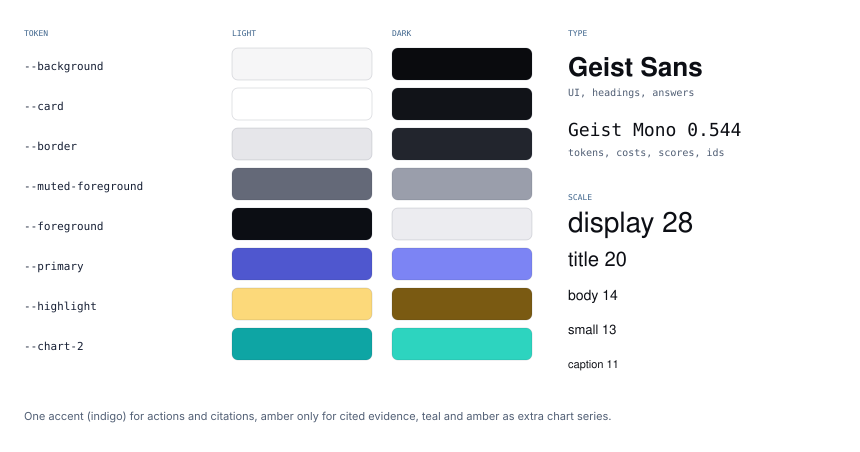
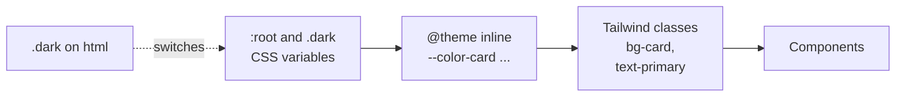

# 03. Design System

In this doc:

- Why the UI was rebuilt and the new direction
- The library stack and what each library is for
- Tokens: light and dark themes on CSS variables, mapped into Tailwind
- The shared primitives: Button, Badge, Card, overlays, small pieces
- Formatting helpers

Files:

- [src/styles/globals.css](../src/styles/globals.css)
- [src/components/ui/button.jsx](../src/components/ui/button.jsx), [badge.jsx](../src/components/ui/badge.jsx), [card.jsx](../src/components/ui/card.jsx), [overlay.jsx](../src/components/ui/overlay.jsx), [misc.jsx](../src/components/ui/misc.jsx)
- [src/lib/utils.js](../src/lib/utils.js), [src/lib/format.js](../src/lib/format.js) and [format.test.js](../src/lib/format.test.js)
- [vite.config.js](../vite.config.js) (Tailwind plugin, "@" alias)

## Why a rebuild

The first UI (a three-column "reading desk") worked, but it looked like a demo: hand-made controls, no navigation, no way to see the PDF behind an answer, no ingestion details and no cost view. The new UI is a product-grade workspace modelled on tools people already trust for this job: chat-with-PDF apps (answer on the left, document on the right), and the calm, precise surfaces of Linear, Vercel and Notion.

<table width="100%">
<thead><tr><th>Question</th><th>Answer</th></tr></thead>
<tbody>
<tr><td>Who uses it?</td><td>Someone testing RAG on their own files: they upload, ask, check the answer against the real page, and watch the cost</td></tr>
<tr><td>What must it make easy?</td><td>Ingest with visible progress, chat with citations that open the exact PDF page, read usage and cost at a glance</td></tr>
<tr><td>How should it feel?</td><td>A precise, quiet workspace: neutral surfaces, one accent, data in a monospaced face, light and dark themes</td></tr>
<tr><td>Signature</td><td>Clicking a citation opens the PDF at the cited page with the passage highlighted</td></tr>
</tbody>
</table>

## Library stack

<table width="100%">
<thead><tr><th>Library</th><th>Used for</th><th>Why this one</th></tr></thead>
<tbody>
<tr><td>Tailwind CSS 4</td><td>Styling with utility classes on design tokens</td><td>Fast, consistent spacing and color; the Vite plugin needs no config file</td></tr>
<tr><td>radix-ui</td><td>Tooltip, HoverCard, Dialog (Sheet), DropdownMenu, Tabs</td><td>Accessible behaviour (focus, keyboard, Escape, positioning) without writing it by hand</td></tr>
<tr><td>class-variance-authority, clsx, tailwind-merge</td><td>Component variants and class merging</td><td>The shadcn/ui pattern: one component, named variants, overridable classes</td></tr>
<tr><td>lucide-react</td><td>Icons</td><td>Consistent 1.5px stroke icon set, tree-shaken</td></tr>
<tr><td>react-router 7</td><td>Pages: Chat, Documents, Analytics</td><td>Standard client-side routing with URLs</td></tr>
<tr><td>@tanstack/react-query 5</td><td>Server data: caching, loading and error states, refetching</td><td>Replaces hand-written fetch hooks</td></tr>
<tr><td>react-pdf</td><td>PDF rendering with a text layer</td><td>pdf.js in React; the text layer lets us highlight cited text</td></tr>
<tr><td>react-dropzone</td><td>Drag and drop upload</td><td>Handles drag events, file types and keyboard access</td></tr>
<tr><td>recharts</td><td>Analytics charts</td><td>Composable React charts with tooltips</td></tr>
<tr><td>motion</td><td>Small entrance and layout animations</td><td>Smooth, interruptible animations</td></tr>
<tr><td>sonner</td><td>Toast notifications</td><td>Clean, stackable toasts for upload and delete results</td></tr>
<tr><td>react-markdown, remark-gfm</td><td>Answers rendered as Markdown</td><td>Lists, bold and tables in answers display properly</td></tr>
<tr><td>Geist Sans and Geist Mono</td><td>Typography</td><td>A modern, technical pairing; mono for numbers and ids</td></tr>
</tbody>
</table>

## Tokens

Every color is a CSS variable, defined twice: once in `:root` (light) and once in `.dark`. The `@theme inline` block tells Tailwind about them, so `bg-card`, `text-muted-foreground`, `border-border` or `bg-primary-soft` work in both themes without any `dark:` classes in components.

<table width="100%">
<thead><tr><th>Group</th><th>Tokens</th><th>Rule</th></tr></thead>
<tbody>
<tr><td>Surfaces</td><td>background, sidebar, card, muted, accent</td><td>Canvas is slightly grey, cards are white (light) so content lifts off the page</td></tr>
<tr><td>Text</td><td>foreground, muted-foreground, subtle-foreground</td><td>Three levels: primary, secondary, metadata</td></tr>
<tr><td>Accent</td><td>primary, primary-hover, primary-soft</td><td>One muted indigo for actions, active navigation and citations</td></tr>
<tr><td>Evidence</td><td>highlight, highlight-strong</td><td>Amber, only for cited passages and their markers</td></tr>
<tr><td>Status</td><td>success, warning, danger (+ soft backgrounds)</td><td>Upload results, health, errors</td></tr>
<tr><td>Charts</td><td>chart-1 to chart-4</td><td>Indigo, teal, amber, violet: distinguishable in both themes</td></tr>
<tr><td>Shape</td><td>radius 6 / 8 / 12 / 16, shadow-card, shadow-pop</td><td>Small radius for controls, larger for cards; one soft card shadow, a stronger one for floating surfaces</td></tr>
</tbody>
</table>

## Primitives

<table width="100%">
<thead><tr><th>Component</th><th>Variants or parts</th><th>Notes</th></tr></thead>
<tbody>
<tr><td>Button</td><td>primary, secondary, outline, ghost, danger; sm, md, lg, icon</td><td>Native button, press scale 0.98, icons sized automatically</td></tr>
<tr><td>Badge</td><td>neutral, primary, success, warning, danger</td><td>File types, statuses, run kinds</td></tr>
<tr><td>Card</td><td>Card, CardHeader, CardTitle, CardDescription, CardContent</td><td>Same padding everywhere (20px)</td></tr>
<tr><td>Tooltip, HoverCard</td><td>Radix</td><td>HoverCard shows citation previews</td></tr>
<tr><td>Sheet</td><td>Radix Dialog from the right</td><td>Document drawer with PDF and chunks</td></tr>
<tr><td>DropdownMenu</td><td>Radix</td><td>Row actions (open, delete)</td></tr>
<tr><td>Tabs</td><td>Radix</td><td>Preview and Chunks in the drawer</td></tr>
<tr><td>Skeleton, Kbd, Separator, Spinner</td><td>misc.jsx</td><td>Loading placeholders and small details</td></tr>
</tbody>
</table>

All primitives accept `className`, and `cn()` (clsx + tailwind-merge) lets a caller override a default class cleanly.

## Formatting helpers

`src/lib/format.js` turns API numbers into readable text: `plural`, `formatBytes` (885323 to "865 KB"), `formatCost` ($0.000198), `formatTokens` (21198 to "21.2K"), `formatMs` (1503 to "1.5 s") and `timeAgo`. Covered by unit tests.

## Dependencies changed

Removed: the IBM Plex and Source Serif font packages of the first design. Added: the libraries in the stack table above (versions in [package.json](../package.json)).
