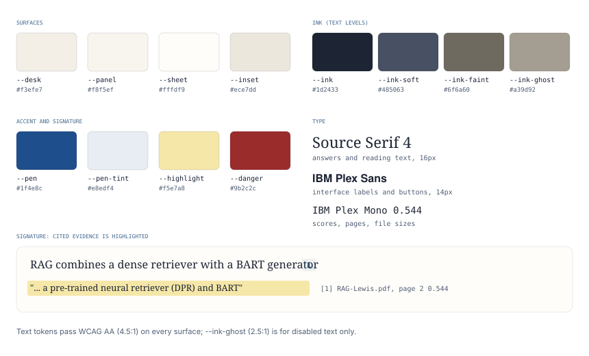
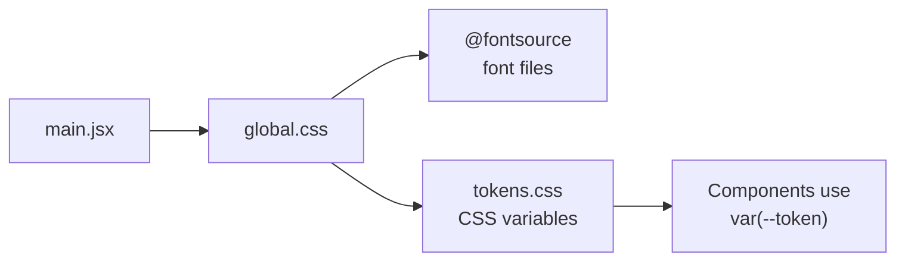

# 03. Design System

In this doc:

- The design direction "Reading desk" and why
- Who the UI is for and what it must make easy
- Every token: surfaces, ink, accent, signature, type, spacing, radius, motion
- Contrast checks
- Fonts and how they are loaded
- Rules components follow

Files:

- [src/styles/tokens.css](../src/styles/tokens.css)
- [src/styles/global.css](../src/styles/global.css)

## Intent

<table width="100%">
<thead><tr><th>Question</th><th>Answer</th></tr></thead>
<tbody>
<tr><td>Who is this human?</td><td>Someone learning or testing RAG: uploads a paper or a policy, asks questions, and wants to check whether the answer is really supported by the documents</td></tr>
<tr><td>What must they do?</td><td>Upload documents, ask a question, read the answer, verify it against the cited chunks</td></tr>
<tr><td>How should it feel?</td><td>Like reading at a desk with a highlighter: calm, document-centric, the evidence always in view</td></tr>
</tbody>
</table>

## Direction: Reading desk

<table width="100%">
<thead><tr><th>Element</th><th>From the domain</th><th>In the UI</th></tr></thead>
<tbody>
<tr><td>Desk and paper</td><td>Warm off-white paper on a slightly darker desk</td><td>--desk behind everything, --sheet for the conversation (the focal surface)</td></tr>
<tr><td>Ink</td><td>Navy ink, not pure black</td><td>Four text levels from --ink to --ink-ghost</td></tr>
<tr><td>Fountain pen</td><td>One deep blue for writing and marking</td><td>--pen: buttons, links, citation numbers. The only accent color.</td></tr>
<tr><td>Highlighter (signature)</td><td>Yellow marker on the passage you rely on</td><td>Cited chunk text gets a --highlight background in the evidence panel</td></tr>
<tr><td>Footnotes and margins</td><td>Numbered notes beside the text</td><td>[1] [2] citation chips in the answer, evidence panel on the right</td></tr>
</tbody>
</table>

### Defaults rejected

<table width="100%">
<thead><tr><th>Default</th><th>Replaced with</th><th>Why</th></tr></thead>
<tbody>
<tr><td>Chat bubbles with a purple gradient</td><td>Answers set as reading text on a paper sheet</td><td>Answers are documents to verify, not chat messages</td></tr>
<tr><td>Inter or system font everywhere</td><td>Serif for reading, Plex Sans for UI, Plex Mono for data</td><td>Three roles, three voices; serif slows the eye for reading</td></tr>
<tr><td>Grey card grid</td><td>Three columns on one desk: documents, conversation, evidence</td><td>Matches the task order: add, ask, verify</td></tr>
</tbody>
</table>

## Tokens

### Surfaces

<table width="100%">
<thead><tr><th>Token</th><th>Value</th><th>Used for</th></tr></thead>
<tbody>
<tr><td>--desk</td><td>#f3efe7</td><td>Page background</td></tr>
<tr><td>--panel</td><td>#f8f5ef</td><td>Documents rail and evidence panel (same family as the desk, slightly lighter)</td></tr>
<tr><td>--sheet</td><td>#fffdf9</td><td>The conversation sheet, the focal surface, lifted with --lift</td></tr>
<tr><td>--inset</td><td>#ece7dd</td><td>Inputs and drop zone: slightly darker, because inputs receive content</td></tr>
</tbody>
</table>

### Ink (text levels)

<table width="100%">
<thead><tr><th>Token</th><th>Value</th><th>Level</th><th>Example</th></tr></thead>
<tbody>
<tr><td>--ink</td><td>#1d2433</td><td>Primary</td><td>Answer text, headings</td></tr>
<tr><td>--ink-soft</td><td>#485063</td><td>Secondary</td><td>Question text, labels</td></tr>
<tr><td>--ink-faint</td><td>#6f6a60</td><td>Tertiary</td><td>Metadata: pages, chunk counts</td></tr>
<tr><td>--ink-ghost</td><td>#a39d92</td><td>Disabled</td><td>Disabled buttons, placeholders</td></tr>
</tbody>
</table>

### Accent, signature and semantic

<table width="100%">
<thead><tr><th>Token</th><th>Value</th><th>Used for</th></tr></thead>
<tbody>
<tr><td>--pen</td><td>#1f4e8c</td><td>Primary button, citation numbers, focus ring base</td></tr>
<tr><td>--pen-tint</td><td>8% pen</td><td>Citation chip background, selected document</td></tr>
<tr><td>--highlight</td><td>#f5e7a8</td><td>Cited evidence text (signature)</td></tr>
<tr><td>--success</td><td>#2f6b4f</td><td>Upload succeeded</td></tr>
<tr><td>--danger</td><td>#9b2c2c</td><td>Errors (409, 422, server down)</td></tr>
</tbody>
</table>

Color is scarce on purpose: about 60 percent paper, 30 percent ink and rules, under 10 percent pen blue and highlighter.

### Typography

<table width="100%">
<thead><tr><th>Role</th><th>Font</th><th>Size and weight</th><th>Why</th></tr></thead>
<tbody>
<tr><td>Reading</td><td>Source Serif 4</td><td>16px / 400, line height 1.6</td><td>Comfortable for paragraphs of answer text and evidence quotes</td></tr>
<tr><td>Interface</td><td>IBM Plex Sans</td><td>14px; 500 for labels, 600 for titles</td><td>Technical, documentary voice; not the default Inter</td></tr>
<tr><td>Data</td><td>IBM Plex Mono</td><td>11 to 12px / 400 to 500</td><td>Scores, page numbers and counts line up (fixed width)</td></tr>
</tbody>
</table>

Scale: 14px base with ratio 1.25, rounded: caption 11, small 12, body 14, reading 16, h3 18, h2 22, h1 28. Hierarchy uses weight and ink level first, size second.

### Spacing, radius, elevation, motion

<table width="100%">
<thead><tr><th>Group</th><th>Values</th><th>Rule</th></tr></thead>
<tbody>
<tr><td>Spacing</td><td>4, 8, 12, 16, 20, 24, 32, 40 px</td><td>4px base unit, multiples only. Panels 16px padding (calm, not dense).</td></tr>
<tr><td>Radius</td><td>4 (controls), 6 (cards), 10 (sheet)</td><td>Small things small radius; nested radius = inner + padding</td></tr>
<tr><td>Elevation</td><td>--lift on the sheet only; hairline --rule borders elsewhere</td><td>One depth strategy: rules plus a single soft lift for the focal surface</td></tr>
<tr><td>Motion</td><td>120 and 180 ms, ease-out</td><td>Only opacity and transform; disabled when the user prefers reduced motion</td></tr>
<tr><td>Layout</td><td>Rail 272px, evidence 340px, conversation fills the rest</td><td>Rail and evidence serve the conversation, which gets the most width</td></tr>
</tbody>
</table>

## Contrast checks

Measured with the WCAG 2 formula against each surface:

<table width="100%">
<thead><tr><th>Text token</th><th>On --desk</th><th>On --sheet</th><th>On --highlight</th><th>Passes AA for text</th></tr></thead>
<tbody>
<tr><td>--ink</td><td>13.54</td><td>15.28</td><td>12.48</td><td>Yes</td></tr>
<tr><td>--ink-soft</td><td>7.03</td><td>7.94</td><td>6.48</td><td>Yes</td></tr>
<tr><td>--ink-faint</td><td>4.69</td><td>5.29</td><td>4.32</td><td>Yes on paper; not used on highlight</td></tr>
<tr><td>--ink-ghost</td><td>2.35</td><td>2.65</td><td>2.17</td><td>No: disabled text only</td></tr>
<tr><td>--pen</td><td>7.25</td><td>8.18</td><td>6.68</td><td>Yes</td></tr>
<tr><td>--danger</td><td>6.56</td><td>7.41</td><td>6.05</td><td>Yes</td></tr>
</tbody>
</table>

## How tokens and fonts are loaded

Fonts come from `@fontsource` npm packages, so they are bundled with the app: no request to Google Fonts, works offline, no layout jump from late font loading on a slow network.

`global.css` also sets: box sizing, removed default margins, desk background, balanced headings and pretty paragraph wrapping, a visible focus ring for keyboard users only (`:focus-visible`), and reduced motion support.

## Rules for components

1. Use only `var(--token)` values. No raw hex colors, no random pixel sizes.
2. Text color comes from the four ink levels. If a fifth is needed, the hierarchy is wrong.
3. --pen is for actions and citations only; --highlight is for cited evidence only.
4. Every interactive element has default, hover, active, focus and disabled states.
5. Inputs use --inset; panels use --panel; only the conversation sheet uses --sheet and --lift.

## Dependencies added

<table width="100%">
<thead><tr><th>Package</th><th>Version</th><th>Why</th></tr></thead>
<tbody>
<tr><td>@fontsource/ibm-plex-sans</td><td>5.2.6</td><td>Interface font, weights 400, 500, 600</td></tr>
<tr><td>@fontsource/ibm-plex-mono</td><td>5.2.6</td><td>Data font, weights 400, 500</td></tr>
<tr><td>@fontsource-variable/source-serif-4</td><td>5.2.8</td><td>Reading font (variable weight)</td></tr>
</tbody>
</table>
