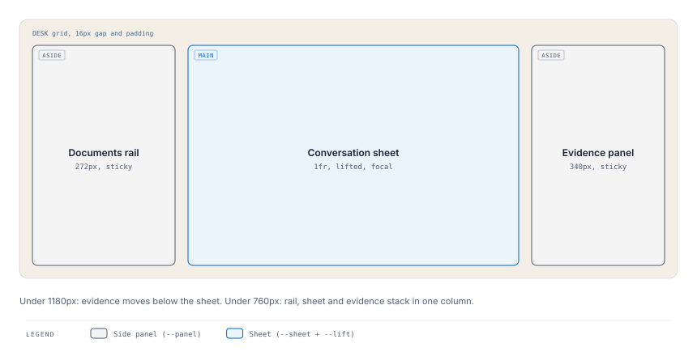
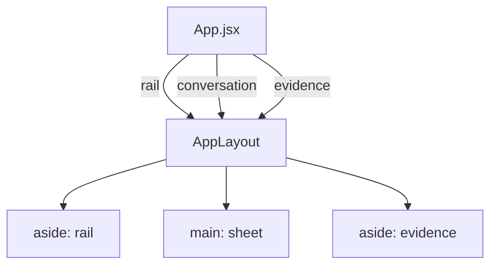
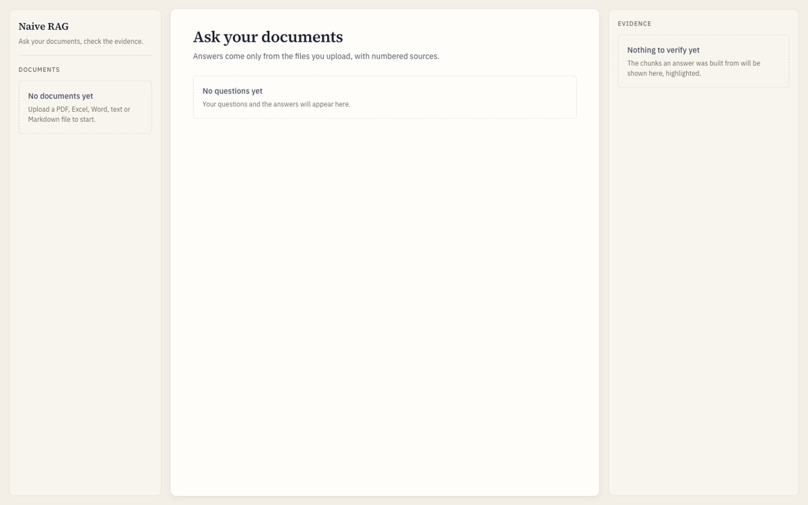

# 04. App Layout

In this doc:

- The three regions and why they are in this order
- How AppLayout places regions without knowing their content
- Responsive behaviour
- The shared PanelHeader and EmptyState components
- Why CSS Modules
- Screenshot

Files:

- [src/components/AppLayout.jsx](../src/components/AppLayout.jsx) and [AppLayout.module.css](../src/components/AppLayout.module.css)
- [src/components/PanelHeader.jsx](../src/components/PanelHeader.jsx) and [PanelHeader.module.css](../src/components/PanelHeader.module.css)
- [src/components/EmptyState.jsx](../src/components/EmptyState.jsx) and [EmptyState.module.css](../src/components/EmptyState.module.css)
- [src/App.jsx](../src/App.jsx) and [App.module.css](../src/App.module.css)

## Three regions

<table width="100%">
<thead><tr><th>Region</th><th>HTML element</th><th>Width</th><th>Task</th><th>Surface</th></tr></thead>
<tbody>
<tr><td>Documents rail</td><td>aside</td><td>272px</td><td>Add documents, see what is indexed</td><td>--panel, hairline rule</td></tr>
<tr><td>Conversation sheet</td><td>main</td><td>Remaining width</td><td>Ask and read answers (the one main task)</td><td>--sheet with --lift</td></tr>
<tr><td>Evidence panel</td><td>aside</td><td>340px</td><td>Verify the chunks behind an answer</td><td>--panel, hairline rule</td></tr>
</tbody>
</table>

The left-to-right order follows the task order: **add, ask, verify**. The sheet is the only lifted, brightest surface and has the largest heading, so the eye lands there first. The side panels use the same family of color as the desk, so they recede.

## How AppLayout works

`AppLayout` receives three props, `rail`, `conversation` and `evidence`, and places each in its region. It does not know what is inside.

<table width="100%">
<thead><tr><th>Benefit</th><th>Why</th></tr></thead>
<tbody>
<tr><td>Layout and features stay separate</td><td>The documents and chat features are built later without touching the layout</td></tr>
<tr><td>Semantic HTML</td><td>main and aside with aria-label give screen readers clear landmarks: Documents, Evidence</td></tr>
<tr><td>One place for responsive rules</td><td>All breakpoints live in AppLayout.module.css</td></tr>
</tbody>
</table>

## Responsive behaviour

<table width="100%">
<thead><tr><th>Screen width</th><th>Columns</th><th>Side panels</th></tr></thead>
<tbody>
<tr><td>Over 1180px</td><td>rail / sheet / evidence</td><td>Sticky: stay in view while the conversation scrolls</td></tr>
<tr><td>760 to 1180px</td><td>rail / sheet; evidence below the sheet</td><td>Rail sticky, evidence flows with the page</td></tr>
<tr><td>Under 760px</td><td>One column: rail, sheet, evidence</td><td>Not sticky, natural height</td></tr>
</tbody>
</table>

The grid uses `minmax(0, 1fr)` for the sheet column so long words or code in answers can never push the layout wider than the screen.

## Shared components

<table width="100%">
<thead><tr><th>Component</th><th>Props</th><th>Look</th><th>Why shared</th></tr></thead>
<tbody>
<tr><td>PanelHeader</td><td>title, meta (optional)</td><td>11px uppercase tracked label, data-font count on the right</td><td>Every panel heading has the same size and spacing</td></tr>
<tr><td>EmptyState</td><td>title, children (hint)</td><td>Dashed rule box, secondary title, tertiary hint</td><td>Every empty region says what will appear and what to do next</td></tr>
</tbody>
</table>

Empty states are part of the design, not an afterthought: before the first upload, every region tells the user exactly what to do.

## Why CSS Modules

Each component imports its own `Name.module.css`. Vite turns class names like `.title` into unique names such as `_title_x1y2z`, so two components can both use `.title` without clashing.

<table width="100%">
<thead><tr><th>Option</th><th>Scoped</th><th>Extra dependency</th><th>Decision</th></tr></thead>
<tbody>
<tr><td>One global stylesheet</td><td>No, names clash as the app grows</td><td>No</td><td>Rejected</td></tr>
<tr><td>CSS Modules</td><td>Yes</td><td>No, built into Vite</td><td>Chosen: plain CSS, using the tokens from doc 03</td></tr>
<tr><td>Tailwind / CSS-in-JS</td><td>Yes</td><td>Yes</td><td>Not needed</td></tr>
</tbody>
</table>

## Screenshot

Desktop, 1440 x 900, before any upload:

The layout was also checked at phone width (390px): the three regions stack with no horizontal scroll.
