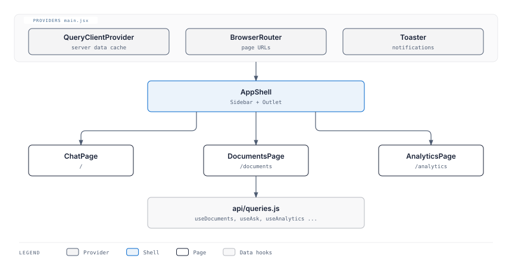
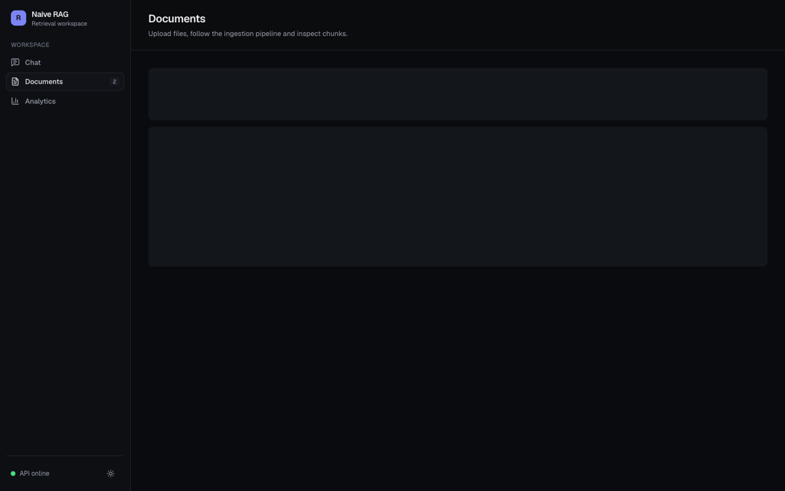
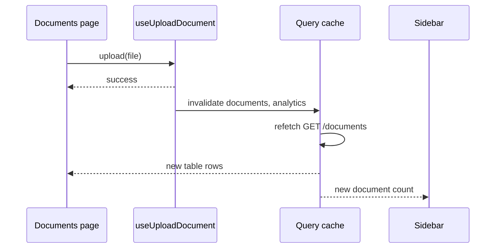

# 04. App Shell, Routing and Data Layer

In this doc:

- The page structure and the providers around it
- The sidebar: navigation, document count, API status, theme toggle
- Routing with React Router
- The data layer: TanStack Query hooks and cache invalidation
- API client changes: upload progress, file URL, chunks, delete, analytics
- Light and dark theme

Files:

- [src/main.jsx](../src/main.jsx), [src/App.jsx](../src/App.jsx)
- [src/components/layout/AppShell.jsx](../src/components/layout/AppShell.jsx), [Sidebar.jsx](../src/components/layout/Sidebar.jsx), [PageHeader.jsx](../src/components/layout/PageHeader.jsx)
- [src/api/queries.js](../src/api/queries.js), [src/api/client.js](../src/api/client.js) and [client.test.js](../src/api/client.test.js)
- [src/lib/theme.js](../src/lib/theme.js)

## Structure

<table width="100%">
<thead><tr><th>Layer</th><th>What it does</th></tr></thead>
<tbody>
<tr><td>QueryClientProvider</td><td>One cache for all server data; queries stay fresh for 10 seconds and retry once</td></tr>
<tr><td>BrowserRouter</td><td>Real URLs for pages, so a page can be bookmarked or refreshed</td></tr>
<tr><td>Toaster (sonner)</td><td>Bottom-right notifications for upload, delete and errors</td></tr>
<tr><td>AppShell</td><td>Sidebar on the left (top bar on phones), the active page on the right, which scrolls on its own</td></tr>
</tbody>
</table>

## Sidebar

<table width="100%">
<thead><tr><th>Part</th><th>Behaviour</th></tr></thead>
<tbody>
<tr><td>Product mark</td><td>Square "R" mark, name and "Retrieval workspace"</td></tr>
<tr><td>Navigation</td><td>Chat, Documents, Analytics with lucide icons; the active page is a raised card with a ring, others are muted until hover</td></tr>
<tr><td>Document count</td><td>Live count next to Documents, from the same cached query as the documents page</td></tr>
<tr><td>API status</td><td>Green pulsing dot "API online", red "API offline" or "Azure not configured", checked every 30 seconds</td></tr>
<tr><td>Theme toggle</td><td>Sun or moon icon with a tooltip</td></tr>
</tbody>
</table>

## Routing

<table width="100%">
<thead><tr><th>URL</th><th>Page</th><th>Built in</th></tr></thead>
<tbody>
<tr><td>/</td><td>Chat</td><td>Doc 07</td></tr>
<tr><td>/documents</td><td>Documents and ingestion</td><td>Docs 05 and 06</td></tr>
<tr><td>/analytics</td><td>Analytics</td><td>Doc 08</td></tr>
<tr><td>anything else</td><td>Redirect to /</td><td>-</td></tr>
</tbody>
</table>

Pages render inside the shell through React Router's nested routes and `<Outlet />`, so the sidebar never re-mounts when the page changes.

## Data layer

All server data goes through TanStack Query hooks in `api/queries.js`. Components never call `fetch` or manage loading flags themselves.

<table width="100%">
<thead><tr><th>Hook</th><th>Kind</th><th>Endpoint</th><th>Notes</th></tr></thead>
<tbody>
<tr><td>useHealth</td><td>query</td><td>GET /health</td><td>Refetches every 30 s, no retry (offline should show fast)</td></tr>
<tr><td>useDocuments</td><td>query</td><td>GET /documents</td><td>Shared by sidebar, documents page and chat</td></tr>
<tr><td>useDocumentChunks(source)</td><td>query</td><td>GET /documents/{source}/chunks</td><td>Only runs when a source is given</td></tr>
<tr><td>useAnalytics</td><td>query</td><td>GET /analytics</td><td>Refetches every 60 s</td></tr>
<tr><td>useUploadDocument</td><td>mutation</td><td>POST /documents</td><td>Invalidates documents and analytics</td></tr>
<tr><td>useDeleteDocument</td><td>mutation</td><td>DELETE /documents/{source}</td><td>Invalidates documents</td></tr>
<tr><td>useAsk</td><td>mutation</td><td>POST /query</td><td>Invalidates analytics</td></tr>
</tbody>
</table>

Cache keys live in one `keys` object, so a mutation can never invalidate a misspelled key.

## API client changes

<table width="100%">
<thead><tr><th>Function</th><th>Change</th></tr></thead>
<tbody>
<tr><td>uploadDocument(file, onProgress)</td><td>Uses XMLHttpRequest, because fetch cannot report upload progress; same ApiError handling as request()</td></tr>
<tr><td>documentFileUrl(source)</td><td>URL of the original file for the PDF viewer, name URL-encoded</td></tr>
<tr><td>getDocumentChunks, deleteDocument, getAnalytics</td><td>New endpoints from API docs 22 and 23</td></tr>
</tbody>
</table>

Tests use a fake XMLHttpRequest (upload progress 0.5 reported, JSON returned) and check URL encoding of names with spaces. 11 tests pass.

## Theme

`useTheme` toggles the `dark` class on `<html>`; every token switches (doc 03). The first visit follows the operating system; the choice is saved in localStorage, wrapped in try/catch so a blocked storage (private window) never breaks the app.

## Placeholders

The three pages render a header and loading skeletons in this step; each one is built in its own step next.
