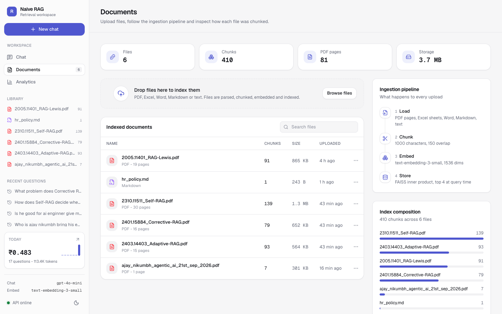
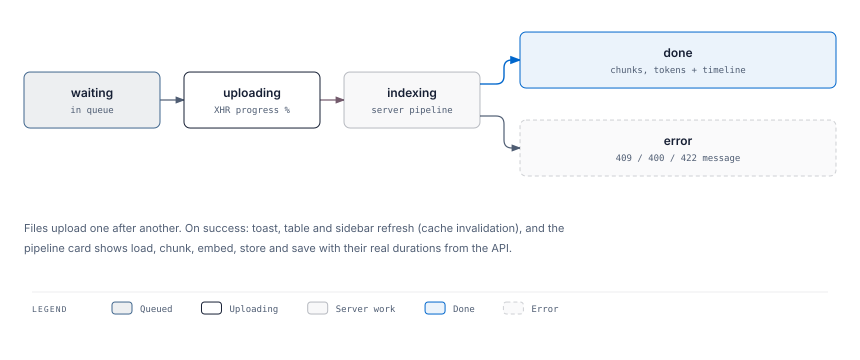
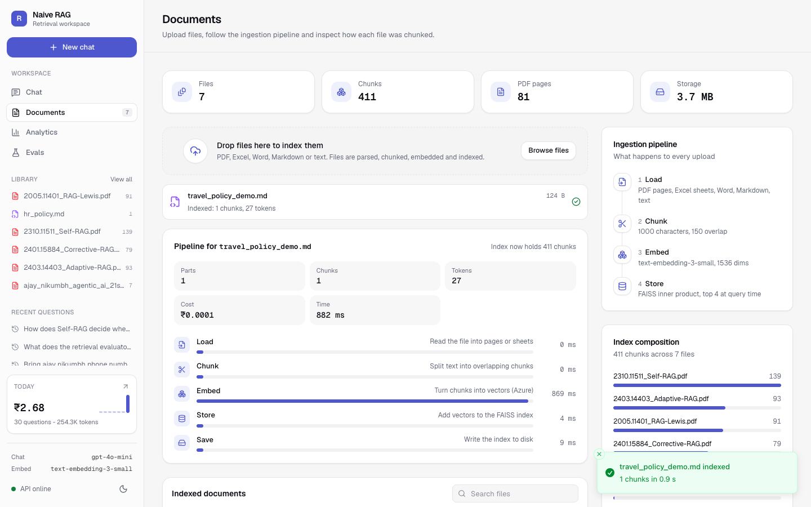
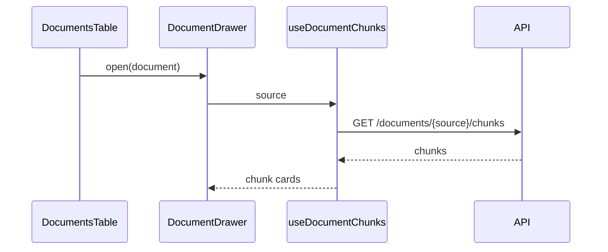

# 05. Documents and Ingestion

In this doc:

- The documents page layout
- The upload panel: drop zone, queue, real progress, toasts
- The pipeline breakdown of an upload
- The documents table: search, row actions, delete with confirmation
- The document drawer with the chunk list
- Screenshots of real uploads

Files:

- [src/features/documents/DocumentsPage.jsx](../src/features/documents/DocumentsPage.jsx)
- [UploadPanel.jsx](../src/features/documents/UploadPanel.jsx), [IngestionResult.jsx](../src/features/documents/IngestionResult.jsx)
- [DocumentsTable.jsx](../src/features/documents/DocumentsTable.jsx), [DocumentDrawer.jsx](../src/features/documents/DocumentDrawer.jsx), [ChunkList.jsx](../src/features/documents/ChunkList.jsx)
- [fileTypes.js](../src/features/documents/fileTypes.js), [src/components/ui/overlay.jsx](../src/components/ui/overlay.jsx) (new ConfirmDialog)

Backend: [API docs 13, 20, 22 and 23](../../03.%20API/docs/)

## Layout

<table width="100%">
<thead><tr><th>Area</th><th>Content</th></tr></thead>
<tbody>
<tr><td>Summary</td><td>Files, chunks, PDF pages and storage, from GET /documents</td></tr>
<tr><td>Upload zone (left)</td><td>One compact row: icon, accepted types and a "Browse files" button; the queue and the pipeline breakdown of the latest file appear under it</td></tr>
<tr><td>Documents table (left)</td><td>All indexed files with search and actions</td></tr>
<tr><td>Index overview (right)</td><td>Ingestion pipeline with the live settings, index composition (chunks per file) and recent ingestions with their cost in rupees</td></tr>
</tbody>
</table>

The first version stacked a tall drop zone and the table across the full width, which left a large empty area under the table. The page now uses two columns from 1280 px: the work (upload and table) on the left and the explanation of the index on the right. Below 1280 px the overview moves under the table.

### Index overview

<table width="100%">
<thead><tr><th>Card</th><th>Content</th><th>Data</th></tr></thead>
<tbody>
<tr><td>Ingestion pipeline</td><td>Load, Chunk, Embed, Store, each with the setting the backend uses: "1000 characters, 150 overlap", "text-embedding-3-small, 1536 dims", "FAISS inner product, top 4 at query time"</td><td>GET /health pipeline settings (API doc 03)</td></tr>
<tr><td>Index composition</td><td>One bar per file, most chunks first, scaled to the largest file; hover shows the share of the index</td><td>GET /documents</td></tr>
<tr><td>Recent ingestions</td><td>Last 5 uploads with time, chunks, duration and cost in rupees</td><td>GET /analytics recent runs</td></tr>
</tbody>
</table>

Showing the settings next to the files answers the questions people ask when they look at chunks ("why is this paper 139 chunks?"): 30 pages of dense text at 1000 characters per chunk with 150 characters of overlap.

## Upload panel

### Step by step

1. Files are dropped or picked; `react-dropzone` accepts only .pdf, .xlsx, .docx, .txt and .md and reports rejected files in a toast.
2. Each file becomes a queue item (`waiting`) and the queue is processed one file at a time, so uploads never compete for the index lock.
3. `useUploadDocument` calls `uploadDocument(file, onProgress)` (UI doc 04). While bytes are sent the row shows a real progress bar (`uploading 64%`).
4. When all bytes are sent the row switches to `indexing`: the server is parsing, chunking and embedding. That work happens inside one request, so the UI shows an honest indeterminate bar instead of fake stages.
5. On success: a toast ("93 chunks in 3.6 s"), the row shows chunks and tokens, the pipeline card appears, and the documents table, summary and sidebar count refresh through cache invalidation.
6. On failure: the row shows the backend message (for example "already indexed") and an error toast.

### Pipeline breakdown

The card uses the real `steps` from the API (doc 23): each step has an icon, a plain description, a bar for its share of the total time and its duration. The numbers above it are parts, chunks, embedding tokens, cost and total time. The small Markdown file above: 1 chunk, 27 tokens, Rs 0.0001, 882 ms, of which 869 ms was the embedding call. For comparison, the 15-page Adaptive-RAG paper took 93 chunks, 22.7K tokens, $0.000454 and 3.6 s, of which 3.3 s was embedding: the embedding call always dominates.

## Documents table

<table width="100%">
<thead><tr><th>Column</th><th>Content</th></tr></thead>
<tbody>
<tr><td>Name</td><td>Type icon on a tile (PDF red, Excel green, Word blue, Markdown violet), the file name, and under it the type and "19 pages" or "1 sheet"</td></tr>
<tr><td>Chunks, Size, Uploaded</td><td>Monospaced numbers; size as KB or MB; upload time as "3 h ago"</td></tr>
<tr><td>Actions</td><td>Menu with Open and Delete (visible on row hover)</td></tr>
</tbody>
</table>

- Type and parts sit under the name instead of in their own columns, so four columns fit next to the index overview without horizontal scrolling.
- The search box filters by file name as you type.
- Clicking a row opens the drawer. The action cell stops the click, so opening the menu does not also open the drawer.
- Delete opens a confirmation dialog (Radix AlertDialog) that says what will happen; after confirming, a toast reports how many chunks were removed.
- Loading shows skeleton rows; an empty index or no search match shows a one-line message.

## Document drawer

A Radix Dialog sliding in from the right, with the file name and "PDF / 19 pages / 91 chunks / 865 KB" in the header, and the chunk list from GET /documents/{source}/chunks: one card per chunk with its page, chunk number, character count and text. The next step adds the PDF preview next to it.

## Real run

Three papers from this repository were uploaded through the new drop zone to give the chat and analytics real data:

<table width="100%">
<thead><tr><th>File</th><th>Pages</th><th>Chunks</th><th>Embedding tokens</th></tr></thead>
<tbody>
<tr><td>2310.11511_Self-RAG.pdf</td><td>30</td><td>139</td><td>30,646</td></tr>
<tr><td>2401.15884_Corrective-RAG.pdf</td><td>16</td><td>79</td><td>18,325</td></tr>
<tr><td>2403.14403_Adaptive-RAG.pdf</td><td>15</td><td>93</td><td>22,702</td></tr>
</tbody>
</table>

The index now holds 5 files and 403 chunks.
