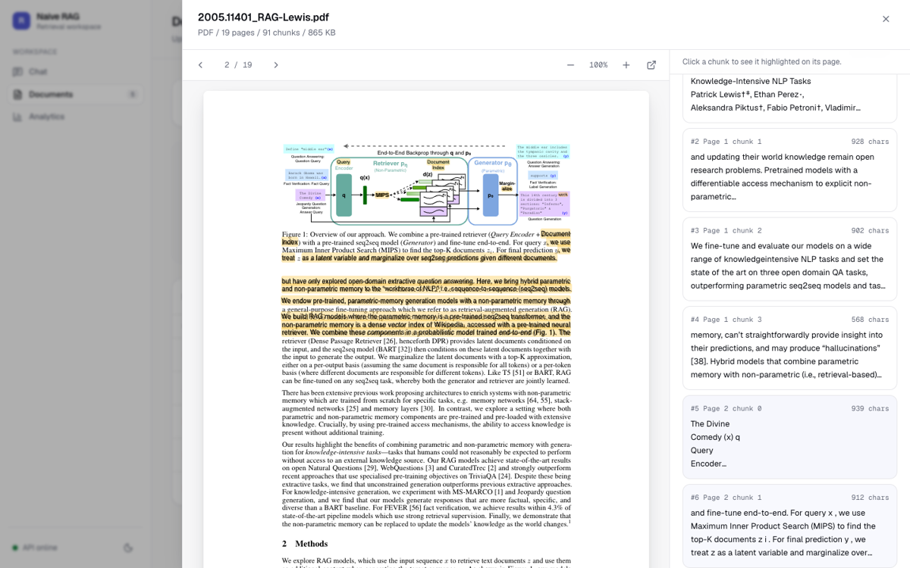
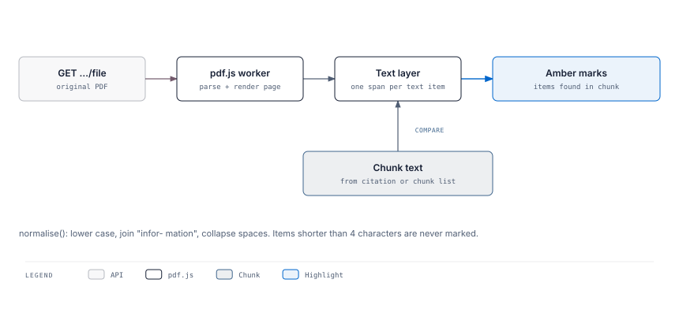

# 06. PDF Viewer and Document Drawer

In this doc:

- The PDF viewer: pages, zoom, fit-to-width, open in a new tab
- How a chunk is highlighted on its page
- The document drawer: PDF next to its chunks
- Browser requirement of pdf.js 6
- Tests and a live check

Files:

- [src/features/pdf/PdfViewer.jsx](../src/features/pdf/PdfViewer.jsx)
- [src/features/pdf/highlight.js](../src/features/pdf/highlight.js) and [highlight.test.js](../src/features/pdf/highlight.test.js)
- [src/features/documents/DocumentDrawer.jsx](../src/features/documents/DocumentDrawer.jsx), [ChunkList.jsx](../src/features/documents/ChunkList.jsx)

Backend: GET /documents/{source}/file ([API doc 23](../../03.%20API/docs/23.%20Document%20Viewer%20and%20Management%20API.md))

## The drawer

The RAG paper opened from the documents table. Chunk 5 (page 2) was clicked in the list on the right: the viewer jumped to page 2 and the chunk's text is highlighted in amber on the real page. This is the most direct way to see how the chunker cut a document, and the same viewer opens citations in the chat (doc 07).

<table width="100%">
<thead><tr><th>Part</th><th>Behaviour</th></tr></thead>
<tbody>
<tr><td>Header</td><td>File name; "PDF / 19 pages / 91 chunks / 865 KB"; close button (Escape also closes)</td></tr>
<tr><td>Left (PDF files, large screens)</td><td>PDF viewer</td></tr>
<tr><td>Right</td><td>Chunk cards: number, page, chunk index, character count, first lines of text</td></tr>
<tr><td>Non-PDF files</td><td>Narrow drawer with the chunk list only</td></tr>
</tbody>
</table>

## PDF viewer

<table width="100%">
<thead><tr><th>Feature</th><th>How</th></tr></thead>
<tbody>
<tr><td>Render</td><td>react-pdf (pdf.js) renders one page at a time onto a canvas, with a text layer above it</td></tr>
<tr><td>Fit to width</td><td>A ResizeObserver tracks the container width; the page width follows it, multiplied by the zoom</td></tr>
<tr><td>Toolbar</td><td>Previous and next page, "2 / 19", zoom 60 to 200 percent, open in a new tab</td></tr>
<tr><td>Jump from outside</td><td>When the `page` prop changes (a chunk or citation was clicked), the viewer moves to it; the user can still page freely afterwards</td></tr>
<tr><td>Loading and errors</td><td>Page-shaped skeleton while loading; a clear message if the file cannot be loaded</td></tr>
</tbody>
</table>

The worker (`pdf.worker.min.mjs`) parses the PDF off the main thread, so the UI stays responsive while large files load.

"Jump from outside" uses React's recommended pattern for adjusting state when a prop changes (compare the new prop with the last one during render), not an effect, so there is no extra render and no lint warning.

## Highlighting the chunk

The text layer is made of small text items (a word, a line, part of a line). react-pdf's `customTextRenderer` lets us return the HTML for each item:

1. The chunk text is normalised once: lower case, hyphenated line breaks joined ("infor- mation" to "information"), runs of whitespace collapsed.
2. Each text item is normalised the same way.
3. If the item is at least 4 characters long and appears inside the normalised chunk, it is wrapped in `<mark class="pdf-highlight">`.
4. Item text is HTML-escaped, so text from the PDF can never become markup.

Normalising both sides matters because the backend (pypdf) and the browser (pdf.js) extract the same page with slightly different spacing. The 4-character minimum avoids marking tiny items such as "a" or "1" that appear in every chunk.

Live check: clicking chunk 5 of the RAG paper marked 18 text items on page 2.

## Browser requirement

pdf.js 6 uses recent JavaScript features. It works in current Chrome, Edge, Firefox and Safari. An older headless Chrome 131 failed to load PDFs with `UnknownErrorException`, while Chrome 156 rendered them correctly; the UI tests were run with the newer browser.

## Tests

<table width="100%">
<thead><tr><th>Test</th><th>Checks</th></tr></thead>
<tbody>
<tr><td>normalises case, hyphen breaks and spaces</td><td>"Dense  Passage\nRetri- eval" becomes "dense passage retrieval"</td></tr>
<tr><td>matches page items that appear in the chunk</td><td>Long contained items match; short or absent items do not</td></tr>
<tr><td>escapes HTML</td><td>Markup in PDF text is escaped</td></tr>
</tbody>
</table>

14 UI tests pass.
