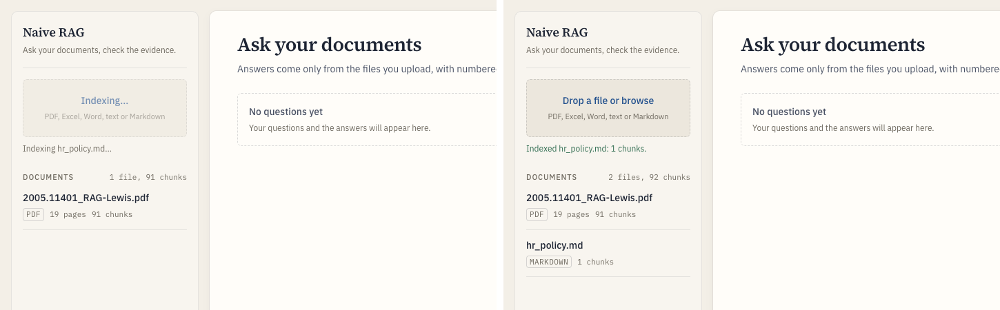
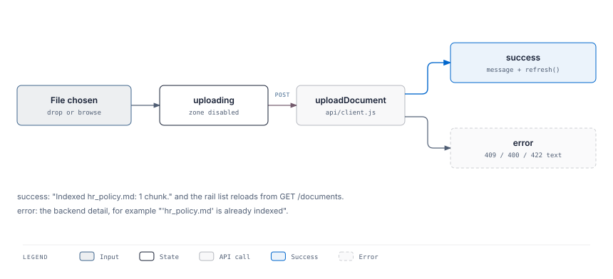
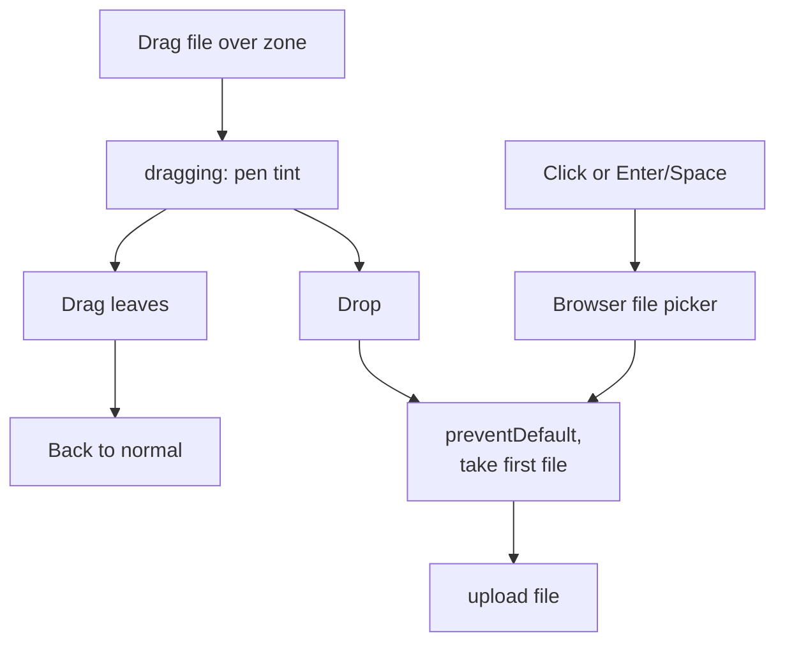
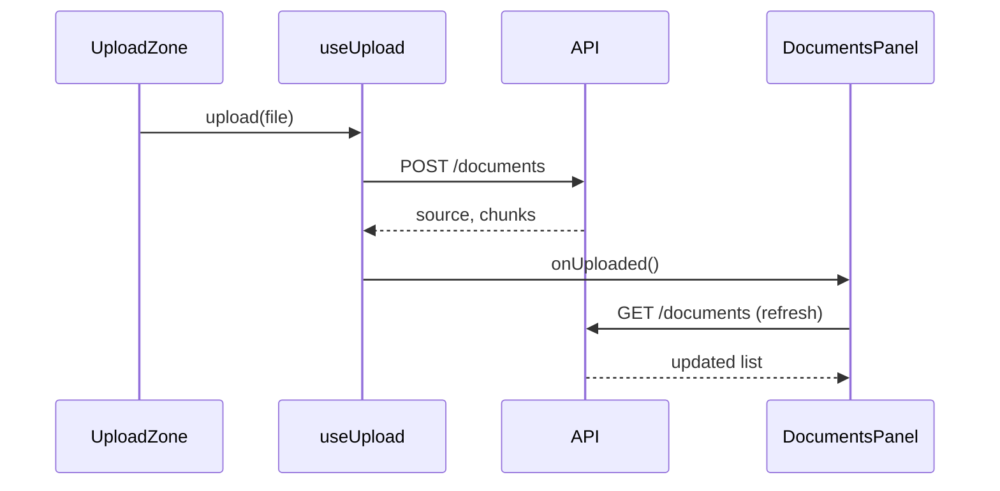

# 06. Upload Zone

In this doc:

- What the upload zone does
- The useUpload hook and its four states
- Drag and drop and keyboard access
- How the list refreshes after an upload
- The plural helper
- Screenshot of a real upload

Files:

- [src/features/documents/UploadZone.jsx](../src/features/documents/UploadZone.jsx) and [UploadZone.module.css](../src/features/documents/UploadZone.module.css)
- [src/features/documents/useUpload.js](../src/features/documents/useUpload.js)
- [src/features/documents/DocumentsPanel.jsx](../src/features/documents/DocumentsPanel.jsx) (adds the zone, passes refresh)
- [src/utils/format.js](../src/utils/format.js) and [format.test.js](../src/utils/format.test.js)

Backend: [POST /documents, implementation doc 13](../../03.%20API/docs/13.%20Document%20Upload%20API.md)

## What it does

The zone sits at the top of the documents rail. Drop a file on it, or click (or press Enter or Space on it) to open the file browser. The file is sent to `POST /documents`, and the result appears right below the zone.

Left: indexing in progress (zone dimmed, "Indexing hr_policy.md..."). Right: success, the list refreshed to 2 files and 92 chunks.

## The useUpload hook

<table width="100%">
<thead><tr><th>Status</th><th>Zone</th><th>Message under the zone</th><th>Color</th></tr></thead>
<tbody>
<tr><td>idle</td><td>"Drop a file or browse"</td><td>None</td><td>-</td></tr>
<tr><td>uploading</td><td>"Indexing...", dimmed, disabled</td><td>Indexing hr_policy.md...</td><td>--ink-faint</td></tr>
<tr><td>success</td><td>Ready again</td><td>Indexed hr_policy.md: 1 chunk.</td><td>--success</td></tr>
<tr><td>error</td><td>Ready again</td><td>The backend message, for example 'hr_policy.md' is already indexed</td><td>--danger</td></tr>
</tbody>
</table>

### Step by step

1. `upload(file)` sets status "uploading" and a message with the file name.
2. `uploadDocument(file)` (doc 02) posts the file as form data.
3. On success: status "success", a message with the chunk count, then `onUploaded()`.
4. On failure: status "error" and the `ApiError` message, which already holds FastAPI's detail text (400 unsupported, 409 duplicate, 422 no text).

The message element has `role="status"`, so screen readers announce "Indexing..." and the result without moving focus.

## Drag, drop and keyboard

<table width="100%">
<thead><tr><th>Detail</th><th>Why</th></tr></thead>
<tbody>
<tr><td>The whole zone is a label for a hidden file input</td><td>Clicking anywhere opens the native picker; no custom click handler needed</td></tr>
<tr><td>The input is visually hidden, not display:none</td><td>It stays in the tab order, so keyboard users can reach it; :focus-within shows the focus ring on the zone</td></tr>
<tr><td>accept=".pdf,.xlsx,.docx,.txt,.md"</td><td>The picker shows only supported files; the backend still validates (doc 13)</td></tr>
<tr><td>event.preventDefault() on dragover and drop</td><td>Otherwise the browser opens the dropped file in the tab</td></tr>
<tr><td>Input value reset after each pick</td><td>Picking the same file again still triggers a change (for example after fixing an error)</td></tr>
<tr><td>Disabled while uploading</td><td>One upload at a time keeps the message and the list consistent</td></tr>
</tbody>
</table>

## How the list refreshes

`DocumentsPanel` owns both pieces: it passes the list's `refresh` function to the zone as `onUploaded`. The zone does not know the list exists.

## The plural helper

`plural(count, word)` in `src/utils/format.js` returns "1 chunk" or "92 chunks". It replaced three hand-written versions (upload message, list rows, panel header), so the wording is the same everywhere. A Vitest test covers 1, many and 0.

## Verified live

Run in a headless browser against the running API:

<table width="100%">
<thead><tr><th>Action</th><th>Result shown</th></tr></thead>
<tbody>
<tr><td>Upload hr_policy.md</td><td>Indexed hr_policy.md: 1 chunk. List shows 2 files, 92 chunks</td></tr>
<tr><td>Upload hr_policy.md again</td><td>'hr_policy.md' is already indexed (409 from the backend)</td></tr>
</tbody>
</table>

No new dependencies.
