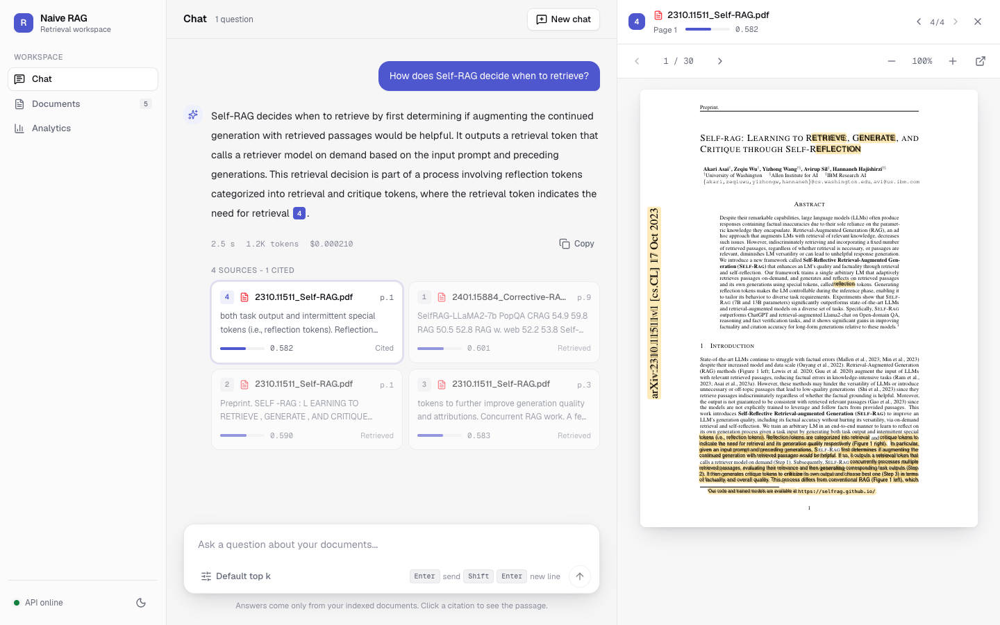
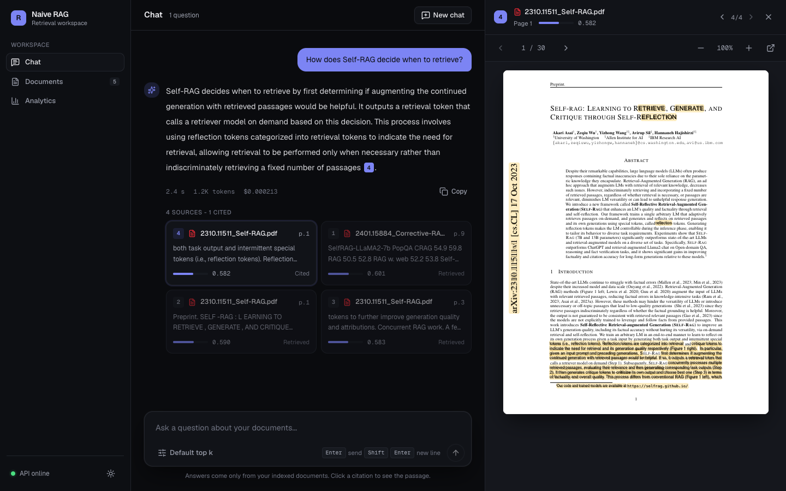
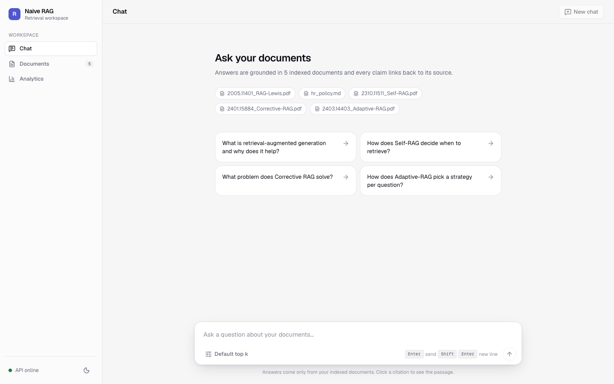
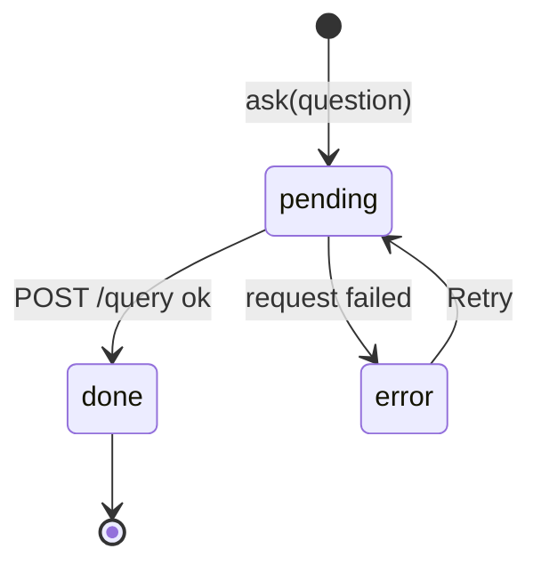
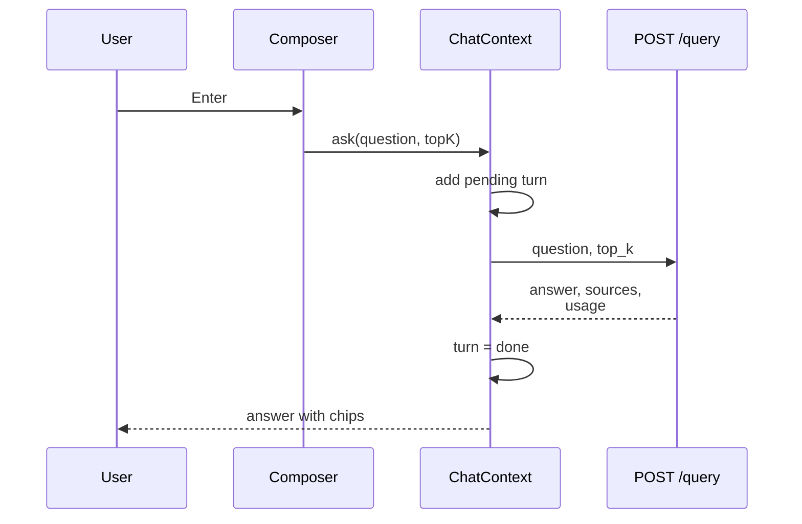
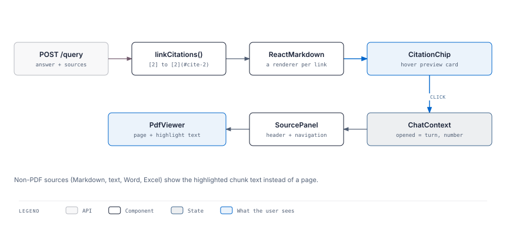
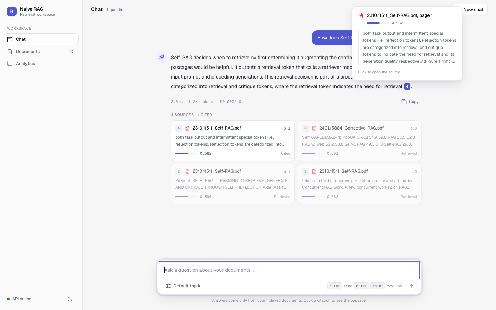

# 07. Chat with Citations

In this doc:

- The chat-with-PDF split view
- How a question becomes a turn (state and lifecycle)
- How citation markers become clickable chips
- The source panel: PDF at the cited page, passage highlighted
- Composer, usage line and source cards
- Tests and a live check

Files:

- [src/features/chat/ChatPage.jsx](../src/features/chat/ChatPage.jsx): layout, empty state, split view
- [src/features/chat/ChatContext.jsx](../src/features/chat/ChatContext.jsx) and [useChat.js](../src/features/chat/useChat.js): conversation state
- [src/features/chat/ChatTurn.jsx](../src/features/chat/ChatTurn.jsx): one question and its answer
- [src/features/chat/AnswerMarkdown.jsx](../src/features/chat/AnswerMarkdown.jsx), [CitationChip.jsx](../src/features/chat/CitationChip.jsx), [citations.js](../src/features/chat/citations.js)
- [src/features/chat/SourceCards.jsx](../src/features/chat/SourceCards.jsx), [SourcePanel.jsx](../src/features/chat/SourcePanel.jsx), [Composer.jsx](../src/features/chat/Composer.jsx)
- [src/lib/useMediaQuery.js](../src/lib/useMediaQuery.js)

Backend: POST /query ([API doc 22](../../03.%20API/docs/22.%20Usage%20and%20Cost%20Tracking.md) for the usage fields)

## The page

A question about Self-RAG was asked. The answer cites source 4; clicking the chip opened the Self-RAG paper on the right at page 1, with the cited passage highlighted in amber (28 text items marked). The same view in dark mode:

### Why a split view

Products built for reading documents with an assistant (chat-with-PDF tools, research assistants) put the answer and the source side by side. A citation is only useful if checking it is cheap: one click, no new tab, the exact passage marked. The conversation keeps its scroll position while the source panel changes, so the user can check several citations in a row.

<table width="100%">
<thead><tr><th>Screen width</th><th>Source panel</th></tr></thead>
<tbody>
<tr><td>1024 px and wider</td><td>Right column, 46 percent of the width (420 to 760 px), next to the conversation</td></tr>
<tr><td>Narrower</td><td>Side sheet over the page, closed with Escape or the close button</td></tr>
</tbody>
</table>

`useMediaQuery` subscribes to `window.matchMedia` with `useSyncExternalStore`, so the layout switches as soon as the window crosses the breakpoint.

## Empty state

Before the first question the page lists the indexed documents (from GET /documents) and four starter questions that match the papers in the index. With no documents it shows a single action that leads to the Documents page, because a question without an index can only fail.

## Conversation state

The conversation lives in `ChatProvider`, placed around all routes in `App.jsx`. That is why moving to Documents or Analytics and back keeps the chat.

<table width="100%">
<thead><tr><th>Field</th><th>Meaning</th></tr></thead>
<tbody>
<tr><td>turns</td><td>List of turns: id, question, topK, status (pending, done, error), answer, sources, usage, error</td></tr>
<tr><td>busy</td><td>True while any turn is pending; the composer and "New chat" are disabled</td></tr>
<tr><td>opened</td><td>The source in the panel: the turn id and the citation number, or null</td></tr>
<tr><td>ask(question, topK)</td><td>Adds a pending turn at once, calls POST /query through the useAsk mutation, then fills the turn or stores the error</td></tr>
<tr><td>openSource, closeSource, reset</td><td>Open or close the panel; clear the conversation</td></tr>
</tbody>
</table>

The question is shown before the request is sent, so the screen reacts immediately. While the turn is pending, the answer area shows the three pipeline steps (embed, search, write) pulsing in turn above a text skeleton. The useAsk mutation also marks the analytics query stale, so the Analytics page includes the new question.

## Citations

The backend prompt asks the model to cite sources as [1], [2] (see the API prompt doc). The UI turns those markers into chips in three steps:

1. `linkCitations()` rewrites every marker that is not already a link into a Markdown link: `[2]` becomes `[2](#cite-2)`. Adjacent markers such as `[2][3]` become two links.
2. ReactMarkdown (with remark-gfm for lists and tables) renders the answer. Its link renderer checks the href: `#cite-N` draws a `CitationChip`, every other link stays a normal link that opens in a new tab.
3. A chip looks up source N of the same turn. A marker without a matching source (a model mistake) is shown as plain text instead of a broken chip.

Using the Markdown link syntax means the answer is parsed once by a real Markdown parser. Splitting the text with a regular expression would break bold text, lists and code that contain citations.

### Hover preview

Hovering a chip (150 ms delay) shows a card with the file and page, the cosine score as a bar and the first lines of the chunk. Clicking opens the source panel. The chip of the opened source is filled with the primary color, so the user sees which citation is on the right.

## Source panel

<table width="100%">
<thead><tr><th>Part</th><th>Behaviour</th></tr></thead>
<tbody>
<tr><td>Header</td><td>Citation number, file name, page, score bar</td></tr>
<tr><td>Navigation</td><td>Previous and next source of the same answer ("4/4") and close</td></tr>
<tr><td>PDF source</td><td>PdfViewer (doc 06) with the file from GET /documents/{source}/file, opened at `source.page` with `source.text` highlighted</td></tr>
<tr><td>Other files</td><td>The chunk text on a card, fully highlighted, because Markdown, text, Word and Excel files have no page view</td></tr>
</tbody>
</table>

The viewer is reused unchanged from the document drawer: changing the `page` or the `url` prop makes it jump, so stepping through sources needs no extra code.

## Answer details

<table width="100%">
<thead><tr><th>Element</th><th>Content</th></tr></thead>
<tbody>
<tr><td>Usage line</td><td>Latency, total tokens (tooltip splits embedding, prompt and completion tokens) and cost of this answer, plus a Copy button</td></tr>
<tr><td>Source cards</td><td>All retrieved chunks, cited ones first. Each card has the number, file, page, chunk start and score. Retrieved but not cited sources are dimmed</td></tr>
<tr><td>Error</td><td>The API error message with a Retry button that asks the same question again</td></tr>
</tbody>
</table>

Showing retrieved but uncited sources is deliberate for a Naive RAG project: it makes retrieval quality visible. In the screenshot the highest scoring chunk (0.601, a results table from the Corrective RAG paper) was not useful, and the model cited a lower scoring chunk instead.

## Composer

<table width="100%">
<thead><tr><th>Feature</th><th>How</th></tr></thead>
<tbody>
<tr><td>Auto height</td><td>CSS `field-sizing: content` grows the textarea with its text, up to 12rem, with no resize code</td></tr>
<tr><td>Keys</td><td>Enter sends, Shift+Enter adds a line; Enter during IME composition is ignored</td></tr>
<tr><td>Top k</td><td>Menu with server default, 3, 5, 8 or 10 chunks; sent as `top_k`</td></tr>
<tr><td>Disabled</td><td>Send is off while a question runs or the box is empty</td></tr>
</tbody>
</table>

## Tests

<table width="100%">
<thead><tr><th>Test</th><th>Checks</th></tr></thead>
<tbody>
<tr><td>links markers, including adjacent ones</td><td>"[2][3]" becomes two links; text without markers and existing links are unchanged</td></tr>
<tr><td>collects cited numbers once and reads citation links</td><td>Repeated markers count once; "#cite-4" gives 4, normal links give null</td></tr>
</tbody>
</table>

16 UI tests pass. Live check with headless Chrome 156: the question was sent with Enter, the pending state appeared, the answer arrived in 2.5 s for 1.2K tokens and $0.000210, the hover card opened, and clicking the chip opened the PDF with 28 highlighted text items.
