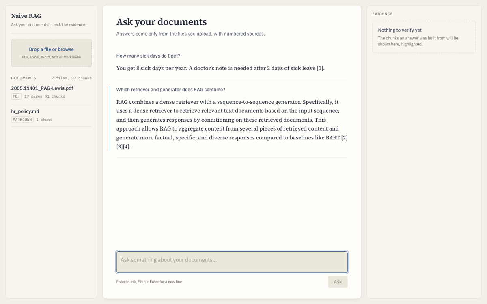
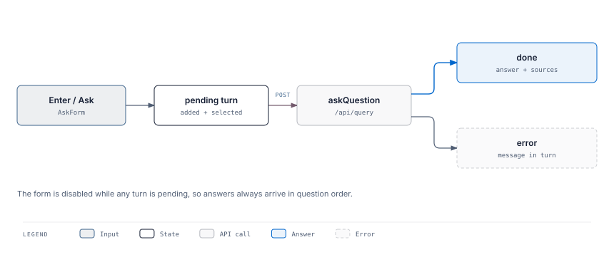
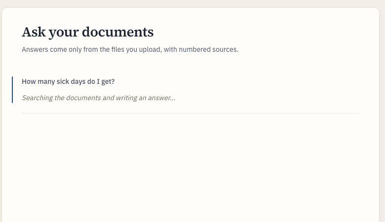
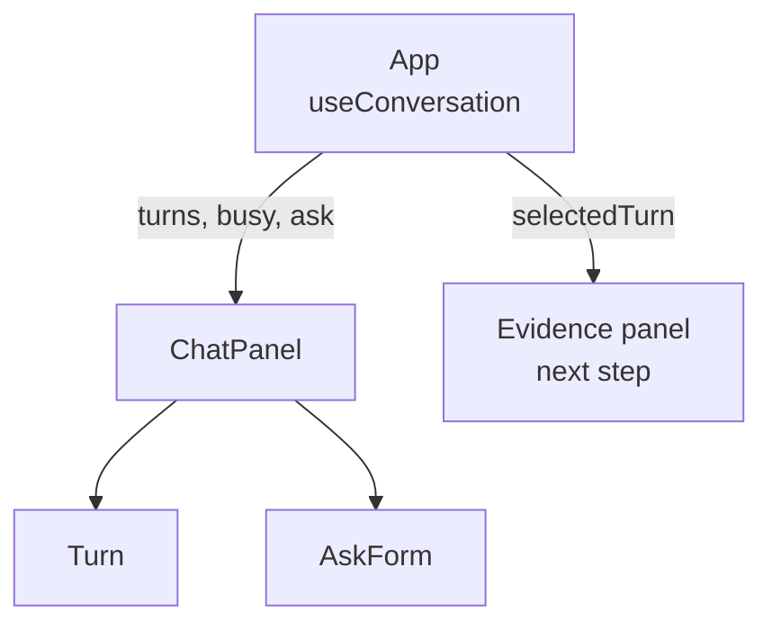

# 07. Conversation

In this doc:

- What the conversation sheet shows
- The useConversation hook and the life of a question
- The ask form: keyboard, limits, disabled state
- How a turn is laid out, and why not chat bubbles
- Why the conversation state lives in App
- Screenshots of live answers

Files:

- [src/features/chat/useConversation.js](../src/features/chat/useConversation.js)
- [src/features/chat/ChatPanel.jsx](../src/features/chat/ChatPanel.jsx) and [ChatPanel.module.css](../src/features/chat/ChatPanel.module.css)
- [src/features/chat/Turn.jsx](../src/features/chat/Turn.jsx) and [Turn.module.css](../src/features/chat/Turn.module.css)
- [src/features/chat/AskForm.jsx](../src/features/chat/AskForm.jsx) and [AskForm.module.css](../src/features/chat/AskForm.module.css)
- [src/App.jsx](../src/App.jsx)

Backend: [POST /query, implementation doc 18](../../03.%20API/docs/18.%20Query%20API.md)

## What the sheet shows

Two real questions against the indexed RAG paper and the HR policy: each answer comes back grounded with `[n]` citations. The newest turn has the pen-blue margin bar: it is the selected turn whose sources the evidence panel will show (next step).

## The useConversation hook

A **turn** is one question and its answer:

<table width="100%">
<thead><tr><th>Field</th><th>Example</th><th>Meaning</th></tr></thead>
<tbody>
<tr><td>id</td><td>random UUID</td><td>Stable key for React and for selection</td></tr>
<tr><td>question</td><td>How many sick days do I get?</td><td>What the user asked</td></tr>
<tr><td>status</td><td>pending, done or error</td><td>Where the turn is in its life</td></tr>
<tr><td>answer</td><td>You get 8 sick days per year ... [1].</td><td>From POST /query</td></tr>
<tr><td>sources</td><td>[{number, label, score, text}]</td><td>Chunks the answer was built from</td></tr>
<tr><td>error</td><td>Cannot reach the API server ...</td><td>ApiError message when status is error</td></tr>
</tbody>
</table>

### Step by step: ask(question)

1. Create a new id and add a turn with status "pending", so the question appears immediately.
2. Select the new turn.
3. Call `askQuestion(question)` (doc 02).
4. On success, `updateTurn` fills in the answer and sources and sets "done".
5. On failure, it stores the error message and sets "error".

`updateTurn` uses the function form of `setTurns(current => ...)`, which always works on the latest list, even though the answer arrives seconds after `ask` was called.

### Values the hook returns

<table width="100%">
<thead><tr><th>Value</th><th>Use</th></tr></thead>
<tbody>
<tr><td>turns</td><td>The thread to render</td></tr>
<tr><td>busy</td><td>True while any turn is pending; disables the ask form</td></tr>
<tr><td>ask(question)</td><td>Called by the ask form</td></tr>
<tr><td>selectedTurn</td><td>The turn whose sources the evidence panel shows</td></tr>
<tr><td>select(id)</td><td>Change the selected turn (used in the next step)</td></tr>
</tbody>
</table>

## The ask form

<table width="100%">
<thead><tr><th>Behaviour</th><th>How</th><th>Why</th></tr></thead>
<tbody>
<tr><td>Enter sends, Shift+Enter adds a line</td><td>onKeyDown checks event.key and event.shiftKey</td><td>Fast to ask, still possible to write a long question</td></tr>
<tr><td>Grows with the text</td><td>CSS field-sizing: content, max 200px</td><td>No JavaScript resizing code</td></tr>
<tr><td>2000 character limit</td><td>maxLength on the textarea</td><td>Same limit as the backend QueryRequest schema, so the user never gets a 422 for length</td></tr>
<tr><td>Ask disabled when empty or busy</td><td>canAsk = non-blank text and not busy</td><td>No empty questions, one question at a time</td></tr>
<tr><td>Always reachable</td><td>position: sticky at the bottom of the sheet</td><td>The box stays in view as the thread grows</td></tr>
<tr><td>Accessible label</td><td>Visually hidden label "Question" tied to the textarea</td><td>Screen readers announce the field, the placeholder is only a hint</td></tr>
</tbody>
</table>

## How a turn is laid out

<table width="100%">
<thead><tr><th>Part</th><th>Style</th><th>Why</th></tr></thead>
<tbody>
<tr><td>Question</td><td>Interface font 500, secondary ink</td><td>A label for what follows</td></tr>
<tr><td>Answer</td><td>Source Serif 16px, line height 1.65, primary ink</td><td>The focal content: set as reading text</td></tr>
<tr><td>Pending</td><td>Italic tertiary ink, role="status"</td><td>Screen readers announce the wait</td></tr>
<tr><td>Error</td><td>Danger text on a danger tint, role="alert"</td><td>Clear, and announced immediately</td></tr>
<tr><td>Separator</td><td>Hairline rule below each turn</td><td>Turns read as sections of a document</td></tr>
<tr><td>Selected</td><td>2px pen-blue bar in the left margin</td><td>Links the turn to the evidence on the right</td></tr>
</tbody>
</table>

Answers are documents to verify, not chat messages, so they are set like a page (rules between sections, serif text, a 720px reading column) instead of left and right bubbles.

The thread scrolls the newest turn into view when a question is added (`scrollIntoView` on a marker after the last turn).

Pending state, right after pressing Enter:

## Why the state lives in App

Both the chat (adds turns) and the evidence panel (shows the selected turn's sources) need the same state. Keeping it in their common parent, `App`, avoids duplicating it or adding a state library.

## Verified live

<table width="100%">
<thead><tr><th>Question</th><th>Answer shown</th></tr></thead>
<tbody>
<tr><td>How many sick days do I get?</td><td>You get 8 sick days per year. A doctor's note is needed after 2 days of sick leave [1].</td></tr>
<tr><td>Which retriever and generator does RAG combine?</td><td>RAG combines a dense retriever with a sequence-to-sequence generator ... [2][3][4].</td></tr>
</tbody>
</table>

No new dependencies.
