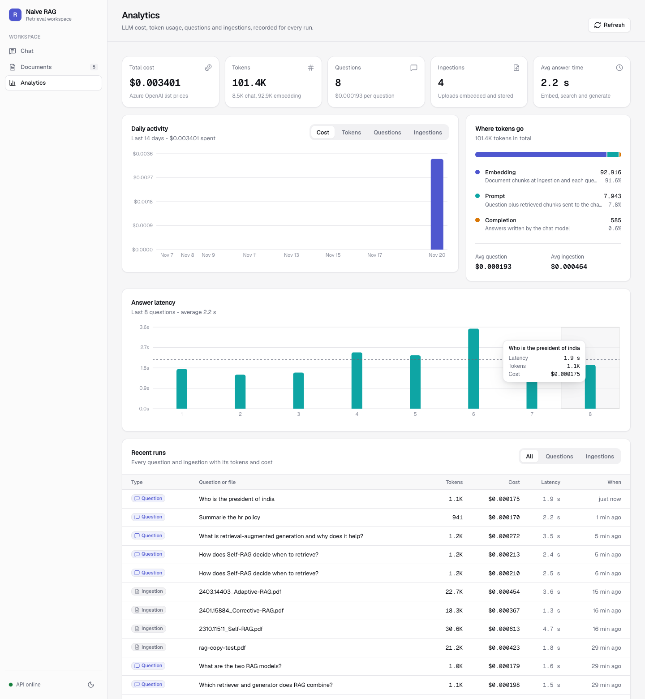
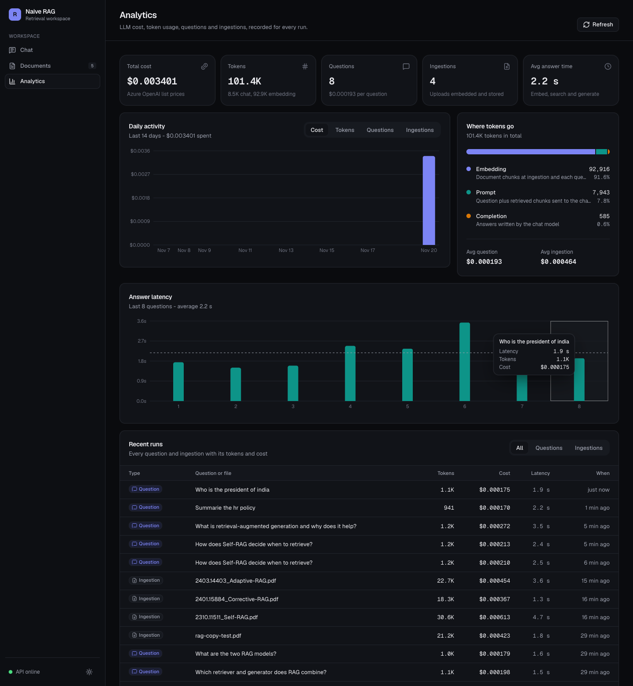
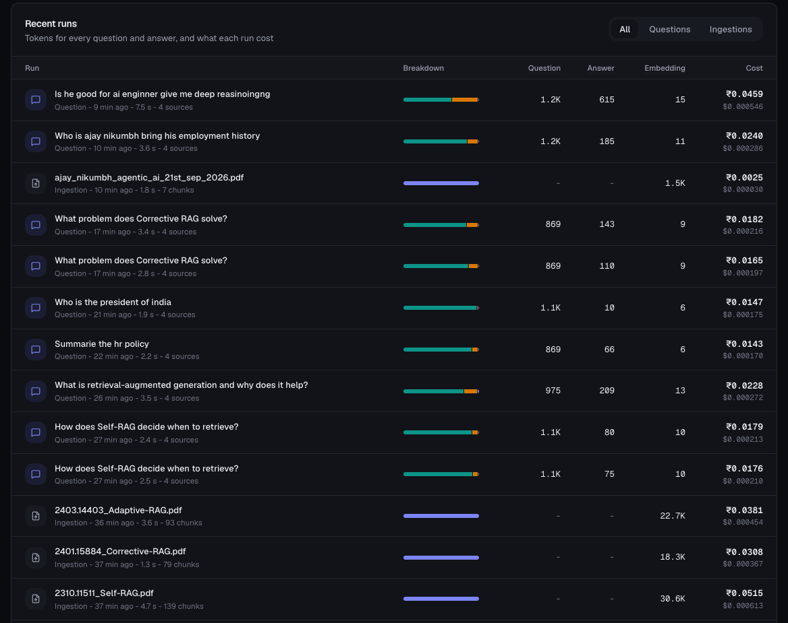
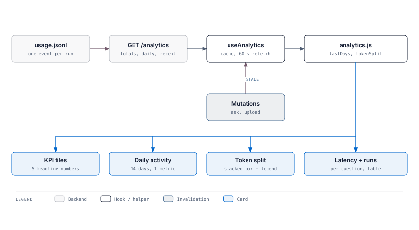
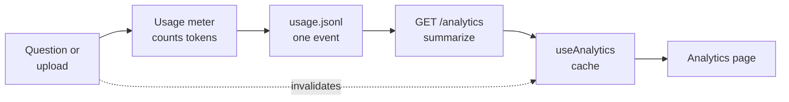

# 08. Analytics Dashboard

In this doc:

- What the Analytics page shows and why each card exists
- Where the numbers come from
- Chart design decisions (one axis, validated colors, hover everywhere)
- Helpers and tests

Files:

- [src/features/analytics/AnalyticsPage.jsx](../src/features/analytics/AnalyticsPage.jsx): layout, loading and error states
- [src/features/analytics/KpiTile.jsx](../src/features/analytics/KpiTile.jsx), [DailyChart.jsx](../src/features/analytics/DailyChart.jsx), [TokenSplit.jsx](../src/features/analytics/TokenSplit.jsx), [LatencyChart.jsx](../src/features/analytics/LatencyChart.jsx), [RecentRuns.jsx](../src/features/analytics/RecentRuns.jsx), [ChartTooltip.jsx](../src/features/analytics/ChartTooltip.jsx)
- [src/features/analytics/analytics.js](../src/features/analytics/analytics.js) and [analytics.test.js](../src/features/analytics/analytics.test.js)

Backend: GET /analytics ([API doc 22](../../03.%20API/docs/22.%20Usage%20and%20Cost%20Tracking.md))

## The page

Live data at the time of the first screenshots: 8 questions and 4 ingestions, 101K tokens, $0.0034 in total. The hovered bar in the latency chart shows the question, its latency, tokens and cost. Dark mode:

## What each card answers

<table width="100%">
<thead><tr><th>Card</th><th>Question it answers</th><th>Form</th></tr></thead>
<tbody>
<tr><td>KPI tiles</td><td>What has this cost, how much was used, how fast are answers?</td><td>Five headline numbers with one line of context each (for example the average cost per question)</td></tr>
<tr><td>Daily activity</td><td>How do cost and usage change over time?</td><td>Bar chart of the last 14 days, one metric at a time (Cost, Tokens, Questions, Ingestions)</td></tr>
<tr><td>Where tokens go</td><td>Which part of the pipeline uses the tokens?</td><td>One stacked bar plus a legend with exact counts and shares, and the average cost of a question and of an ingestion</td></tr>
<tr><td>Answer latency</td><td>How long does each answer take, and which ones are slow?</td><td>One bar per recent question with a dashed average line</td></tr>
<tr><td>Recent runs</td><td>What exactly happened, run by run, and what did each question and answer use?</td><td>Table with the run, a token breakdown bar, question, answer and embedding tokens, and the cost in rupees and dollars; filter tabs</td></tr>
</tbody>
</table>

The token split makes one property of Naive RAG obvious: embedding the documents dominates the token count (over 90 percent here), but embedding tokens are cheap ($0.02 per million). Chat tokens are a small share of the count but most of the cost of a question. That is why the card also shows money per run type.

## Costs in rupees

Every cost on the page is shown in Indian rupees first, with the dollar amount as context (for example "Rs 0.393" with "$0.004675 at Rs 84 per USD" under it on the total cost tile). The rate comes from the backend (`usd_to_inr` in GET /analytics, setting `USD_TO_INR`, API doc 22), so the UI never hard-codes it; `useInrRate()` in `queries.js` gives the same rate to other pages (for example the ingestion result card). The Chat page uses `usage.cost_inr`, which the backend computes for each answer.

<table width="100%">
<thead><tr><th>Amount</th><th>Shown as</th><th>Rule in formatInr()</th></tr></thead>
<tbody>
<tr><td>0.0459 rupees</td><td>Rs 0.0459</td><td>Under 0.1: four decimals, because one question costs a few paise</td></tr>
<tr><td>0.42 rupees</td><td>Rs 0.420</td><td>0.1 to 1: three decimals</td></tr>
<tr><td>12.5 rupees</td><td>Rs 12.50</td><td>1 and above: two decimals</td></tr>
</tbody>
</table>

In the UI the rupee sign is used; these docs write "Rs" to stay plain ASCII.

## Recent runs

<table width="100%">
<thead><tr><th>Column</th><th>Content</th></tr></thead>
<tbody>
<tr><td>Run</td><td>Question or file name, then type, time, latency and the number of sources (question) or chunks (ingestion)</td></tr>
<tr><td>Breakdown</td><td>Thin bar split into question, answer and embedding tokens, in the token split colors; the legend is under the table</td></tr>
<tr><td>Question</td><td>Prompt tokens: the question plus the retrieved chunks. This is why a short question still costs about 1,000 tokens</td></tr>
<tr><td>Answer</td><td>Completion tokens written by the chat model; long answers cost more because output tokens are 4 times the input price</td></tr>
<tr><td>Embedding</td><td>Question embedding (a few tokens) or every chunk of an uploaded file</td></tr>
<tr><td>Cost</td><td>Rupees in bold, dollars underneath</td></tr>
</tbody>
</table>

Headers with a dotted underline explain the column on hover. Ingestions show a dash for question and answer tokens, because they only use the embedding model.

## Where the numbers come from

1. The backend usage meter (API doc 22) records one event per successful question or ingestion, with token counts, cost and latency.
2. GET /analytics returns `totals`, `daily` (one row per date) and `recent` (the latest events, newest first).
3. `useAnalytics` caches the response, refetches every 60 seconds, and is marked stale by the ask and upload mutations. Asking a question in Chat and opening Analytics shows the new run without a manual refresh. The Refresh button refetches on demand.
4. Pure helpers in `analytics.js` shape the data for the charts; the components only draw.

<table width="100%">
<thead><tr><th>Helper</th><th>What it does</th></tr></thead>
<tbody>
<tr><td>lastDays(daily, 14)</td><td>Builds the last 14 local days, oldest first, filling days without runs with zeros so the time axis never skips a day</td></tr>
<tr><td>tokenSplit(totals)</td><td>Embedding, prompt and completion tokens with their share of the total (all zero when nothing was used)</td></tr>
<tr><td>recentQueries(recent, 20)</td><td>The latest 20 questions, oldest first, numbered for the x axis</td></tr>
<tr><td>averageCost(recent, kind)</td><td>Mean cost of one question or one ingestion among the recent runs</td></tr>
</tbody>
</table>

## Chart design decisions

<table width="100%">
<thead><tr><th>Decision</th><th>Why</th></tr></thead>
<tbody>
<tr><td>One metric per chart, switched by tabs</td><td>Cost (fractions of a dollar) and tokens (tens of thousands) have different scales. Two y axes on one chart invite false comparisons, so each metric gets its own single axis</td></tr>
<tr><td>Bars for days and for questions</td><td>Both are discrete counts per slot; with few data points a line would suggest values between slots that do not exist</td></tr>
<tr><td>Thin, rounded bars; recessive grid</td><td>Bars are capped at 24 to 28 px with 4 px rounded tops; only horizontal grid lines in the border color; axis labels in the subtle text color</td></tr>
<tr><td>Hover on every mark</td><td>Daily bars show all four totals of the day; latency bars show the full question, tokens and cost; token segments show exact counts</td></tr>
<tr><td>Text in text colors</td><td>Values and labels use foreground and muted text colors. Series color is carried only by the marks and small swatches</td></tr>
<tr><td>Legend with numbers</td><td>The token split names each part with its exact count and percentage, so identity never depends on color alone</td></tr>
</tbody>
</table>

### Validated colors

The three series colors (chart-1 indigo, chart-2 teal, chart-3 amber) were checked with the dataviz palette validator against the card surface in each theme: lightness band, chroma, color-blind separation of neighbouring colors, normal-vision separation and contrast.

<table width="100%">
<thead><tr><th>Theme</th><th>Colors</th><th>Result</th></tr></thead>
<tbody>
<tr><td>Light (surface #ffffff)</td><td>#4f57cf, #0ea5a4, #d97706</td><td>All checks pass; worst color-blind separation 16.1</td></tr>
<tr><td>Dark (surface #111318)</td><td>#7c84f4, #0d9488, #d97706</td><td>All checks pass; worst separation 6.4 (tritan), which is allowed because every part is also named in the legend</td></tr>
</tbody>
</table>

The first amber (#f59e0b) had only 2.15:1 contrast on white, and the brighter dark-mode teal and amber were outside the lightness band, so those tokens were changed in `globals.css`.

## States

<table width="100%">
<thead><tr><th>State</th><th>What is shown</th></tr></thead>
<tbody>
<tr><td>Loading</td><td>Skeletons in the shape of the KPI row and the first chart</td></tr>
<tr><td>Error</td><td>A message with the API error; the Refresh button retries</td></tr>
<tr><td>No questions yet</td><td>The latency card says "No questions asked yet"; the table says "Nothing recorded yet"</td></tr>
</tbody>
</table>

## Tests

<table width="100%">
<thead><tr><th>Test</th><th>Checks</th></tr></thead>
<tbody>
<tr><td>fills missing days with zeros and keeps real totals</td><td>A 3-day window around one real day, oldest first</td></tr>
<tr><td>computes token shares</td><td>75 / 20 / 5 tokens give 0.75 / 0.2 / 0.05; zero totals give zero shares</td></tr>
<tr><td>lists recent questions oldest first</td><td>Ingestions are skipped and questions are numbered from the oldest</td></tr>
<tr><td>averages the cost of one run type</td><td>Two questions costing 1 and 3 average 2; no runs give 0</td></tr>
</tbody>
</table>

20 UI tests pass.
