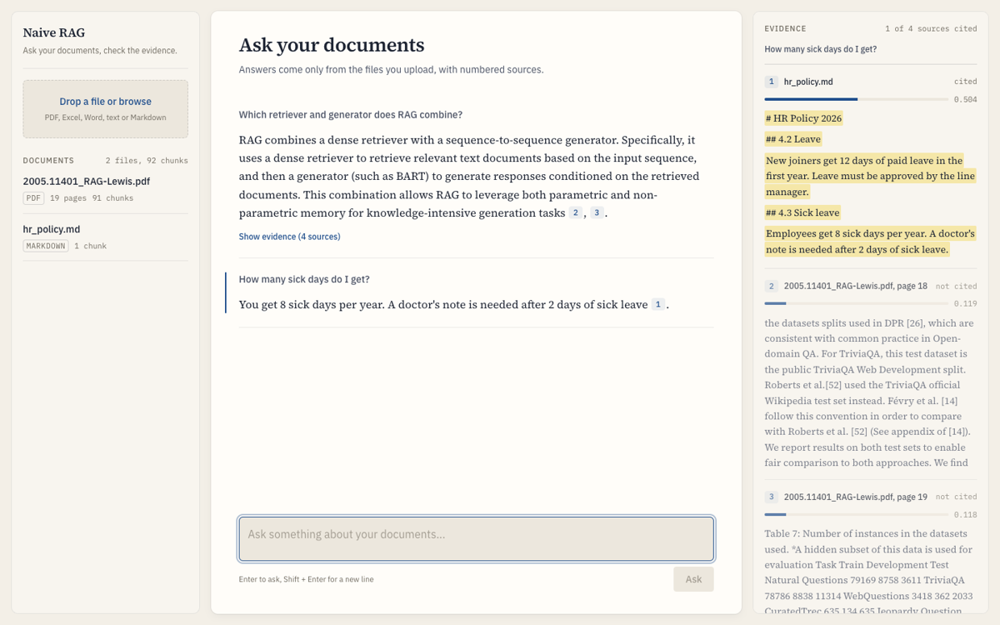
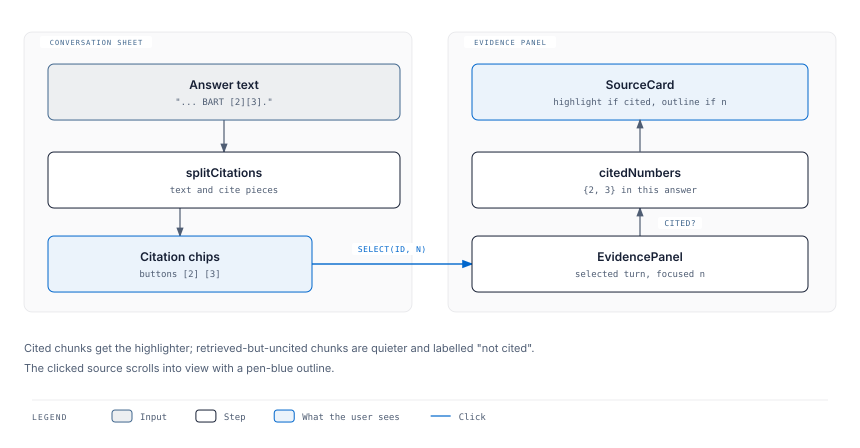
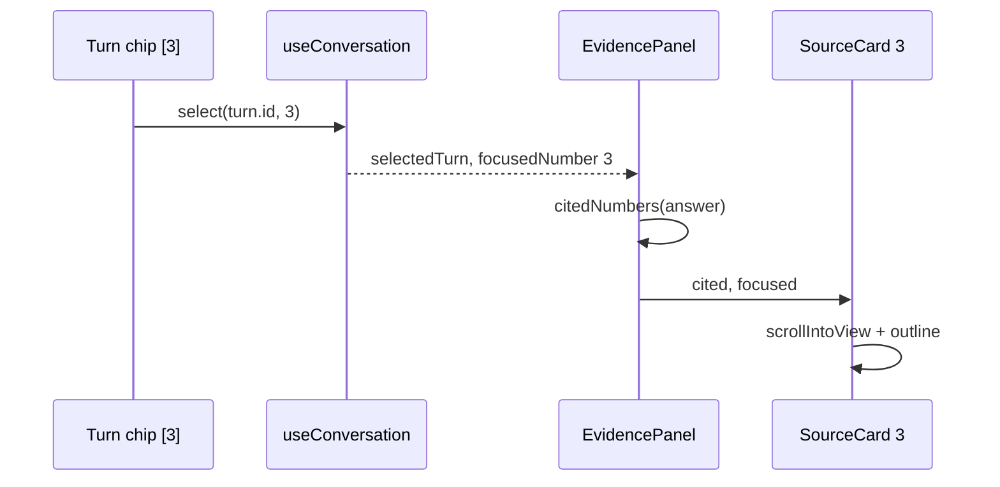
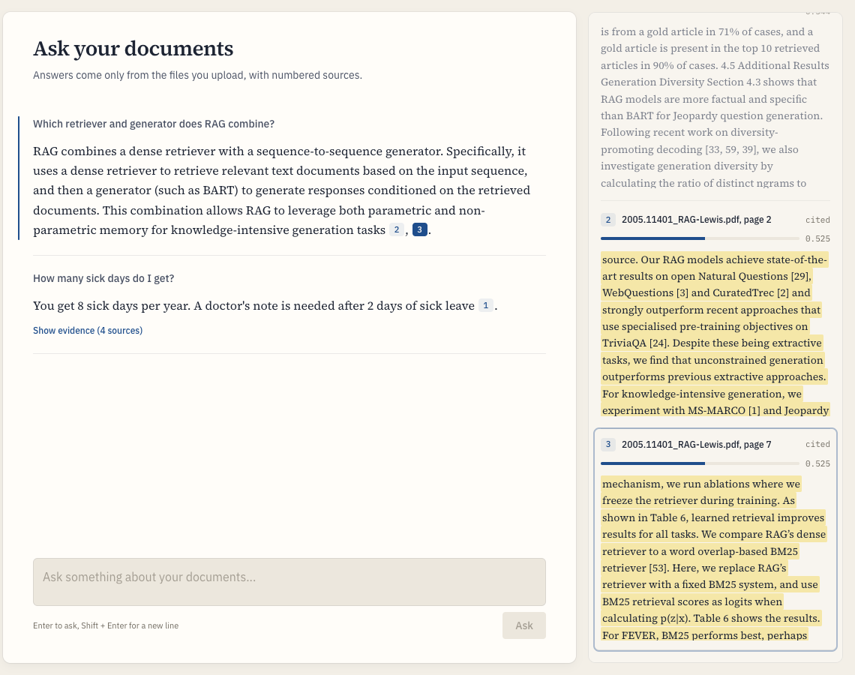

# 08. Citations and Evidence

In this doc:

- The signature of the UI: clickable citations and highlighted evidence
- How answer text becomes citation chips
- How a click reaches the evidence panel
- The source card: label, score bar, highlighted text
- The evidence panel states
- Screenshots and tests

Files:

- [src/features/chat/citations.js](../src/features/chat/citations.js) and [citations.test.js](../src/features/chat/citations.test.js)
- [src/features/chat/Turn.jsx](../src/features/chat/Turn.jsx) and [Turn.module.css](../src/features/chat/Turn.module.css) (chips, Show evidence)
- [src/features/chat/useConversation.js](../src/features/chat/useConversation.js) (select with a source number)
- [src/features/evidence/EvidencePanel.jsx](../src/features/evidence/EvidencePanel.jsx) and [EvidencePanel.module.css](../src/features/evidence/EvidencePanel.module.css)
- [src/features/evidence/SourceCard.jsx](../src/features/evidence/SourceCard.jsx) and [SourceCard.module.css](../src/features/evidence/SourceCard.module.css)

## Why this is the signature

The whole point of RAG is that an answer is backed by retrieved text. This repository exists to learn how well Naive RAG does that. So the UI makes the backing visible: every `[n]` in an answer is a chip that opens chunk `n`, cited chunks get a highlighter, and every retrieved chunk shows its cosine score, including the ones the model did not use.

Above: for "How many sick days do I get?", chunk 1 (hr_policy.md, score 0.504) is cited and highlighted. Chunks 2 to 4 from the RAG paper were retrieved because top_k is 4, but their scores are low (0.119) and the answer does not cite them: they are shown quieter and labelled "not cited". This is a Naive RAG behaviour (fixed top-k, no threshold) made visible.

## From marker to chip

`splitCitations(text)` walks through the answer with the pattern `\[(\d+)\]` and returns pieces in order:

<table width="100%">
<thead><tr><th>Answer text</th><th>Pieces</th></tr></thead>
<tbody>
<tr><td>You get 8 days [1]. Ask HR [2]</td><td>text "You get 8 days ", cite 1, text ". Ask HR ", cite 2</td></tr>
<tr><td>BART [2][3].</td><td>text "BART ", cite 2, cite 3, text "."</td></tr>
<tr><td>Not found.</td><td>text "Not found."</td></tr>
</tbody>
</table>

`Turn` renders text pieces as spans and cite pieces as `<button>` chips. Real buttons give keyboard access and a screen-reader label ("Show source 2") for free.

`citedNumbers(text)` returns the set of numbers cited anywhere in the answer, used to decide which chunks get the highlighter.

### Chip details

<table width="100%">
<thead><tr><th>Detail</th><th>Value</th><th>Why</th></tr></thead>
<tbody>
<tr><td>Look</td><td>Pen-tint background, pen-blue number in the data font, raised 2px</td><td>Reads like a footnote mark, same look as the number in the source card</td></tr>
<tr><td>Hover</td><td>Solid pen blue with paper text</td><td>Clearly clickable</td></tr>
<tr><td>Hit area</td><td>Invisible ::after extends the chip by 6px vertically</td><td>An 18px chip is easy to miss; the larger target stays invisible</td></tr>
</tbody>
</table>

## From click to evidence

`select(id, number)` stores both the turn and the source number. Asking a new question calls `select(newId)` with no number, so the panel follows the newest turn. Turns that are not selected show a "Show evidence (4 sources)" link that selects them.

Clicking chip 3 in an earlier answer: the turn gets the margin bar, and source 3 is scrolled into view and outlined:

## The source card

<table width="100%">
<thead><tr><th>Part</th><th>Content</th><th>Style</th></tr></thead>
<tbody>
<tr><td>Header</td><td>Number, file and page or sheet, "cited" or "not cited"</td><td>Number chip, 12px label, data-font status</td></tr>
<tr><td>Score bar</td><td>Bar filled to the cosine score (0 to 1) and the value to 3 decimals</td><td>4px pen-blue bar on an inset track</td></tr>
<tr><td>Text</td><td>The chunk, one paragraph at a time</td><td>Reading font 14px, scrolls inside the card after 220px</td></tr>
<tr><td>Cited</td><td>Highlighter on each paragraph</td><td>--highlight with box-decoration-break: clone so each wrapped line is marked</td></tr>
<tr><td>Not cited</td><td>No highlight</td><td>70 percent opacity, secondary ink</td></tr>
<tr><td>Focused</td><td>The source clicked in the answer</td><td>Pen focus-ring outline</td></tr>
</tbody>
</table>

PDF chunks keep the line breaks of the page. `paragraphs(text)` splits at blank lines and joins single line breaks with spaces, so the chunk reads as normal paragraphs and the highlighter has no empty strips.

## Evidence panel states

<table width="100%">
<thead><tr><th>Selected turn</th><th>Panel shows</th></tr></thead>
<tbody>
<tr><td>None yet</td><td>EmptyState: what will appear here</td></tr>
<tr><td>Pending</td><td>"Retrieving chunks..."</td></tr>
<tr><td>Error</td><td>EmptyState: the question failed, no chunks</td></tr>
<tr><td>Done, no sources (nothing indexed)</td><td>EmptyState: no chunks were retrieved</td></tr>
<tr><td>Done with sources</td><td>Header "2 of 4 sources cited", the question, one card per source</td></tr>
</tbody>
</table>

## Tests

<table width="100%">
<thead><tr><th>Test</th><th>Checks</th></tr></thead>
<tbody>
<tr><td>splits text and markers in order</td><td>Text and cite pieces in the right order, marker at the end</td></tr>
<tr><td>handles markers next to each other and text without markers</td><td>[2][3] gives two cite pieces; plain text gives one piece</td></tr>
<tr><td>returns each cited number once</td><td>Duplicates collapse into one set entry</td></tr>
</tbody>
</table>

Live check in a headless browser: two questions asked, chip 3 of the first answer clicked; the evidence header read "2 of 4 sources cited" and source 3 was outlined (screenshot above). 11 unit tests pass in total.

No new dependencies.
