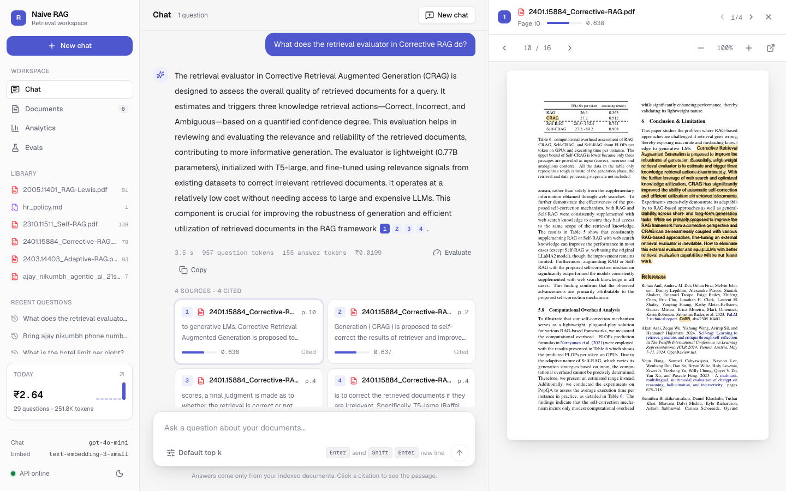
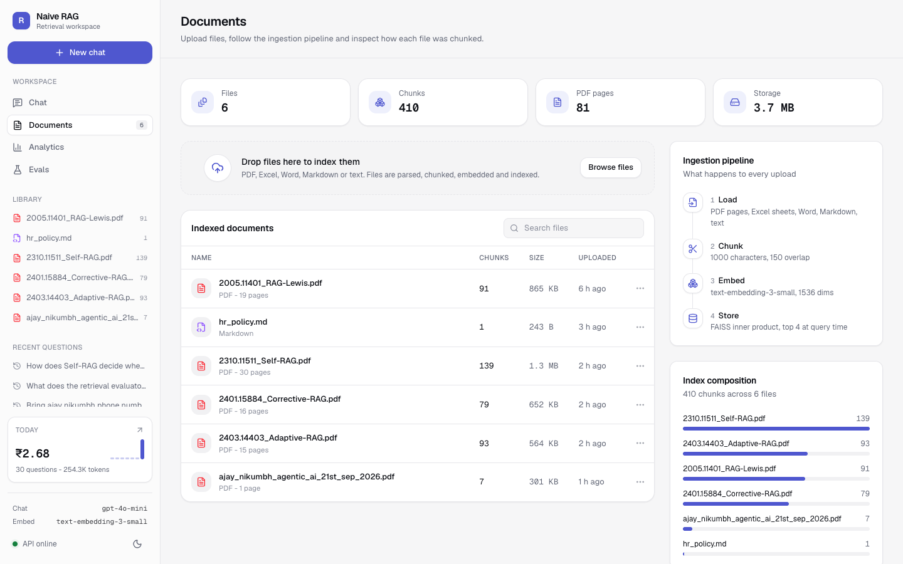
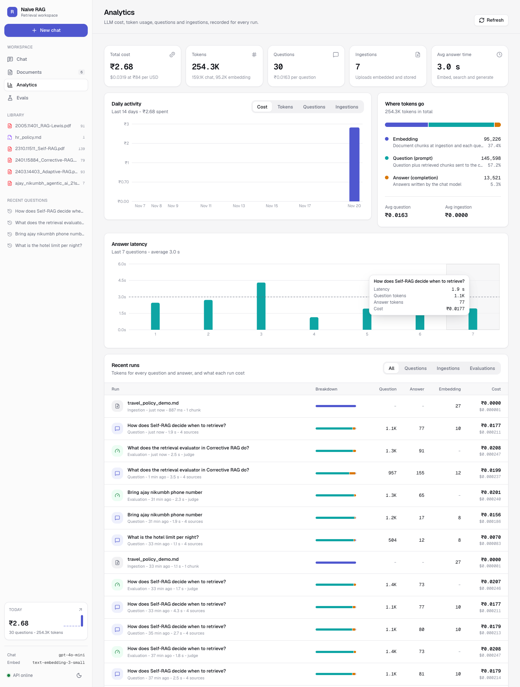
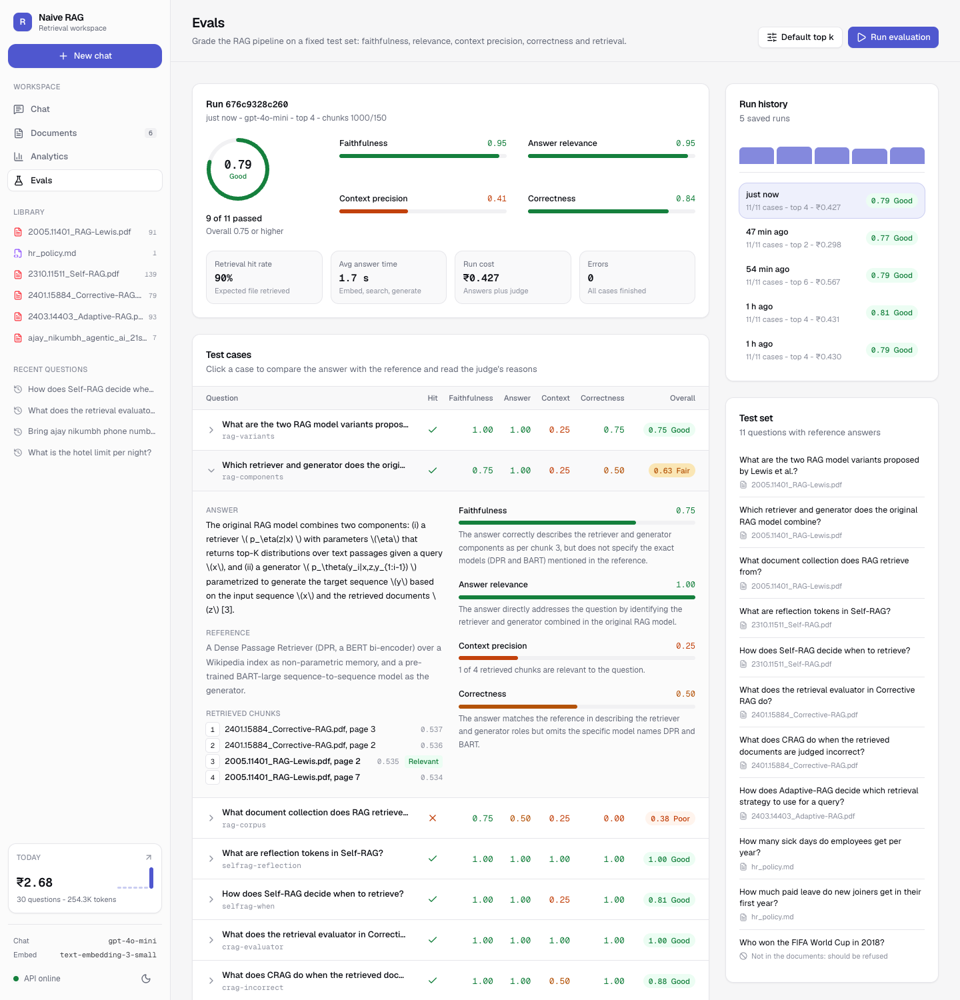
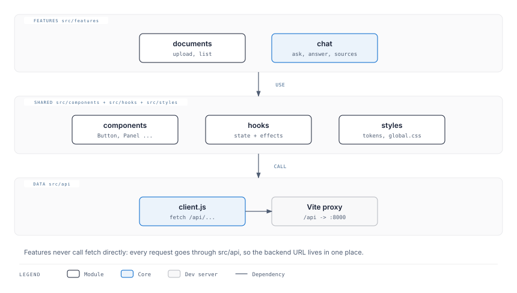
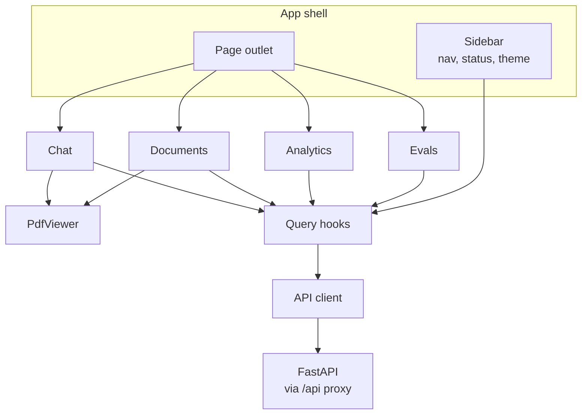
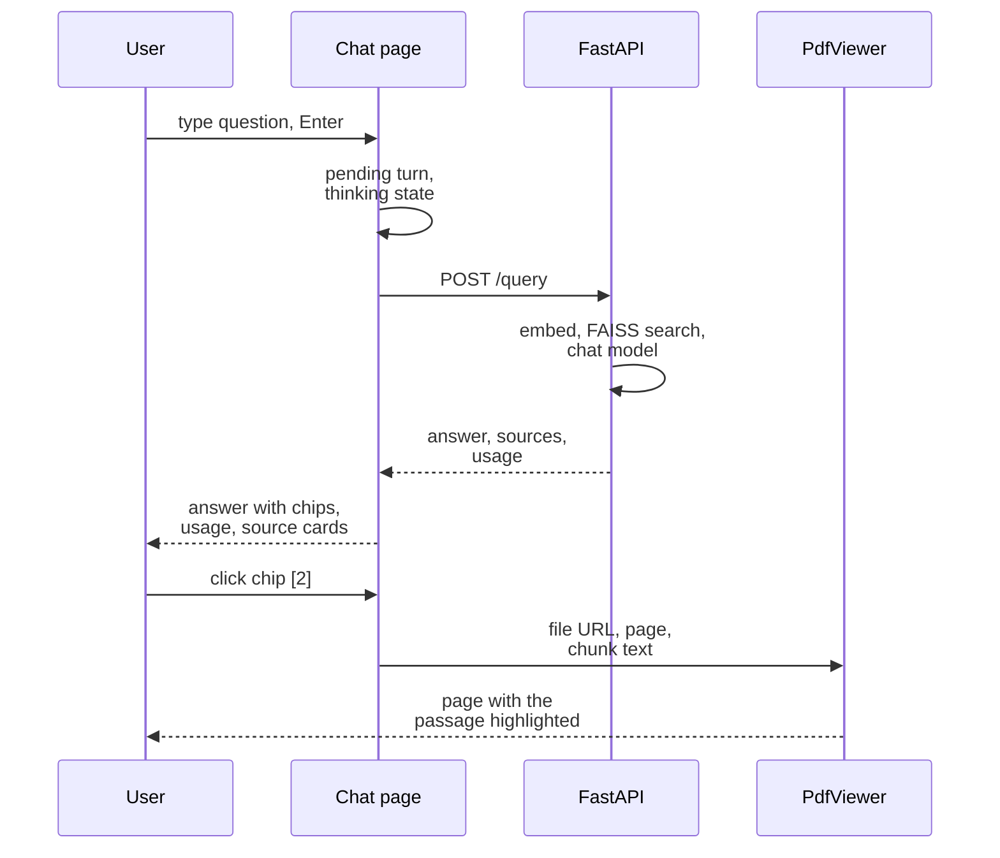
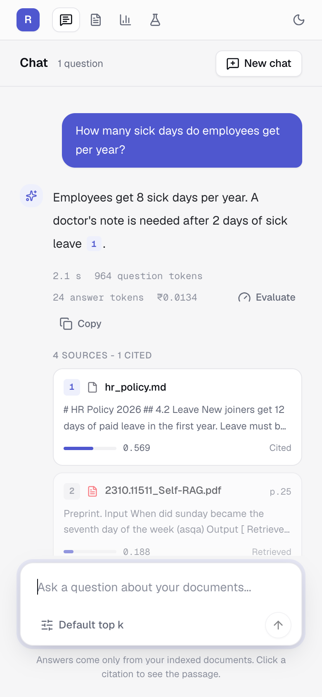

# 09. UI Architecture Overview

This doc is the map of the whole UI: the three pages, how they share data, and where to read more. Each part has its own detailed doc (01 to 08).

In this doc:

- The four pages and what each is for
- How the parts fit together
- How data flows from FastAPI to the screen
- One question, end to end
- Responsive layout and themes
- Doc index

## The four pages

<table width="100%">
<thead><tr><th>Page</th><th>URL</th><th>Purpose</th><th>Doc</th></tr></thead>
<tbody>
<tr><td>Chat</td><td>/</td><td>Ask questions; answers cite sources; clicking a citation opens the PDF at the cited passage</td><td>07</td></tr>
<tr><td>Documents</td><td>/documents</td><td>Upload files, follow the ingestion pipeline, inspect chunks next to the PDF, delete files</td><td>05, 06</td></tr>
<tr><td>Analytics</td><td>/analytics</td><td>LLM cost, token usage, answer latency and every recorded run</td><td>08</td></tr>
<tr><td>Evals</td><td>/evals</td><td>Run the test set through the pipeline and grade every answer with an LLM judge; run history and case details</td><td>11</td></tr>
</tbody>
</table>

### Chat

### Documents

### Analytics

### Evals

## How the parts fit together

<table width="100%">
<thead><tr><th>Shared part</th><th>Used by</th><th>Doc</th></tr></thead>
<tbody>
<tr><td>Design tokens and UI components</td><td>Every page: buttons, badges, cards, sheets, menus, tooltips, hover cards, tabs, dialogs, skeletons</td><td>03</td></tr>
<tr><td>App shell and sidebar</td><td>Frame of every page; shows the document count and the API status</td><td>04</td></tr>
<tr><td>Query hooks</td><td>All server data; mutations refresh related data (upload refreshes documents and analytics, a question refreshes analytics)</td><td>04</td></tr>
<tr><td>API client</td><td>The only code that talks to FastAPI</td><td>02</td></tr>
<tr><td>PdfViewer</td><td>Document drawer (chunk clicked) and Chat source panel (citation clicked)</td><td>06</td></tr>
<tr><td>ChatProvider</td><td>Keeps the conversation while moving between pages</td><td>07</td></tr>
</tbody>
</table>

## Data flow

<table width="100%">
<thead><tr><th>Hook</th><th>Endpoint</th><th>Refresh rule</th></tr></thead>
<tbody>
<tr><td>useHealth</td><td>GET /health</td><td>Every 30 seconds</td></tr>
<tr><td>useDocuments</td><td>GET /documents</td><td>After an upload or delete</td></tr>
<tr><td>useDocumentChunks</td><td>GET /documents/{source}/chunks</td><td>Only while a drawer is open</td></tr>
<tr><td>useAnalytics</td><td>GET /analytics</td><td>Every 60 seconds, and after an upload or a question</td></tr>
<tr><td>useUploadDocument</td><td>POST /documents</td><td>Mutation with upload progress</td></tr>
<tr><td>useDeleteDocument</td><td>DELETE /documents/{source}</td><td>Mutation</td></tr>
<tr><td>useAsk</td><td>POST /query</td><td>Mutation</td></tr>
<tr><td>useEvaluateAnswer</td><td>POST /evals/answer</td><td>Mutation; refreshes analytics</td></tr>
<tr><td>useEvalTestset, useEvalRuns, useEvalRun</td><td>GET /evals/testset, /evals/runs, /evals/runs/{id}</td><td>Run list every 3 s and the selected run every 2 s, only while a run is in progress</td></tr>
<tr><td>useStartEvalRun</td><td>POST /evals/runs</td><td>Mutation; refreshes the run list and analytics</td></tr>
</tbody>
</table>

The PDF file itself is not fetched through a hook: `documentFileUrl(source)` builds the URL and pdf.js loads it, so the browser can stream and cache it.

## One question, end to end

The same run also appears on the Analytics page (the usage meter recorded it, and the question marked the analytics data stale) and in the backend logs with its request id, step timings, tokens and cost (API doc 21).

## Responsive layout and themes

<table width="100%">
<thead><tr><th>Width</th><th>Layout</th></tr></thead>
<tbody>
<tr><td>Under 768 px</td><td>Sidebar becomes a top bar with icon links; pages stack in one column; the chat source panel and the document drawer open as full-width sheets</td></tr>
<tr><td>768 to 1023 px</td><td>Sidebar on the left; chat sources still open as a sheet</td></tr>
<tr><td>1024 px and wider</td><td>Chat split view with the source panel on the right; drawer shows PDF and chunks side by side</td></tr>
<tr><td>1536 px and wider</td><td>Documents page puts the upload panel next to the table</td></tr>
</tbody>
</table>

Light and dark themes come from the same token names with different values (doc 03). The theme follows the system setting until the user picks one with the sidebar toggle; the choice is saved in the browser. Chart colors were validated for both themes (doc 08).

## Doc index

<table width="100%">
<thead><tr><th>Step</th><th>Doc</th><th>Covers</th></tr></thead>
<tbody>
<tr><td>01</td><td><a href="01.%20UI%20Project%20Setup%20and%20Folder%20Structure.md">UI Project Setup and Folder Structure</a></td><td>Stack, folders, Vite proxy, commands, code style</td></tr>
<tr><td>02</td><td><a href="02.%20API%20Client.md">API Client</a></td><td>Endpoint functions, errors, upload progress</td></tr>
<tr><td>03</td><td><a href="03.%20Design%20System.md">Design System</a></td><td>Tokens, typography, components, dark mode</td></tr>
<tr><td>04</td><td><a href="04.%20App%20Shell%2C%20Routing%20and%20Data%20Layer.md">App Shell, Routing and Data Layer</a></td><td>Sidebar, routes, query hooks, theme toggle</td></tr>
<tr><td>05</td><td><a href="05.%20Documents%20and%20Ingestion.md">Documents and Ingestion</a></td><td>Upload queue, pipeline steps, table</td></tr>
<tr><td>06</td><td><a href="06.%20PDF%20Viewer%20and%20Document%20Drawer.md">PDF Viewer and Document Drawer</a></td><td>pdf.js viewer, chunk highlighting</td></tr>
<tr><td>07</td><td><a href="07.%20Chat%20with%20Citations.md">Chat with Citations</a></td><td>Conversation, citation chips, source panel</td></tr>
<tr><td>08</td><td><a href="08.%20Analytics%20Dashboard.md">Analytics Dashboard</a></td><td>Cost, tokens, latency, runs, chart design</td></tr>
<tr><td>10</td><td><a href="10.%20Answer%20Evaluation%20in%20Chat.md">Answer Evaluation in Chat</a></td><td>Evaluate button, judge scores, relevant chunk tags</td></tr>
<tr><td>11</td><td><a href="11.%20Evals%20Page.md">Evals Page</a></td><td>Test set runs, summary, case details, run history</td></tr>
<tr><td>09</td><td>UI Architecture Overview</td><td>This doc</td></tr>
</tbody>
</table>
