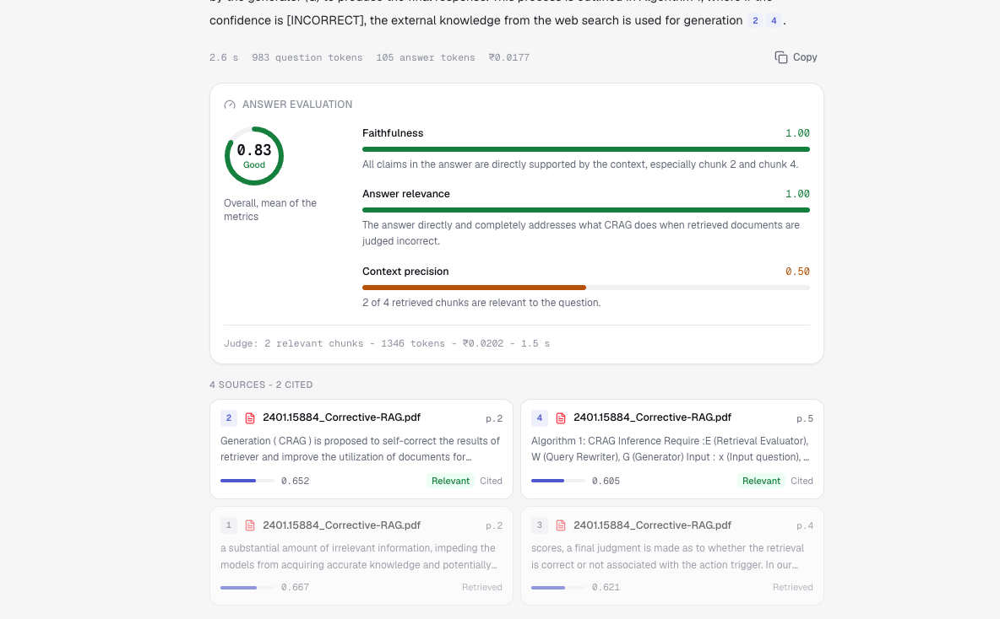
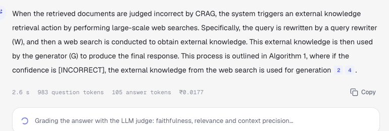
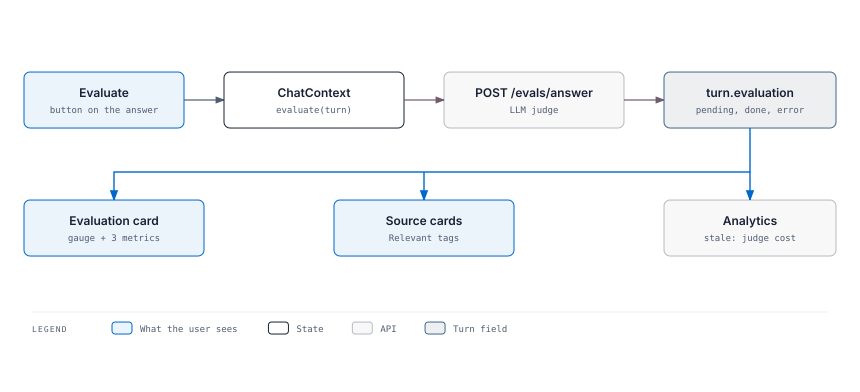
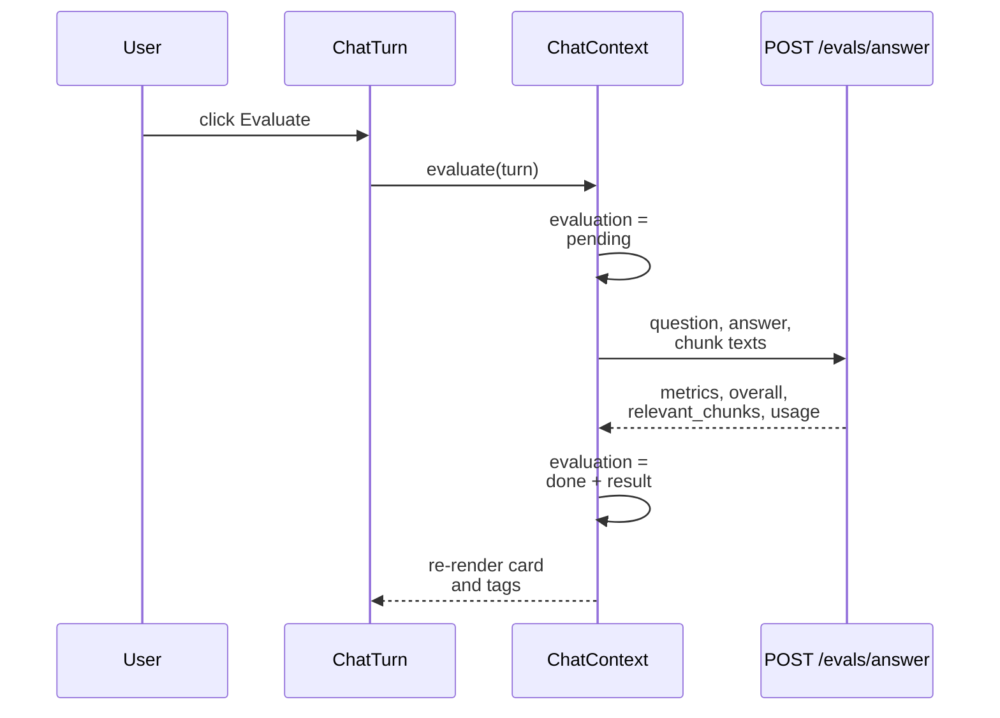

# 10. Answer Evaluation in Chat

In this doc:

- Where evaluation lives in the UI, and why in two places
- The Evaluate button and the evaluation card
- How the state flows
- Shared score components
- Evaluation runs in the analytics table
- Tests and a live check

Files:

- [src/features/chat/AnswerEvaluation.jsx](../src/features/chat/AnswerEvaluation.jsx): the card under an answer
- [src/features/chat/ChatContext.jsx](../src/features/chat/ChatContext.jsx): `evaluate(turn)`
- [src/features/chat/ChatTurn.jsx](../src/features/chat/ChatTurn.jsx), [SourceCards.jsx](../src/features/chat/SourceCards.jsx)
- [src/features/evals/scores.js](../src/features/evals/scores.js), [ScoreParts.jsx](../src/features/evals/ScoreParts.jsx), [scores.test.js](../src/features/evals/scores.test.js)
- [src/api/client.js](../src/api/client.js), [src/api/queries.js](../src/api/queries.js): eval endpoints and hooks
- [src/features/analytics/RecentRuns.jsx](../src/features/analytics/RecentRuns.jsx): evaluation runs

Backend: POST /evals/answer ([API doc 24](../../03.%20API/docs/24.%20Answer%20Evaluation%20with%20an%20LLM%20Judge.md)).

## Two places for evaluation

<table width="100%">
<thead><tr><th>Where</th><th>Answers</th><th>Metrics</th><th>When to use it</th></tr></thead>
<tbody>
<tr><td>Chat: Evaluate button under an answer</td><td>"Is this answer grounded, relevant, and was retrieval good?"</td><td>Faithfulness, answer relevance, context precision</td><td>Checking one answer you doubt, on demand</td></tr>
<tr><td>Evals page: test set runs (doc 11)</td><td>"How good is the whole pipeline, and did a change help?"</td><td>All four, plus correctness against reference answers and retrieval hit rate</td><td>Comparing settings or architectures</td></tr>
</tbody>
</table>

Grading is on demand in the chat, not automatic: each grade is one extra model call (about 1,300 tokens, Rs 0.02), so the user decides when it is worth it. Correctness is not shown in the chat because a chat question has no reference answer.

## The Evaluate button and card

<table width="100%">
<thead><tr><th>State</th><th>What is shown</th></tr></thead>
<tbody>
<tr><td>Not graded</td><td>"Evaluate" button in the usage line, next to Copy (hidden when the answer has no sources)</td></tr>
<tr><td>Pending</td><td>A card with a spinner: "Grading the answer with the LLM judge: faithfulness, relevance and context precision..."</td></tr>
<tr><td>Done</td><td>Overall score as a gauge with its word (Good, Fair, Poor); one row per metric with a bar, the score and the judge's reason; a footer with the number of relevant chunks, judge tokens, cost in rupees and time</td></tr>
<tr><td>Error</td><td>The error message and a Retry button</td></tr>
</tbody>
</table>

After grading, every source card the judge listed in `relevant_chunks` gets a green "Relevant" tag next to "Cited" or "Retrieved". The cards now show two separate signals: what the model cited, and what was actually useful. In the screenshot both cited chunks were relevant, and the two uncited chunks were not, so context precision is 0.5.

## State flow

- `evaluate(turn)` lives in `ChatProvider` next to `ask()`. The evaluation is stored on the turn (`turn.evaluation`), so it survives page changes like the rest of the conversation.
- The contexts are the turn's source texts in citation order, so the judge's chunk numbers match the numbers on the source cards.
- `useEvaluateAnswer` marks analytics stale on success, so the judge cost appears in the sidebar's Today card and on the Analytics page right away.

## Shared score components

The Evals page shows the same scores, so the pieces live in `src/features/evals/` and are reused:

<table width="100%">
<thead><tr><th>Piece</th><th>Content</th></tr></thead>
<tbody>
<tr><td>METRICS</td><td>The four metrics in display order with a label and a hover explanation</td></tr>
<tr><td>scoreTone(score)</td><td>Good (0.75 and above), Fair (0.5 and above), Poor (below 0.5), n/a for missing scores</td></tr>
<tr><td>ScoreBadge</td><td>Score and word on a tinted pill</td></tr>
<tr><td>ScoreRing</td><td>Circular gauge (SVG arc proportional to the score) with the number and word inside</td></tr>
<tr><td>MetricRow</td><td>Metric name (hover for its meaning), bar, score and the judge's reason</td></tr>
</tbody>
</table>

Scores use the reserved status colors (success, warning, danger) and always come with a number and a word, so they never depend on color alone. The 0.75 threshold for Good is the same as the backend's pass score.

## Evaluation runs in analytics

Grading creates usage events of kind `eval_judge` (and test set runs also `eval_query`). The Recent runs table shows them as "Evaluation" with a gauge icon and has a new "Evaluations" filter tab, so the cost of grading is visible but never mixed up with user questions.

## Tests

<table width="100%">
<thead><tr><th>Test</th><th>Checks</th></tr></thead>
<tbody>
<tr><td>maps scores to tones at the boundaries</td><td>0.75 good, 0.74 and 0.5 fair, 0.49 poor, null n/a</td></tr>
<tr><td>formats scores</td><td>0.8125 to "0.81", 1 to "1.00", null to "-"</td></tr>
</tbody>
</table>

22 UI tests pass. Live check in headless Chrome: the question "What does CRAG do when the retrieved documents are judged incorrect?" was answered, Evaluate showed the pending card, then overall 0.83 (faithfulness 1.00, relevance 1.00, context precision 0.50) with 2 source cards tagged Relevant; grading cost 1,346 tokens and Rs 0.0202.
