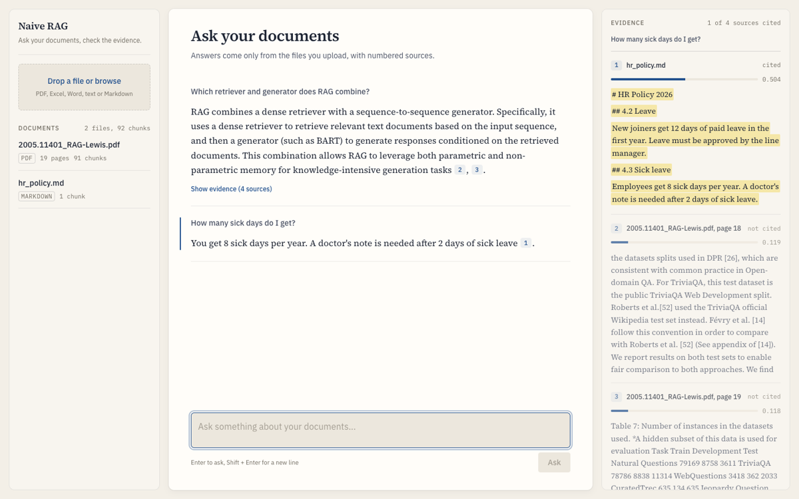
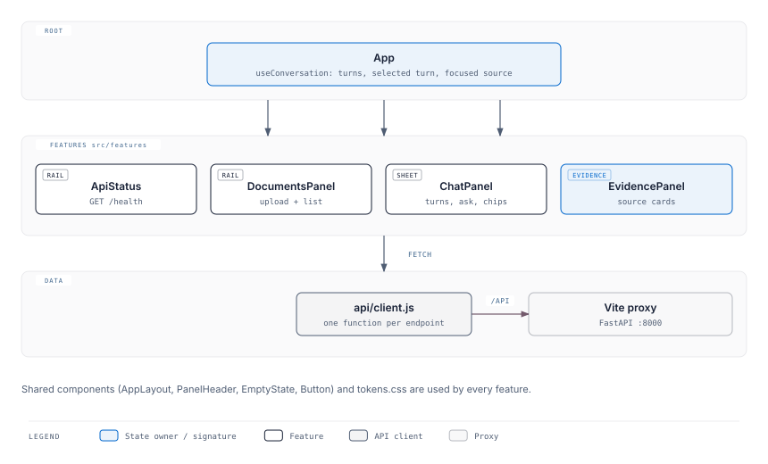
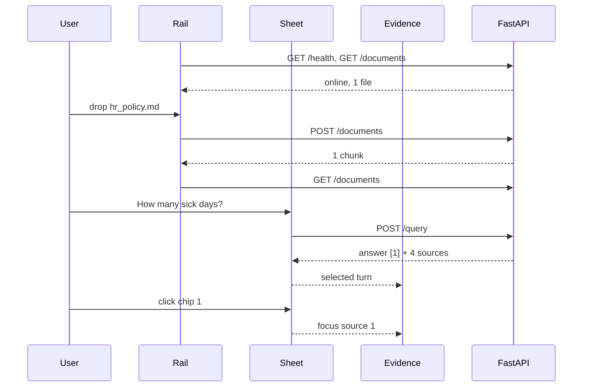
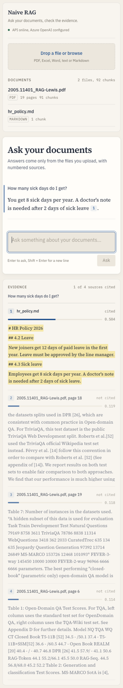

# 10. UI Architecture Overview

In this doc:

- The finished UI in one picture
- Component and state architecture
- One full user session traced through the code
- Every UI design decision in one table
- What the UI makes visible about Naive RAG
- Map of all UI docs

This doc ties UI docs 01 to 09 together. Read it first for the big picture.

## The finished UI

<table width="100%">
<thead><tr><th>Region</th><th>Shows</th><th>Lets the user</th><th>Doc</th></tr></thead>
<tbody>
<tr><td>Documents rail</td><td>App name, API status, upload zone, indexed files</td><td>Check the API is ready, add files, see what is searchable</td><td>05, 06, 09</td></tr>
<tr><td>Conversation sheet</td><td>Questions and answers with citation chips</td><td>Ask, read, click a citation</td><td>07, 08</td></tr>
<tr><td>Evidence panel</td><td>Every retrieved chunk with score, cited ones highlighted</td><td>Verify the answer against its sources</td><td>08</td></tr>
</tbody>
</table>

## Component and state architecture

<table width="100%">
<thead><tr><th>State</th><th>Owner</th><th>Why there</th></tr></thead>
<tbody>
<tr><td>Turns, selected turn, focused source</td><td>App (useConversation)</td><td>Needed by both ChatPanel and EvidencePanel</td></tr>
<tr><td>Indexed documents</td><td>DocumentsPanel (useDocuments)</td><td>Only the rail uses it; upload refreshes it from the same component</td></tr>
<tr><td>Upload status and message</td><td>UploadZone (useUpload)</td><td>Local to the drop zone</td></tr>
<tr><td>API status</td><td>ApiStatus (useHealth)</td><td>Local to the status line</td></tr>
<tr><td>Question text</td><td>AskForm</td><td>Local to the form</td></tr>
</tbody>
</table>

State lives in the lowest component that needs it. No state library is needed for an app of this size.

## One session, traced through the code

<table width="100%">
<thead><tr><th>#</th><th>User action</th><th>Code path</th><th>Visible result</th></tr></thead>
<tbody>
<tr><td>1</td><td>Opens the page</td><td>useHealth, useDocuments</td><td>Status "API online", list of indexed files</td></tr>
<tr><td>2</td><td>Drops a file</td><td>UploadZone, useUpload, uploadDocument</td><td>"Indexing...", then "Indexed hr_policy.md: 1 chunk."</td></tr>
<tr><td>3</td><td>List refreshes</td><td>onUploaded, refresh, listDocuments</td><td>New file in the rail, counts updated</td></tr>
<tr><td>4</td><td>Asks a question</td><td>AskForm, useConversation.ask, askQuestion</td><td>Pending turn, then the answer with chips</td></tr>
<tr><td>5</td><td>Reads the evidence</td><td>EvidencePanel, citedNumbers, SourceCard</td><td>Cited chunk highlighted, uncited chunks quieter</td></tr>
<tr><td>6</td><td>Clicks a chip</td><td>Turn, select(id, n)</td><td>Source n scrolled into view and outlined</td></tr>
</tbody>
</table>

## Design decisions

<table width="100%">
<thead><tr><th>Decision</th><th>Choice</th><th>Main reason</th><th>Doc</th></tr></thead>
<tbody>
<tr><td>Stack</td><td>React 19, Vite 8, JavaScript</td><td>Fast dev server, simple code</td><td>01</td></tr>
<tr><td>Backend access</td><td>Vite proxy on /api, one client module</td><td>No CORS, one place for URLs and errors</td><td>01, 02</td></tr>
<tr><td>Direction</td><td>Reading desk: paper, ink, pen blue, highlighter</td><td>Answers are documents to verify, not chat</td><td>03</td></tr>
<tr><td>Fonts</td><td>Source Serif 4, IBM Plex Sans, IBM Plex Mono, bundled</td><td>Reading, interface and data voices; works offline</td><td>03</td></tr>
<tr><td>Layout</td><td>Rail, sheet, evidence; stacks on phones</td><td>Task order: add, ask, verify</td><td>04</td></tr>
<tr><td>Styling</td><td>CSS Modules on design tokens</td><td>Scoped classes, no extra tooling</td><td>04</td></tr>
<tr><td>States</td><td>Loading, empty, error for every region</td><td>No blank or confusing screens</td><td>04 to 09</td></tr>
<tr><td>Upload</td><td>Drop zone on a hidden, focusable file input</td><td>Mouse, drag and keyboard all work</td><td>06</td></tr>
<tr><td>Answers</td><td>Serif reading text, rules between turns</td><td>Comfortable to read and check</td><td>07</td></tr>
<tr><td>Signature</td><td>Citation chips and highlighted evidence with scores</td><td>Makes grounding, and its gaps, visible</td><td>08</td></tr>
<tr><td>Health</td><td>Status line, checked every 30 seconds; proxy 502 means server down</td><td>Setup problems are clear before any action</td><td>09</td></tr>
</tbody>
</table>

## What the UI makes visible about Naive RAG

<table width="100%">
<thead><tr><th>Naive RAG behaviour</th><th>How it shows in the UI</th></tr></thead>
<tbody>
<tr><td>Always top-4, no score threshold</td><td>Unrelated chunks appear in the evidence panel with low scores (0.11 to 0.12) and "not cited"</td></tr>
<tr><td>Grounded generation</td><td>Answers carry [n] chips; cited chunks are highlighted</td></tr>
<tr><td>Similar scores for related chunks</td><td>Score bars of near-equal length (0.52 to 0.54) for paper chunks</td></tr>
<tr><td>Answers limited to what was retrieved</td><td>When a needed chunk is missing, its absence is visible in the panel</td></tr>
</tbody>
</table>

These are the baselines later architectures will improve, and the same UI can show the difference.

## Phone layout

At 390px wide, the rail, sheet and evidence stack in one column with no horizontal scroll.

## Map of all UI docs

<table width="100%">
<thead><tr><th>Doc</th><th>Topic</th></tr></thead>
<tbody>
<tr><td><a href="01.%20UI%20Project%20Setup%20and%20Folder%20Structure.md">01</a></td><td>Project setup and folder structure</td></tr>
<tr><td><a href="02.%20API%20Client.md">02</a></td><td>API client</td></tr>
<tr><td><a href="03.%20Design%20System.md">03</a></td><td>Design system</td></tr>
<tr><td><a href="04.%20App%20Layout.md">04</a></td><td>App layout</td></tr>
<tr><td><a href="05.%20Document%20List.md">05</a></td><td>Document list</td></tr>
<tr><td><a href="06.%20Upload%20Zone.md">06</a></td><td>Upload zone</td></tr>
<tr><td><a href="07.%20Conversation.md">07</a></td><td>Conversation</td></tr>
<tr><td><a href="08.%20Citations%20and%20Evidence.md">08</a></td><td>Citations and evidence</td></tr>
<tr><td><a href="09.%20API%20Status.md">09</a></td><td>API status</td></tr>
<tr><td>10</td><td>UI architecture overview (this doc)</td></tr>
</tbody>
</table>
