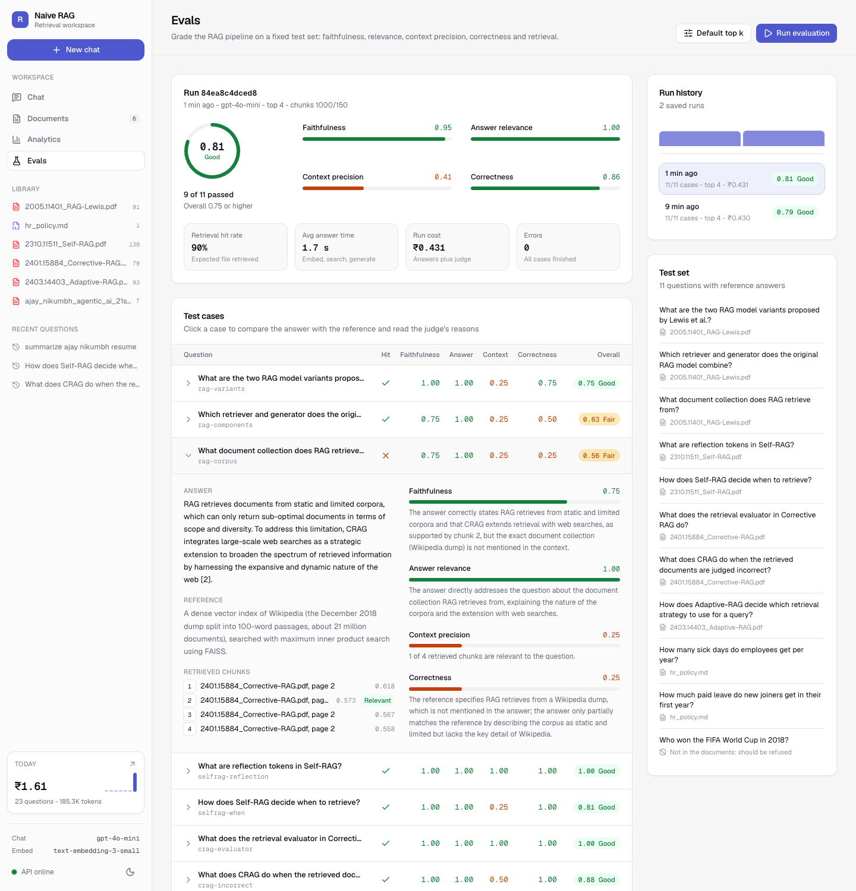
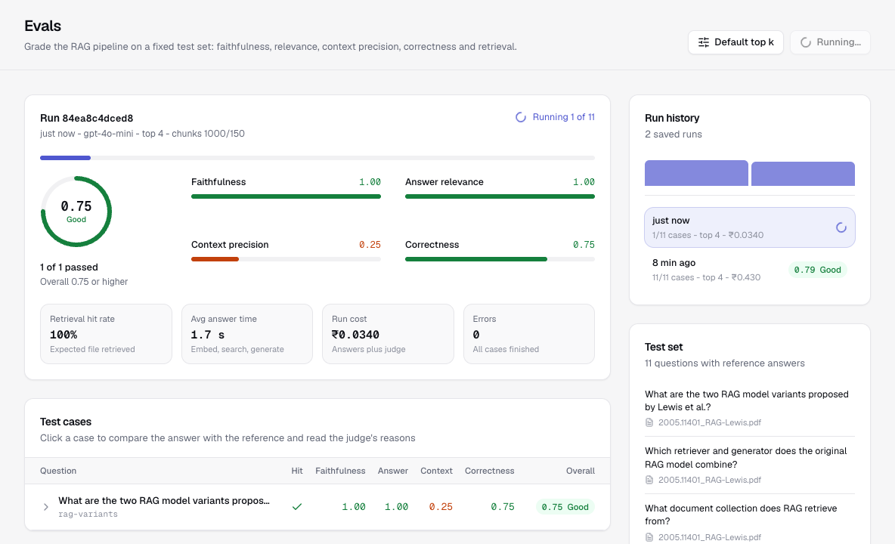
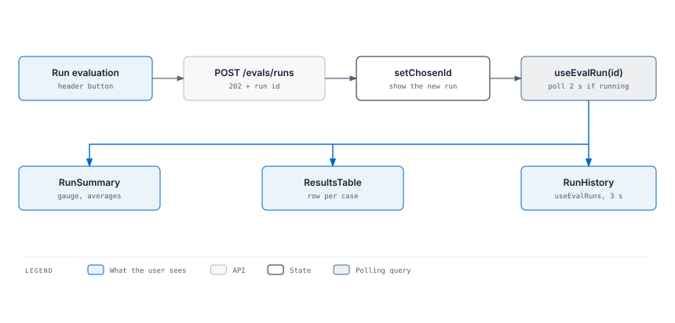
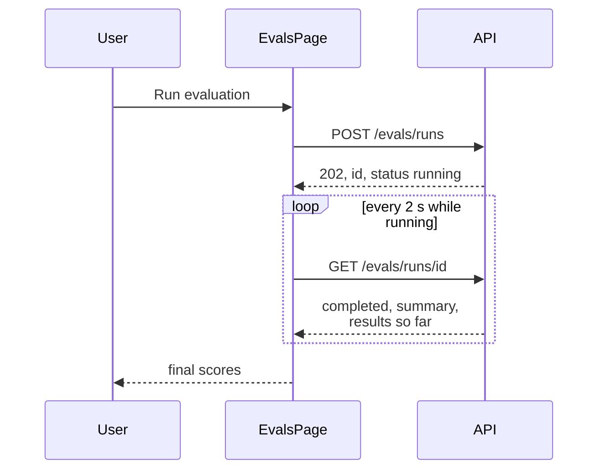
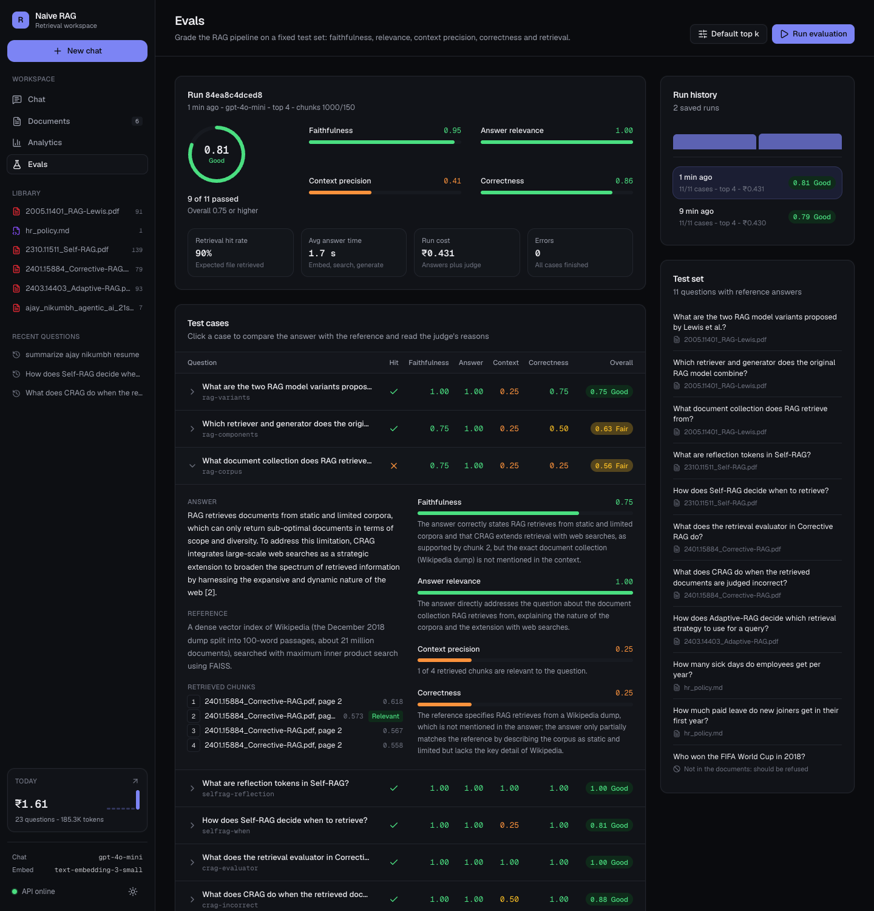

# 11. Evals Page

In this doc:

- What the Evals page is for
- How to run an evaluation from the UI
- The run summary, the test case table and the case details
- Run history and the test set
- How progress is polled
- Reading the first runs
- Live check

Files:

- [src/features/evals/EvalsPage.jsx](../src/features/evals/EvalsPage.jsx): layout, run button, selected run
- [src/features/evals/RunSummary.jsx](../src/features/evals/RunSummary.jsx), [ResultsTable.jsx](../src/features/evals/ResultsTable.jsx), [RunHistory.jsx](../src/features/evals/RunHistory.jsx), [TestsetCard.jsx](../src/features/evals/TestsetCard.jsx)
- [src/features/evals/ScoreParts.jsx](../src/features/evals/ScoreParts.jsx), [scores.js](../src/features/evals/scores.js) (shared with the chat, doc 10)
- [src/api/queries.js](../src/api/queries.js): useEvalTestset, useEvalRuns, useEvalRun, useStartEvalRun

Backend: /evals/testset and /evals/runs ([API doc 25](../../03.%20API/docs/25.%20Evaluation%20Runs%20and%20Reports.md)).

## What the page is for

The chat Evaluate button (doc 10) grades one answer. The Evals page grades the whole pipeline on the same 11 questions every time, with reference answers, so a change in settings or architecture shows up as a change in numbers. It is the scoreboard every later architecture in this repository will be compared on.

## Running an evaluation

1. Open **Evals** in the sidebar.
2. Optionally pick a top k in the header menu (server default, 2, 4, 6 or 8 chunks). This makes it easy to compare retrieval depth.
3. Click **Run evaluation**. A toast confirms "11 test cases, top 4" and the new run is selected.
4. Scores appear case by case while the run is in progress (about 20 to 40 seconds); the button shows "Running..." and a second run cannot be started (the API answers 409).

## The selected run

### Summary

<table width="100%">
<thead><tr><th>Part</th><th>Content</th></tr></thead>
<tbody>
<tr><td>Title</td><td>Run id, when it ran, chat model, top k and chunk size/overlap, so runs with different settings are never confused</td></tr>
<tr><td>Progress</td><td>"Running 5 of 11" with a bar, while in progress; "Interrupted" or "Failed" with the reason otherwise</td></tr>
<tr><td>Overall</td><td>Gauge with the mean overall score and its word; "9 of 11 passed" (overall 0.75 or higher)</td></tr>
<tr><td>Metric averages</td><td>Faithfulness, answer relevance, context precision and correctness as bars</td></tr>
<tr><td>Facts</td><td>Retrieval hit rate, average answer time, run cost in rupees (answers plus judge), number of failed cases</td></tr>
</tbody>
</table>

### Test case table

One row per case: question and case id, a retrieval hit icon (check: the expected file was retrieved; cross: it was not; dash: no expected file), the four metric scores colored by tone, and the overall score as a badge. The metric columns hide on narrow screens so the table never scrolls sideways.

Clicking a row expands it:

<table width="100%">
<thead><tr><th>Left</th><th>Right</th></tr></thead>
<tbody>
<tr><td>The system's answer, the reference answer, and the retrieved chunks with their scores; the expected file is in bold and relevant chunks are tagged</td><td>Every metric with its bar, score and the judge's one-sentence reason</td></tr>
</tbody>
</table>

The expanded `rag-corpus` case in the screenshot shows the diagnosis in one place: the hit icon is a cross, all four retrieved chunks come from the Corrective RAG paper (which mentions RAG's corpus only in passing), only one is relevant, and the judge explains that the answer misses the Wikipedia detail from the reference.

## Run history and test set

<table width="100%">
<thead><tr><th>Card</th><th>Content</th></tr></thead>
<tbody>
<tr><td>Run history</td><td>Every saved run, newest first: when, cases done, top k, cost and overall badge (spinner while running). Click to view a run. A bar chart on top shows overall scores of the last 12 runs, oldest to newest, scaled from 0.5 to 1 so small changes stay visible</td></tr>
<tr><td>Test set</td><td>The 11 questions with the expected file under each (or "Not in the documents: should be refused"); hovering a case shows its reference answer</td></tr>
</tbody>
</table>

With no runs yet, the main column shows a short explanation of what a run does and a Run evaluation button.

## How progress is polled

TanStack Query's `refetchInterval` can be a function of the current data. `useEvalRun` returns 2000 ms while the report says `running` and `false` afterwards, and `useEvalRuns` does the same with 3000 ms when any run in the list is running. Polling therefore starts and stops by itself: no timers to clean up, and no requests once every run is finished. Starting a run also marks analytics stale, because a run spends tokens.

## Reading the first runs

<table width="100%">
<thead><tr><th>Run</th><th>Overall</th><th>Faithful</th><th>Relevant</th><th>Precision</th><th>Correct</th><th>Hit rate</th><th>Cost</th></tr></thead>
<tbody>
<tr><td>First (API)</td><td>0.79</td><td>0.93</td><td>0.98</td><td>0.41</td><td>0.84</td><td>90%</td><td>Rs 0.430</td></tr>
<tr><td>Second (UI)</td><td>0.81</td><td>0.95</td><td>1.00</td><td>0.41</td><td>0.86</td><td>90%</td><td>Rs 0.431</td></tr>
</tbody>
</table>

The two runs used the same settings, so the small difference (0.79 to 0.81) is the judge's and the generator's natural variation, even at temperature 0. Treat differences of a few hundredths as noise; a real improvement from a new architecture should move context precision and correctness clearly. The constant 0.41 context precision and the same missed case (`rag-corpus`) in both runs confirm that retrieval, not generation, is what limits Naive RAG.

## Live check

In headless Chrome with the real backend: the Evals page loaded the previous run and the test set; Run evaluation started run `84ea8c4dced8`; after 9 seconds the page showed "Running 1 of 11" with the first case scored; the run finished on its own with overall 0.81, 9 of 11 passed, Rs 0.431; expanding `rag-corpus` showed the answer, the reference, the retrieved chunks and the judge's reasons. The same page in dark mode:

22 UI tests pass.
