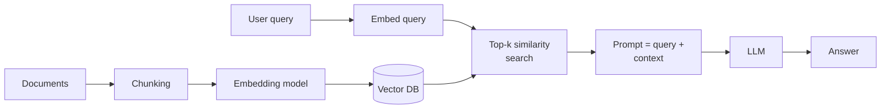

# 01. Naive (Basic) RAG

**Category:** Foundational  
**Core idea:** Index, retrieve top-k chunks by vector similarity, stuff them into the prompt, generate.  
**Status:** Notes and implementation complete.

## Table of Contents

- [Overview](#overview)
- [Architecture](#architecture)
- [How It Works](#how-it-works)
- [When to Use](#when-to-use)
- [Limitations](#limitations)
- [Key Components](#key-components)
- [Notes](#notes)
- [Research Papers](#research-papers)
- [Navigation](#navigation)

## Overview

The baseline retrieve-then-read pipeline. Documents are split into chunks, embedded and stored in a vector database. At query time the question is embedded, the top-k most similar chunks are retrieved and passed as context to the LLM, which generates the answer. Every other architecture in this repo is an improvement on one or more stages of this pipeline.

## Architecture

## How It Works

1. Load documents (PDF, HTML, Markdown) and clean the text.
2. Split into fixed-size chunks with overlap.
3. Embed each chunk and store vectors plus metadata in a vector DB.
4. Embed the user query and retrieve the top-k nearest chunks.
5. Build a prompt with the retrieved context and generate the answer with source citations.

## When to Use

- Small, clean, single-domain corpus.
- First prototype and baseline for evaluation.

## Limitations

- Low precision: irrelevant chunks reach the prompt.
- No handling of ambiguous or multi-hop questions.
- Fixed chunking can split facts.

## Key Components

- Document loaders
- Text splitter
- Embedding model
- Vector DB
- Prompt template
- LLM
- RAGAS evaluation

## Notes

Read the notes in this order, then the implementation.

<table width="100%">
<thead><tr><th>#</th><th>Notes</th><th>What it covers</th></tr></thead>
<tbody>
<tr><td>1</td><td><a href="01.%20Notes/01.%20Basic%20Concepts/">Basic Concepts</a></td><td>Every building block of a RAG system explained in simple terms with diagrams: documents, chunking, embeddings, similarity, vector databases, retrieval, prompting, evaluation.</td></tr>
<tr><td>2</td><td><a href="01.%20Notes/02.%20Research%20Paper%20Explained/">Research Paper Explained</a></td><td>Section by section walkthrough of Lewis et al. 2020: figures, equations and results explained in simple terms.</td></tr>
<tr><td>3</td><td><a href="03.%20API/">API</a></td><td>End-to-end FastAPI app with Azure OpenAI and FAISS, structured logging, usage tracking and LLM-judge evaluation, built step by step, with 26 numbered design docs (doc 26 explains how to read the evaluation report).</td></tr>
<tr><td>4</td><td><a href="04.%20UI/">UI</a></td><td>React app with chat and clickable citations that open the PDF at the cited passage, document ingestion, an LLM cost and usage dashboard in rupees, and answer evaluation with test set runs, with 11 numbered design docs.</td></tr>
</tbody>
</table>

## Research Papers

<table width="100%">
<thead><tr><th>#</th><th>Paper</th><th>Year</th><th>Venue / Org</th><th>arXiv</th><th>Local copy</th></tr></thead>
<tbody>
<tr><td>1</td><td>Retrieval-Augmented Generation for Knowledge-Intensive NLP Tasks</td><td>2020</td><td>NeurIPS 2020 (Meta AI)</td><td><a href="https://arxiv.org/abs/2005.11401">2005.11401</a></td><td><a href="02.%20Papers/2005.11401_RAG-Lewis.pdf">PDF</a></td></tr>
</tbody>
</table>

## Navigation

Previous: [00. RAG Surveys and Foundations](../00.%20RAG%20Surveys%20and%20Foundations/) | [Home](../README.md) | Next: [02. Advanced RAG](../02.%20Advanced%20RAG/)
