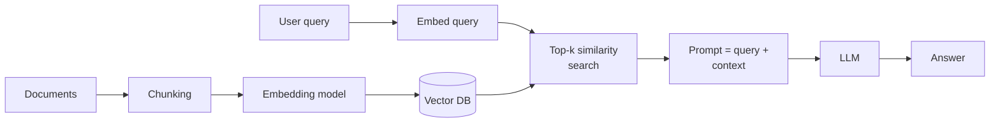

# 01. Naive (Basic) RAG

**Category:** Foundational  
**Core idea:** Index, retrieve top-k chunks by vector similarity, stuff them into the prompt, generate.  
**Status:** Complete: notes, paper walkthrough, interview preparation, API, UI and evaluation baseline. Next: [02. Advanced RAG](../02.%20Advanced%20RAG/).

## Table of Contents

- [Overview](#overview)
- [Architecture](#architecture)
- [How It Works](#how-it-works)
- [When to Use](#when-to-use)
- [Limitations](#limitations)
- [Key Components](#key-components)
- [What Was Built](#what-was-built)
- [Results](#results)
- [Notes](#notes)
- [Next: Advanced RAG](#next-advanced-rag)
- [Research Papers](#research-papers)
- [Navigation](#navigation)

## Overview

The baseline retrieve-then-read pipeline. Documents are split into chunks, embedded and stored in a vector database. At query time the question is embedded, the top-k most similar chunks are retrieved and passed as context to the LLM, which generates the answer. Every other architecture in this repo is an improvement on one or more stages of this pipeline.

## Architecture

## How It Works

1. Load documents (PDF, Word, Excel, Markdown, text) and clean the text.
2. Split into fixed-size chunks with overlap.
3. Embed each chunk and store vectors plus metadata in a vector DB.
4. Embed the user query and retrieve the top-k nearest chunks.
5. Build a prompt with the retrieved context and generate the answer with source citations.

## When to Use

- Small, clean, single-domain corpus.
- First prototype and baseline for evaluation.

## Limitations

- Low precision: irrelevant chunks reach the prompt (measured: context precision 0.41).
- Similar documents and exact names (acronyms, model names) confuse dense search.
- No handling of follow-up, ambiguous or multi-hop questions.
- Fixed chunking can split facts or cap precision for short documents.
- No check of retrieved chunks before answering.

All of these were measured on the implementation; see [API doc 28](03.%20API/docs/28.%20Naive%20RAG%20Limitations%2C%20Lessons%20and%20Next%20Steps.md).

## Key Components

- Document loaders
- Text splitter
- Embedding model
- Vector DB
- Prompt template
- LLM
- Evaluation (LLM judge with RAGAS-style metrics)

## What Was Built

<table width="100%">
<thead><tr><th>Part</th><th>Stack</th><th>Highlights</th></tr></thead>
<tbody>
<tr><td><a href="03.%20API/">API</a></td><td>FastAPI, Azure OpenAI gpt-4o-mini and text-embedding-3-small, FAISS</td><td>13 endpoints; five file types; cited answers; structured logs with retrieved chunks; cost in USD and INR; LLM-judge evaluation with test set runs; 63 tests; 28 design docs</td></tr>
<tr><td><a href="04.%20UI/">UI</a></td><td>React 19, Vite, Tailwind, Radix, TanStack Query, react-pdf, Recharts</td><td>Chat where citations open the PDF at the highlighted passage; Evaluate button; Documents with ingestion pipeline; Analytics in rupees; Evals page; dark mode and phone layout; 22 tests; 11 design docs</td></tr>
</tbody>
</table>

The [UI showcase](04.%20UI/README.md#showcase) has screenshots of every screen.

## Results

Baseline on the 11-question test set (top 4, mean of three runs), graded by an LLM judge:

<table width="100%">
<thead><tr><th>Metric</th><th>Score</th><th>Meaning</th></tr></thead>
<tbody>
<tr><td>Overall</td><td>0.80</td><td>Average grade of all questions; 9 of 11 pass</td></tr>
<tr><td>Faithfulness</td><td>0.95</td><td>Answers stay within the retrieved chunks</td></tr>
<tr><td>Answer relevance</td><td>0.98</td><td>Answers address the question</td></tr>
<tr><td>Context precision</td><td>0.41</td><td>Fewer than half of the retrieved chunks are useful: the bottleneck</td></tr>
<tr><td>Correctness</td><td>0.85</td><td>Agreement with reference answers</td></tr>
<tr><td>Retrieval hit rate</td><td>90%</td><td>Expected file among the retrieved chunks</td></tr>
<tr><td>Cost and time</td><td>Rs 0.02, 1.7 s</td><td>Per question</td></tr>
</tbody>
</table>

Generation is reliable; retrieval is where the next architectures must improve. How to read these numbers: [API doc 26](03.%20API/docs/26.%20Reading%20the%20Evaluation%20Report.md).

## Notes

Read the notes in this order, then the implementation.

<table width="100%">
<thead><tr><th>#</th><th>Notes</th><th>What it covers</th></tr></thead>
<tbody>
<tr><td>1</td><td><a href="01.%20Notes/01.%20Basic%20Concepts/">Basic Concepts</a></td><td>Every building block of a RAG system explained in simple terms with diagrams: documents, chunking, embeddings, similarity, vector databases, retrieval, prompting, evaluation.</td></tr>
<tr><td>2</td><td><a href="01.%20Notes/02.%20Research%20Paper%20Explained/">Research Paper Explained</a></td><td>Section by section walkthrough of Lewis et al. 2020: figures, equations and results explained in simple terms.</td></tr>
<tr><td>3</td><td><a href="01.%20Notes/03.%20Interview%20Preparation/">Interview Preparation</a></td><td>Naive RAG from an interview point of view: explanations, the diagram to draw, questions on 14 topics, worked numbers, system design, the project story with real results.</td></tr>
<tr><td>4</td><td><a href="03.%20API/">API</a></td><td>End-to-end FastAPI app with Azure OpenAI and FAISS, structured logging, usage tracking and LLM-judge evaluation, built step by step, with 28 numbered design docs (doc 26 explains the evaluation report, doc 27 maps the research paper to the code, doc 28 covers limitations, next steps and interview questions).</td></tr>
<tr><td>5</td><td><a href="04.%20UI/">UI</a></td><td>React app with chat and clickable citations that open the PDF at the cited passage, document ingestion, an LLM cost and usage dashboard in rupees, and answer evaluation with test set runs, with 11 numbered design docs.</td></tr>
</tbody>
</table>

## Next: Advanced RAG

The evaluation decides the next step. Faithfulness (0.95) and relevance (0.98) leave little room, while context precision (0.41) and the missed retrievals show that **retrieval** limits the system. [02. Advanced RAG](../02.%20Advanced%20RAG/) keeps this pipeline and adds:

<table width="100%">
<thead><tr><th>Stage</th><th>Technique</th><th>Targets</th></tr></thead>
<tbody>
<tr><td>Pre-retrieval</td><td>Query rewriting, standalone rewriting of follow-ups</td><td>Missed retrievals, follow-up questions</td></tr>
<tr><td>Retrieval</td><td>Retrieve 20 candidates</td><td>Hit rate towards 100 percent</td></tr>
<tr><td>Post-retrieval</td><td>Cross-encoder reranking to the best 3, score threshold</td><td>Context precision 0.65 or higher</td></tr>
</tbody>
</table>

Target on the same test set: overall 0.85 or higher, correctness 0.90 or higher, faithfulness kept at 0.95, under Rs 0.04 per question. The same API, UI and evaluation are reused so the comparison is fair.

## Research Papers

<table width="100%">
<thead><tr><th>#</th><th>Paper</th><th>Year</th><th>Venue / Org</th><th>arXiv</th><th>Local copy</th></tr></thead>
<tbody>
<tr><td>1</td><td>Retrieval-Augmented Generation for Knowledge-Intensive NLP Tasks</td><td>2020</td><td>NeurIPS 2020 (Meta AI)</td><td><a href="https://arxiv.org/abs/2005.11401">2005.11401</a></td><td><a href="02.%20Papers/2005.11401_RAG-Lewis.pdf">PDF</a></td></tr>
</tbody>
</table>

## Navigation

Previous: [00. RAG Surveys and Foundations](../00.%20RAG%20Surveys%20and%20Foundations/) | [Home](../README.md) | Next: [02. Advanced RAG](../02.%20Advanced%20RAG/)
