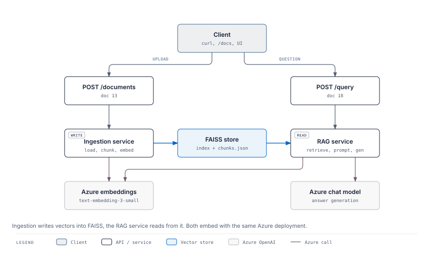

# Naive RAG Implementation

An end-to-end Naive RAG API built with FastAPI, Azure OpenAI (chat and `text-embedding-3-small` embeddings) and FAISS. Upload documents, then ask questions answered only from them, with citations.

Start with [docs/19. Naive RAG Architecture Overview](docs/19.%20Naive%20RAG%20Architecture%20Overview.md) for the big picture.



## Endpoints

<table width="100%">
<thead><tr><th>Method</th><th>Path</th><th>What it does</th><th>Doc</th></tr></thead>
<tbody>
<tr><td>GET</td><td>/health</td><td>API status and whether Azure chat and embedding settings are present</td><td>03</td></tr>
<tr><td>POST</td><td>/documents</td><td>Upload a .pdf, .xlsx, .docx, .txt or .md file and index it</td><td>13</td></tr>
<tr><td>POST</td><td>/query</td><td>Ask a question, get an answer with numbered sources</td><td>18</td></tr>
</tbody>
</table>

## Setup

1. Add these variables to the repository root `.env` (see `.env.example`):

<table width="100%">
<thead><tr><th>Variable</th><th>Example</th></tr></thead>
<tbody>
<tr><td>AZURE_OPENAI_ENDPOINT</td><td>https://your-resource.openai.azure.com/</td></tr>
<tr><td>AZURE_OPENAI_API_KEY</td><td>your key</td></tr>
<tr><td>AZURE_OPENAI_DEPLOYMENT_NAME</td><td>your chat deployment</td></tr>
<tr><td>AZURE_OPENAI_EMBEDDING_DEPLOYMENT</td><td>text-embedding-3-small</td></tr>
</tbody>
</table>

2. Install and run from this folder:

```bash
uv venv .venv --python 3.12
uv pip install -p .venv -r requirements.txt
.venv/bin/uvicorn app.main:app --reload
```

3. Open http://127.0.0.1:8000/docs to try the endpoints.

## Quick example

```bash
# Index the RAG paper
curl -F "file=@../papers/2005.11401_RAG-Lewis.pdf" http://127.0.0.1:8000/documents

# Ask a question
curl -X POST http://127.0.0.1:8000/query \
  -H "content-type: application/json" \
  -d '{"question": "Which retriever and generator does RAG combine?"}'
```

## Tests

```bash
.venv/bin/python -m pytest -q tests
```

All tests run offline: Azure calls are replaced with fakes.

## Docs

Each feature was built, documented and pushed as its own step. The docs explain why each choice was made and how the code works, with diagrams.

<table width="100%">
<thead><tr><th>Step</th><th>Doc</th></tr></thead>
<tbody>
<tr><td>01</td><td><a href="docs/01.%20Project%20Folder%20Structure.md">Project Folder Structure</a></td></tr>
<tr><td>02</td><td><a href="docs/02.%20Configuration%20and%20Settings.md">Configuration and Settings</a></td></tr>
<tr><td>03</td><td><a href="docs/03.%20FastAPI%20Application%20Setup.md">FastAPI Application Setup</a></td></tr>
<tr><td>04</td><td><a href="docs/04.%20PDF%20Loader.md">PDF Loader</a></td></tr>
<tr><td>05</td><td><a href="docs/05.%20Excel%20Loader.md">Excel Loader</a></td></tr>
<tr><td>06</td><td><a href="docs/06.%20Word%20Loader.md">Word Loader</a></td></tr>
<tr><td>07</td><td><a href="docs/07.%20Text%20and%20Markdown%20Loader.md">Text and Markdown Loader</a></td></tr>
<tr><td>08</td><td><a href="docs/08.%20File%20Loader%20Selection.md">File Loader Selection</a></td></tr>
<tr><td>09</td><td><a href="docs/09.%20Chunker.md">Chunker</a></td></tr>
<tr><td>10</td><td><a href="docs/10.%20Embeddings.md">Embeddings</a></td></tr>
<tr><td>11</td><td><a href="docs/11.%20FAISS%20Vector%20Store.md">FAISS Vector Store</a></td></tr>
<tr><td>12</td><td><a href="docs/12.%20Ingestion%20Service.md">Ingestion Service</a></td></tr>
<tr><td>13</td><td><a href="docs/13.%20Document%20Upload%20API.md">Document Upload API</a></td></tr>
<tr><td>14</td><td><a href="docs/14.%20Retriever.md">Retriever</a></td></tr>
<tr><td>15</td><td><a href="docs/15.%20Prompt%20Builder.md">Prompt Builder</a></td></tr>
<tr><td>16</td><td><a href="docs/16.%20Answer%20Generator.md">Answer Generator</a></td></tr>
<tr><td>17</td><td><a href="docs/17.%20RAG%20Service.md">RAG Service</a></td></tr>
<tr><td>18</td><td><a href="docs/18.%20Query%20API.md">Query API</a></td></tr>
<tr><td>19</td><td><a href="docs/19.%20Naive%20RAG%20Architecture%20Overview.md">Naive RAG Architecture Overview</a></td></tr>
</tbody>
</table>
