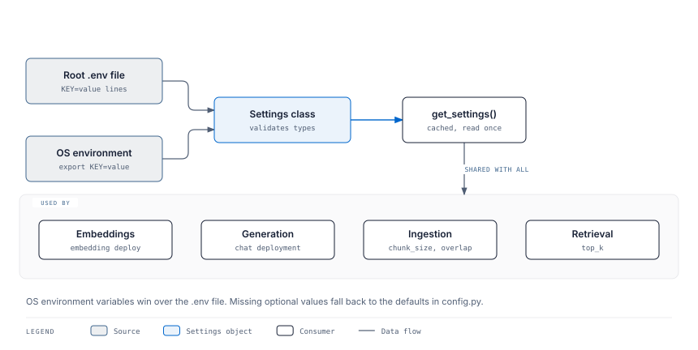
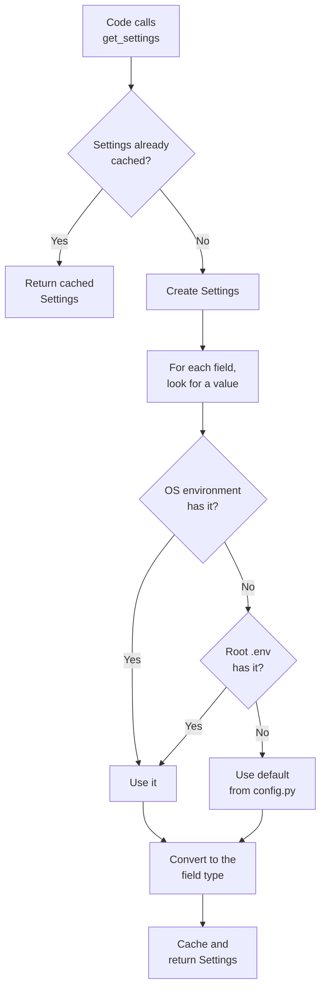
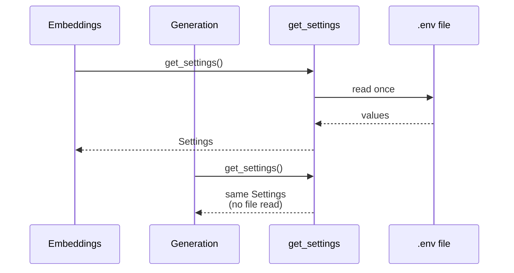

# 02. Configuration and Settings

In this doc:

- Why settings are kept outside the code
- Why pydantic-settings was chosen
- How a value travels from the .env file into the code
- Every setting, its default and who uses it
- How get_settings() caches the settings

File: [app/core/config.py](../app/core/config.py)

## Why settings live outside the code

API keys, endpoints and tuning values (chunk size, top-k) change between machines and experiments. If they were written inside the code:

- Secrets would be pushed to GitHub.
- Every experiment would need a code change.

So the code only reads **names** of settings. The **values** come from the repository root `.env` file, which git ignores.

## Why pydantic-settings

<table width="100%">
<thead><tr><th>Option</th><th>Reads .env</th><th>Type checking</th><th>Defaults in one place</th><th>Decision</th></tr></thead>
<tbody>
<tr><td>os.getenv everywhere</td><td>No (needs python-dotenv)</td><td>No, everything is a string</td><td>No, spread across files</td><td>Rejected</td></tr>
<tr><td>python-dotenv + manual parsing</td><td>Yes</td><td>Manual</td><td>Partly</td><td>Rejected</td></tr>
<tr><td>pydantic-settings</td><td>Yes</td><td>Yes, "4" becomes int 4, bad values raise an error at start</td><td>Yes, one Settings class</td><td>Chosen</td></tr>
</tbody>
</table>

pydantic-settings is also the approach FastAPI recommends, and it uses the same Pydantic library as our request and response schemas.

## How a value is loaded





### Step by step

1. `IMPLEMENTATION_DIR` is found from the location of `config.py` (two folders up). `REPO_ROOT` is two more folders up. This is where `.env` lives.
2. `Settings` lists every field with its type and default.
3. `model_config` tells pydantic-settings to read `REPO_ROOT/.env` and to ignore variables this app does not use (the shared `.env` may hold keys for other projects).
4. Field names match variable names without caring about case: field `azure_openai_endpoint` reads `AZURE_OPENAI_ENDPOINT`.
5. Each value is converted to the field type. `TOP_K=6` becomes the integer `6`. `TOP_K=abc` stops the app with a clear error.
6. `get_settings()` is wrapped with `lru_cache`, so the `.env` file is read only once and every module shares the same object.

## All settings

<table width="100%">
<thead><tr><th>Variable</th><th>Default</th><th>Required</th><th>Used by</th><th>Meaning</th></tr></thead>
<tbody>
<tr><td>AZURE_OPENAI_ENDPOINT</td><td>empty</td><td>Yes</td><td>Generation</td><td>URL of the Azure OpenAI resource</td></tr>
<tr><td>AZURE_OPENAI_API_KEY</td><td>empty</td><td>Yes</td><td>Generation</td><td>Secret key for Azure OpenAI</td></tr>
<tr><td>AZURE_OPENAI_DEPLOYMENT_NAME</td><td>empty</td><td>Yes</td><td>Generation</td><td>Name of the deployed chat model</td></tr>
<tr><td>AZURE_OPENAI_API_VERSION</td><td>2024-10-21</td><td>No</td><td>Generation</td><td>Azure OpenAI REST API version</td></tr>
<tr><td>OPENAI_API_KEY</td><td>empty</td><td>Yes (from embeddings step)</td><td>Embeddings</td><td>Secret key for the OpenAI embeddings API</td></tr>
<tr><td>OPENAI_EMBEDDING_MODEL</td><td>text-embedding-3-small</td><td>No</td><td>Embeddings</td><td>Embedding model name (1,536 dimensions)</td></tr>
<tr><td>CHUNK_SIZE</td><td>1000</td><td>No</td><td>Ingestion</td><td>Maximum characters per chunk (about 250 tokens)</td></tr>
<tr><td>CHUNK_OVERLAP</td><td>150</td><td>No</td><td>Ingestion</td><td>Characters repeated between neighbouring chunks</td></tr>
<tr><td>TOP_K</td><td>4</td><td>No</td><td>Retrieval</td><td>Number of chunks sent to the LLM</td></tr>
<tr><td>UPLOAD_DIR</td><td>data/uploads</td><td>No</td><td>Ingestion</td><td>Folder for uploaded files</td></tr>
<tr><td>INDEX_DIR</td><td>data/index</td><td>No</td><td>Vector store</td><td>Folder for the saved FAISS index</td></tr>
</tbody>
</table>

Required values have an empty default so the app can start for development. The module that needs a value checks it before calling the API and gives a clear error if it is missing.

## How other files use it

```python
# Imports
from app.core.config import get_settings


# Read the shared settings
settings = get_settings()

# Use a value
top_k = settings.top_k
```

## Why the cache matters



Without the cache, every call would read and parse the `.env` file again. With it, there is one read per app start, and all modules see the same values.

## Quick check

From `01. Naive RAG/implementation`:

```bash
.venv/bin/python -c "from app.core.config import get_settings; print(get_settings().top_k)"
```

Prints `4` (or the value of `TOP_K` in `.env`).
