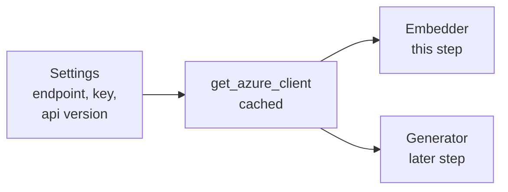
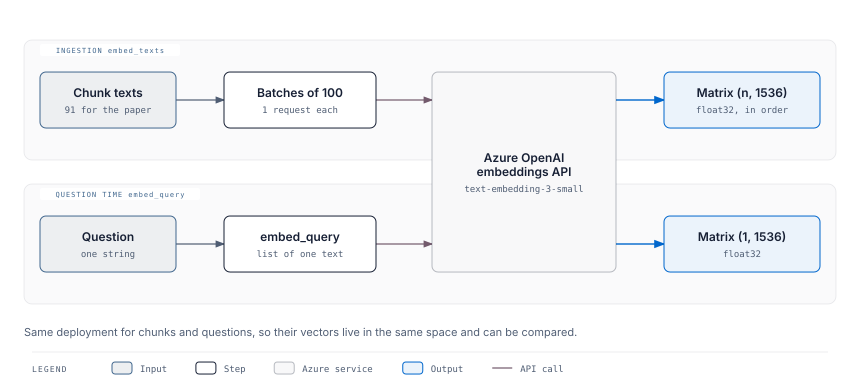
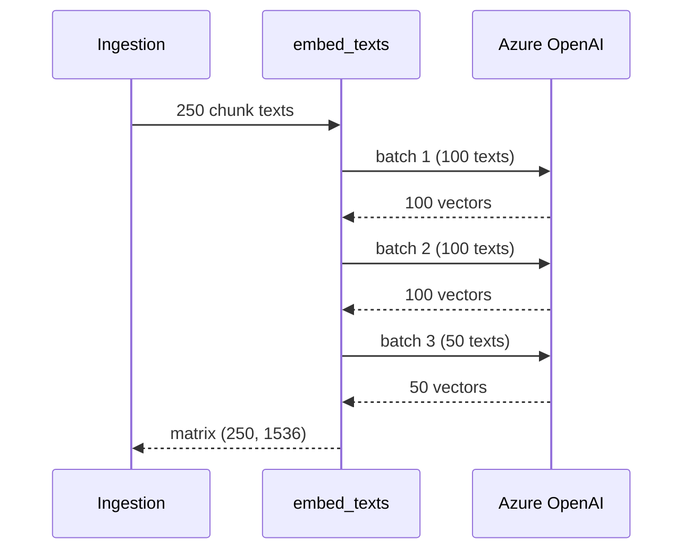

# 10. Embeddings

In this doc:

- Why Azure OpenAI text-embedding-3-small
- The shared Azure OpenAI client
- How embed_texts and embed_query work, step by step
- Why batching and why float32
- A real similarity check
- Offline tests with a fake client

Files:

- [app/core/azure_client.py](../app/core/azure_client.py)
- [app/embeddings/embedder.py](../app/embeddings/embedder.py)
- [tests/test_embedder.py](../tests/test_embedder.py)

Background: [notes 05. Embeddings](../../notes/01.%20Basic%20Concepts/05.%20Embeddings.md)

## Why text-embedding-3-small on Azure

<table width="100%">
<thead><tr><th>Property</th><th>Value</th><th>Why it matters</th></tr></thead>
<tbody>
<tr><td>Dimensions</td><td>1536</td><td>Rich enough for good retrieval, 6 KB per vector in float32</td></tr>
<tr><td>Max input</td><td>8,191 tokens</td><td>Our 1000-character chunks (about 250 tokens) fit easily</td></tr>
<tr><td>Vector length</td><td>Already normalised to 1</td><td>Dot product equals cosine similarity (notes 06)</td></tr>
<tr><td>Hosting</td><td>Same Azure OpenAI resource as the chat model</td><td>One endpoint, one key, data stays in the Azure tenant</td></tr>
<tr><td>Cost</td><td>The cheapest OpenAI embedding model</td><td>Re-indexing during experiments stays cheap</td></tr>
</tbody>
</table>

The deployment `text-embedding-3-small` was verified on the resource. `text-embedding-ada-002` and `text-embedding-3-large` are not deployed there.

## The shared Azure client

`get_azure_client()` creates one `AzureOpenAI` client from the endpoint, key and API version in settings, and caches it with `lru_cache`.

- One client means one HTTP connection pool reused by every request, which is faster than reconnecting each time.
- If the endpoint or key is missing it raises a clear `RuntimeError` instead of a confusing network error.

## How it works

### embed_texts, step by step

1. Read settings and get the shared client. Tests can pass their own fake `client`.
2. Walk through the texts in steps of `BATCH_SIZE = 100`.
3. Send each batch in one request: `client.embeddings.create(model=deployment, input=batch)`.
4. The API returns one embedding per input, in input order. Each vector is appended to `vectors`, so row `i` of the result always belongs to text `i`.
5. Convert the list to a NumPy array of type `float32` with shape `(number of texts, 1536)`.

### embed_query

`embed_query(question)` calls `embed_texts([question])` and returns a `(1, 1536)` matrix. Using the exact same function guarantees the question is embedded with the same model and settings as the chunks.

## Why batching

<table width="100%">
<thead><tr><th>Approach</th><th>Requests for 1,000 chunks</th><th>Problem</th></tr></thead>
<tbody>
<tr><td>One text per request</td><td>1,000</td><td>Slow: 1,000 network round trips, hits rate limits quickly</td></tr>
<tr><td>All texts in one request</td><td>1</td><td>API limit is 2,048 inputs and a token budget per request; one failure loses everything</td></tr>
<tr><td>Batches of 100</td><td>10</td><td>Chosen: few round trips, small safe requests</td></tr>
</tbody>
</table>

## Why float32

FAISS (next step) only accepts `float32` matrices. Python floats are 64-bit; converting here keeps memory at half (6 KB instead of 12 KB per vector) and avoids conversion errors later.

Memory for the index: `vectors x 1536 x 4 bytes`. 10,000 chunks take about 61 MB.

## Real similarity check

Three texts embedded with the real deployment:

<table width="100%">
<thead><tr><th>Pair</th><th>Dot product (= cosine)</th><th>Meaning</th></tr></thead>
<tbody>
<tr><td>"How many sick days do I get?" vs "Employees get 8 sick days per year."</td><td>0.657</td><td>Related: the chunk answers the question</td></tr>
<tr><td>"How many sick days do I get?" vs "Laptops are replaced every 3 years."</td><td>0.156</td><td>Unrelated</td></tr>
</tbody>
</table>

All three vectors had length 1.0 (rounded), confirming that the model returns normalised vectors.

## Tests

The tests never call Azure. A `FakeEmbeddings` object with the same `create(model, input)` method returns small fake vectors and records each batch size.

<table width="100%">
<thead><tr><th>Test</th><th>Checks</th></tr></thead>
<tbody>
<tr><td>test_embed_texts_batches_and_keeps_order</td><td>250 texts are sent as 100, 100, 50; output is (250, 3) float32; row 0 and row 249 match their texts</td></tr>
<tr><td>test_embed_query_returns_one_row</td><td>One question gives shape (1, 3)</td></tr>
</tbody>
</table>

## Dependencies added

<table width="100%">
<thead><tr><th>Package</th><th>Version</th><th>Why</th></tr></thead>
<tbody>
<tr><td>openai</td><td>1.59.7</td><td>AzureOpenAI client for embeddings and chat</td></tr>
<tr><td>numpy</td><td>2.2.1</td><td>float32 vector matrices for FAISS</td></tr>
</tbody>
</table>
