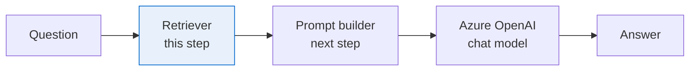
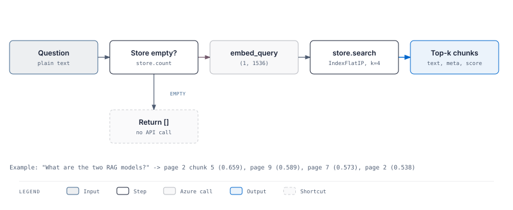
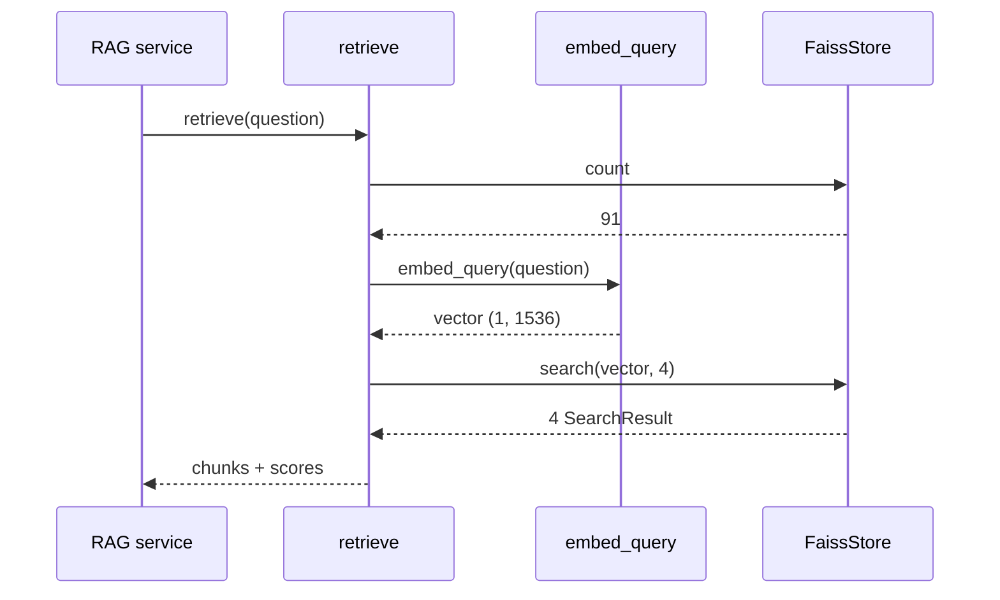

# 14. Retriever

In this doc:

- Where the retriever sits in the query pipeline
- How retrieve works, step by step
- Why top_k is 4
- Real results on the RAG paper and what they show
- Tests

Files:

- [app/retrieval/retriever.py](../app/retrieval/retriever.py)
- [tests/test_retriever.py](../tests/test_retriever.py)

Background: [notes 08. Retrieval](../../notes/01.%20Basic%20Concepts/08.%20Retrieval.md)

## Where it fits

The query pipeline has three parts. This step builds the first one.



## How it works



```python
results = retrieve("What are the two RAG models?")
```

### Step by step

1. `top_k` defaults to `TOP_K` from settings (4). The store defaults to the shared store from doc 12. Tests pass their own.
2. If the store is empty, return an empty list right away. No embedding call is made, so asking a question before uploading anything costs nothing.
3. `embed_query(question)` turns the question into a `(1, 1536)` vector using the **same** deployment as the chunks (doc 10). Vectors from different models cannot be compared.
4. `store.search(vector, top_k)` (doc 11) returns the `top_k` best `SearchResult` objects, best first, each with the chunk and its cosine score.



## Why top_k = 4

<table width="100%">
<thead><tr><th>top_k</th><th>Context sent to the LLM</th><th>Effect</th></tr></thead>
<tbody>
<tr><td>1 to 2</td><td>About 250 to 500 tokens</td><td>Cheap, but the answer chunk is often ranked 3rd or 4th and missed</td></tr>
<tr><td>4 (chosen)</td><td>About 1,000 tokens</td><td>Good recall for focused questions, little noise, low cost</td></tr>
<tr><td>10+</td><td>2,500+ tokens</td><td>Higher recall but more irrelevant text and higher cost</td></tr>
</tbody>
</table>

`TOP_K` is a setting, so it can be changed in `.env` and measured during evaluation.

## Real results on the RAG paper

With the paper indexed through `POST /documents` (91 chunks):

<table width="100%">
<thead><tr><th>Question</th><th>Rank</th><th>Score</th><th>Page, chunk</th><th>Contains the answer?</th></tr></thead>
<tbody>
<tr><td rowspan="4">What are the two RAG models?</td><td>1</td><td>0.659</td><td>p2, c5</td><td>Yes: start of Methods, introduces RAG-Sequence and RAG-Token</td></tr>
<tr><td>2</td><td>0.589</td><td>p9, c4</td><td>Partly: discussion summary</td></tr>
<tr><td>3</td><td>0.573</td><td>p7, c3</td><td>No: FEVER results</td></tr>
<tr><td>4</td><td>0.538</td><td>p2, c4</td><td>Partly: introduction</td></tr>
<tr><td rowspan="4">Which generator model does RAG use?</td><td>1</td><td>0.605</td><td>p2, c5</td><td>Partly: mentions the generator</td></tr>
<tr><td>2</td><td>0.579</td><td>p7, c3</td><td>No</td></tr>
<tr><td>3</td><td>0.573</td><td>p2, c4</td><td>Yes: "the seq2seq model (BART)"</td></tr>
<tr><td>4</td><td>0.538</td><td>p3, c0</td><td>Yes: Section 2.3, BART-large</td></tr>
</tbody>
</table>

What this shows about Naive RAG:

- The right chunks are usually **in** the top 4, but not always at rank 1. This is why k is more than 1.
- Scores are close together (0.54 to 0.66), so a fixed score threshold would be fragile. Re-ranking (folder 02) addresses this.
- Some retrieved chunks are noise (the FEVER chunk). The prompt builder (next step) tells the LLM to use only relevant context.

## Tests

<table width="100%">
<thead><tr><th>Test</th><th>Checks</th></tr></thead>
<tbody>
<tr><td>test_retrieve_returns_best_chunks_first</td><td>With a fixed fake question vector, the two leave chunks come back best first and the unrelated chunk is left out</td></tr>
<tr><td>test_retrieve_on_empty_store_skips_embedding</td><td>An empty store returns [] and never calls the embedding model</td></tr>
</tbody>
</table>

No new dependencies.
