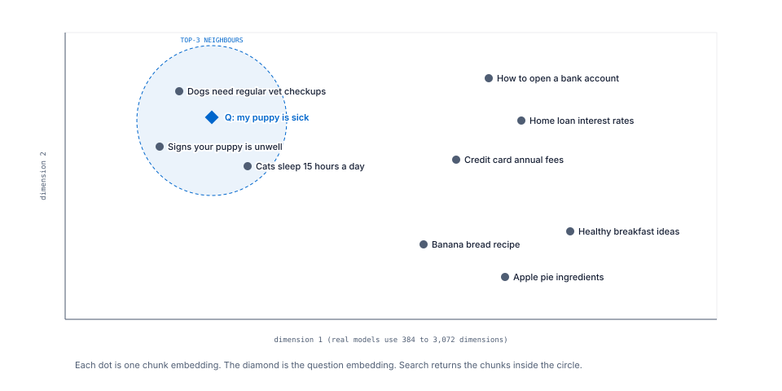
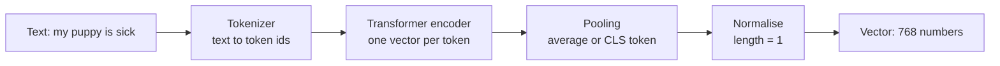
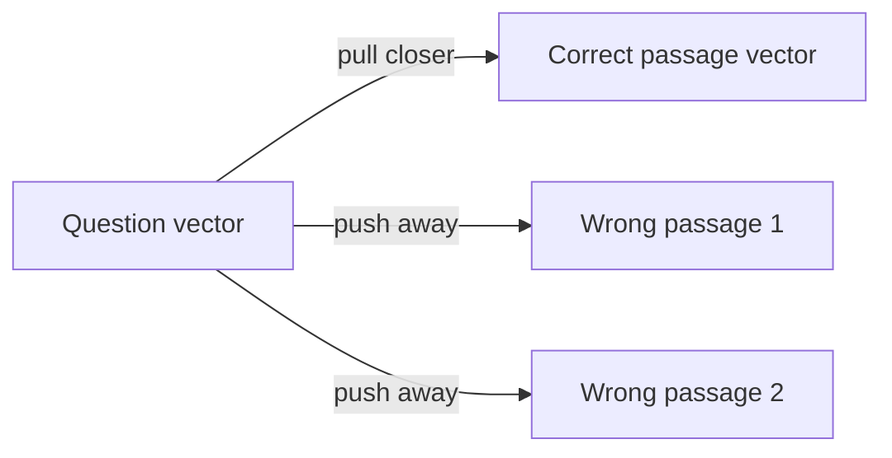
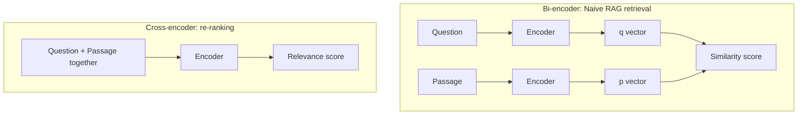

# 05. Embeddings

In this note:

- What an embedding is
- Why similar meaning gives nearby vectors
- How an embedding model turns text into a vector
- Dimensions, normalisation and model choice
- Dense vs sparse vectors
- Bi-encoder vs cross-encoder

## What is an embedding

An **embedding** is a list of numbers (a **vector**) that represents the meaning of a piece of text.

```text
"Signs your puppy is unwell"  ->  [0.12, -0.48, 0.33, 0.05, ..., -0.21]   (for example 768 numbers)
```

The key property: **texts with similar meaning get vectors that are close together**, even when they use different words.

<table width="100%">
<thead><tr><th>Text A</th><th>Text B</th><th>Shared words</th><th>Meaning</th><th>Vector distance</th></tr></thead>
<tbody>
<tr><td>my puppy is sick</td><td>signs your dog is unwell</td><td>none (except is)</td><td>Same topic</td><td>Close</td></tr>
<tr><td>my puppy is sick</td><td>home loan interest rates</td><td>none</td><td>Different topic</td><td>Far</td></tr>
<tr><td>bank of a river</td><td>bank account</td><td>bank</td><td>Different meaning</td><td>Farther than keyword overlap suggests</td></tr>
</tbody>
</table>

This is why embeddings power **semantic search**: search by meaning, not by exact keyword.

## Picture it as points in space

Each vector is a point in a space with many dimensions. In the picture below we squash it to 2 dimensions so we can see it. Topics form clusters. The question becomes a point too, and search returns its nearest neighbours.



## How an embedding model works

An embedding model is a neural network (usually a Transformer encoder like BERT) trained so that related texts land close and unrelated texts land far apart.



1. **Tokenize**: split text into tokens and map each to an id.
2. **Encode**: the Transformer reads all tokens together and produces one vector per token. Each token vector now carries context ("bank" near "river" differs from "bank" near "loan").
3. **Pool**: combine token vectors into one vector for the whole text (average them, or take the special [CLS] token vector).
4. **Normalise**: scale the vector to length 1, so similarity depends only on direction.

### How it learns: contrastive training

The model sees pairs: a question and a passage that answers it (positive), plus passages that do not (negatives). Training pulls positive pairs together and pushes negatives apart.



DPR, the retriever in the original RAG paper, was trained exactly like this on question and answer-passage pairs.

## Dimensions

The **dimension** is how many numbers are in the vector.

<table width="100%">
<thead><tr><th>Dimension</th><th>Example models</th><th>Storage per 1M vectors (float32)</th><th>Comment</th></tr></thead>
<tbody>
<tr><td>384</td><td>all-MiniLM-L6-v2, bge-small</td><td>about 1.5 GB</td><td>Fast, cheap, good for prototypes</td></tr>
<tr><td>768</td><td>BERT-base, DPR, bge-base, nomic-embed</td><td>about 3 GB</td><td>Classic size, used in the RAG paper</td></tr>
<tr><td>1,024</td><td>bge-large, e5-large, Cohere embed v3</td><td>about 4 GB</td><td>Higher quality, more cost</td></tr>
<tr><td>1,536 to 3,072</td><td>OpenAI text-embedding-3-small / large</td><td>about 6 to 12 GB</td><td>Strong quality, API based</td></tr>
</tbody>
</table>

Storage formula: number of vectors x dimension x 4 bytes (float32). For 1,000,000 x 768 x 4 = 3,072,000,000 bytes, about 3 GB.

More dimensions can hold more detail but cost more storage and slower search. Some models support **shortening** (Matryoshka embeddings) so you can keep the first 256 or 512 numbers with small quality loss.

## Choosing an embedding model

<table width="100%">
<thead><tr><th>Factor</th><th>Question to ask</th></tr></thead>
<tbody>
<tr><td>Quality</td><td>How does it rank on the MTEB retrieval benchmark, and more important, on my own evaluation set?</td></tr>
<tr><td>Language</td><td>Does it support all languages in my documents and questions?</td></tr>
<tr><td>Domain</td><td>Is there a model tuned for my domain (legal, medical, code)?</td></tr>
<tr><td>Max input length</td><td>Does it accept my chunk size?</td></tr>
<tr><td>Hosting</td><td>API (no servers, data leaves your network) or open-source (self-host, full control)?</td></tr>
<tr><td>Cost and speed</td><td>Price per million tokens, or GPU cost to self-host?</td></tr>
</tbody>
</table>

**Golden rule: use the same embedding model for indexing and for questions.** Vectors from different models live in different spaces and cannot be compared. If you change the model, you must re-embed the whole corpus.

## Dense vs sparse vectors

<table width="100%">
<thead><tr><th>Type</th><th>What the numbers mean</th><th>Example</th><th>Strong at</th><th>Weak at</th></tr></thead>
<tbody>
<tr><td>Dense</td><td>Hundreds of numbers, all non-zero, no single number has a human meaning</td><td>DPR, OpenAI embeddings, bge</td><td>Synonyms, paraphrases, meaning</td><td>Exact codes, rare names, IDs</td></tr>
<tr><td>Sparse</td><td>One slot per vocabulary word, mostly zeros, non-zero where the word appears</td><td>TF-IDF, BM25, SPLADE</td><td>Exact keywords, product codes, names</td><td>Synonyms ("car" vs "automobile")</td></tr>
</tbody>
</table>

Naive RAG usually uses only dense vectors. Combining both is **Hybrid Search** (folder 03).

## Bi-encoder vs cross-encoder

<table width="100%">
<thead><tr><th>Model type</th><th>How it scores a question and a passage</th><th>Speed</th><th>Accuracy</th><th>Used for</th></tr></thead>
<tbody>
<tr><td>Bi-encoder</td><td>Encodes each one separately into a vector, then compares the vectors</td><td>Very fast: passage vectors are computed once, ahead of time</td><td>Good</td><td>First-stage retrieval over millions of chunks</td></tr>
<tr><td>Cross-encoder</td><td>Reads question and passage together in one model pass, outputs one relevance score</td><td>Slow: must run for every pair at query time</td><td>Better</td><td>Re-ranking a short list (folder 02)</td></tr>
</tbody>
</table>



## Key points

- An embedding is a vector that captures meaning. Similar meaning, nearby vectors.
- Embedding models are trained with contrastive learning on related and unrelated pairs.
- Always use the same model for chunks and questions.
- Dense vectors capture meaning, sparse vectors capture exact words.
- Naive RAG retrieval uses a fast bi-encoder.

## Navigation

Previous: [04. Chunking](04.%20Chunking.md) | [Index](README.md) | Next: [06. Similarity Measures](06.%20Similarity%20Measures.md)
