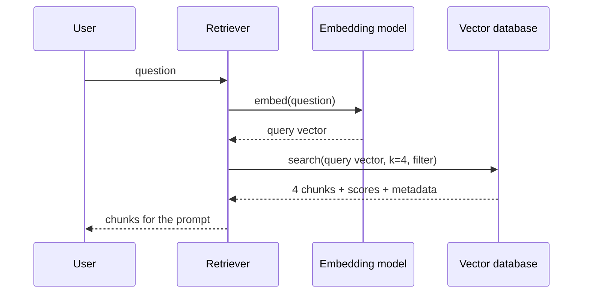

# 08. Retrieval

In this note:

- What the retriever does at question time
- Choosing k (how many chunks)
- Similarity score thresholds
- Dense, sparse and hybrid retrieval in one view
- Maximal Marginal Relevance (MMR) for diversity
- What can go wrong in retrieval

## The retriever's job

The **retriever** takes the user question and returns the most relevant chunks from the vector database. In Naive RAG it does exactly three things:

1. Embed the question with the **same** model used for chunks.
2. Search the vector index for the top-k nearest chunk vectors.
3. Return chunk text, scores and metadata.

## Choosing k

**k** is the number of chunks returned.

<table width="100%">
<thead><tr><th>k</th><th>Effect on recall (finding the right chunk)</th><th>Effect on precision (avoiding noise)</th><th>Cost and latency</th></tr></thead>
<tbody>
<tr><td>Small (1 to 3)</td><td>Lower: the right chunk may be ranked 4th and missed</td><td>High: little noise</td><td>Low</td></tr>
<tr><td>Medium (4 to 8)</td><td>Good</td><td>Good</td><td>Moderate. Common default.</td></tr>
<tr><td>Large (10 to 50)</td><td>High</td><td>Low: many irrelevant chunks, "lost in the middle" risk</td><td>High</td></tr>
</tbody>
</table>

The RAG paper retrieved 5 or 10 documents during training, and found that for RAG-Sequence, retrieving more documents at test time kept improving question answering, while RAG-Token peaked at 10. A good practical start is k = 4 to 5, then tune with evaluation.

A useful pattern for later architectures: retrieve a larger k (like 20 to 50) for high recall, then **re-rank** and keep the best 3 to 5 (folder 02).

## Score thresholds

Top-k always returns k chunks, **even when none are relevant**. If the user asks "What is the weather today?" in an HR bot, top-k still returns 4 HR chunks.

A **similarity threshold** drops chunks whose score is below a minimum (for example cosine below 0.5).

<table width="100%">
<thead><tr><th>Approach</th><th>Behaviour</th><th>Risk</th></tr></thead>
<tbody>
<tr><td>Top-k only</td><td>Always k chunks</td><td>Irrelevant context when nothing matches</td></tr>
<tr><td>Threshold only</td><td>Variable number of chunks, maybe zero</td><td>Too many chunks if threshold is low</td></tr>
<tr><td>Top-k + threshold</td><td>At most k, only if score is high enough</td><td>Threshold must be tuned per embedding model</td></tr>
</tbody>
</table>

Score scales differ between embedding models. A cosine of 0.75 can mean "very relevant" for one model and "weak" for another. Tune thresholds on your own data.

If no chunk passes, the system should say "I could not find this in the documents" instead of calling the LLM with no context.

## Retrieval types in one view

<table width="100%">
<thead><tr><th>Type</th><th>How it matches</th><th>Example query it handles well</th><th>Covered in</th></tr></thead>
<tbody>
<tr><td>Dense (semantic)</td><td>Embedding similarity</td><td>"How do I get money back for a faulty item?" matches "refund policy"</td><td>This folder (Naive RAG)</td></tr>
<tr><td>Sparse (lexical)</td><td>Keyword overlap, BM25 scoring</td><td>"Error code E-4021"</td><td>Folder 03</td></tr>
<tr><td>Hybrid</td><td>Both, then fuse the rankings</td><td>Mixed natural language + codes</td><td>Folder 03</td></tr>
</tbody>
</table>

### BM25 in one line

BM25 is the classic keyword scoring formula. It gives a high score when the query words appear often in the chunk (term frequency), the words are rare across the whole corpus (inverse document frequency), and it does not over-reward very long chunks (length normalisation). The RAG paper compared its dense retriever with BM25: dense was better on most tasks, BM25 was best on FEVER, where claims are full of entity names.

## Maximal Marginal Relevance (MMR)

Top-k can return near-duplicate chunks (the same paragraph from three versions of a document). **MMR** picks chunks that are relevant to the question **and** different from chunks already picked.

$$\text{MMR} = \arg\max_{c \in C \setminus S} \Big[ \lambda \cdot \text{sim}(c, q) - (1 - \lambda) \cdot \max_{s \in S} \text{sim}(c, s) \Big]$$

Symbol by symbol:

<table width="100%">
<thead><tr><th>Symbol</th><th>Meaning</th></tr></thead>
<tbody>
<tr><td>q</td><td>The question vector</td></tr>
<tr><td>C</td><td>Candidate chunks (for example the top 20)</td></tr>
<tr><td>S</td><td>Chunks already selected</td></tr>
<tr><td>c</td><td>A candidate chunk being considered</td></tr>
<tr><td>sim(c, q)</td><td>How relevant c is to the question</td></tr>
<tr><td>max sim(c, s)</td><td>How similar c is to the most similar already-selected chunk (redundancy)</td></tr>
<tr><td>lambda (0 to 1)</td><td>Balance: 1 = only relevance (plain top-k), 0 = only diversity. Typical 0.5 to 0.7.</td></tr>
</tbody>
</table>

In words: repeatedly pick the chunk with the best "relevance minus redundancy" score until you have k chunks.

## What can go wrong in retrieval

<table width="100%">
<thead><tr><th>Failure</th><th>Example</th><th>Typical fix (later folders)</th></tr></thead>
<tbody>
<tr><td>Vocabulary mismatch</td><td>User says "PTO", documents say "paid leave"</td><td>Query rewriting (02), HyDE (04)</td></tr>
<tr><td>Exact term missed</td><td>Product code not matched by dense vectors</td><td>Hybrid search (03)</td></tr>
<tr><td>Right chunk ranked low</td><td>Answer chunk at position 7 with k = 4</td><td>Re-ranking (02), RAG-Fusion (05)</td></tr>
<tr><td>Answer split across chunks</td><td>Policy and its exception in different chunks</td><td>Better chunking (06), parent-child retrieval</td></tr>
<tr><td>Multi-hop question</td><td>"Who manages the team that owns product X?"</td><td>Iterative RAG (11), Graph RAG (13)</td></tr>
<tr><td>Nothing relevant exists</td><td>Question outside the knowledge base</td><td>Thresholds, Corrective RAG web fallback (09)</td></tr>
</tbody>
</table>

## Key points

- The retriever embeds the question and returns the top-k chunks with scores and metadata.
- k trades recall for precision. Start around 4 to 5.
- Top-k always returns something. Add a threshold to avoid irrelevant context.
- MMR adds diversity. Hybrid adds keyword strength. Both are easy upgrades.

## Navigation

Previous: [07. Vector Databases and Indexing](07.%20Vector%20Databases%20and%20Indexing.md) | [Index](README.md) | Next: [09. Prompt Augmentation and Generation](09.%20Prompt%20Augmentation%20and%20Generation.md)
