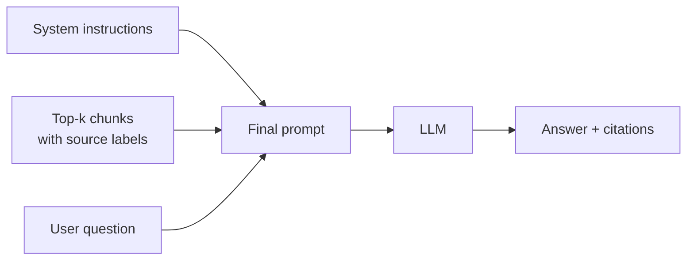

# 09. Prompt Augmentation and Generation

In this note:

- What "augmentation" means in practice
- The parts of a RAG prompt and a full template
- Grounding rules, citations and "I do not know"
- Ordering and formatting the context
- Generation settings: temperature, max tokens
- Context budget arithmetic

## Augmentation: putting context into the prompt

**Augmentation** is the step where retrieved chunks are inserted into the prompt together with the question. This is called **context stuffing** in Naive RAG: all top-k chunks go into one prompt, and the LLM is called once.



## Parts of a RAG prompt

<table width="100%">
<thead><tr><th>Part</th><th>Purpose</th><th>Example</th></tr></thead>
<tbody>
<tr><td>Role</td><td>Sets behaviour and tone</td><td>You are a helpful HR assistant.</td></tr>
<tr><td>Grounding rule</td><td>Answer only from the context</td><td>Use only the information in the context below.</td></tr>
<tr><td>Fallback rule</td><td>What to do if the answer is missing</td><td>If the context does not contain the answer, say you do not know.</td></tr>
<tr><td>Citation rule</td><td>Make answers traceable</td><td>Cite sources as [1], [2] after each fact.</td></tr>
<tr><td>Context</td><td>The retrieved chunks, numbered, with source</td><td>[1] (hr_policy.pdf, p.4) Employees get 8 sick days...</td></tr>
<tr><td>Question</td><td>The user's question</td><td>How many sick days do I get?</td></tr>
<tr><td>Output format</td><td>Shape of the answer</td><td>Answer in 2 to 4 sentences.</td></tr>
</tbody>
</table>

## A full prompt template

```text
SYSTEM:
You are a helpful assistant that answers questions about company policies.
Rules:
1. Use ONLY the information in the CONTEXT section.
2. If the CONTEXT does not contain the answer, reply exactly:
   "I could not find this in the provided documents."
3. After each fact, cite the source number in square brackets, like [2].
4. Be concise: 2 to 4 sentences.

CONTEXT:
[1] (source: hr_policy.pdf, page 4, section 4.3)
Employees get 8 sick days per year. A doctor's note is needed after 2 days.

[2] (source: hr_policy.pdf, page 4, section 4.2)
New joiners get 12 days of paid leave in the first year.

USER QUESTION:
How many sick days do I get, and when do I need a doctor's note?
```

Expected answer:

```text
You get 8 sick days per year [1]. A doctor's note is needed if you are sick for more than 2 days [1].
```

## Why each rule matters

<table width="100%">
<thead><tr><th>Rule</th><th>Without it</th><th>With it</th></tr></thead>
<tbody>
<tr><td>Use only the context</td><td>Model mixes in training memory, which may be outdated or wrong</td><td>Answers stay tied to your documents</td></tr>
<tr><td>Say "I do not know"</td><td>Model invents an answer when retrieval failed</td><td>Honest failure, easy to detect and log</td></tr>
<tr><td>Cite sources</td><td>User cannot verify, hard to debug</td><td>Trust, verification, faster debugging</td></tr>
<tr><td>Numbered, labelled chunks</td><td>Model cannot refer to a specific chunk</td><td>Clean citations, clear separation between chunks</td></tr>
</tbody>
</table>

## Ordering and formatting the context

- **Order by relevance.** Put the best chunk first. Models also attend well to the end of a prompt, so some systems put the best chunks at the start and the end, weaker ones in the middle ("lost in the middle" effect).
- **Separate chunks clearly** with numbers and blank lines, or XML-style tags like `<doc id="1">...</doc>`.
- **Include source metadata** inside each chunk header so the model can cite it.
- **Remove duplicates** before stuffing. Duplicates waste tokens and over-weight one source.

## Generation settings

<table width="100%">
<thead><tr><th>Setting</th><th>What it controls</th><th>Recommended for RAG</th></tr></thead>
<tbody>
<tr><td>temperature</td><td>Randomness of token choice. 0 = always the most likely token.</td><td>0 to 0.3 for factual answers</td></tr>
<tr><td>max_tokens</td><td>Maximum length of the answer</td><td>Enough for the expected answer, for example 300 to 800</td></tr>
<tr><td>top_p</td><td>Only sample from the most likely tokens whose total probability is p</td><td>Leave default when temperature is low</td></tr>
<tr><td>stop sequences</td><td>Text that ends generation</td><td>Optional</td></tr>
</tbody>
</table>

### Temperature in one formula

The model produces a score $z_i$ for every token $i$. Temperature $T$ changes how sharp the probabilities are:

$$p_i = \frac{e^{z_i / T}}{\sum_j e^{z_j / T}}$$

- Small $T$ (like 0.1): the top token gets almost all the probability, output is stable and repeatable.
- Large $T$ (like 1.0+): probabilities spread out, output is more varied and creative, and more likely to drift from the facts.

## Context budget arithmetic

Everything must fit in the context window:

$$\text{system} + k \times \text{chunk size} + \text{question} + \text{max answer} \le \text{context window}$$

Example: system prompt 300 tokens, k = 5 chunks of 500 tokens, question 50 tokens, answer up to 500 tokens.

300 + 5 x 500 + 50 + 500 = **3,350 tokens**. This fits easily in a 128K window, and keeps cost low.

Cost per question = input tokens x input price + output tokens x output price. Fewer, better chunks lower both cost and latency.

## Streaming

LLM APIs can **stream** the answer token by token. The user sees text immediately instead of waiting for the full answer. This does not change quality but greatly improves perceived speed. Citations or sources can be sent with or after the stream.

## Key points

- Augmentation = put numbered, labelled chunks and the question into one prompt.
- Always add grounding, fallback and citation rules.
- Order chunks by relevance, remove duplicates, separate them clearly.
- Use low temperature for factual RAG answers.
- Check the token budget: system + chunks + question + answer must fit the window.

## Navigation

Previous: [08. Retrieval](08.%20Retrieval.md) | [Index](README.md) | Next: [10. Naive RAG Architecture End to End](10.%20Naive%20RAG%20Architecture%20End%20to%20End.md)
