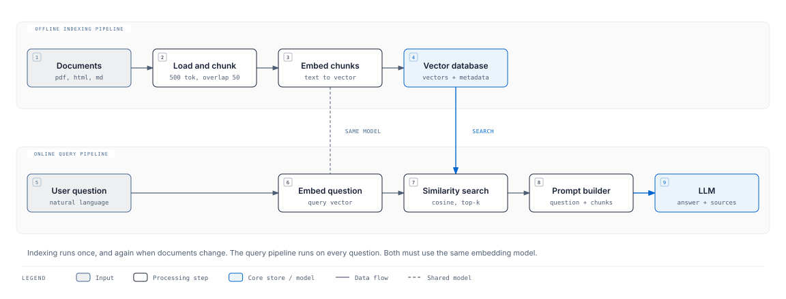
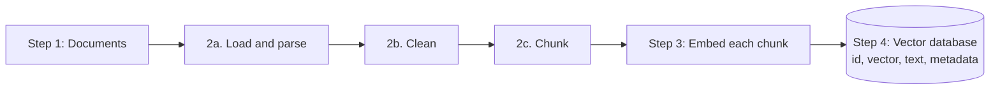
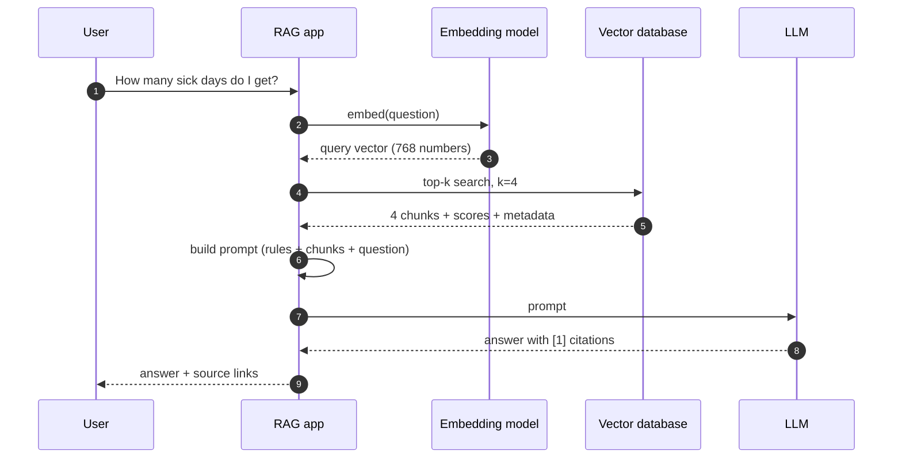

# 10. Naive RAG Architecture End to End

In this note:

- The full Naive RAG architecture in one diagram
- The offline indexing pipeline step by step
- The online query pipeline step by step
- One question traced through the whole system with real data shapes
- Components, technology choices and the settings to tune

## The full picture

Naive RAG has **two pipelines** that share one embedding model and one vector database.



<table width="100%">
<thead><tr><th>Pipeline</th><th>When it runs</th><th>Input</th><th>Output</th><th>Steps in diagram</th></tr></thead>
<tbody>
<tr><td>Offline indexing</td><td>Once at setup, then when documents change</td><td>Raw documents</td><td>Filled vector database</td><td>1 to 4</td></tr>
<tr><td>Online query</td><td>On every user question</td><td>User question</td><td>Grounded answer with sources</td><td>5 to 9</td></tr>
</tbody>
</table>

## Offline indexing pipeline



<table width="100%">
<thead><tr><th>Step</th><th>What happens</th><th>Data shape after the step</th><th>Note</th></tr></thead>
<tbody>
<tr><td>1. Documents</td><td>Collect source files and pages</td><td>Files: hr_policy.pdf, benefits.docx</td><td>03</td></tr>
<tr><td>2a. Load and parse</td><td>Extract text and metadata from each file</td><td>List of Document(text, metadata)</td><td>03</td></tr>
<tr><td>2b. Clean</td><td>Remove headers, fix spacing, drop duplicates</td><td>Same list, cleaner text</td><td>03</td></tr>
<tr><td>2c. Chunk</td><td>Split into chunks of about 500 tokens, overlap 50</td><td>List of chunks, each with metadata and chunk_id</td><td>04</td></tr>
<tr><td>3. Embed</td><td>Embedding model turns each chunk into a vector (batched)</td><td>N vectors of dimension d, for example 1,200 x 768</td><td>05</td></tr>
<tr><td>4. Store</td><td>Insert id, vector, text, metadata; build the ANN index (HNSW)</td><td>Searchable vector index</td><td>07</td></tr>
</tbody>
</table>

## Online query pipeline



<table width="100%">
<thead><tr><th>Step</th><th>What happens</th><th>Typical latency</th><th>Note</th></tr></thead>
<tbody>
<tr><td>5. User question</td><td>Question arrives through UI or API</td><td>-</td><td>-</td></tr>
<tr><td>6. Embed question</td><td>Same embedding model as indexing</td><td>10 to 100 ms</td><td>05</td></tr>
<tr><td>7. Similarity search</td><td>ANN top-k search, optional metadata filter and threshold</td><td>5 to 50 ms</td><td>06, 07, 08</td></tr>
<tr><td>8. Prompt builder</td><td>Number chunks, add sources, add rules and question</td><td>under 5 ms</td><td>09</td></tr>
<tr><td>9. LLM</td><td>Generate grounded answer with citations</td><td>0.5 to 5 s (most of the total)</td><td>09</td></tr>
</tbody>
</table>

The LLM call dominates latency and cost. Retrieval is usually fast.

## One question traced end to end

**Setup (indexing already done):** the HR policy PDF was split into chunks. Three of them:

<table width="100%">
<thead><tr><th>chunk_id</th><th>text</th><th>metadata</th></tr></thead>
<tbody>
<tr><td>hr_c1</td><td>Section 4.2 Leave. New joiners get 12 days of paid leave in the first year.</td><td>hr_policy.pdf, p.4</td></tr>
<tr><td>hr_c2</td><td>Section 4.3 Sick leave. Employees get 8 sick days per year. A doctor's note is needed after 2 days.</td><td>hr_policy.pdf, p.4</td></tr>
<tr><td>it_c7</td><td>Laptops are replaced every 3 years. Raise a ticket in the IT portal.</td><td>it_handbook.pdf, p.2</td></tr>
</tbody>
</table>

**Step 5.** User asks: "How many sick days do I get?"

**Step 6.** Embedding model returns the query vector, for example (0.9, 0.1, 0.2, ...).

**Step 7.** Vector search with cosine similarity, k = 2:

<table width="100%">
<thead><tr><th>Rank</th><th>chunk_id</th><th>cosine score</th><th>Kept</th></tr></thead>
<tbody>
<tr><td>1</td><td>hr_c2</td><td>0.89</td><td>Yes</td></tr>
<tr><td>2</td><td>hr_c1</td><td>0.71</td><td>Yes</td></tr>
<tr><td>3</td><td>it_c7</td><td>0.12</td><td>No (outside top-2)</td></tr>
</tbody>
</table>

**Step 8.** Prompt built:

```text
Use ONLY the context. If the answer is missing, say you do not know. Cite sources like [1].

CONTEXT:
[1] (hr_policy.pdf, p.4) Section 4.3 Sick leave. Employees get 8 sick days per year. A doctor's note is needed after 2 days.
[2] (hr_policy.pdf, p.4) Section 4.2 Leave. New joiners get 12 days of paid leave in the first year.

QUESTION: How many sick days do I get?
```

**Step 9.** LLM answer: "You get 8 sick days per year [1]. A doctor's note is needed after 2 days of sick leave [1]."

The app shows the answer and a link to hr_policy.pdf page 4.

## Components and technology choices

<table width="100%">
<thead><tr><th>Component</th><th>Role</th><th>Common choices</th></tr></thead>
<tbody>
<tr><td>Document loaders</td><td>Read files and sources</td><td>LangChain / LlamaIndex loaders, Unstructured, PyMuPDF</td></tr>
<tr><td>Text splitter</td><td>Create chunks</td><td>RecursiveCharacterTextSplitter, token-based splitters</td></tr>
<tr><td>Embedding model</td><td>Text to vector</td><td>OpenAI text-embedding-3, Cohere embed, bge, e5, nomic-embed</td></tr>
<tr><td>Vector database</td><td>Store and search vectors</td><td>Chroma, FAISS, Qdrant, pgvector, Pinecone, Weaviate, Milvus</td></tr>
<tr><td>LLM</td><td>Generate answers</td><td>Claude, GPT, Gemini, Llama, Mistral, Qwen</td></tr>
<tr><td>Orchestration</td><td>Glue the steps together</td><td>Plain Python, LangChain, LlamaIndex, Haystack</td></tr>
<tr><td>Evaluation</td><td>Measure quality</td><td>RAGAS, custom test set, LLM-as-judge</td></tr>
<tr><td>Interface</td><td>Let users ask questions</td><td>FastAPI, Streamlit, Gradio, chat UI</td></tr>
</tbody>
</table>

## Settings to tune

<table width="100%">
<thead><tr><th>Setting</th><th>Starting value</th><th>Raise it when</th><th>Lower it when</th></tr></thead>
<tbody>
<tr><td>chunk_size</td><td>500 tokens</td><td>Answers need more surrounding context</td><td>Retrieved chunks contain lots of unrelated text</td></tr>
<tr><td>chunk_overlap</td><td>50 tokens</td><td>Facts get split at boundaries</td><td>Too many duplicate results</td></tr>
<tr><td>k</td><td>4</td><td>The right chunk is often just outside the top-k</td><td>Answers get distracted by noise</td></tr>
<tr><td>similarity threshold</td><td>none, then tune</td><td>Off-topic questions get confident answers</td><td>Valid questions get "I do not know"</td></tr>
<tr><td>temperature</td><td>0 to 0.2</td><td>Need more varied wording</td><td>Answers drift from the facts</td></tr>
</tbody>
</table>

## Code shape (preview of the implementation)

```python
# Indexing (offline)
docs = load_documents("data/")
chunks = split(docs, chunk_size=500, chunk_overlap=50)
vectors = embed([c.text for c in chunks])
vector_db.add(ids=[c.id for c in chunks], vectors=vectors,
              texts=[c.text for c in chunks], metadata=[c.metadata for c in chunks])

# Query (online)
def answer(question: str, k: int = 4) -> str:
    q_vec = embed([question])[0]
    hits = vector_db.search(q_vec, k=k)
    prompt = build_prompt(question, hits)
    return llm.generate(prompt, temperature=0)
```

The full end-to-end implementation will be added in this folder after the notes.

## Key points

- Two pipelines: offline indexing (load, chunk, embed, store) and online query (embed, search, prompt, generate).
- Both pipelines must use the same embedding model.
- The LLM call is the slowest and most expensive step.
- Chunk size, overlap, k, threshold and temperature are the main tuning knobs.

## Navigation

Previous: [09. Prompt Augmentation and Generation](09.%20Prompt%20Augmentation%20and%20Generation.md) | [Index](README.md) | Next: [11. Evaluation Basics](11.%20Evaluation%20Basics.md)
