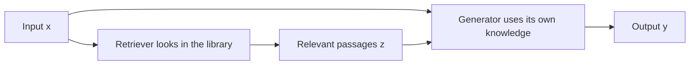
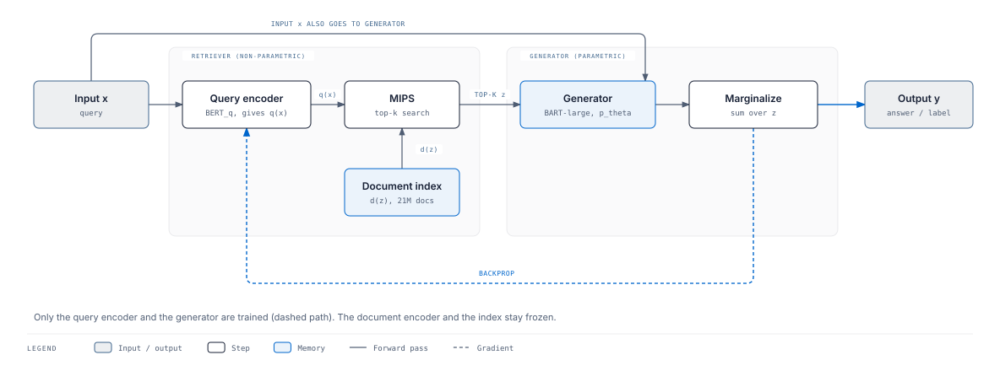

# 01. Abstract and Introduction

In this note:

- The problem the paper solves
- Parametric memory vs non-parametric memory
- Figure 1 redrawn and explained part by part
- The main contributions and claims

## 1. The Problem in Simple Words

Pre-trained language models such as BART, T5 and GPT learn a lot of facts during training. The facts are stored inside the model weights. The paper calls this an "implicit knowledge base". It works surprisingly well, but it has four problems:

<table width="100%">
<thead><tr><th>Problem</th><th>What it means</th><th>Example</th></tr></thead>
<tbody>
<tr><td>Cannot update easily</td><td>To change a fact you must retrain or fine-tune the model</td><td>A new president is elected; the model still names the old one</td></tr>
<tr><td>No provenance</td><td>The model cannot show which source supports its answer</td><td>You cannot check where "Paris is the capital" came from</td></tr>
<tr><td>Hallucination</td><td>The model produces fluent text that is factually wrong</td><td>"The middle ear is between the middle ear and the nose"</td></tr>
<tr><td>Weak on knowledge-intensive tasks</td><td>Tasks that need precise facts lag behind task-specific systems</td><td>Open-domain question answering</td></tr>
</tbody>
</table>

"Knowledge-intensive tasks" are tasks that a human could not reasonably do without looking something up, for example answering trivia questions or verifying a claim against Wikipedia.

## 2. Two Kinds of Memory

The core idea of the paper is to combine two kinds of memory.

<table width="100%">
<thead><tr><th>Memory type</th><th>Where knowledge lives</th><th>In this paper</th><th>Strength</th><th>Weakness</th></tr></thead>
<tbody>
<tr><td>Parametric</td><td>Inside model weights (parameters)</td><td>BART generator, parameters theta</td><td>Fluent language, general knowledge, reasoning</td><td>Hard to update, no sources, can hallucinate</td></tr>
<tr><td>Non-parametric</td><td>Outside the model, in a searchable store</td><td>Dense vector index of 21M Wikipedia passages</td><td>Easy to update, inspectable, exact facts</td><td>Needs a good retriever to find the right text</td></tr>
</tbody>
</table>

Analogy: parametric memory is what a student remembers in their head. Non-parametric memory is the textbook they are allowed to open during an open-book exam. RAG lets the model take an open-book exam.

## 3. What Existed Before

Earlier hybrid models already combined a language model with retrieval:

- **REALM** and **ORQA** combined a masked language model with a differentiable retriever. They only did **extractive** question answering, which means copying a span of text from a retrieved passage.
- **Memory networks**, stack-augmented networks and memory layers added external memory, but were trained from scratch for one task.

The gap: nobody had given a general **sequence-to-sequence (seq2seq) generator** a pre-trained retrieval memory that works for many tasks. The paper calls seq2seq models the "workhorse of NLP" because translation, summarization, question answering and classification can all be framed as "text in, text out".

## 4. Figure 1 Redrawn

### 4.1 Each part of the figure

<table width="100%">
<thead><tr><th>Part</th><th>Symbol</th><th>What it does</th><th>Trained?</th></tr></thead>
<tbody>
<tr><td>Input</td><td>x</td><td>The question, claim or answer entity given to the model</td><td>Not a model</td></tr>
<tr><td>Query encoder</td><td>q(x)</td><td>A BERT model that turns x into one vector of numbers</td><td>Yes, fine-tuned</td></tr>
<tr><td>Document index</td><td>d(z)</td><td>Pre-computed vectors for all 21M Wikipedia passages z</td><td>No, frozen</td></tr>
<tr><td>MIPS</td><td>top-k</td><td>Maximum Inner Product Search: finds the k passages whose vector has the largest dot product with q(x)</td><td>No parameters</td></tr>
<tr><td>Retriever</td><td>p_eta(z|x)</td><td>Query encoder plus index together; gives a probability for each passage</td><td>Partly (query side)</td></tr>
<tr><td>Generator</td><td>p_theta</td><td>BART-large; reads x plus one passage z and writes the output token by token</td><td>Yes, fine-tuned</td></tr>
<tr><td>Marginalize</td><td>sum over z</td><td>Combines the generator outputs from the k passages, weighted by retriever probability</td><td>No parameters</td></tr>
<tr><td>Output</td><td>y</td><td>The answer, question or label</td><td>Not a model</td></tr>
<tr><td>Backprop path</td><td>dashed line</td><td>Training signal flows back through the generator and the query encoder</td><td>Defines what learns</td></tr>
</tbody>
</table>

### 4.2 Walking through the figure

1. The input x enters the **query encoder**, which outputs a vector q(x).
2. **MIPS** compares q(x) against every passage vector d(z) in the **document index** and returns the top k passages, named z1, z2, z3, z4 in the figure.
3. For each retrieved passage, the **generator** reads the pair (x, z) and predicts the output.
4. **Marginalize** means: we do not know which passage is the "right" one, so we treat the passage as a hidden (latent) variable and add up the predictions from all k passages, each weighted by how likely the retriever thinks that passage is. The exact formulas are in note 02.
5. The final output y comes out of this weighted combination.
6. The caption "End-to-End Backprop through q and p_theta" means that during training the error on y is pushed back into both the generator and the query encoder. The retriever learns which passages help the generator, without anyone labelling the correct passage.

### 4.3 The three example tasks in Figure 1

The original figure shows that one architecture handles very different tasks, because each task is just "text x in, text y out".

<table width="100%">
<thead><tr><th>Task</th><th>Input x (query)</th><th>Output y</th><th>Type</th></tr></thead>
<tbody>
<tr><td>Question answering</td><td>Define "middle ear"</td><td>The middle ear includes the tympanic cavity and the three ossicles.</td><td>Answer generation</td></tr>
<tr><td>Fact verification</td><td>Barack Obama was born in Hawaii.</td><td>supports</td><td>Label generation (classification)</td></tr>
<tr><td>Jeopardy question generation</td><td>The Divine Comedy</td><td>This 14th century work is divided into 3 sections: "Inferno", "Purgatorio" and "Paradiso"</td><td>Question generation</td></tr>
</tbody>
</table>

## 5. The Two Model Variants (preview)

The paper introduces two ways to marginalize:

- **RAG-Sequence**: the same passage is used to write the whole output. Combine at the end.
- **RAG-Token**: a different passage can be used for each output token (word piece). Combine at every token.

Both are explained with equations and numbers in note 02.

## 6. Contributions and Claims

<table width="100%">
<thead><tr><th>#</th><th>Contribution</th><th>Evidence in the paper</th></tr></thead>
<tbody>
<tr><td>1</td><td>A general fine-tuning recipe that joins a pre-trained retriever (DPR) and a pre-trained seq2seq generator (BART)</td><td>Same architecture used for QA, generation and classification</td></tr>
<tr><td>2</td><td>Both memories are pre-trained, so knowledge access works without extra pre-training</td><td>No salient span masking pre-training like REALM or T5+SSM</td></tr>
<tr><td>3</td><td>State of the art on open Natural Questions, WebQuestions and CuratedTrec</td><td>Table 1</td></tr>
<tr><td>4</td><td>Generation beats extraction even on extractive tasks</td><td>RAG beats extractive DPR reader on NQ</td></tr>
<tr><td>5</td><td>More factual, specific and diverse text than BART</td><td>MS-MARCO, Jeopardy human evaluation (Tables 2, 4, 5)</td></tr>
<tr><td>6</td><td>Within 4.3% of complex pipelines on FEVER without retrieval supervision</td><td>Table 2</td></tr>
<tr><td>7</td><td>Knowledge can be updated by swapping the index, with no retraining</td><td>Index hot-swap experiment with world leaders</td></tr>
</tbody>
</table>

## 7. Key Points to Remember

- RAG = pre-trained retriever (non-parametric memory) + pre-trained generator (parametric memory), fine-tuned together.
- The retrieved passage is a **latent variable**: the model is never told which passage is correct; it learns this from the final answer.
- The architecture is task-agnostic: anything that can be written as text in, text out.

## Navigation

[Index](README.md) | Next: [02. Models RAG-Sequence and RAG-Token](02.%20Models%20RAG-Sequence%20and%20RAG-Token.md)
