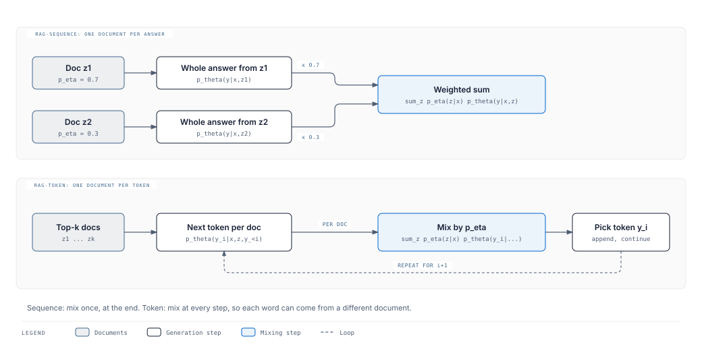

# 02. Models: RAG-Sequence and RAG-Token

In this note:

- The two building blocks: retriever and generator
- The idea of a latent document
- RAG-Sequence equation, symbol by symbol
- RAG-Token equation, symbol by symbol
- A worked numeric example computing both by hand
- When the two models are the same

## 1. The Two Building Blocks

The paper (Section 2) defines RAG with two components:

1. **Retriever** $p_\eta(z \mid x)$ with parameters $\eta$ (eta). Given input $x$, it returns a probability distribution over text passages $z$, cut down to the top $K$ passages.
2. **Generator** $p_\theta(y_i \mid x, z, y_{1:i-1})$ with parameters $\theta$ (theta). It predicts the next output token $y_i$ from the input $x$, one retrieved passage $z$, and the tokens already generated $y_1$ to $y_{i-1}$.

## 2. The Retrieved Document is a Latent Variable

A **latent variable** is something that affects the result but is never observed in the training data. The training data only has pairs (question, answer). It never says "passage number 4,512,006 contains the answer". So the model treats "which passage was used" as hidden, and **marginalizes** over it.

**Marginalizing** means: compute the answer probability for every possible passage, multiply each by the probability of that passage, and add them up. This is the law of total probability:

$$
p(y \mid x) = \sum_{z} p(z \mid x) \, p(y \mid x, z)
$$

Summing over all 21 million passages is too expensive, so the paper only sums over the top $K$ passages returned by the retriever (the "top-k approximation"). The two RAG models differ only in **when** this sum happens.

## 3. RAG-Sequence

### 3.1 The equation

$$
p_{\text{RAG-Sequence}}(y \mid x) \approx \sum_{z \in \text{top-}k(p(\cdot \mid x))} p_\eta(z \mid x) \, p_\theta(y \mid x, z) = \sum_{z \in \text{top-}k(p(\cdot \mid x))} p_\eta(z \mid x) \prod_{i}^{N} p_\theta(y_i \mid x, z, y_{1:i-1})
$$

### 3.2 Symbol table

<table width="100%">
<thead><tr><th>Symbol (plain text)</th><th>Name</th><th>Meaning</th></tr></thead>
<tbody>
<tr><td>x</td><td>Input</td><td>The question or claim</td></tr>
<tr><td>y</td><td>Output sequence</td><td>The full answer, made of N tokens y_1 ... y_N</td></tr>
<tr><td>y_i</td><td>Token i</td><td>The i-th output token</td></tr>
<tr><td>y_1:i-1</td><td>Prefix</td><td>All tokens generated before token i</td></tr>
<tr><td>z</td><td>Document</td><td>One retrieved Wikipedia passage</td></tr>
<tr><td>top-k(p(.|x))</td><td>Top-k set</td><td>The k passages with the highest retriever score for x</td></tr>
<tr><td>p_eta(z|x)</td><td>Retriever probability</td><td>How relevant the retriever thinks passage z is for x</td></tr>
<tr><td>p_theta(y|x,z)</td><td>Generator probability</td><td>How likely BART writes the full answer y after reading x and z</td></tr>
<tr><td>Product over i</td><td>Chain rule</td><td>Probability of a sequence = product of next-token probabilities</td></tr>
<tr><td>Sum over z</td><td>Marginalization</td><td>Weighted average over the top-k passages</td></tr>
<tr><td>approx sign</td><td>Approximation</td><td>We only sum over top-k, not all passages</td></tr>
</tbody>
</table>

### 3.3 In plain words

For each retrieved passage, imagine BART writes the **whole answer** using only that passage. Compute how likely that whole answer is. Then take a weighted average across passages, where the weight is the retriever's confidence in each passage. One passage is responsible for the entire answer.

## 4. RAG-Token

### 4.1 The equation

$$
p_{\text{RAG-Token}}(y \mid x) \approx \prod_{i}^{N} \sum_{z \in \text{top-}k(p(\cdot \mid x))} p_\eta(z \mid x) \, p_\theta(y_i \mid x, z, y_{1:i-1})
$$

### 4.2 What changed compared to RAG-Sequence

The product and the sum swapped places.

<table width="100%">
<thead><tr><th>Aspect</th><th>RAG-Sequence</th><th>RAG-Token</th></tr></thead>
<tbody>
<tr><td>Order of operations</td><td>Sum over docs of (product over tokens)</td><td>Product over tokens of (sum over docs)</td></tr>
<tr><td>When documents are mixed</td><td>Once, after the whole answer</td><td>At every token</td></tr>
<tr><td>Docs per answer</td><td>One doc explains the whole answer</td><td>Each token can lean on a different doc</td></tr>
<tr><td>Good for</td><td>Short answers from one source</td><td>Answers that combine facts from several sources</td></tr>
<tr><td>Decoding</td><td>Needs special beam search (note 04)</td><td>Standard beam search</td></tr>
</tbody>
</table>

### 4.3 In plain words

At every step, each passage proposes a distribution over the next token. The model blends those proposals using the retriever weights, picks the next token, and repeats. Token 3 can come mostly from passage 1 while token 7 comes mostly from passage 2. The paper shows this in the Jeopardy "Hemingway" example (note 06): "The Sun Also Rises" comes from one passage and "A Farewell to Arms" from another.

## 5. Worked Numeric Example

Assume the answer has 2 tokens, $y = (y_1, y_2)$, and the retriever returns 2 passages.

Retriever probabilities:

<table width="100%">
<thead><tr><th>Passage</th><th>p_eta(z|x)</th></tr></thead>
<tbody>
<tr><td>z1</td><td>0.7</td></tr>
<tr><td>z2</td><td>0.3</td></tr>
</tbody>
</table>

Generator probabilities (made up for the example):

<table width="100%">
<thead><tr><th>Passage</th><th>p_theta(y_1 | x, z)</th><th>p_theta(y_2 | x, z, y_1)</th><th>p_theta(y | x, z) = product</th></tr></thead>
<tbody>
<tr><td>z1</td><td>0.9</td><td>0.8</td><td>0.72</td></tr>
<tr><td>z2</td><td>0.2</td><td>0.5</td><td>0.10</td></tr>
</tbody>
</table>

### 5.1 RAG-Sequence by hand

Multiply tokens first (per passage), then mix:

$$
p = 0.7 \times (0.9 \times 0.8) + 0.3 \times (0.2 \times 0.5) = 0.7 \times 0.72 + 0.3 \times 0.10 = 0.504 + 0.030 = 0.534
$$

### 5.2 RAG-Token by hand

Mix first (per token), then multiply:

$$
\text{token 1: } 0.7 \times 0.9 + 0.3 \times 0.2 = 0.63 + 0.06 = 0.69
$$

$$
\text{token 2: } 0.7 \times 0.8 + 0.3 \times 0.5 = 0.56 + 0.15 = 0.71
$$

$$
p = 0.69 \times 0.71 = 0.4899
$$

### 5.3 What the numbers show

- The two models give different probabilities for the same answer (0.534 vs 0.490), so they are genuinely different models.
- In RAG-Sequence, passage z1 "wins" as a whole package. In RAG-Token, z2 is allowed to contribute a little to every token.
- If passage z2 were great for token 2 but bad for token 1, only RAG-Token could exploit that.

## 6. When the Two Models are the Same

For **classification** (for example FEVER labels "supports", "refutes", "not enough info"), the output is one token long (N = 1). With one token, the product has a single term, so:

$$
\prod_{i=1}^{1} \sum_{z} p_\eta(z \mid x) \, p_\theta(y_1 \mid x, z) = \sum_{z} p_\eta(z \mid x) \, p_\theta(y_1 \mid x, z)
$$

Both formulas become the same. This is why the paper reports one FEVER number for "RAG" in the ablation table.

## 7. Key Points to Remember

- Both models treat the passage as hidden and average over the top-k passages.
- RAG-Sequence: one passage per answer, mix at the end.
- RAG-Token: passages can change per token, mix at every step.
- They are identical for single-token outputs (classification).

## Navigation

Previous: [01. Abstract and Introduction](01.%20Abstract%20and%20Introduction.md) | [Index](README.md) | Next: [03. Retriever DPR and Generator BART](03.%20Retriever%20DPR%20and%20Generator%20BART.md)
