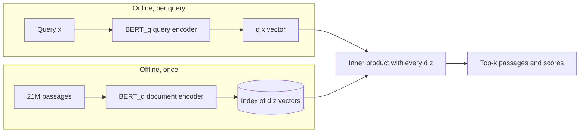
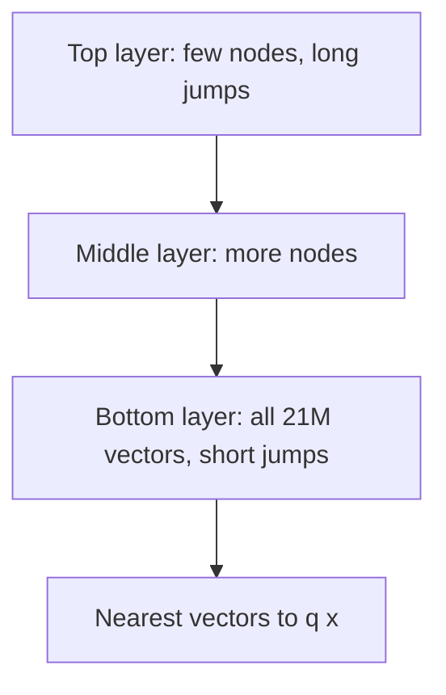
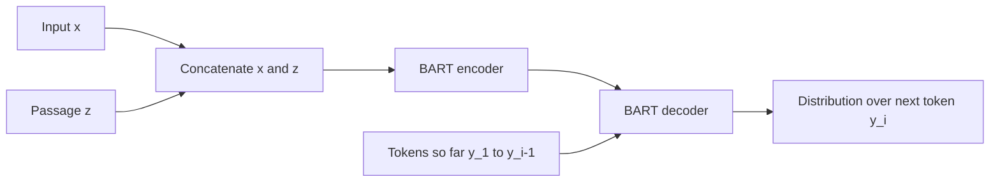

# 03. Retriever DPR and Generator BART

In this note:

- How the retriever scores a passage (the DPR equation)
- Bi-encoder architecture and why it is fast
- Inner product (dot product) explained with numbers
- MIPS and why it can run in sub-linear time
- The BART generator and how it reads the passage
- Why the paper calls them non-parametric and parametric memory

## 1. Retriever: Dense Passage Retriever (DPR)

Section 2.2 of the paper. The retriever $p_\eta(z \mid x)$ is the DPR model from Karpukhin et al. 2020.

### 1.1 The equation

$$
p_\eta(z \mid x) \propto \exp\left( \mathbf{d}(z)^\top \mathbf{q}(x) \right)
\qquad
\mathbf{d}(z) = \text{BERT}_d(z), \quad \mathbf{q}(x) = \text{BERT}_q(x)
$$

### 1.2 Symbol table

<table width="100%">
<thead><tr><th>Symbol (plain text)</th><th>Name</th><th>Meaning</th></tr></thead>
<tbody>
<tr><td>d(z)</td><td>Document vector</td><td>Dense vector for passage z, made by the document encoder</td></tr>
<tr><td>q(x)</td><td>Query vector</td><td>Dense vector for input x, made by the query encoder</td></tr>
<tr><td>BERT_d</td><td>Document encoder</td><td>A BERT-base model used only for passages</td></tr>
<tr><td>BERT_q</td><td>Query encoder</td><td>A separate BERT-base model used only for queries</td></tr>
<tr><td>d(z)^T q(x)</td><td>Inner product</td><td>Similarity score between query and passage</td></tr>
<tr><td>exp(...)</td><td>Exponential</td><td>Turns any score into a positive number</td></tr>
<tr><td>proportional sign</td><td>Proportional to</td><td>The value must still be divided by a total so probabilities add up to 1</td></tr>
<tr><td>eta</td><td>Retriever parameters</td><td>The weights of the two BERT encoders</td></tr>
</tbody>
</table>

### 1.3 In plain words

Turn the question into a vector. Every passage already has a vector. The score of a passage is the dot product of the two vectors: bigger means more relevant. Exponentiate and normalize the scores of the retrieved passages so they become probabilities that sum to 1. This normalization is a **softmax**:

$$
p_\eta(z \mid x) = \frac{\exp\left(\mathbf{d}(z)^\top \mathbf{q}(x)\right)}{\sum_{z' \in \text{top-}k} \exp\left(\mathbf{d}(z')^\top \mathbf{q}(x)\right)}
$$

## 2. Bi-encoder Architecture

DPR is a **bi-encoder**: two separate encoders, one for queries and one for passages. The two texts never see each other inside a model. They only meet when their vectors are compared.

<table width="100%">
<thead><tr><th>Design</th><th>How it works</th><th>Speed</th><th>Accuracy</th><th>Used in RAG?</th></tr></thead>
<tbody>
<tr><td>Bi-encoder</td><td>Encode query and passage separately, compare vectors</td><td>Very fast; passage vectors pre-computed</td><td>Good</td><td>Yes, as the retriever</td></tr>
<tr><td>Cross-encoder</td><td>Feed query and passage together into one model</td><td>Slow; must run per pair</td><td>Better</td><td>No; the paper shows it is not needed</td></tr>
</tbody>
</table>

Because passage vectors do not depend on the query, all 21 million can be computed once and stored. At query time only one BERT pass (for the query) is needed.

## 3. Inner Product with Numbers

The inner product (dot product) multiplies matching positions and adds them up. Real DPR vectors have 768 numbers. Here is a 3-number toy example:

<table width="100%">
<thead><tr><th>Vector</th><th>Dim 1</th><th>Dim 2</th><th>Dim 3</th><th>Inner product with q(x)</th></tr></thead>
<tbody>
<tr><td>q(x) query</td><td>0.9</td><td>0.1</td><td>0.4</td><td>-</td></tr>
<tr><td>d(z1) relevant passage</td><td>0.8</td><td>0.0</td><td>0.5</td><td>0.72 + 0.00 + 0.20 = 0.92</td></tr>
<tr><td>d(z2) unrelated passage</td><td>0.1</td><td>0.9</td><td>0.0</td><td>0.09 + 0.09 + 0.00 = 0.18</td></tr>
</tbody>
</table>

Passage z1 points in a similar direction to the query, so its score is higher. Softmax of (0.92, 0.18) gives roughly (0.68, 0.32).

## 4. MIPS: Maximum Inner Product Search

Finding the top-k passages means finding the k vectors with the **largest inner product** with q(x). This problem is called **Maximum Inner Product Search (MIPS)**.

<table width="100%">
<thead><tr><th>Approach</th><th>How</th><th>Cost per query</th><th>Exact?</th></tr></thead>
<tbody>
<tr><td>Brute force</td><td>Compute the score for all 21M passages</td><td>Linear: grows with the number of passages</td><td>Yes</td></tr>
<tr><td>Approximate (HNSW in FAISS)</td><td>Walk a graph of neighbouring vectors toward the best region</td><td>Sub-linear: grows much slower than the number of passages</td><td>Almost; may miss a few</td></tr>
</tbody>
</table>

**Sub-linear time** means doubling the number of passages does not double the search time. The paper uses **FAISS** (Facebook AI Similarity Search) with a **Hierarchical Navigable Small World (HNSW)** graph. HNSW builds layers of graphs: the top layer has few nodes and long jumps, lower layers have more nodes and short jumps. A search starts at the top, greedily moves to closer nodes, then drops down a layer, much like zooming from a country map to a street map.

The paper calls the document index the **non-parametric memory**.

### 4.1 Where the retriever came from

The retriever is initialized from a pre-trained DPR bi-encoder. That DPR model was trained to find passages containing answers for TriviaQA and Natural Questions. So RAG starts with a retriever that already works, and only fine-tunes the query side.

## 5. Generator: BART

Section 2.3. The generator $p_\theta(y_i \mid x, z, y_{1:i-1})$ can be any encoder-decoder model. The paper uses **BART-large**.

<table width="100%">
<thead><tr><th>Property</th><th>Value</th></tr></thead>
<tbody>
<tr><td>Type</td><td>Pre-trained seq2seq (encoder-decoder) transformer</td></tr>
<tr><td>Size</td><td>About 400M parameters (406M in the appendix)</td></tr>
<tr><td>Pre-training</td><td>Denoising: corrupt text with several noising functions, learn to restore it</td></tr>
<tr><td>Strength</td><td>State of the art on many generation tasks, beats similar-sized T5</td></tr>
<tr><td>How it reads the passage</td><td>Simple concatenation of input x and passage z</td></tr>
<tr><td>Paper's name for it</td><td>Parametric memory, parameters theta</td></tr>
</tbody>
</table>

### 5.1 How x and z are combined

There is no special fusion layer. The input and the passage are joined into one text and fed to the BART encoder. The decoder then writes the output one token at a time.

This is done separately for each of the k retrieved passages, giving k next-token distributions. RAG-Sequence or RAG-Token (note 02) then combines them.

## 6. Parametric vs Non-parametric Naming

<table width="100%">
<thead><tr><th>Component</th><th>Paper name</th><th>Why the name fits</th><th>How to update knowledge</th></tr></thead>
<tbody>
<tr><td>BART generator</td><td>Parametric memory</td><td>Knowledge stored in learned parameters theta</td><td>Retrain or fine-tune</td></tr>
<tr><td>Wikipedia vector index</td><td>Non-parametric memory</td><td>Knowledge stored as raw text plus vectors, not learned weights</td><td>Re-encode new passages and swap the index</td></tr>
</tbody>
</table>

## 7. Key Points to Remember

- Relevance score = inner product of query vector and passage vector.
- Two separate BERT encoders (bi-encoder) make it possible to pre-compute all passage vectors.
- MIPS with FAISS HNSW finds top-k passages quickly in sub-linear time.
- BART reads "input + passage" as one concatenated text and generates the output.

## Navigation

Previous: [02. Models RAG-Sequence and RAG-Token](02.%20Models%20RAG-Sequence%20and%20RAG-Token.md) | [Index](README.md) | Next: [04. Training and Decoding](04.%20Training%20and%20Decoding.md)
