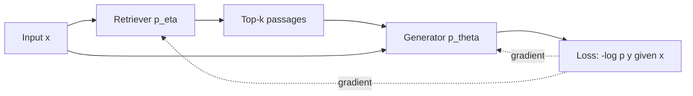
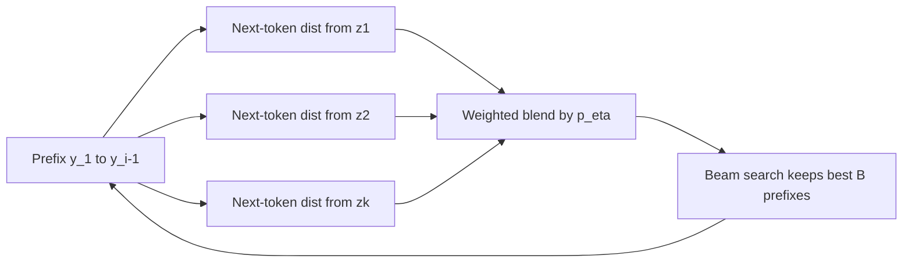
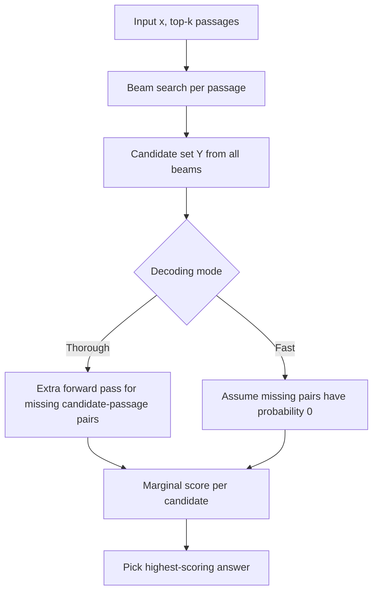

# 04. Training and Decoding

In this note:

- The training objective (negative marginal log-likelihood)
- Why no passage labels are needed
- What is trained and what is frozen, and why
- Decoding for RAG-Token (standard beam search)
- Decoding for RAG-Sequence (Thorough and Fast decoding)

## 1. Training (Section 2.4)

### 1.1 The data

Training uses pairs $(x_j, y_j)$: an input and its correct output. Example: ("who wrote the divine comedy", "Dante Alighieri"). There is **no label** saying which Wikipedia passage contains the answer.

### 1.2 The loss function

$$
\mathcal{L} = \sum_{j} -\log p(y_j \mid x_j)
$$

<table width="100%">
<thead><tr><th>Symbol (plain text)</th><th>Meaning</th></tr></thead>
<tbody>
<tr><td>j</td><td>Index of a training example</td></tr>
<tr><td>x_j, y_j</td><td>Input and correct output of example j</td></tr>
<tr><td>p(y_j | x_j)</td><td>Marginal probability from RAG-Sequence or RAG-Token (note 02), summed over top-k passages</td></tr>
<tr><td>-log</td><td>Negative log: small when the probability is high, large when it is low</td></tr>
<tr><td>Sum over j</td><td>Total loss over the training set (in practice, a mini-batch)</td></tr>
</tbody>
</table>

In plain words: make the correct answer as likely as possible, after averaging over the retrieved passages. This is called **negative marginal log-likelihood**, because the probability is a marginal (summed over the latent passage).

The loss is minimized with **stochastic gradient descent** using the **Adam** optimizer.

### 1.3 Why no passage labels are needed

The marginal probability contains $p_\eta(z \mid x)$, the retriever probability. When the gradient flows back:

- If passage z helped the generator produce the correct answer (high $p_\theta(y \mid x, z)$), the gradient **raises** $p_\eta(z \mid x)$, so the query encoder learns to rank that passage higher next time.
- If passage z did not help, its weight is lowered.

So the retriever learns from the generator's success. This is what "end-to-end" means in Figure 1.

### 1.4 What is trained and what is frozen

<table width="100%">
<thead><tr><th>Component</th><th>Parameters</th><th>Status during fine-tuning</th><th>Reason</th></tr></thead>
<tbody>
<tr><td>Query encoder BERT_q</td><td>110M</td><td>Trained</td><td>Cheap: only affects the query vector</td></tr>
<tr><td>Generator BART-large</td><td>406M</td><td>Trained</td><td>Learns to use passages for the task</td></tr>
<tr><td>Document encoder BERT_d</td><td>110M</td><td>Frozen</td><td>Changing it would require re-encoding 21M passages</td></tr>
<tr><td>Document index</td><td>21M vectors</td><td>Frozen</td><td>Rebuilding the index during training is very expensive</td></tr>
</tbody>
</table>

**Why freeze the document side?** If BERT_d changes, every stored passage vector becomes stale, and the whole index must be recomputed and rebuilt. REALM does this periodically during pre-training, which is costly. The RAG authors found that this step is **not necessary** for strong performance, so they keep the document encoder and index fixed. This is the same choice modern RAG systems make: the vector index is built once and only the query side (or nothing) changes.

## 2. Decoding (Section 2.5)

**Decoding** is how we pick the final output at test time. We want the output $y$ with the highest probability, written as $\arg\max_y p(y \mid x)$. Checking every possible sentence is impossible, so we use **beam search**: keep the B best partial outputs at each step, extend each by one token, and keep the best B again.

### 2.1 RAG-Token decoding

RAG-Token mixes passages at every token, so it behaves like a normal generator with a special next-token probability:

$$
p'_\theta(y_i \mid x, y_{1:i-1}) = \sum_{z \in \text{top-}k(p(\cdot \mid x))} p_\eta(z_i \mid x) \, p_\theta(y_i \mid x, z_i, y_{1:i-1})
$$

In plain words: at each step, blend the k next-token distributions using the retriever weights, then treat the blend as the model's next-token distribution. This can be plugged straight into a **standard beam decoder**.

### 2.2 RAG-Sequence decoding

For RAG-Sequence, $p(y \mid x)$ is a sum of products over whole sequences. It does **not** break into one probability per token, so a single beam search cannot score it. The paper offers two procedures.

#### Thorough Decoding

1. Run a separate beam search for **each** passage z, scoring with $p_\theta(y_i \mid x, z, y_{1:i-1})$.
2. Collect all candidate answers from all beams into a set Y.
3. Some candidate y may appear in the beam of passage z1 but not of passage z2. For each missing (candidate, passage) pair, run an **extra forward pass** to compute $p_\theta(y \mid x, z)$.
4. For each candidate, compute the full marginal $\sum_z p_\eta(z \mid x) p_\theta(y \mid x, z)$.
5. Output the candidate with the highest marginal.

Accurate, but when outputs are long, Y gets large and many extra forward passes are needed.

#### Fast Decoding

Same as Thorough, but skip step 3. If candidate y was not produced in the beam for passage $z_i$, assume $p_\theta(y \mid x, z_i) \approx 0$. No extra forward passes are needed.

<table width="100%">
<thead><tr><th>Mode</th><th>Extra forward passes</th><th>Accuracy</th><th>Used in the paper for</th></tr></thead>
<tbody>
<tr><td>Thorough Decoding</td><td>Yes</td><td>Exact marginal for candidates</td><td>Open-domain QA (short answers)</td></tr>
<tr><td>Fast Decoding</td><td>No</td><td>Approximate</td><td>MS-MARCO and Jeopardy (long outputs; Thorough did not help)</td></tr>
</tbody>
</table>

For QA the paper actually used **greedy decoding** (beam size 1) because beam search did not improve results. For generation tasks it used beam size 4 (see note 08).

## 3. Key Points to Remember

- Loss = negative log of the marginal answer probability; no passage labels needed.
- The retriever learns because passages that help the generator get higher weight.
- Only the query encoder and BART are trained; the document encoder and index stay frozen.
- RAG-Token decodes with normal beam search; RAG-Sequence needs per-passage beams plus Thorough or Fast scoring.

## Navigation

Previous: [03. Retriever DPR and Generator BART](03.%20Retriever%20DPR%20and%20Generator%20BART.md) | [Index](README.md) | Next: [05. Experiments Setup](05.%20Experiments%20Setup.md)
