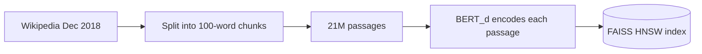

# 05. Experiments Setup

In this note:

- The knowledge source: how Wikipedia was chunked and indexed
- The four task families tested
- Dataset sizes (Table 7)
- Every evaluation metric explained in simple words

## 1. The Knowledge Source (Section 3)

All experiments use one Wikipedia snapshot as the non-parametric memory.

<table width="100%">
<thead><tr><th>Setting</th><th>Value</th><th>Why it matters</th></tr></thead>
<tbody>
<tr><td>Source</td><td>Wikipedia dump, December 2018</td><td>Same dump as DPR and ORQA, so results are comparable</td></tr>
<tr><td>Chunking</td><td>Each article split into disjoint 100-word chunks</td><td>Fixed-size, non-overlapping chunks; the ancestor of modern chunking</td></tr>
<tr><td>Number of passages</td><td>About 21 million</td><td>Size of the search space</td></tr>
<tr><td>Encoding</td><td>Document encoder BERT_d computes one vector per chunk</td><td>Done once, offline</td></tr>
<tr><td>Index</td><td>FAISS MIPS index with HNSW approximation</td><td>Fast approximate top-k search</td></tr>
<tr><td>k during training</td><td>5 or 10</td><td>Number of passages marginalized per example</td></tr>
<tr><td>k at test time</td><td>Chosen on dev data</td><td>Can differ from training k</td></tr>
</tbody>
</table>

"Disjoint" means chunks do not overlap: words 1 to 100 form chunk 1, words 101 to 200 form chunk 2, and so on.

## 2. The Four Task Families

### 2.1 Open-domain Question Answering (Section 3.1)

Answer a question with no passage given. The model must find the knowledge itself.

- Datasets: **Natural Questions (NQ)**, **TriviaQA (TQA)**, **WebQuestions (WQ)**, **CuratedTrec (CT)**.
- CT and WQ are small, so their models start from the NQ RAG model (same as DPR does).
- RAG is compared with two families:

<table width="100%">
<thead><tr><th>Family</th><th>How it answers</th><th>Uses retrieval?</th><th>Examples</th></tr></thead>
<tbody>
<tr><td>Extractive (open-book)</td><td>Copies a span from a retrieved passage</td><td>Yes</td><td>DPR, REALM</td></tr>
<tr><td>Closed-book</td><td>Generates from parametric memory only</td><td>No</td><td>T5-11B, T5-11B+SSM</td></tr>
<tr><td>RAG</td><td>Generates while reading retrieved passages</td><td>Yes</td><td>RAG-Sequence, RAG-Token</td></tr>
</tbody>
</table>

- Metric: **Exact Match (EM)**.

### 2.2 Abstractive Question Answering (Section 3.2)

- Dataset: **MS-MARCO NLG v2.1**. Questions with full-sentence human answers.
- The dataset ships 10 gold passages per question, but the paper **does not use them**. Only questions and answers are used, so it becomes an open-domain task.
- Some questions cannot be answered without the gold passages (for example "What is the weather in Volcano, CA?"), and some cannot be answered from Wikipedia at all. RAG then relies on BART's own knowledge.
- Metrics: **BLEU-1** and **ROUGE-L**.

### 2.3 Jeopardy Question Generation (Section 3.3)

Jeopardy works backwards: given an answer entity, write a factual clue that points to it.

- Example: answer "The World Cup", clue "In 1986 Mexico scored as the first country to host this international sports competition twice."
- Harder than normal question generation because clues are precise factual statements.
- Splits from SearchQA: 100K train, 14K dev, 27K test.
- Baseline: BART trained on the same data.
- Metric: **Q-BLEU-1**, plus two **human evaluations** (factuality and specificity) using pairwise comparison: annotators see two clues (one from BART, one from RAG) and choose "A better", "B better", "both good" or "neither good".

### 2.4 Fact Verification (Section 3.4)

- Dataset: **FEVER**. Decide if a claim is supported, refuted, or has not enough info, using Wikipedia.
- The label is mapped to a single output token, so it is classification framed as generation.
- Unlike most FEVER systems, RAG gets **no supervision on which evidence to retrieve**.
- Two variants: 3-way (supports / refutes / not enough info) and 2-way (supports / refutes).
- Metric: **label accuracy**.

## 3. Dataset Sizes (Table 7)

<table width="100%">
<thead><tr><th>Task</th><th>Train</th><th>Development</th><th>Test</th></tr></thead>
<tbody>
<tr><td>Natural Questions</td><td>79,169</td><td>8,758</td><td>3,611</td></tr>
<tr><td>TriviaQA</td><td>78,786</td><td>8,838</td><td>11,314</td></tr>
<tr><td>WebQuestions</td><td>3,418</td><td>362</td><td>2,033</td></tr>
<tr><td>CuratedTrec</td><td>635</td><td>134</td><td>635</td></tr>
<tr><td>Jeopardy Question Generation</td><td>97,392</td><td>13,714</td><td>26,849</td></tr>
<tr><td>MS-MARCO</td><td>153,726</td><td>12,468</td><td>101,093 (hidden subset used)</td></tr>
<tr><td>FEVER 3-way</td><td>145,450</td><td>10,000</td><td>10,000</td></tr>
<tr><td>FEVER 2-way</td><td>96,966</td><td>6,666</td><td>6,666</td></tr>
</tbody>
</table>

## 4. Metrics Explained

<table width="100%">
<thead><tr><th>Metric</th><th>Used for</th><th>What it measures</th><th>Simple example</th></tr></thead>
<tbody>
<tr><td>Exact Match (EM)</td><td>Open-domain QA</td><td>Percent of answers identical to a gold answer after normalization (lowercase, no punctuation or articles)</td><td>"Dante" vs gold "dante" counts; "Dante A." does not</td></tr>
<tr><td>BLEU-1</td><td>MS-MARCO, Jeopardy</td><td>Share of generated words that also appear in the reference (unigram precision)</td><td>Output has 10 words, 7 in reference: about 0.7</td></tr>
<tr><td>ROUGE-L</td><td>MS-MARCO</td><td>Length of the longest common subsequence between output and reference</td><td>Rewards keeping the reference word order</td></tr>
<tr><td>Q-BLEU-1</td><td>Jeopardy</td><td>BLEU-1 variant that gives more weight to matching entities; correlates better with humans for question generation</td><td>Getting "Mount Rainier" right counts more than "the"</td></tr>
<tr><td>Label accuracy</td><td>FEVER</td><td>Percent of claims with the correct label</td><td>90 of 100 correct: 90%</td></tr>
<tr><td>Factuality (human)</td><td>Jeopardy</td><td>Can the statement be confirmed by trusted external sources?</td><td>Annotators may search the web</td></tr>
<tr><td>Specificity (human)</td><td>Jeopardy</td><td>Is the output strongly tied to this input, not generic?</td><td>A clue that only fits "Washington", not any state</td></tr>
<tr><td>Distinct tri-gram ratio</td><td>Diversity analysis</td><td>Unique 3-word sequences divided by all 3-word sequences generated</td><td>Higher means less repetitive output</td></tr>
<tr><td>Answer Recall @ K</td><td>Retrieval analysis</td><td>Percent of questions where an answer appears in the top K passages</td><td>Measures the retriever alone</td></tr>
</tbody>
</table>

## 5. Key Points to Remember

- Index: 21M disjoint 100-word Wikipedia chunks, FAISS HNSW.
- Four task families: extractive-style QA, abstractive QA, question generation, fact verification.
- RAG never gets told which passage is correct in any task.

## Navigation

Previous: [04. Training and Decoding](04.%20Training%20and%20Decoding.md) | [Index](README.md) | Next: [06. Results](06.%20Results.md)
