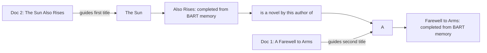

# 06. Results

In this note:

- Table 1: open-domain QA
- Table 2: generation and classification
- Table 3: example generations
- Table 4: human evaluation for Jeopardy
- Figure 2: RAG-Token document posterior (Hemingway example)
- Table 5: generation diversity
- Table 6: retrieval ablations
- Index hot-swapping
- Figure 3: effect of retrieving more documents

## 1. Open-domain QA (Section 4.1, Table 1)

Scores are Exact Match (higher is better). For TQA, two numbers are shown: standard open-domain test set / TQA-Wiki test set.

<table width="100%">
<thead><tr><th>Family</th><th>Model</th><th>NQ</th><th>TQA</th><th>WQ</th><th>CT</th></tr></thead>
<tbody>
<tr><td>Closed book</td><td>T5-11B</td><td>34.5</td><td>- / 50.1</td><td>37.4</td><td>-</td></tr>
<tr><td>Closed book</td><td>T5-11B+SSM</td><td>36.6</td><td>- / 60.5</td><td>44.7</td><td>-</td></tr>
<tr><td>Open book</td><td>REALM</td><td>40.4</td><td>- / -</td><td>40.7</td><td>46.8</td></tr>
<tr><td>Open book</td><td>DPR</td><td>41.5</td><td>57.9 / -</td><td>41.1</td><td>50.6</td></tr>
<tr><td>RAG</td><td>RAG-Token</td><td>44.1</td><td>55.2 / 66.1</td><td>45.5</td><td>50.0</td></tr>
<tr><td>RAG</td><td>RAG-Sequence</td><td><b>44.5</b></td><td>56.8 / <b>68.0</b></td><td>45.2</td><td><b>52.2</b></td></tr>
</tbody>
</table>

How to read it:

- RAG sets a new state of the art on NQ, WQ and CT, and on the T5-comparable TQA-Wiki split.
- RAG beats T5-11B (11 billion parameters) with only 626M trainable parameters. Retrieval is far more parameter-efficient than storing everything in weights.
- RAG beats REALM and T5+SSM **without** their expensive "salient span masking" pre-training.
- RAG beats DPR, which uses a BERT **cross-encoder re-ranker** plus an **extractive reader**. The paper concludes that neither a re-ranker nor an extractive reader is required for state-of-the-art results.

Why generating beats extracting:

- A passage can contain **clues** without containing the exact answer string. A generator can still use those clues; an extractor cannot.
- RAG answered correctly in **11.8%** of NQ cases where the answer was **not in any retrieved passage**. An extractive model scores 0% on those cases, because there is nothing to copy. Here RAG uses its parametric memory.

## 2. Generation and Classification (Sections 4.2 to 4.4, Table 2)

<table width="100%">
<thead><tr><th>Model</th><th>Jeopardy B-1</th><th>Jeopardy QB-1</th><th>MS-MARCO R-L</th><th>MS-MARCO B-1</th><th>FEVER-3 Acc</th><th>FEVER-2 Acc</th></tr></thead>
<tbody>
<tr><td>SotA</td><td>-</td><td>-</td><td>49.8 (gold)</td><td>49.9 (gold)</td><td>76.8</td><td>92.2 (gold)</td></tr>
<tr><td>BART</td><td>15.1</td><td>19.7</td><td>38.2</td><td>41.6</td><td>64.0</td><td>81.1</td></tr>
<tr><td>RAG-Token</td><td><b>17.3</b></td><td><b>22.2</b></td><td>40.1</td><td>41.5</td><td rowspan="2">72.5</td><td rowspan="2">89.5</td></tr>
<tr><td>RAG-Sequence</td><td>14.7</td><td>21.4</td><td><b>40.8</b></td><td><b>44.2</b></td></tr>
</tbody>
</table>

"gold" means that system used the gold passages or gold evidence, which RAG does not. FEVER has one RAG number because RAG-Sequence and RAG-Token are identical for single-token outputs.

How to read it:

- **MS-MARCO**: RAG-Sequence beats BART by 2.6 BLEU-1 and 2.6 ROUGE-L, and comes close to state-of-the-art systems that read the gold passages.
- **Jeopardy**: RAG-Token is best. Jeopardy clues often combine two facts, and RAG-Token can take each fact from a different passage.
- **FEVER 3-way**: 72.5 vs 76.8, within 4.3% of complex pipeline systems that are trained with retrieval supervision.
- **FEVER 2-way**: 89.5 vs 92.2, within 2.7% of a RoBERTa model that is **given** the gold evidence sentence, while RAG retrieves its own evidence.
- Retrieval quality on FEVER: the top retrieved passage is from a gold article in **71%** of cases, and a gold article is in the top 10 in **90%** of cases.

## 3. Example Generations (Table 3)

A "?" marks a factually wrong answer, "*" a partly correct one.

<table width="100%">
<thead><tr><th>Task</th><th>Input</th><th>Model</th><th>Generation</th></tr></thead>
<tbody>
<tr><td>MS-MARCO</td><td>define middle ear</td><td>BART</td><td>? The middle ear is the part of the ear between the middle ear and the nose.</td></tr>
<tr><td>MS-MARCO</td><td>define middle ear</td><td>RAG-T</td><td>The middle ear is the portion of the ear internal to the eardrum.</td></tr>
<tr><td>MS-MARCO</td><td>define middle ear</td><td>RAG-S</td><td>The middle ear includes the tympanic cavity and the three ossicles.</td></tr>
<tr><td>MS-MARCO</td><td>what currency needed in scotland</td><td>BART</td><td>The currency needed in Scotland is Pound sterling.</td></tr>
<tr><td>MS-MARCO</td><td>what currency needed in scotland</td><td>RAG-T</td><td>Pound is the currency needed in Scotland.</td></tr>
<tr><td>MS-MARCO</td><td>what currency needed in scotland</td><td>RAG-S</td><td>The currency needed in Scotland is the pound sterling.</td></tr>
<tr><td>Jeopardy</td><td>Washington</td><td>BART</td><td>? This state has the largest number of counties in the U.S.</td></tr>
<tr><td>Jeopardy</td><td>Washington</td><td>RAG-T</td><td>It's the only U.S. state named for a U.S. president</td></tr>
<tr><td>Jeopardy</td><td>Washington</td><td>RAG-S</td><td>It's the state where you'll find Mount Rainier National Park</td></tr>
<tr><td>Jeopardy</td><td>The Divine Comedy</td><td>BART</td><td>* This epic poem by Dante is divided into 3 parts: the Inferno, the Purgatorio and the Purgatorio</td></tr>
<tr><td>Jeopardy</td><td>The Divine Comedy</td><td>RAG-T</td><td>Dante's "Inferno" is the first part of this epic poem</td></tr>
<tr><td>Jeopardy</td><td>The Divine Comedy</td><td>RAG-S</td><td>This 14th century work is divided into 3 sections: "Inferno", "Purgatorio" and "Paradiso"</td></tr>
</tbody>
</table>

The pattern: BART alone hallucinates (a circular definition of the middle ear, a wrong county fact, a repeated "Purgatorio"). RAG answers are specific and correct because they are grounded in retrieved text.

## 4. Human Evaluation for Jeopardy (Table 4)

452 pairs of clues from BART and RAG-Token were judged.

<table width="100%">
<thead><tr><th>Judgement</th><th>Factuality</th><th>Specificity</th></tr></thead>
<tbody>
<tr><td>BART better</td><td>7.1%</td><td>16.8%</td></tr>
<tr><td>RAG better</td><td><b>42.7%</b></td><td><b>37.4%</b></td></tr>
<tr><td>Both good</td><td>11.7%</td><td>11.8%</td></tr>
<tr><td>Both poor</td><td>17.7%</td><td>6.9%</td></tr>
<tr><td>No majority</td><td>20.8%</td><td>20.1%</td></tr>
</tbody>
</table>

RAG was judged more factual about 6 times as often as BART (42.7% vs 7.1%) and more specific more than twice as often.

## 5. Figure 2: RAG-Token Document Posterior

### 5.1 What the figure shows

Input: "Hemingway". Task: write a Jeopardy clue. Five passages are retrieved. The figure is a heatmap: one row per passage (Doc 1 to Doc 5), one column per generated token, darker = that passage is more responsible for that token. Responsibility here is the **posterior** $p(z_i \mid x, y_i, y_{-i})$: after seeing the token, how likely is it that passage z produced it.

Generated clue: `"The Sun Also Rises" is a novel by this author of "A Farewell to Arms"`

Relevant passages:

- **Doc 1**: "... His wartime experiences formed the basis for his novel "A Farewell to Arms" (1929) ..."
- **Doc 2**: "... His debut novel, "The Sun Also Rises", was published in 1926."

### 5.2 Figure 2 as a table

<table width="100%">
<thead><tr><th>Generated tokens</th><th>Dominant passage</th><th>Posterior pattern</th><th>Meaning</th></tr></thead>
<tbody>
<tr><td>BOS "</td><td>None</td><td>Flat</td><td>Start of output, no fact needed yet</td></tr>
<tr><td>The Sun</td><td>Doc 2</td><td>High on Doc 2 at "Sun"</td><td>The first title is pulled from Doc 2</td></tr>
<tr><td>Also R ises "</td><td>None</td><td>Flattens</td><td>Once "The Sun" is written, BART completes the title from memory</td></tr>
<tr><td>is a novel by this author of "</td><td>None</td><td>Flat</td><td>Template words, no specific fact</td></tr>
<tr><td>A</td><td>Doc 1</td><td>High on Doc 1</td><td>The second title is pulled from Doc 1</td></tr>
<tr><td>Fare well to Arms "</td><td>None</td><td>Flattens</td><td>Again completed from parametric memory</td></tr>
</tbody>
</table>

### 5.3 Why it matters

- This is the clearest evidence that **RAG-Token mixes passages within one output**: two facts, two passages.
- The posterior **flattens after the first token of each title**. The authors tested BART alone: given the partial text "The Sun, BART completes "The Sun Also Rises". So the title is stored in BART's weights.
- Conclusion: **the non-parametric memory guides the generation, and the parametric memory fills in details it already knows.** The two memories cooperate.

## 6. Generation Diversity (Table 5)

Ratio of distinct tri-grams to total tri-grams (higher = less repetitive).

<table width="100%">
<thead><tr><th>Model</th><th>MS-MARCO</th><th>Jeopardy QGen</th></tr></thead>
<tbody>
<tr><td>Gold (human)</td><td>89.6%</td><td>90.0%</td></tr>
<tr><td>BART</td><td>70.7%</td><td>32.4%</td></tr>
<tr><td>RAG-Token</td><td>77.8%</td><td>46.8%</td></tr>
<tr><td>RAG-Sequence</td><td><b>83.5%</b></td><td><b>53.8%</b></td></tr>
</tbody>
</table>

Both RAG models are much more diverse than BART, without any special diversity-promoting decoding. Different retrieved passages push the generator toward different, specific content.

## 7. Retrieval Ablations (Table 6)

Dev set results. An **ablation** removes or replaces one part to see how much it matters.

- **BM25**: replace the dense retriever with classic keyword search; BM25 scores are used as logits for p(z|x).
- **Frozen**: keep the dense retriever but do not fine-tune the query encoder.
- **Full**: normal RAG with learned retrieval.

<table width="100%">
<thead><tr><th>Model</th><th>NQ</th><th>TQA</th><th>WQ</th><th>CT</th><th>Jeop B-1</th><th>Jeop QB-1</th><th>MSM R-L</th><th>MSM B-1</th><th>FVR-3</th><th>FVR-2</th></tr></thead>
<tbody>
<tr><td>RAG-Token-BM25</td><td>29.7</td><td>41.5</td><td>32.1</td><td>33.1</td><td>17.5</td><td>22.3</td><td>55.5</td><td>48.4</td><td rowspan="2"><b>75.1</b></td><td rowspan="2"><b>91.6</b></td></tr>
<tr><td>RAG-Sequence-BM25</td><td>31.8</td><td>44.1</td><td>36.6</td><td>33.8</td><td>11.1</td><td>19.5</td><td>56.5</td><td>46.9</td></tr>
<tr><td>RAG-Token-Frozen</td><td>37.8</td><td>50.1</td><td>37.1</td><td>51.1</td><td>16.7</td><td>21.7</td><td>55.9</td><td>49.4</td><td rowspan="2">72.9</td><td rowspan="2">89.4</td></tr>
<tr><td>RAG-Sequence-Frozen</td><td>41.2</td><td>52.1</td><td>41.8</td><td>52.6</td><td>11.8</td><td>19.6</td><td>56.7</td><td>47.3</td></tr>
<tr><td>RAG-Token</td><td>43.5</td><td>54.8</td><td><b>46.5</b></td><td>51.9</td><td>17.9</td><td>22.6</td><td>56.2</td><td>49.4</td><td rowspan="2">74.5</td><td rowspan="2">90.6</td></tr>
<tr><td>RAG-Sequence</td><td><b>44.0</b></td><td><b>55.8</b></td><td>44.9</td><td><b>53.4</b></td><td>15.3</td><td>21.5</td><td>57.2</td><td>47.5</td></tr>
</tbody>
</table>

How to read it:

- **Learned retrieval beats frozen retrieval** on nearly every task. Fine-tuning the query encoder end-to-end helps.
- **Dense beats BM25** by a large margin on open-domain QA (for example NQ 44.0 vs 31.8).
- **FEVER is the exception**: BM25 is best (75.1). FEVER claims are full of entity names, and keyword overlap is very good at matching names. This is an early hint that **hybrid search** (keyword plus dense, folder 03 of this repo) is valuable.

## 8. Index Hot-swapping

Because knowledge lives in the index, it can be replaced without retraining.

Experiment: 82 world leaders who changed between 2016 and 2018. Query template: "Who is {position}?" (for example "Who is the President of Peru?"). Two indexes: Wikipedia December 2016 (DrQA dump) and December 2018.

<table width="100%">
<thead><tr><th>Index used</th><th>Leaders asked about</th><th>Accuracy</th><th>Meaning</th></tr></thead>
<tbody>
<tr><td>2016 index</td><td>2016 leaders</td><td>70%</td><td>Matched: correct</td></tr>
<tr><td>2018 index</td><td>2018 leaders</td><td>68%</td><td>Matched: correct</td></tr>
<tr><td>2018 index</td><td>2016 leaders</td><td>12%</td><td>Mismatched: answers follow the index</td></tr>
<tr><td>2016 index</td><td>2018 leaders</td><td>4%</td><td>Mismatched: answers follow the index</td></tr>
</tbody>
</table>

The model's answers follow whatever the index says. Updating world knowledge = swapping the index. A parametric-only model like T5 or BART would need retraining.

## 9. Figure 3: Effect of Retrieving More Documents

The figure has three line charts with K (number of retrieved documents at test time, 10 to 50) on the x-axis. Models were trained with 5 or 10 documents, with no significant difference between the two.

<table width="100%">
<thead><tr><th>Panel</th><th>Y-axis</th><th>What happens as K grows</th></tr></thead>
<tbody>
<tr><td>Left</td><td>NQ Exact Match</td><td>RAG-Sequence keeps improving; RAG-Token peaks at about K = 10 and then drops slightly</td></tr>
<tr><td>Center</td><td>NQ Answer Recall @ K</td><td>Recall rises for all retrievers; learned RAG retrievers are above fixed DPR, which is far above BM25</td></tr>
<tr><td>Right</td><td>MS-MARCO BLEU-1 and ROUGE-L</td><td>RAG-Token: ROUGE-L up, BLEU-1 down; RAG-Sequence: smaller effect</td></tr>
</tbody>
</table>

Takeaway: K is a **test-time knob** that trades accuracy against speed. More passages can help, but not always, and the best K depends on the model and task. Modern RAG systems tune top-k the same way.

## 10. Key Points to Remember

- RAG wins open-domain QA with far fewer parameters than T5-11B and without a re-ranker.
- RAG is more factual, specific and diverse than BART on generation.
- RAG-Token combines facts from different passages within one output (Figure 2).
- Learned dense retrieval beats frozen and BM25, except on entity-heavy FEVER.
- Swapping the index updates knowledge instantly.

## Navigation

Previous: [05. Experiments Setup](05.%20Experiments%20Setup.md) | [Index](README.md) | Next: [07. Related Work Discussion and Broader Impact](07.%20Related%20Work%20Discussion%20and%20Broader%20Impact.md)
