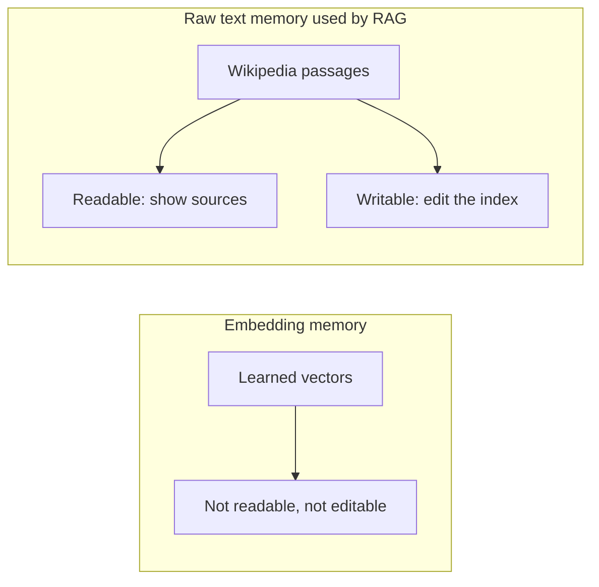

# 07. Related Work, Discussion and Broader Impact

In this note:

- The five lines of earlier work and how RAG differs from each
- The authors' discussion and future work
- Benefits and risks from the Broader Impact section

## 1. Related Work (Section 5)

<table width="100%">
<thead><tr><th>Line of work</th><th>What earlier work did</th><th>How RAG differs</th></tr></thead>
<tbody>
<tr><td>Single-task retrieval</td><td>Retrieval helped individual tasks: open-domain QA, fact checking, fact completion, long-form QA, Wikipedia generation, dialogue, translation, language modeling</td><td>One retrieval architecture works well across many tasks</td></tr>
<tr><td>General-purpose NLP architectures</td><td>One pre-trained model (BERT, GPT-2, BART, T5) fine-tuned for many tasks, without retrieval</td><td>Adds a learned retrieval module to a general generator</td></tr>
<tr><td>Learned retrieval</td><td>Retrievers optimized for one downstream task using search, reinforcement learning, or latent variables (ORQA, REALM)</td><td>Same latent-variable idea, but one model fine-tuned for many tasks</td></tr>
<tr><td>Memory-based architectures</td><td>Memory networks attend over learned embeddings; some models retrieve entity embeddings or fact embeddings</td><td>RAG's memory is raw text, so it is human-readable and human-writable</td></tr>
<tr><td>Retrieve-and-edit</td><td>Retrieve a similar training pair and lightly edit it (translation, semantic parsing)</td><td>RAG aggregates content from several passages and retrieves evidence, not training pairs</td></tr>
</tbody>
</table>

### 1.1 Why raw-text memory matters

The paper highlights two properties of storing knowledge as raw text:

- **Human-readable**: you can look at the retrieved passages and see why the model answered the way it did. This gives a form of interpretability and makes citations possible.
- **Human-writable**: you can edit, add or remove passages to change what the model knows, with no training. The index hot-swap experiment (note 06) proves this.

## 2. Discussion (Section 6)

What the authors claim they showed:

1. Hybrid models with parametric and non-parametric memory reach state of the art on open-domain QA.
2. People prefer RAG generations over purely parametric BART; RAG is more factual and specific.
3. The learned retrieval component is effective (ablations).
4. The retrieval index can be hot-swapped to update the model without retraining.

Future work suggested:

- **Joint pre-training** of retriever and generator from scratch, with a denoising objective like BART or another objective.
- Research into **how parametric and non-parametric memories interact** and how best to combine them.
- Applying RAG to a wide variety of other NLP tasks.

Many later papers in this repository follow these directions, for example RETRO (retrieval in pre-training, folder 00) and Self-RAG (learning when to retrieve, folder 08).

## 3. Broader Impact

### 3.1 Benefits

<table width="100%">
<thead><tr><th>Benefit</th><th>Why</th></tr></thead>
<tbody>
<tr><td>Less hallucination</td><td>Generation is grounded in real factual text (Wikipedia)</td></tr>
<tr><td>More control and interpretability</td><td>Retrieved passages show what the answer is based on</td></tr>
<tr><td>Domain use</td><td>Swap in a domain index, for example a medical index, to answer domain questions</td></tr>
<tr><td>Productivity</td><td>Helps people be more effective at their jobs</td></tr>
</tbody>
</table>

### 3.2 Risks

<table width="100%">
<thead><tr><th>Risk</th><th>Explanation</th><th>Modern mitigation</th></tr></thead>
<tbody>
<tr><td>Knowledge source is imperfect</td><td>Wikipedia or any source is never fully factual or free of bias</td><td>Curate sources, track provenance, show citations</td></tr>
<tr><td>Misuse as a language model</td><td>Could generate abuse, fake or misleading news, impersonation, spam or phishing (same concerns as GPT-2, arguably less)</td><td>Guardrails, content filters, usage policies</td></tr>
<tr><td>Job automation</td><td>Advanced language models may automate some jobs over time</td><td>Human-in-the-loop design</td></tr>
</tbody>
</table>

The authors suggest that AI systems themselves could be used to fight misleading content and automated spam.

## 4. Key Points to Remember

- RAG unifies earlier single-task retrieval successes into one general architecture.
- Its memory is raw text: readable (citations) and writable (updates without training).
- The authors already pointed to joint pre-training and memory interaction as open problems.

## Navigation

Previous: [06. Results](06.%20Results.md) | [Index](README.md) | Next: [08. Appendix Details](08.%20Appendix%20Details.md)
