# 09. Key Takeaways and Link to Modern RAG

In this note:

- The ten most important takeaways from the paper
- What modern Naive RAG kept from the paper
- What changed and why
- Side-by-side comparison: paper RAG vs today's Naive RAG
- How the paper's findings point to later architectures in this repo

## 1. Ten Takeaways

1. **Two memories are better than one.** Model weights give fluency and general knowledge; a text index gives exact, updatable facts.
2. **Retrieve, then generate.** Find relevant passages first, then condition the generator on them.
3. **Dense retrieval works.** Query and passage vectors compared by inner product beat keyword search on most tasks.
4. **The passage is a latent variable.** No passage labels are needed; the retriever learns from the final answer.
5. **Two ways to combine passages.** RAG-Sequence (one passage per answer) and RAG-Token (passages can change per token).
6. **Freeze the document side.** Rebuilding the index during training is expensive and not needed.
7. **Generation beats extraction.** Even on extractive QA, and even when the answer string is not in any passage.
8. **Less hallucination, more specificity.** Human judges strongly prefer RAG over BART for factuality.
9. **Update knowledge by swapping the index.** No retraining required.
10. **Small plus retrieval beats huge without retrieval.** About 626M parameters with retrieval beat T5 with 11B.

## 2. What Modern Naive RAG Kept

<table width="100%">
<thead><tr><th>Idea from the paper</th><th>How it appears in Naive RAG today</th></tr></thead>
<tbody>
<tr><td>Retrieve-then-generate pipeline</td><td>Same two-stage design: retriever finds chunks, LLM writes the answer</td></tr>
<tr><td>Dense bi-encoder retrieval</td><td>Embedding models (for example OpenAI, Cohere, BGE, E5) encode chunks and queries separately</td></tr>
<tr><td>Fixed-size chunking (100 words)</td><td>Fixed-size chunks (often 200 to 1000 tokens), now usually with overlap</td></tr>
<tr><td>Pre-computed vector index</td><td>Vector databases (FAISS, Chroma, Qdrant, pgvector, Pinecone)</td></tr>
<tr><td>Approximate nearest neighbour search (HNSW)</td><td>HNSW is still the default index in most vector databases</td></tr>
<tr><td>Frozen document encoder and index</td><td>Index built once offline; re-indexed only when documents change</td></tr>
<tr><td>Top-k as a tunable knob</td><td>top_k is a standard retriever parameter</td></tr>
<tr><td>Hot-swappable knowledge</td><td>Update the vector store to update answers; no model training</td></tr>
<tr><td>Provenance from raw text</td><td>Return source chunks and citations with the answer</td></tr>
</tbody>
</table>

## 3. What Changed

<table width="100%">
<thead><tr><th>Paper (2020)</th><th>Today's Naive RAG</th><th>Why it changed</th></tr></thead>
<tbody>
<tr><td>Retriever and generator fine-tuned jointly</td><td>No training at all; both models used as-is</td><td>Large LLMs are expensive to fine-tune and already good at reading context</td></tr>
<tr><td>BART-large encoder-decoder, 406M</td><td>Large decoder-only LLMs (Claude, GPT, Llama)</td><td>Much stronger instruction following and reasoning</td></tr>
<tr><td>Generator reads one passage at a time</td><td>All top-k chunks stuffed into one prompt</td><td>Long context windows can hold many chunks at once</td></tr>
<tr><td>Marginalization over passages (RAG-Sequence / RAG-Token)</td><td>No marginalization; the LLM reads all chunks together and decides</td><td>Prompt stuffing is simpler and works well with strong LLMs</td></tr>
<tr><td>Wikipedia only</td><td>Any private or public documents (PDFs, wikis, tickets, code)</td><td>Enterprise use cases</td></tr>
<tr><td>100-word disjoint chunks</td><td>Token-based chunks with overlap, plus smarter splitting</td><td>Overlap avoids cutting facts at chunk borders</td></tr>
<tr><td>BERT-base 768-dim encoders trained for QA</td><td>General-purpose embedding models, 384 to 3072 dims</td><td>Better embeddings trained on huge, diverse data</td></tr>
<tr><td>Output tied to fine-tuned task</td><td>Behavior controlled by a prompt template</td><td>Prompting replaces task-specific fine-tuning</td></tr>
</tbody>
</table>

## 4. Side-by-side Flow

```mermaid
flowchart TB
    subgraph Paper[RAG paper 2020]
        PX[Input x] --> PQ[BERT_q query encoder]
        PQ --> PM[MIPS over 21M Wikipedia vectors]
        PM --> PG[BART reads x plus each passage separately]
        PG --> PMG[Marginalize over passages]
        PMG --> PY[Output y]
    end
    subgraph Today[Naive RAG today]
        TX[User question] --> TE[Embedding model]
        TE --> TV[Vector DB top-k search]
        TV --> TP[Prompt: question plus all top-k chunks]
        TP --> TL[Frozen LLM]
        TL --> TY[Answer with citations]
    end
```

## 5. From the Paper's Findings to Later Architectures

Several results in the paper already hint at problems that later RAG architectures solve.

<table width="100%">
<thead><tr><th>Finding in the paper</th><th>Problem it reveals</th><th>Later architecture in this repo</th></tr></thead>
<tbody>
<tr><td>BM25 beats dense retrieval on entity-heavy FEVER</td><td>Dense vectors miss exact names</td><td>03. Hybrid Search RAG</td></tr>
<tr><td>DPR baseline used a cross-encoder re-ranker</td><td>Bi-encoder ranking is imperfect</td><td>02. Advanced RAG (re-ranking)</td></tr>
<tr><td>Null document did not help; model ignores retrieval for some questions</td><td>Not every query needs retrieval</td><td>08. Self RAG, 10. Adaptive RAG</td></tr>
<tr><td>Some MS-MARCO questions are not answerable from Wikipedia</td><td>The knowledge base can be incomplete</td><td>09. Corrective RAG (web fallback)</td></tr>
<tr><td>RAG-Token combines facts from two passages</td><td>Multi-fact and multi-hop questions</td><td>11. Active Iterative RAG, 13. Graph RAG</td></tr>
<tr><td>Best K varies by task; more docs not always better</td><td>Context selection matters</td><td>02. Advanced RAG, 19. Long RAG</td></tr>
<tr><td>Future work: joint pre-training</td><td>Retrieval inside pre-training</td><td>RETRO and REALM in 00. RAG Surveys and Foundations</td></tr>
</tbody>
</table>

## 6. One-sentence Summary

The RAG paper showed that giving a generator a searchable, swappable library of text makes it more accurate, more factual and easier to update than storing everything in its weights, and that idea is the foundation of every architecture in this repository.

## Navigation

Previous: [08. Appendix Details](08.%20Appendix%20Details.md) | [Index](README.md) | Next: [Notes Home](../../README.md#notes)
