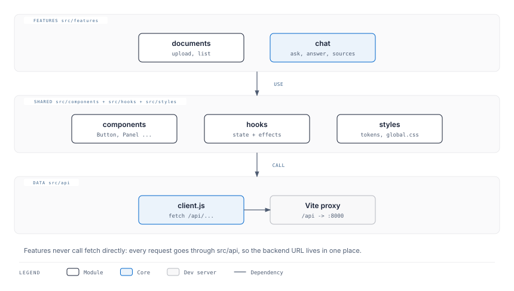
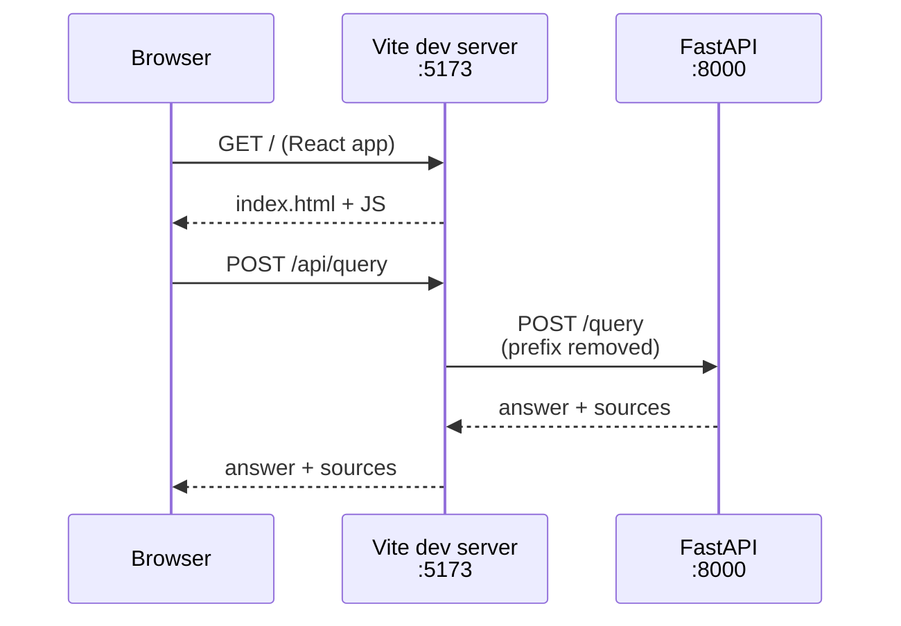

# 01. UI Project Setup and Folder Structure

In this doc:

- Why React with Vite and plain JavaScript
- The folder structure and what each folder holds
- How the UI talks to the FastAPI backend (Vite proxy)
- What was removed from the Vite template and why
- How to install, run, build and lint
- Code style rules for the UI

## Why React, Vite and JavaScript

<table width="100%">
<thead><tr><th>Choice</th><th>Alternative</th><th>Why this one</th></tr></thead>
<tbody>
<tr><td>React 19</td><td>Vue, Svelte, plain HTML</td><td>Project decision; component model fits the two panels (documents, chat) well</td></tr>
<tr><td>Vite 8</td><td>Create React App (retired), Next.js</td><td>Instant dev server and fast builds; no server rendering needed because FastAPI is the backend</td></tr>
<tr><td>JavaScript (JSX)</td><td>TypeScript</td><td>Project decision ("React JS"); keeps the code simple to read. Response shapes are documented in the backend schemas.</td></tr>
<tr><td>Plain CSS with tokens</td><td>Tailwind, CSS-in-JS</td><td>No extra tooling; design tokens as CSS variables in one file (next step)</td></tr>
<tr><td>oxlint</td><td>ESLint</td><td>Comes with the Vite template, very fast, catches React hook mistakes</td></tr>
</tbody>
</table>

## Folder structure



```text
01. Naive RAG/ui/
    index.html              page shell, loads src/main.jsx
    vite.config.js          React plugin and the /api proxy
    package.json            scripts and dependencies
    public/                 static files served as they are (favicon)
    src/
        main.jsx            entry: global styles + mount App
        App.jsx             top-level layout
        api/                every call to the backend lives here
        components/         shared building blocks (Button, Panel, ...)
        features/
            documents/      upload and list documents
            chat/           ask questions, show answers with citation chips
            evidence/       retrieved chunks, scores, highlighted citations
            health/         API status line
        hooks/              shared React hooks (state + effects)
        utils/              small text helpers (plural)
        styles/             global.css and design tokens
    docs/                   numbered docs like this one
        images/             design diagrams
```

<table width="100%">
<thead><tr><th>Folder</th><th>Holds</th><th>May use</th><th>Must not</th></tr></thead>
<tbody>
<tr><td>src/features</td><td>Screens and parts of screens for one task</td><td>components, hooks, api</td><td>Call fetch directly</td></tr>
<tr><td>src/components</td><td>Generic, reusable pieces with no API knowledge</td><td>styles</td><td>Import from features or api</td></tr>
<tr><td>src/hooks</td><td>Reusable state logic</td><td>api</td><td>Render UI</td></tr>
<tr><td>src/api</td><td>One function per backend endpoint</td><td>fetch</td><td>Know about React</td></tr>
<tr><td>src/styles</td><td>Tokens and global CSS</td><td>nothing</td><td>Hold component-specific rules</td></tr>
</tbody>
</table>

The structure mirrors the backend layers (doc 01 of the implementation): features are like routes, `src/api` is the only door to the backend.

## How the UI talks to the backend



The browser only ever talks to the Vite server. Vite forwards every `/api/...` request to FastAPI and removes the `/api` prefix.

<table width="100%">
<thead><tr><th>Option</th><th>Backend change</th><th>Decision</th></tr></thead>
<tbody>
<tr><td>Vite proxy</td><td>None</td><td>Chosen: same origin for the browser, so no CORS errors and no CORS setup</td></tr>
<tr><td>Call http://127.0.0.1:8000 directly</td><td>Add CORSMiddleware to FastAPI</td><td>Not needed for local development</td></tr>
</tbody>
</table>

The `/api` prefix also keeps UI routes and backend routes apart: `/documents` could later be a UI page while `/api/documents` is always the backend.

## Removed from the Vite template

<table width="100%">
<thead><tr><th>Removed</th><th>Why</th></tr></thead>
<tbody>
<tr><td>src/App.css, src/index.css</td><td>Template demo styles; replaced by styles/global.css and tokens</td></tr>
<tr><td>src/assets (React and Vite logos)</td><td>Demo images, not part of this product</td></tr>
<tr><td>public/icons.svg</td><td>Template icon sprite, unused</td></tr>
<tr><td>Template README.md</td><td>Generic text; the docs folder explains this UI</td></tr>
<tr><td>Counter demo in App.jsx</td><td>Replaced by a placeholder until the layout step</td></tr>
</tbody>
</table>

## Install and run

Start the backend first (from `01. Naive RAG/implementation`):

```bash
.venv/bin/uvicorn app.main:app --reload
```

Then the UI (from `01. Naive RAG/ui`):

```bash
npm install
npm run dev
```

Open http://localhost:5173.

<table width="100%">
<thead><tr><th>Command</th><th>What it does</th></tr></thead>
<tbody>
<tr><td>npm run dev</td><td>Dev server with hot reload and the /api proxy</td></tr>
<tr><td>npm run build</td><td>Production build into dist/</td></tr>
<tr><td>npm run preview</td><td>Serve the dist/ build locally</td></tr>
<tr><td>npm run lint</td><td>Run oxlint</td></tr>
</tbody>
</table>

## Versions

<table width="100%">
<thead><tr><th>Package</th><th>Version</th><th>Role</th></tr></thead>
<tbody>
<tr><td>react, react-dom</td><td>19.3.1</td><td>UI library</td></tr>
<tr><td>vite</td><td>8.3.8</td><td>Dev server and bundler</td></tr>
<tr><td>@vitejs/plugin-react</td><td>6.3.0</td><td>JSX and fast refresh</td></tr>
<tr><td>oxlint</td><td>1.94.0</td><td>Linter</td></tr>
</tbody>
</table>

## Code style for the UI

The same rules as the Python code, adapted to JavaScript:

1. Every file starts with a block comment (`/** ... */`) that explains what the file does.
2. Imports come next under one `// Imports` comment, longest line first, shortest last.
3. A short comment above each logical block, then the code, then a blank line.
4. Simple, readable code over clever code.

```jsx
// Main component
export default function App() {

  // Placeholder until the layout is built
  return (
    <main>
      <h1>Naive RAG</h1>
    </main>
  )
}
```
