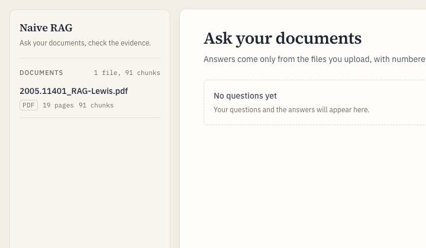
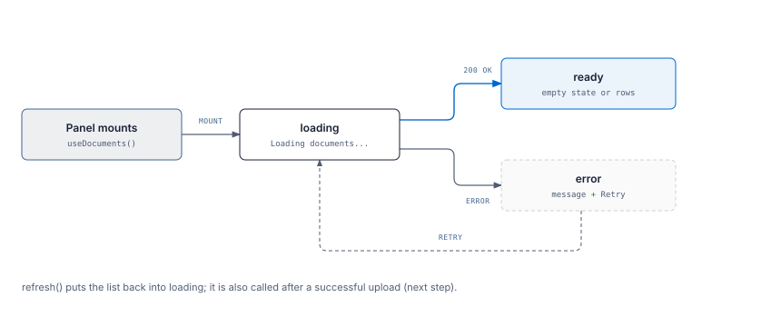
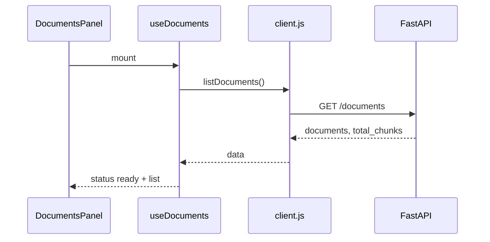

# 05. Document List

In this doc:

- What the documents rail shows
- The useDocuments hook and its states
- How a row is laid out
- The shared Button component
- Why the fetch is written with .then inside the hook
- Screenshot and tests

Files:

- [src/features/documents/DocumentsPanel.jsx](../src/features/documents/DocumentsPanel.jsx)
- [src/features/documents/useDocuments.js](../src/features/documents/useDocuments.js)
- [src/features/documents/DocumentList.jsx](../src/features/documents/DocumentList.jsx) and [DocumentList.module.css](../src/features/documents/DocumentList.module.css)
- [src/components/Button.jsx](../src/components/Button.jsx) and [Button.module.css](../src/components/Button.module.css)
- [src/api/client.js](../src/api/client.js) (new listDocuments)

Backend: [GET /documents, implementation doc 20](../../implementation/docs/20.%20Document%20List%20API.md)

## What the rail shows

<table width="100%">
<thead><tr><th>Element</th><th>Content</th><th>Style</th></tr></thead>
<tbody>
<tr><td>Panel header meta</td><td>1 file, 91 chunks</td><td>Data font, tabular numbers</td></tr>
<tr><td>Row title</td><td>File name, cut with an ellipsis if too long (full name on hover)</td><td>Interface font 500, primary ink</td></tr>
<tr><td>Row meta</td><td>Type tag, pages or sheets, chunks</td><td>Data font 11px, tertiary ink</td></tr>
<tr><td>Separator</td><td>Hairline rule between rows</td><td>--rule, no boxes</td></tr>
</tbody>
</table>

Pages or sheets come from `parts` (doc 20): "19 pages" for a PDF, "1 sheet" for an Excel file, nothing for Word, text and Markdown, which have no natural parts.

## The useDocuments hook

<table width="100%">
<thead><tr><th>Returned value</th><th>Meaning</th></tr></thead>
<tbody>
<tr><td>documents</td><td>Array of {source, file_type, parts, chunks}</td></tr>
<tr><td>totalChunks</td><td>Chunks in the whole index</td></tr>
<tr><td>status</td><td>"loading", "ready" or "error"</td></tr>
<tr><td>error</td><td>Message from ApiError (doc 02) when status is "error"</td></tr>
<tr><td>refresh()</td><td>Reload the list: used by Retry now and after uploads in the next step</td></tr>
</tbody>
</table>

### Step by step

1. State starts as `status = "loading"` with an empty list.
2. On mount, the effect calls `load()`, which calls `listDocuments()` (GET /api/documents).
3. When the request finishes, `.then` stores the list and sets "ready"; `.catch` stores the message and sets "error".
4. `refresh()` sets "loading" and calls `load()` again.

### Why .then inside the hook

React's lint rule `set-state-in-effect` warns when state is set synchronously inside an effect, because that causes an extra render before anything useful happens. The initial "loading" status is set by `useState` itself, and the effect only starts the request. State changes happen in `.then` and `.catch`, after the network answer, which is exactly when the screen should update.

## The four list states

<table width="100%">
<thead><tr><th>State</th><th>When</th><th>Shown</th></tr></thead>
<tbody>
<tr><td>Loading</td><td>First load in progress, no list yet</td><td>"Loading documents..." in tertiary ink</td></tr>
<tr><td>Error</td><td>Request failed, for example the API is not running</td><td>Message on a danger tint with a Retry button (role="alert" for screen readers)</td></tr>
<tr><td>Empty</td><td>Loaded, nothing indexed</td><td>EmptyState: what to upload</td></tr>
<tr><td>Ready</td><td>Loaded with files</td><td>One row per file</td></tr>
</tbody>
</table>

## The Button component

A wrapper around the native `<button>` (keyboard, focus and screen reader support for free) with two variants:

<table width="100%">
<thead><tr><th>Variant</th><th>Look</th><th>Used for</th></tr></thead>
<tbody>
<tr><td>primary</td><td>Pen blue fill, paper text, darker on hover</td><td>The main action of a region: Upload, Ask</td></tr>
<tr><td>quiet</td><td>Outline, pen tint on hover</td><td>Secondary actions: Retry</td></tr>
</tbody>
</table>

All variants: 36px tall, 4px radius, a small press (`scale(0.97)`) when clicked, the global focus ring for keyboard users, and ghost ink when disabled. `type="button"` is the default so a button inside a form never submits it by accident.

## Tests

<table width="100%">
<thead><tr><th>Test</th><th>Checks</th></tr></thead>
<tbody>
<tr><td>listDocuments calls GET /api/documents</td><td>URL and returned body (client test, now 7 tests in total)</td></tr>
</tbody>
</table>

Visual check: the rail was rendered against the live API with the RAG paper indexed (screenshot above).
