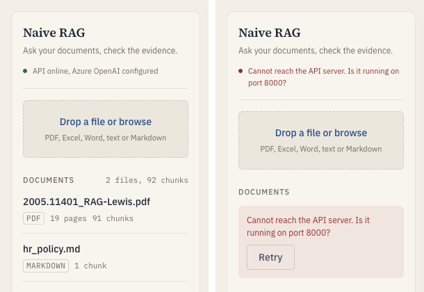
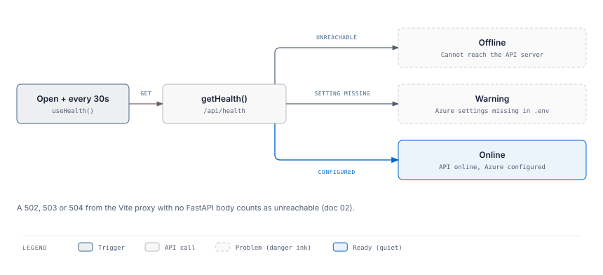
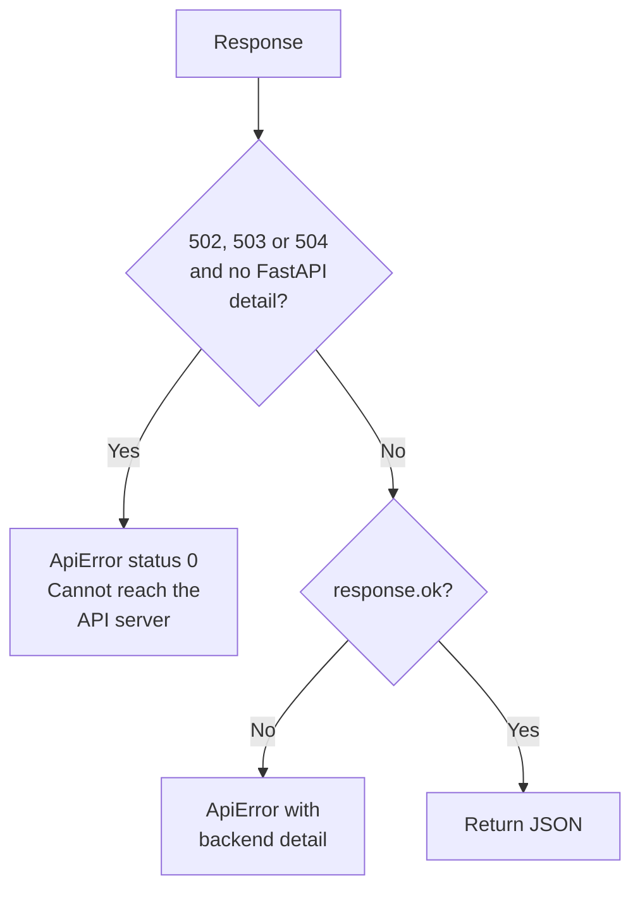

# 09. API Status

In this doc:

- Why the UI shows the API status
- The useHealth hook: when it checks and what it reports
- The three messages and their tone
- The proxy 502 fix in the API client
- Screenshots and tests

Files:

- [src/features/health/useHealth.js](../src/features/health/useHealth.js)
- [src/features/health/ApiStatus.jsx](../src/features/health/ApiStatus.jsx) and [ApiStatus.module.css](../src/features/health/ApiStatus.module.css)
- [src/api/client.js](../src/api/client.js) (proxy 502 handling) and [client.test.js](../src/api/client.test.js)
- [src/App.jsx](../src/App.jsx) (status under the app name)

Backend: [GET /health, implementation doc 03](../../implementation/docs/03.%20FastAPI%20Application%20Setup.md)

## Why

The UI needs two things to work: the FastAPI server running, and the Azure OpenAI settings in `.env`. When either is missing, uploads and questions fail with errors that are hard to interpret. A status line under the app name tells the user up front, and says what to fix.

Left: API online and configured (quiet). Right: the backend was stopped; the status line and the document list both say the server cannot be reached.

## The useHealth hook

1. On mount, `check()` calls `getHealth()` (GET /api/health).
2. A timer repeats the check every 30 seconds, so the status recovers by itself when the server is started, and notices when it stops.
3. The timer is cleared when the component unmounts (the cleanup function of the effect), so no checks run in the background after it is gone.
4. Like `useDocuments`, state changes only in `.then` and `.catch`, after the request finishes.

<table width="100%">
<thead><tr><th>Returned value</th><th>Meaning</th></tr></thead>
<tbody>
<tr><td>status</td><td>checking, online or offline</td></tr>
<tr><td>config</td><td>{azure_chat, azure_embeddings} from the backend when online</td></tr>
<tr><td>error</td><td>ApiError message when offline</td></tr>
</tbody>
</table>

## Messages

<table width="100%">
<thead><tr><th>Situation</th><th>Text</th><th>Tone</th></tr></thead>
<tbody>
<tr><td>First check running</td><td>Checking API...</td><td>Tertiary ink</td></tr>
<tr><td>Server unreachable</td><td>Cannot reach the API server. Is it running on port 8000?</td><td>Danger ink and dot</td></tr>
<tr><td>Online, an Azure setting missing</td><td>API online, but Azure OpenAI settings are missing in .env</td><td>Danger ink and dot</td></tr>
<tr><td>Online and configured</td><td>API online, Azure OpenAI configured</td><td>Tertiary ink, green dot</td></tr>
</tbody>
</table>

The good state is deliberately quiet: when everything works, the status should not compete with the documents and the conversation. Only problems use color in the text. The dot is a 6px CSS circle (no icon font or symbol character) and is hidden from screen readers; the text carries the meaning, and `role="status"` announces changes.

## The proxy 502 fix

Checking the offline state in a real browser showed a problem: with the backend stopped, the browser still reaches the Vite dev server, and Vite answers **502 Bad Gateway** with an empty body. The client showed "Request failed with status 502", which tells the user nothing.

`request()` now treats a 502, 503 or 504 **without** a FastAPI `detail` as "server unreachable", with the same message and status 0 as a network failure. A 5xx that FastAPI itself sends with a detail is still shown as the backend's message.

## Tests

<table width="100%">
<thead><tr><th>Test</th><th>Checks</th></tr></thead>
<tbody>
<tr><td>a proxy 502 without a detail means the server is down</td><td>Status 0 and the "Cannot reach the API server" message (12 tests in total)</td></tr>
</tbody>
</table>

Live check: screenshots taken with the backend running, then stopped, then running again.

No new dependencies.
