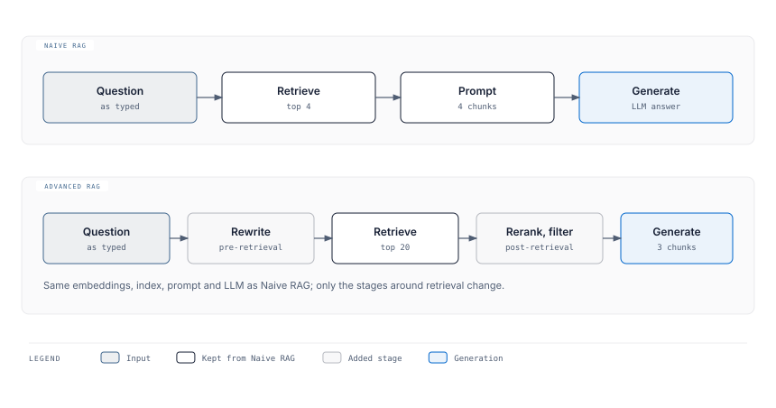
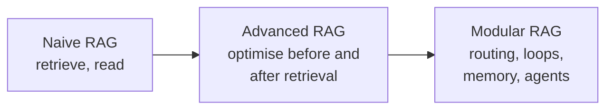
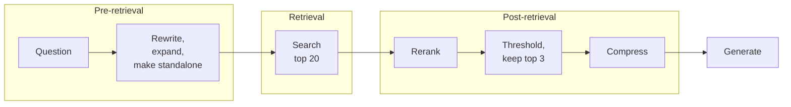

# 01. What is Advanced RAG

In this note:

- The definition of Advanced RAG in plain words
- The three RAG paradigms: Naive, Advanced, Modular
- What Advanced RAG keeps from Naive RAG and what it adds
- The three optimisation stages: pre-retrieval, retrieval, post-retrieval
- The librarian analogy
- What Advanced RAG is not
- The papers behind it

## Definition

**Advanced RAG** is Naive RAG with extra steps around retrieval that make the retrieved context more relevant before the LLM sees it. The pipeline is still a straight line (one question, one retrieval, one answer), but:

- **before retrieval**, the question is improved so it matches the documents better, and
- **after retrieval**, the retrieved chunks are re-scored, filtered and shortened so only the useful ones reach the prompt.

The generator and the grounded prompt stay exactly as in Naive RAG. Advanced RAG changes **what the LLM reads**, not how it writes.

## The three RAG paradigms

The RAG survey by Gao et al. (2023, [arXiv:2312.10997](https://arxiv.org/abs/2312.10997)) groups RAG systems into three paradigms. Each one is a superset of the previous.

<table width="100%">
<thead><tr><th>Paradigm</th><th>Shape of the pipeline</th><th>Main idea</th><th>Typical techniques</th><th>In this repository</th></tr></thead>
<tbody>
<tr><td>Naive RAG</td><td>Index, retrieve, generate (one straight line)</td><td>Retrieve top-k chunks by similarity and put them in the prompt</td><td>Chunking, embeddings, vector search, grounded prompt</td><td><a href="../../../01.%20Naive%20RAG/">01. Naive RAG</a></td></tr>
<tr><td>Advanced RAG</td><td>Still one straight line, with stages added before and after retrieval</td><td>Optimise the query and the retrieved context</td><td>Query rewriting, expansion, reranking, filtering, compression, better indexing</td><td>This folder</td></tr>
<tr><td>Modular RAG</td><td>Flexible graph of interchangeable modules, with routing, loops and memory</td><td>Compose modules per task; retrieve when and as often as needed</td><td>Routing, iterative retrieval, self-reflection, memory, agents</td><td><a href="../../../22.%20Modular%20RAG/">22. Modular RAG</a> and the architectures before it</td></tr>
</tbody>
</table>

## What stays and what is added

<table width="100%">
<thead><tr><th>Component</th><th>Naive RAG</th><th>Advanced RAG</th></tr></thead>
<tbody>
<tr><td>Loaders, chunking</td><td>Yes</td><td>Same (better indexing is optional)</td></tr>
<tr><td>Embedding model and vector index</td><td>Yes</td><td>Same</td></tr>
<tr><td>Query used for search</td><td>The question as typed</td><td>A rewritten, standalone, clearer query</td></tr>
<tr><td>Number of chunks retrieved</td><td>k (for example 4), used directly</td><td>A larger candidate set (for example 20), narrowed later</td></tr>
<tr><td>Ranking</td><td>Embedding similarity only</td><td>Embedding similarity, then a reranker</td></tr>
<tr><td>Chunks sent to the LLM</td><td>All k</td><td>The best few above a score threshold, optionally compressed</td></tr>
<tr><td>Prompt and generator</td><td>Grounded prompt, citations</td><td>Same</td></tr>
<tr><td>LLM calls per question</td><td>1</td><td>2 or more (rewrite, sometimes an LLM reranker or compressor, then generation)</td></tr>
</tbody>
</table>

## The three optimisation stages

<table width="100%">
<thead><tr><th>Stage</th><th>Goal</th><th>Techniques</th><th>Notes</th></tr></thead>
<tbody>
<tr><td>Pre-retrieval</td><td>Make the query match how the documents are written</td><td>Query rewriting, query expansion, multi-query, conversational (standalone) rewriting; on the index side, better chunking and metadata</td><td>03, 04, 05</td></tr>
<tr><td>Retrieval</td><td>Do not miss the right chunk (recall)</td><td>Retrieve a larger candidate set; the same embedding search as Naive RAG</td><td>06</td></tr>
<tr><td>Post-retrieval</td><td>Send only useful chunks (precision)</td><td>Cross-encoder reranking, score thresholds, dynamic k, context compression and ordering</td><td>07, 08, 09, 10</td></tr>
</tbody>
</table>

The idea in one sentence: **retrieve wide for recall, then narrow down for precision.** Naive RAG has to choose one k that serves both goals at once; Advanced RAG separates them.

## The librarian analogy

In the [Naive RAG notes](../../../01.%20Naive%20RAG/01.%20Notes/01.%20Basic%20Concepts/01.%20What%20is%20RAG.md), RAG was an open-book exam: a librarian brings pages and the student answers from them.

- **Naive RAG librarian:** takes your question word for word, grabs the first four pages that look similar, and hands them over without reading them.
- **Advanced RAG librarian:**
  1. first asks "what exactly do you mean?" and rewrites your request in the library's own words (pre-retrieval),
  2. pulls twenty candidate pages from the shelves (retrieval),
  3. actually reads each page against your question, puts the best three on top and leaves the rest (post-retrieval).

The student (the LLM) is the same. It simply gets better pages.

## What Advanced RAG is not

<table width="100%">
<thead><tr><th>Not this</th><th>Why</th><th>Where it is covered</th></tr></thead>
<tbody>
<tr><td>Multiple retrieval rounds or loops</td><td>Advanced RAG still retrieves once per question</td><td>11. Active Iterative RAG, 10. Adaptive RAG</td></tr>
<tr><td>The model judging its own answer</td><td>No self-reflection or answer grading inside the pipeline</td><td>08. Self RAG, 09. Corrective RAG</td></tr>
<tr><td>Keyword plus vector search</td><td>Optional add-on; the main Advanced RAG change is reranking</td><td>03. Hybrid Search RAG</td></tr>
<tr><td>Agents deciding what to do</td><td>The steps are fixed, not chosen at run time</td><td>16. Agentic RAG</td></tr>
<tr><td>Training the LLM</td><td>The generator stays frozen; only small helpers (rewriter, reranker) may be trained</td><td>-</td></tr>
</tbody>
</table>

## The papers behind it

<table width="100%">
<thead><tr><th>Stage</th><th>Paper</th><th>What it shows</th></tr></thead>
<tbody>
<tr><td>Pre-retrieval</td><td>Query Rewriting for Retrieval-Augmented LLMs (Ma et al., EMNLP 2023)</td><td>Rewriting the query before retrieval (Rewrite-Retrieve-Read) improves answers, with a frozen LLM rewriter or a small trained one</td></tr>
<tr><td>Post-retrieval</td><td>Passage Re-ranking with BERT (Nogueira and Cho, 2019)</td><td>A cross-encoder that reads query and passage together re-ranks candidates far better than the first-stage retriever</td></tr>
<tr><td>Post-retrieval</td><td>RECOMP (Xu, Shi and Choi, ICLR 2024)</td><td>Compressing retrieved documents into short summaries keeps accuracy while cutting prompt length, and an empty summary can skip useless documents</td></tr>
</tbody>
</table>

Each paper is explained section by section in [02. Research Paper Explained](../02.%20Research%20Paper%20Explained/).

## Key points

- Advanced RAG = Naive RAG + pre-retrieval optimisation + post-retrieval optimisation; the pipeline is still one straight line.
- It changes what the LLM reads, not the LLM or the prompt.
- Retrieve wide for recall, then rerank and filter for precision.
- It sits between Naive RAG and Modular RAG in the survey's three paradigms.
- Cost: at least one extra model call per question, in exchange for better context.

## Navigation

[Index](README.md) | Next: [02. From Naive to Advanced RAG](02.%20From%20Naive%20to%20Advanced%20RAG.md)
