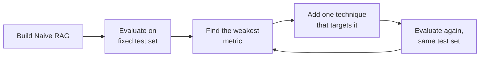
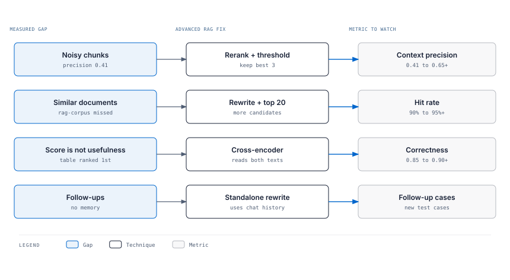
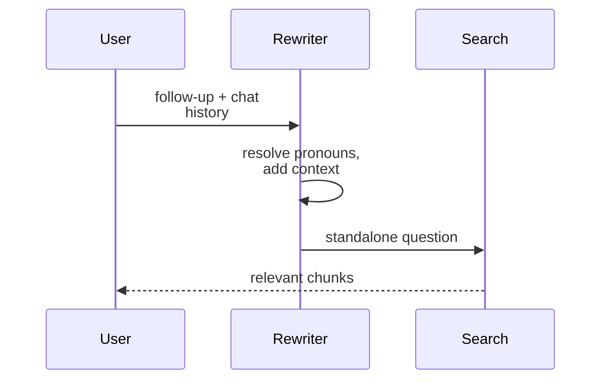

# 02. From Naive to Advanced RAG

In this note:

- Why we do not jump straight to Advanced RAG: measure first
- The Naive RAG baseline, in numbers
- Each measured gap and the Advanced RAG technique that targets it
- Four real failure cases, walked through Naive and Advanced RAG
- Which gaps Advanced RAG does not fix
- The targets for this folder

## Measure first, then improve

Every Advanced RAG technique adds cost and latency, so it should be added only where it solves a measured problem. The [Naive RAG implementation](../../../01.%20Naive%20RAG/) was evaluated on a fixed 11-question test set with an LLM judge (doc 25 of the Naive RAG API) before any of this was planned. The scores tell us exactly where to spend effort.

## The Naive RAG baseline

<table width="100%">
<thead><tr><th>Metric</th><th>Baseline</th><th>Reading</th></tr></thead>
<tbody>
<tr><td>Faithfulness</td><td>0.95</td><td>The LLM stays within the retrieved chunks</td></tr>
<tr><td>Answer relevance</td><td>0.98</td><td>The LLM answers the question asked</td></tr>
<tr><td>Context precision</td><td>0.41</td><td>Fewer than half of the 4 retrieved chunks are useful</td></tr>
<tr><td>Correctness</td><td>0.85</td><td>Mostly right; wrong when the key passage was not retrieved</td></tr>
<tr><td>Retrieval hit rate</td><td>90%</td><td>One question in ten never sees the right document</td></tr>
<tr><td>Overall</td><td>0.80</td><td>9 of 11 questions pass</td></tr>
<tr><td>Cost and time</td><td>Rs 0.02, 1.7 s</td><td>Per question</td></tr>
</tbody>
</table>

The pattern is clear: **generation is near its ceiling, retrieval is not.** A bigger or better LLM would add cost for almost no gain. Every point of improvement must come from giving the LLM better context, which is exactly what Advanced RAG does.

## Gaps and fixes

<table width="100%">
<thead><tr><th>Measured gap (Naive RAG doc 28)</th><th>Evidence</th><th>Root cause</th><th>Advanced RAG fix</th><th>Note</th></tr></thead>
<tbody>
<tr><td>L1 Most retrieved chunks are noise</td><td>Context precision 0.41; chunks scoring 0.14 sent next to a 0.52 chunk</td><td>Fixed k, no minimum score</td><td>Score threshold, dynamic k, reranking</td><td>08, 09</td></tr>
<tr><td>L2 k cannot serve recall and precision at once</td><td>Top 2: precision 0.50, hit rate 80%. Top 6: precision 0.32, hit rate 100%</td><td>One number decides both how much to search and how much to send</td><td>Retrieve 20 for recall, keep 3 for precision</td><td>06, 08</td></tr>
<tr><td>L3 Similar documents confuse search</td><td>rag-corpus retrieved only Corrective RAG chunks</td><td>The question's words match many papers equally</td><td>Query rewriting with specific terms; reranking</td><td>03, 08</td></tr>
<tr><td>L5 Similarity score is not usefulness</td><td>A results table ranked first (0.601), the useful chunk fourth (0.582)</td><td>The bi-encoder never reads question and chunk together</td><td>Cross-encoder reranking</td><td>07, 08</td></tr>
<tr><td>L6 Fixed chunks cap precision</td><td>One-chunk HR file: precision 0.25 with a perfect answer</td><td>Always k chunks, whatever the document</td><td>Threshold and dynamic k</td><td>09</td></tr>
<tr><td>L9 No memory for follow-ups</td><td>A follow-up with a pronoun was searched as is</td><td>Only the latest message is embedded</td><td>Conversational (standalone) rewriting</td><td>05</td></tr>
<tr><td>Prompt full of noise (cost)</td><td>About 59% of context chunks are not useful</td><td>Same as L1</td><td>Fewer chunks, context compression</td><td>10</td></tr>
</tbody>
</table>

## Four failure cases, walked through

These are real cases from the Naive RAG runs. The Advanced RAG column is the expected behaviour that the implementation and its evaluation will have to confirm.

### Case 1: "What document collection does RAG retrieve from?" (rag-corpus)

<table width="100%">
<thead><tr><th>Step</th><th>Naive RAG (measured)</th><th>Advanced RAG (expected)</th></tr></thead>
<tbody>
<tr><td>Query</td><td>As typed</td><td>Rewritten: "Which knowledge corpus and retrieval index does the original RAG model (Lewis et al. 2020) use, for example a Wikipedia dump split into passages?"</td></tr>
<tr><td>Retrieval</td><td>Top 4, all from the Corrective RAG paper</td><td>Top 20 includes RAG-paper chunks about the Wikipedia index</td></tr>
<tr><td>Post-retrieval</td><td>None</td><td>Reranker moves the Wikipedia-index chunk to the top; weak chunks dropped</td></tr>
<tr><td>Result</td><td>Hit = no, correctness 0 to 0.25</td><td>Hit = yes, correctness should rise</td></tr>
</tbody>
</table>

### Case 2: "Which retriever and generator does the original RAG model combine?" (rag-components)

Naive RAG found the RAG paper but not the passage naming DPR and BART-large (correctness 0.25 to 0.50). Retrieving 20 candidates makes it likely that the naming passage is among them, and a cross-encoder, which reads "retriever and generator" next to "DPR ... BART", should rank it first.

### Case 3: "How many sick days do employees get per year?" (hr-sick-days)

The answer was perfect, but precision was 0.25 because three unrelated paper chunks filled the remaining slots. A reranker gives those chunks low scores, and a threshold drops them, so the prompt holds one or two chunks: precision rises and the prompt gets shorter and cheaper.

### Case 4: a follow-up question

After asking about a person in an uploaded CV, the user asked "is he good for an AI engineer role?". Naive RAG searched for "is he good for an AI engineer role" and could not know who "he" was. Conversational rewriting first turns it into "Is [the person named in the previous answer] a good fit for an AI engineer role based on their experience?", then searches.

## What Advanced RAG will not fix

<table width="100%">
<thead><tr><th>Gap</th><th>Why Advanced RAG does not solve it</th><th>Where it is solved</th></tr></thead>
<tbody>
<tr><td>L4 Exact names and codes</td><td>Rewriting and reranking help, but the first search is still dense; if the chunk is not in the top 20, the reranker never sees it</td><td>03. Hybrid Search RAG</td></tr>
<tr><td>L7 PDF extraction noise</td><td>A better ranking of noisy chunks is still noisy</td><td>Better loaders; 18. Multimodal RAG for tables and figures</td></tr>
<tr><td>L8 No check of retrieved chunks before answering</td><td>A threshold drops weak chunks, but there is no "retrieval failed, search again" decision</td><td>09. Corrective RAG, 08. Self RAG</td></tr>
<tr><td>L10 Multi-hop questions</td><td>Still one retrieval</td><td>10. Adaptive RAG, 11. Active Iterative RAG, 13. Graph RAG</td></tr>
</tbody>
</table>

## Targets for this folder

<table width="100%">
<thead><tr><th>Metric</th><th>Naive RAG</th><th>Advanced RAG target</th><th>Main lever</th></tr></thead>
<tbody>
<tr><td>Context precision</td><td>0.41</td><td>0.65 or higher</td><td>Reranking, threshold</td></tr>
<tr><td>Retrieval hit rate</td><td>90%</td><td>95 to 100%</td><td>Rewriting, 20 candidates</td></tr>
<tr><td>Correctness</td><td>0.85</td><td>0.90 or higher</td><td>Right passage reaches the prompt</td></tr>
<tr><td>Faithfulness</td><td>0.95</td><td>0.95 or higher (must not drop)</td><td>Unchanged prompt and generator</td></tr>
<tr><td>Overall</td><td>0.80</td><td>0.85 or higher</td><td>All of the above</td></tr>
<tr><td>Cost per question</td><td>Rs 0.02</td><td>under Rs 0.04</td><td>Extra calls, but fewer chunks in the prompt</td></tr>
<tr><td>Answer time</td><td>1.7 s</td><td>under 3 s</td><td>Fast reranker, short rewrite</td></tr>
</tbody>
</table>

The comparison will be fair: same documents, same 11 test cases (plus new follow-up cases), same judge, at least two runs per setting (Naive RAG note on comparing runs: differences under about 0.03 are noise).

## Key points

- Advanced RAG is chosen because the evaluation says retrieval is the bottleneck, not because it is the next item on a list.
- Each technique maps to a measured gap: reranking and thresholds for noise, rewriting and more candidates for misses, conversational rewriting for follow-ups.
- Some gaps need later architectures: exact names (hybrid search), retrieval checks (Corrective RAG), multi-hop (iterative and graph RAG).
- Success is defined in advance with numbers, and faithfulness must not drop.

## Navigation

Previous: [01. What is Advanced RAG](01.%20What%20is%20Advanced%20RAG.md) | [Index](README.md) | Next: [03. Query Rewriting](03.%20Query%20Rewriting.md)
