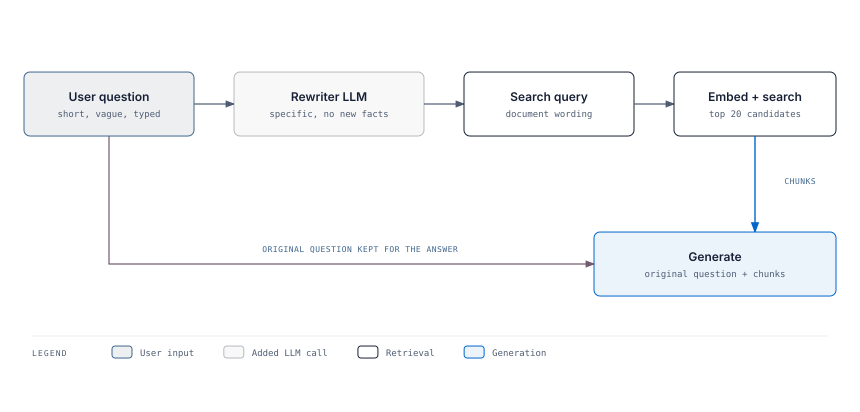
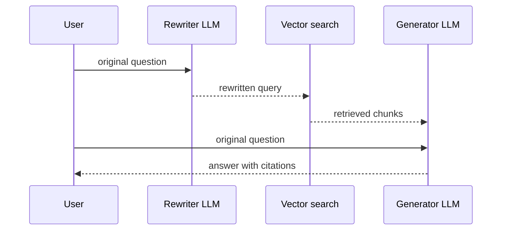

# 03. Query Rewriting

In this note:

- The vocabulary mismatch problem: users and documents use different words
- Why embeddings alone do not solve it
- What query rewriting is, and the rule that the answer still uses the original question
- The kinds of rewriting
- How an LLM rewriter works, with a prompt
- A worked example from the Naive RAG failures
- The Rewrite-Retrieve-Read framework (paper 1, in short)
- Risks and how to control them
- Cost, latency, and when rewriting helps or hurts

## The vocabulary mismatch problem

People ask questions in their own words. Documents are written in the author's words. Retrieval works by comparing the two, so when the words and the style differ, the right chunk can score lower than an unrelated one.

<table width="100%">
<thead><tr><th>User asks</th><th>The document says</th><th>Mismatch</th></tr></thead>
<tbody>
<tr><td>"How does RAG know stuff?"</td><td>"non-parametric memory ... a dense vector index of Wikipedia"</td><td>Informal words versus technical terms</td></tr>
<tr><td>"What document collection does RAG retrieve from?"</td><td>"We use a single Wikipedia dump ... split into disjoint 100-word chunks"</td><td>"collection" versus "dump", "chunks", "index"</td></tr>
<tr><td>"leave for new people?"</td><td>"New joiners get 12 days of paid leave in the first year"</td><td>Short, vague question</td></tr>
<tr><td>"and what about Self-RAG?"</td><td>(depends on the previous question)</td><td>Missing context (note 05)</td></tr>
</tbody>
</table>

In information retrieval this is called the **vocabulary mismatch problem**. It is one reason the Naive RAG evaluation missed the RAG paper entirely for `rag-corpus` (doc 28 of the Naive RAG API, limitation L3).

## Why embeddings do not fully solve it

Embeddings capture meaning, not just exact words, so they handle synonyms better than keyword search. They still struggle when:

<table width="100%">
<thead><tr><th>Situation</th><th>Why the embedding is weak</th></tr></thead>
<tbody>
<tr><td>The question is very short</td><td>Few words give a vector with little specific meaning; it lands near many chunks</td></tr>
<tr><td>Question form versus statement form</td><td>"What is X?" and "X is ..." are different kinds of text; their vectors are less similar than two statements</td></tr>
<tr><td>Ambiguous terms</td><td>"RAG" appears in all four papers; the vector cannot tell which paper is meant</td></tr>
<tr><td>Missing context</td><td>A follow-up like "and its limitations?" has no subject at all</td></tr>
<tr><td>Rare names</td><td>"DPR" or "BART" carry little weight in the vector (best fixed by hybrid search, 03. Hybrid Search RAG)</td></tr>
</tbody>
</table>

Fixing the documents side is expensive (re-chunking, re-embedding). Fixing the query side is cheap: one short LLM call per question.

## What query rewriting is

**Query rewriting** turns the user's question into a better **search query** before retrieval: clearer, more specific, standalone and written the way the documents are written.



**The key rule: rewrite for retrieval, answer the original.** The rewritten query is used only to search. The generator still receives the user's original question (with the retrieved chunks), because the user's exact intent, tone and constraints must be answered, not the rewriter's version of them. (The diagram is simplified: in the full pipeline the candidates are reranked before generation, note 08.)

## Kinds of rewriting

<table width="100%">
<thead><tr><th>Kind</th><th>What it does</th><th>Example</th><th>Note</th></tr></thead>
<tbody>
<tr><td>Clarification</td><td>Makes a vague question specific</td><td>"leave for new people?" to "How many days of paid leave do new joiners get in their first year?"</td><td>This note</td></tr>
<tr><td>Terminology alignment</td><td>Uses the words the documents use</td><td>"document collection" to "retrieval corpus, Wikipedia dump, passage index"</td><td>This note</td></tr>
<tr><td>Normalisation</td><td>Fixes spelling, expands abbreviations</td><td>"reasoningng for ai enginner" to "reasoning for an AI engineer"</td><td>This note</td></tr>
<tr><td>Standalone rewriting</td><td>Resolves follow-ups with the chat history</td><td>"and its limitations?" to "What are the limitations of Self-RAG?"</td><td>05</td></tr>
<tr><td>Expansion and multi-query</td><td>Adds related terms or several variants of the question</td><td>One question becomes three phrasings, each searched</td><td>04</td></tr>
<tr><td>Step-back</td><td>Asks a more general question first</td><td>"Why did CRAG use T5?" to "How is the CRAG retrieval evaluator built?"</td><td>04</td></tr>
<tr><td>Decomposition</td><td>Splits a multi-part question into sub-questions</td><td>"Compare Self-RAG and CRAG" into two questions</td><td>10, 11 (later folders)</td></tr>
<tr><td>Hypothetical answer (HyDE)</td><td>Searches with a generated answer instead of the question</td><td>Embed a fake answer paragraph</td><td>04. HyDE RAG</td></tr>
</tbody>
</table>

## How an LLM rewriter works

The rewriter is a normal chat model (in this project gpt-4o-mini) with a short, strict prompt:

```text
System:
You rewrite user questions into search queries for a document search engine.
Rules:
1. Keep the meaning of the question. Do not answer it.
2. Make it specific and self-contained. Use the technical terms a document would use.
3. Do not add facts, names or numbers that are not in the question.
4. Return only the rewritten query, on one line.

User:
What document collection does RAG retrieve from?
```

Settings: temperature 0 (stable rewrites), a small output limit (about 60 tokens), and logging of both the original and the rewritten query so every rewrite can be inspected.



## Worked example

The Naive RAG case `rag-corpus` (hit = no, correctness 0 to 0.25):

<table width="100%">
<thead><tr><th>Step</th><th>Naive RAG</th><th>With rewriting</th></tr></thead>
<tbody>
<tr><td>Search query</td><td>"What document collection does RAG retrieve from?"</td><td>"knowledge corpus and retrieval index used by the RAG model (Lewis et al.): Wikipedia dump split into passages, dense vector index"</td></tr>
<tr><td>Words shared with the target chunk</td><td>"RAG", "retrieve"</td><td>"Wikipedia", "passages", "index", "dense", "corpus"</td></tr>
<tr><td>Likely top chunks</td><td>Corrective RAG passages about "corpora"</td><td>RAG paper passages about the Wikipedia index</td></tr>
</tbody>
</table>

Rule 3 of the prompt matters here: the rewriter may add "Wikipedia" only because it is the standard term for RAG's corpus in the question's own domain; if it invented a wrong fact (for example a wrong year), retrieval could drift to the wrong passage. That is why rewrites are logged and evaluated.

Why this helps, in numbers (illustrative): if the target chunk d* has cosine similarity 0.52 with the original question q and 0.66 with the rewritten query q', while an unrelated chunk d has 0.55 with q and 0.49 with q', then

$$\cos(q, d^*) = 0.52 < \cos(q, d) = 0.55 \quad\text{but}\quad \cos(q', d^*) = 0.66 > \cos(q', d) = 0.49$$

The rewrite changes the order, which is all retrieval needs.

## Rewrite-Retrieve-Read (paper 1, in short)

The paper [Query Rewriting for Retrieval-Augmented Large Language Models](../02.%20Research%20Paper%20Explained/01.%20Query%20Rewriting%20for%20Retrieval-Augmented%20LLMs/) (Ma et al., EMNLP 2023) names this pattern **Rewrite-Retrieve-Read**, in contrast to the usual retrieve-then-read:

<table width="100%">
<thead><tr><th>Step</th><th>Retrieve-then-read (Naive RAG)</th><th>Rewrite-Retrieve-Read</th></tr></thead>
<tbody>
<tr><td>1</td><td>Retrieve with the question</td><td>Rewrite the question into a query</td></tr>
<tr><td>2</td><td>Read: the LLM answers from the retrieved text</td><td>Retrieve with the rewritten query (the paper uses web search)</td></tr>
<tr><td>3</td><td>-</td><td>Read: the LLM answers from the retrieved text</td></tr>
</tbody>
</table>

The paper tries two rewriters:

- a **frozen LLM** prompted to rewrite (what this project will do first), and
- a **small trainable rewriter** (T5-large), first warmed up on rewrites produced by the LLM, then improved with **reinforcement learning**, where the reward is how well the frozen reader answers when given the documents retrieved with that rewrite.

The point of the trainable version: the reader and the retriever are black boxes that cannot be changed, so instead the query is adapted to them. The paper reports consistent gains on open-domain and multiple-choice QA. The details, figures and equations are in the paper notes.

## Risks and controls

<table width="100%">
<thead><tr><th>Risk</th><th>What goes wrong</th><th>Control</th></tr></thead>
<tbody>
<tr><td>Intent drift</td><td>The rewrite asks a different question</td><td>Prompt rule "keep the meaning"; answer the original question; evaluate correctness</td></tr>
<tr><td>Invented facts</td><td>The rewriter adds a wrong name, number or date, steering retrieval to the wrong place</td><td>Prompt rule "no new facts"; log both queries; spot-check rewrites</td></tr>
<tr><td>Over-specification</td><td>Too many added terms narrow the search and miss the chunk</td><td>Keep rewrites short; retrieve many candidates (note 06)</td></tr>
<tr><td>Unneeded rewrites</td><td>A clear question gets worse</td><td>Search with both the original and the rewritten query and merge, or skip rewriting for long, specific questions</td></tr>
<tr><td>Cost and latency</td><td>One more LLM call per question</td><td>Short prompt and output; small model; cache rewrites of repeated questions</td></tr>
<tr><td>Rewriter failure</td><td>The call errors or times out</td><td>Fall back to the original question</td></tr>
</tbody>
</table>

## Cost and latency

A rewrite prompt is about 150 to 250 tokens and the output about 20 to 60 tokens. With gpt-4o-mini prices ($0.15 per million input, $0.60 per million output):

$$\frac{200 \cdot 0.15 + 40 \cdot 0.60}{10^6} = \$0.000054 \approx \text{Rs } 0.0045$$

That is about a quarter of the Naive RAG cost of one question (Rs 0.02), and about 0.5 to 1 second of extra latency.

## When rewriting helps and when it hurts

<table width="100%">
<thead><tr><th>Helps</th><th>Hurts or adds nothing</th></tr></thead>
<tbody>
<tr><td>Short, vague or misspelled questions</td><td>Long, precise questions already in the documents' words</td></tr>
<tr><td>Informal language against technical documents</td><td>Exact-match lookups (an ID, a code) the rewriter might alter</td></tr>
<tr><td>Follow-up questions (with history, note 05)</td><td>Latency-critical paths where 0.5 s matters more than quality</td></tr>
<tr><td>Corpora with many similar documents</td><td>Very small corpora where any query finds the chunk</td></tr>
</tbody>
</table>

## In this project

The Advanced RAG API will add a rewrite step before retrieval with the prompt above, return the rewritten query with each answer, log both queries, and fall back to the original on error. The UI will show the original and rewritten question side by side. The evaluation will measure the effect of rewriting alone first (before reranking), so its gain or loss is visible on its own.

## Key points

- Users and documents use different words; rewriting the query is the cheapest way to close the gap.
- Rewrite for retrieval, answer the original question.
- Keep the rewriter strict: same meaning, specific terms, no new facts, one line.
- Rewrite-Retrieve-Read (Ma et al. 2023) formalises the idea and shows even a small trained rewriter can help a frozen LLM.
- It costs about Rs 0.0045 and 0.5 to 1 s per question; log every rewrite and measure its effect.

## Navigation

Previous: [02. From Naive to Advanced RAG](02.%20From%20Naive%20to%20Advanced%20RAG.md) | [Index](README.md) | Next: 04. Query Expansion and Multi-Query (next)
