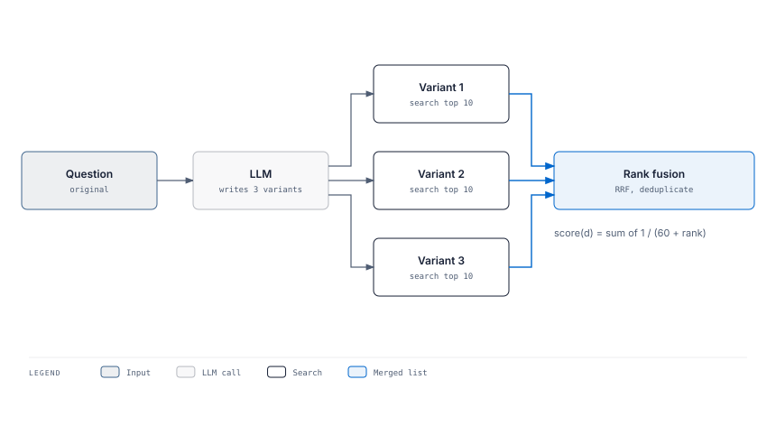
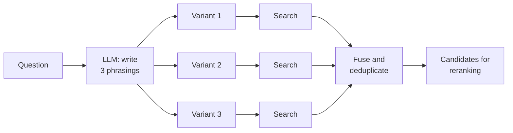

# 04. Query Expansion and Multi-Query

In this note:

- Query expansion: adding the words the documents might use
- Classic expansion (synonyms, pseudo-relevance feedback) and LLM expansion
- Multi-query: searching several phrasings of the same question
- Merging ranked lists with reciprocal rank fusion (RRF), with a worked example
- Step-back questions and hypothetical answers (HyDE), in short
- Cost, risks, and when to use which

Note 03 rewrote one question into one better query. This note goes further: either **add** to the query, or turn it into **several** queries, so that at least one of them matches the way the right chunk is written.

## Query expansion

**Query expansion** adds related terms to the query: synonyms, technical terms, spelled-out abbreviations, words that usually appear next to the answer. The goal is recall: the right chunk is found even if it uses different words from the question.

<table width="100%">
<thead><tr><th>Method</th><th>How it works</th><th>Example for "What is DPR?"</th></tr></thead>
<tbody>
<tr><td>Synonyms and abbreviations</td><td>Add known equivalents from a dictionary or thesaurus</td><td>"DPR Dense Passage Retriever"</td></tr>
<tr><td>Pseudo-relevance feedback (classic)</td><td>Search once, take frequent terms from the top results, add them, search again (Rocchio-style)</td><td>"DPR dense passage retriever BERT bi-encoder question encoder"</td></tr>
<tr><td>LLM expansion</td><td>Ask an LLM for related terms or a short description</td><td>"DPR, Dense Passage Retrieval, dual BERT encoders, inner product search, open-domain QA"</td></tr>
<tr><td>Document-style expansion (Query2doc)</td><td>Ask an LLM to write a short pseudo-document and append it to the query (Wang et al. 2023)</td><td>Question plus a two-sentence passage about DPR</td></tr>
</tbody>
</table>

For dense (embedding) search, expansion moves the query vector towards the region where answer-like text lives. For keyword search (BM25, 03. Hybrid Search RAG), it simply adds matching words, which is where classic expansion was invented.

**Risk:** every added term is a guess. Wrong or too many terms drag the query vector away from the question ("query drift"). Keep expansions short and keep the original question in the query.

## Multi-query

Instead of one improved query, **multi-query** asks an LLM for several different phrasings of the question, searches with each, and merges the results.





Example prompt:

```text
Write 3 different search queries for the question below. Each query should
use different wording or focus on a different aspect. Do not answer the
question. Return one query per line.

Question: What document collection does RAG retrieve from?
```

Possible output:

```text
knowledge source used by the RAG model of Lewis et al.
Wikipedia dump split into 100-word passages for retrieval
dense vector index of documents searched by the RAG retriever
```

Why it works: a single phrasing can miss the chunk by bad luck of wording; three phrasings that cover different words and aspects make it very likely that the right chunk ranks high in at least one list, and chunks that rank well in **several** lists are almost always relevant.

## Merging lists: reciprocal rank fusion

The lists cannot be merged by raw scores: similarity scores from different queries are not on the same scale. **Reciprocal rank fusion (RRF)** (Cormack, Clarke and Buettcher, SIGIR 2009) uses only the **rank** of each chunk in each list:

$$\text{RRF}(d) = \sum_{i=1}^{m} \frac{1}{k + \text{rank}_i(d)}$$

<table width="100%">
<thead><tr><th>Symbol</th><th>Meaning</th></tr></thead>
<tbody>
<tr><td>d</td><td>A chunk</td></tr>
<tr><td>m</td><td>Number of ranked lists (here, the number of query variants)</td></tr>
<tr><td>rank_i(d)</td><td>Position of d in list i (1 = top); a chunk missing from a list adds nothing for that list</td></tr>
<tr><td>k</td><td>A constant, usually 60, that stops the first places from dominating</td></tr>
</tbody>
</table>

### Worked example

Three variants, top results (k = 60):

<table width="100%">
<thead><tr><th>Rank</th><th>List 1</th><th>List 2</th><th>List 3</th></tr></thead>
<tbody>
<tr><td>1</td><td>A</td><td>B</td><td>C</td></tr>
<tr><td>2</td><td>B</td><td>D</td><td>B</td></tr>
<tr><td>3</td><td>E</td><td>A</td><td>F</td></tr>
<tr><td>4</td><td>C</td><td>-</td><td>-</td></tr>
</tbody>
</table>

<table width="100%">
<thead><tr><th>Chunk</th><th>Calculation</th><th>RRF score</th><th>Fused rank</th></tr></thead>
<tbody>
<tr><td>B</td><td>1/62 + 1/61 + 1/62</td><td>0.04865</td><td>1</td></tr>
<tr><td>A</td><td>1/61 + 1/63</td><td>0.03227</td><td>2</td></tr>
<tr><td>C</td><td>1/64 + 1/61</td><td>0.03202</td><td>3</td></tr>
<tr><td>D</td><td>1/62</td><td>0.01613</td><td>4</td></tr>
<tr><td>E, F</td><td>1/63</td><td>0.01587</td><td>5</td></tr>
</tbody>
</table>

B was never first in list 1, but it appears near the top of all three lists, so it wins. That is the behaviour we want: agreement across phrasings is strong evidence of relevance. The same formula is used again to merge keyword and vector results in 03. Hybrid Search RAG and is the core of 05. RAG Fusion.

## Step-back questions and hypothetical answers

Two more ways to generate better queries, each with its own folder or note later:

<table width="100%">
<thead><tr><th>Technique</th><th>Idea</th><th>Example</th><th>Where</th></tr></thead>
<tbody>
<tr><td>Step-back prompting (Zheng et al. 2023)</td><td>Ask a more general question first, retrieve background for it, then answer the specific question</td><td>"Why does CRAG use a T5 evaluator?" steps back to "How does the CRAG retrieval evaluator work?"</td><td>Can be added as one more variant</td></tr>
<tr><td>HyDE, hypothetical document embeddings (Gao et al. 2022)</td><td>Ask the LLM to write a fake answer passage and search with its embedding, because an answer looks more like the chunk than a question does</td><td>A generated paragraph describing RAG's Wikipedia index</td><td><a href="../../../04.%20HyDE%20RAG/">04. HyDE RAG</a></td></tr>
</tbody>
</table>

## Comparing the options

<table width="100%">
<thead><tr><th>Technique</th><th>LLM calls</th><th>Searches</th><th>Best for</th><th>Main risk</th></tr></thead>
<tbody>
<tr><td>Rewriting (note 03)</td><td>1</td><td>1</td><td>Vague or informal questions</td><td>Intent drift</td></tr>
<tr><td>Expansion</td><td>0 or 1</td><td>1</td><td>Terminology gaps, abbreviations</td><td>Query drift from wrong terms</td></tr>
<tr><td>Multi-query + RRF</td><td>1</td><td>3 to 5</td><td>Questions that can be phrased many ways; similar documents</td><td>More candidates to rerank; more latency</td></tr>
<tr><td>Step-back</td><td>1</td><td>2</td><td>Questions that need background first</td><td>Retrieves general text that crowds out the specific answer</td></tr>
<tr><td>HyDE</td><td>1</td><td>1</td><td>Short questions over long technical documents</td><td>A wrong fake answer retrieves wrong chunks</td></tr>
</tbody>
</table>

## Cost

Multi-query with 3 variants costs one LLM call (about 150 input and 60 output tokens) plus 3 embedding calls of about 15 tokens each:

$$\frac{150 \cdot 0.15 + 60 \cdot 0.60 + 45 \cdot 0.02}{10^6} \approx \$0.00006 \approx \text{Rs } 0.005$$

The money is small; the real costs are latency (the LLM call, then 3 searches, which can run in parallel) and a larger candidate set for the reranker (note 06).

## In this project

The first Advanced RAG version uses a single rewrite (note 03) and a conversational rewrite (note 05), because they are the simplest changes and target the measured failures directly. Multi-query and RRF are kept as an option to switch on and evaluate separately; if the hit rate is still below the target after reranking, multi-query is the next lever. RRF is implemented properly in 03. Hybrid Search RAG and 05. RAG Fusion.

## Key points

- Expansion adds terms; multi-query searches several phrasings; both raise recall.
- Merge ranked lists by rank, not score: RRF(d) = sum of 1 / (60 + rank).
- Chunks that rank well for several phrasings are the most reliable.
- Step-back and HyDE are two more ways to write a better query.
- Every extra query adds latency and candidates; add it only if evaluation shows misses remain.

## Navigation

Previous: [03. Query Rewriting](03.%20Query%20Rewriting.md) | [Index](README.md) | Next: 05. Conversational Query Rewriting (next)
