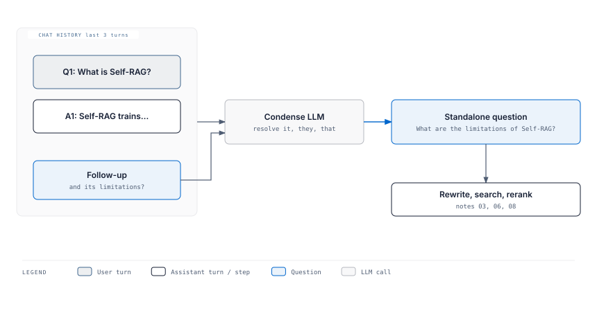
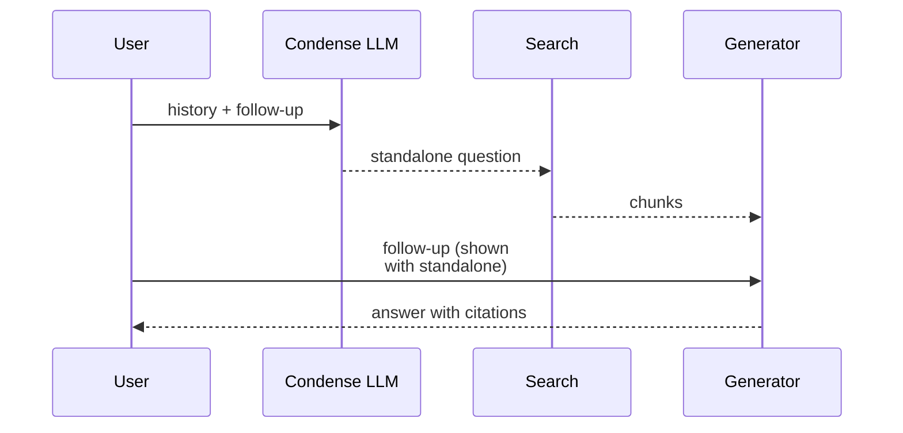

# 05. Conversational Query Rewriting

In this note:

- Why follow-up questions break Naive RAG
- The three things a follow-up leaves out: who, what, and which
- Condensing a follow-up into a standalone question
- The prompt, and how much chat history to send
- What the generator should receive
- When to skip the step, and how to handle topic changes
- Where the history lives in a stateless API
- How to evaluate it

## Why follow-ups break Naive RAG

People talk to a chat assistant in a conversation, not in isolated queries. The second question usually depends on the first:

```text
User: What is Self-RAG?
Assistant: Self-RAG trains a language model to decide when to retrieve and to critique its own output with reflection tokens [1].
User: and its limitations?
```

Naive RAG embeds only the latest message, "and its limitations?". That vector has no subject, so retrieval returns whatever chunks talk about limitations in general, from any paper. The Naive RAG logs showed exactly this with a follow-up that referred to a person with "he" (Naive RAG doc 28, limitation L9).

## What a follow-up leaves out

<table width="100%">
<thead><tr><th>Missing piece</th><th>Linguistic name</th><th>Follow-up</th><th>Standalone question</th></tr></thead>
<tbody>
<tr><td>Who or what (pronouns)</td><td>Coreference</td><td>"How was it trained?"</td><td>"How was Self-RAG trained?"</td></tr>
<tr><td>The rest of the sentence</td><td>Ellipsis</td><td>"And for CRAG?"</td><td>"What are the limitations of Corrective RAG (CRAG)?"</td></tr>
<tr><td>Which of several things</td><td>Reference to the previous answer</td><td>"Explain the second one."</td><td>"Explain the ISREL reflection token in Self-RAG."</td></tr>
<tr><td>Implicit comparison</td><td>Context carry-over</td><td>"Is it better than Naive RAG?"</td><td>"Is Self-RAG better than Naive RAG, and why?"</td></tr>
</tbody>
</table>

## Condensing into a standalone question

**Conversational query rewriting** (also called query condensing or question contextualisation) uses the recent chat history to turn the follow-up into a **standalone question**: one that a person who never saw the conversation would understand. Retrieval then searches with the standalone question.





In practice the condense step and the query rewrite of note 03 can be **one LLM call**: "make it standalone, then write it as a search query". Two separate calls give cleaner logs; one call saves about half a second.

## The prompt

```text
System:
Given the chat history and a follow-up question, rewrite the follow-up into a
standalone question that can be understood without the history.
Rules:
1. Replace pronouns and references (it, they, he, she, that, the second one) with what they refer to.
2. Keep the user's intent and wording as far as possible. Do not answer.
3. If the follow-up is already standalone, return it unchanged.
4. Use only the history; do not add facts.
Return only the standalone question.

Chat history:
User: What is Self-RAG?
Assistant: Self-RAG trains a language model to decide when to retrieve ...

Follow-up: and its limitations?
```

Output: `What are the limitations of Self-RAG?`

Rule 3 matters: most questions in a chat are already standalone, and the step must not damage them.

## How much history to send

<table width="100%">
<thead><tr><th>Choice</th><th>Pros</th><th>Cons</th></tr></thead>
<tbody>
<tr><td>Last 1 turn</td><td>Cheapest, enough for most follow-ups</td><td>Misses references two turns back</td></tr>
<tr><td>Last 3 turns (recommended start)</td><td>Covers nearly all real follow-ups</td><td>A few hundred more tokens</td></tr>
<tr><td>Whole conversation</td><td>Nothing is missed</td><td>Grows without limit; old topics can leak into new questions</td></tr>
<tr><td>Summary of older turns + last 3</td><td>Bounded cost with long memory</td><td>Extra summarisation call; for long chats only</td></tr>
</tbody>
</table>

Answers in the history can be long, so it helps to send the user questions in full and the assistant answers shortened (for example the first 300 characters). A three-turn history is typically 300 to 800 tokens, about Rs 0.01 at most with gpt-4o-mini.

## What the generator receives

Retrieval uses the standalone question. For generation there are two common choices:

<table width="100%">
<thead><tr><th>Option</th><th>Generator gets</th><th>Trade-off</th></tr></thead>
<tbody>
<tr><td>Standalone only</td><td>Standalone question + chunks</td><td>Simple, the question is complete; loses the user's exact phrasing</td></tr>
<tr><td>Both (recommended)</td><td>Standalone question as the question, the user's follow-up shown for tone + chunks</td><td>Answers the complete question in the user's terms</td></tr>
<tr><td>Full history</td><td>History + follow-up + chunks</td><td>Most natural chat, but a longer prompt and a risk of answering from the history instead of the chunks</td></tr>
</tbody>
</table>

This project keeps the grounding rule from Naive RAG: facts come only from the retrieved chunks, never from previous answers in the history.

## When to skip, and topic changes

- **First question of a chat:** no history, skip the call.
- **Already standalone:** the prompt returns it unchanged; to save the call entirely, skip when the question is long and has no pronouns or leading "and", "what about", "also".
- **Topic change:** "Now tell me about the HR leave policy" after questions about Self-RAG must **not** become "the HR leave policy of Self-RAG". The prompt's "keep the intent" rule and the history limit handle most cases; the evaluation includes a topic-change case to check.

## Where the history lives

The Naive RAG API is stateless: each POST /query is independent. Two designs:

<table width="100%">
<thead><tr><th>Design</th><th>How</th><th>Used here</th></tr></thead>
<tbody>
<tr><td>Client sends history</td><td>The request includes the last few turns; the server stores nothing</td><td>Yes: simple, no server state, the UI already holds the conversation</td></tr>
<tr><td>Server stores sessions</td><td>A session id; the server keeps the turns in a database</td><td>Later (20. Memory RAG), when memory must outlive the browser tab</td></tr>
</tbody>
</table>

Privacy note: the history is sent to the LLM again with every follow-up, so anything the user typed earlier (including personal data) is reprocessed. Keep the window short and do not log full histories.

## How to evaluate it

The Naive RAG test set has single questions only. Conversational rewriting needs **multi-turn cases**:

<table width="100%">
<thead><tr><th>Case</th><th>History</th><th>Follow-up</th><th>Expected standalone</th><th>Expected file</th></tr></thead>
<tbody>
<tr><td>Pronoun</td><td>"What is Self-RAG?"</td><td>"How does it decide when to retrieve?"</td><td>"How does Self-RAG decide when to retrieve?"</td><td>Self-RAG paper</td></tr>
<tr><td>Ellipsis</td><td>"What does CRAG do when documents are incorrect?"</td><td>"And when they are ambiguous?"</td><td>"What does CRAG do when retrieved documents are ambiguous?"</td><td>Corrective RAG paper</td></tr>
<tr><td>Topic change</td><td>"What are reflection tokens in Self-RAG?"</td><td>"How many sick days do employees get?"</td><td>Unchanged</td><td>hr_policy.md</td></tr>
</tbody>
</table>

Measure the retrieval hit rate and correctness on these cases with and without the condense step; Naive RAG should fail the first two and pass the third.

## Key points

- Follow-ups leave out who, what or which; searching them as typed retrieves the wrong chunks.
- Condense the follow-up with the last few turns into a standalone question, then search with it.
- Return standalone questions unchanged; do not let old topics leak into new ones.
- Facts still come only from retrieved chunks, never from previous answers.
- The UI sends the recent history with each request; evaluate with multi-turn test cases.

## Navigation

Previous: [04. Query Expansion and Multi-Query](04.%20Query%20Expansion%20and%20Multi-Query.md) | [Index](README.md) | Next: 06. Candidate Retrieval and Recall (next)
