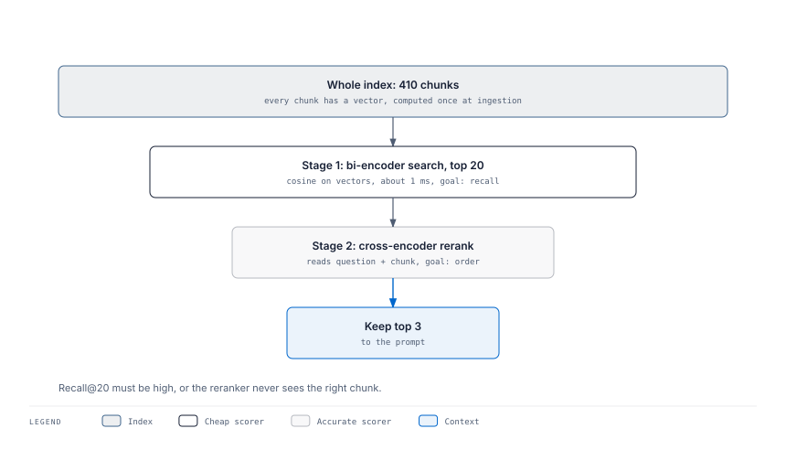
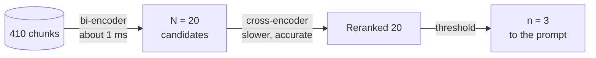

# 06. Candidate Retrieval and Recall

In this note:

- Why one k cannot serve two goals
- Two numbers instead of one: candidates N and final n
- Recall at k and precision at k, with formulas and our own numbers
- Why not simply send all candidates to the LLM
- How to choose the candidate size
- Near-duplicate chunks and diversity (MMR)
- How to measure recall in this project

## One k, two goals

In Naive RAG a single number k decided both **how many chunks to search for** and **how many chunks to send to the LLM**. Those are different goals:

- searching wants **recall**: do not miss the right chunk, so take many;
- the prompt wants **precision**: send only useful chunks, so take few.

The Naive RAG experiment shows the conflict directly (Naive RAG API doc 26):

<table width="100%">
<thead><tr><th>Top k</th><th>Hit rate (recall)</th><th>Context precision</th><th>Correctness</th></tr></thead>
<tbody>
<tr><td>2</td><td>80%</td><td>0.50</td><td>0.73</td></tr>
<tr><td>4</td><td>90%</td><td>0.41</td><td>0.86</td></tr>
<tr><td>6</td><td>100%</td><td>0.32</td><td>0.86</td></tr>
</tbody>
</table>

Raising k improved recall and lowered precision; lowering k did the opposite. No single k wins.

## Two numbers instead of one

Advanced RAG splits k into two:

<table width="100%">
<thead><tr><th>Number</th><th>Meaning</th><th>Typical value</th><th>Decided by</th></tr></thead>
<tbody>
<tr><td>N (candidates)</td><td>How many chunks the first-stage search returns</td><td>20 to 100</td><td>Recall: big enough that the right chunk is almost always inside</td></tr>
<tr><td>n (final)</td><td>How many chunks reach the prompt after reranking and filtering</td><td>2 to 5</td><td>Precision and prompt size</td></tr>
</tbody>
</table>

This is the classic **retrieve-then-rerank** (two-stage) design used by search engines long before LLMs: a cheap scorer over everything, an expensive scorer over a short list. The paper [Passage Re-ranking with BERT](../02.%20Research%20Paper%20Explained/02.%20Passage%20Re-ranking%20with%20BERT/) uses BM25 to get the top 1000 passages and BERT to rerank them.

## Recall at k and precision at k

For one question, let R be the set of chunks that are actually relevant and T_k the top k retrieved chunks:

$$\text{Recall@}k = \frac{|R \cap T_k|}{|R|} \qquad \text{Precision@}k = \frac{|R \cap T_k|}{k}$$

<table width="100%">
<thead><tr><th>Symbol</th><th>Meaning</th></tr></thead>
<tbody>
<tr><td>R</td><td>Relevant chunks for the question (from labels, or from the judge)</td></tr>
<tr><td>T_k</td><td>The top k chunks returned</td></tr>
<tr><td>|R intersect T_k|</td><td>Relevant chunks that were retrieved</td></tr>
</tbody>
</table>

Worked example: the HR sick-days question has one relevant chunk (R has 1 element). With k = 4 and that chunk ranked first: Recall@4 = 1/1 = 1.0, Precision@4 = 1/4 = 0.25. With k = 20: Recall@20 = 1.0, Precision@20 = 0.05. Recall can only go up as k grows; precision usually goes down. That is fine at stage 1, because stage 2 will remove the 19 extra chunks.

A related, simpler measure is the **hit rate** (also called Recall@k at the document level or success@k): 1 if at least one relevant item is in the top k, otherwise 0, averaged over questions. Our Naive RAG "retrieval hit rate" is exactly this, with the expected **file** as the relevant item.

## Why not send all 20 chunks to the LLM?

<table width="100%">
<thead><tr><th>Problem</th><th>Effect</th></tr></thead>
<tbody>
<tr><td>Cost</td><td>20 chunks of about 250 tokens is 5,000 prompt tokens per question instead of about 1,000: five times the price</td></tr>
<tr><td>Noise</td><td>With precision near 0.05 to 0.2, the LLM must find a few useful sentences among many unrelated ones; wrong details can leak into the answer</td></tr>
<tr><td>Lost in the middle</td><td>LLMs use information at the start and end of a long context better than in the middle (Liu et al. 2023), so a useful chunk at position 11 may be ignored</td></tr>
<tr><td>Latency</td><td>Longer prompts take longer to process</td></tr>
</tbody>
</table>

The candidates exist to be **ranked**, not to be read by the generator.

## Choosing N

<table width="100%">
<thead><tr><th>Too small (for example 5)</th><th>About right (20 to 50 here)</th><th>Too large (for example 500)</th></tr></thead>
<tbody>
<tr><td>Same misses as Naive RAG; the reranker cannot rescue a chunk it never sees</td><td>Right chunk almost always inside; reranking stays fast</td><td>Reranker cost and latency grow linearly with N; little extra recall</td></tr>
</tbody>
</table>

Rules of thumb:

- The cost of a cross-encoder grows with N, because it scores every (question, chunk) pair separately. A small cross-encoder scores 20 pairs in tens to a few hundred milliseconds on a CPU; a hosted reranker charges per search or per document.
- The first-stage search itself is almost free: FAISS compares the query vector with all 410 vectors in about a millisecond, so N = 20 or N = 50 costs the same at this stage.
- Pick the smallest N where Recall@N on the test set reaches about 100 percent. Our data gives 100 percent at k = 6 for file-level hits, so N = 20 leaves a wide margin for chunk-level recall.

## Near-duplicates and diversity

Chunks overlap by 150 characters, so neighbouring chunks of the same page are similar and often appear together in the candidates. Two problems follow: duplicates waste candidate slots, and a reranker may keep three near-identical chunks for the prompt.

Two fixes:

- **Deduplicate** candidates that come from the same page and overlap heavily (for example keep the higher-scoring one).
- **Maximal Marginal Relevance (MMR)** (Carbonell and Goldstein, 1998) picks chunks one by one, rewarding similarity to the question and penalising similarity to chunks already picked:

$$\text{MMR} = \arg\max_{d \in C \setminus S} \Big[ \lambda \cdot \text{sim}(q, d) - (1 - \lambda) \cdot \max_{d_j \in S} \text{sim}(d, d_j) \Big]$$

<table width="100%">
<thead><tr><th>Symbol</th><th>Meaning</th></tr></thead>
<tbody>
<tr><td>C</td><td>The candidate chunks</td></tr>
<tr><td>S</td><td>Chunks already selected</td></tr>
<tr><td>sim(q, d)</td><td>Similarity of chunk d to the question</td></tr>
<tr><td>max sim(d, d_j)</td><td>Similarity of d to the most similar chunk already selected</td></tr>
<tr><td>lambda</td><td>Balance between relevance (1) and diversity (0); 0.5 to 0.7 is common</td></tr>
</tbody>
</table>

MMR is most useful when questions need several different facts; for single-fact questions plain reranking is enough. This project starts with simple deduplication and keeps MMR as an option.

## Measuring recall in this project

<table width="100%">
<thead><tr><th>Measure</th><th>How</th><th>Label needed</th></tr></thead>
<tbody>
<tr><td>File-level hit rate at N</td><td>Is the expected file among the N candidates? (the existing test set field expected_source)</td><td>Already in the test set</td></tr>
<tr><td>Hit rate at n</td><td>Is the expected file among the final n chunks after reranking?</td><td>Same</td></tr>
<tr><td>Rank of the first relevant chunk</td><td>Position before and after reranking; shows how much the reranker moved it</td><td>Same, or the judge's relevant chunks</td></tr>
<tr><td>Chunk-level recall</td><td>Needs labelled relevant chunks per question</td><td>Not yet; the judge's relevant-chunk list is used as a proxy</td></tr>
</tbody>
</table>

The Advanced RAG API will add a CANDIDATE_K setting (default 20), log the candidate ranks and scores, and the evaluation will report hit rate at N and at n separately. If hit rate at N is high but hit rate at n is low, the reranker is the problem; if hit rate at N is low, retrieval or the query is.

## Key points

- One k cannot serve recall and precision; split it into N candidates and n final chunks.
- Recall@k = relevant retrieved / relevant; Precision@k = relevant retrieved / k.
- Stage 1 (bi-encoder, cheap) must keep the right chunk somewhere in N; stage 2 (reranker, accurate) puts it on top.
- Do not send all candidates to the LLM: cost, noise, lost in the middle.
- Choose the smallest N with near-perfect recall on the test set; remove near-duplicates, consider MMR for multi-fact questions.

## Navigation

Previous: [05. Conversational Query Rewriting](05.%20Conversational%20Query%20Rewriting.md) | [Index](README.md) | Next: 07. Bi-Encoders vs Cross-Encoders (next)
