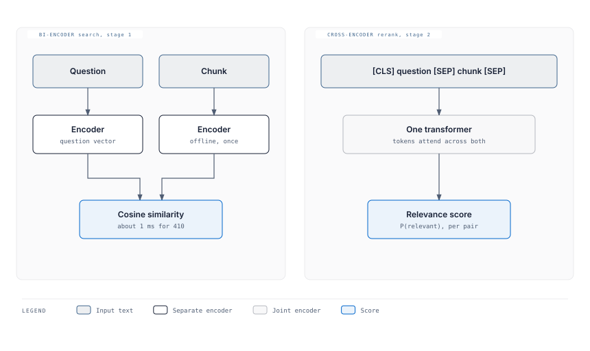
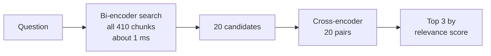

# 07. Bi-Encoders vs Cross-Encoders

In this note:

- Two ways a model can score how relevant a chunk is to a question
- How a bi-encoder works, and why it is fast
- How a cross-encoder works, and why it is accurate
- The cost of each, in numbers
- A real Naive RAG ranking error explained
- The middle ground: late interaction (ColBERT)
- Why Advanced RAG uses both

## Two ways to score relevance

Retrieval needs a function score(question, chunk). There are two families of neural models for it, and the difference is **when the question and the chunk meet**.



<table width="100%">
<thead><tr><th>Family</th><th>When question and chunk meet</th><th>Output</th><th>Role in Advanced RAG</th></tr></thead>
<tbody>
<tr><td>Bi-encoder (two towers, dual encoder)</td><td>Only at the very end, as two finished vectors</td><td>Cosine similarity of two embeddings</td><td>Stage 1: search the whole index</td></tr>
<tr><td>Cross-encoder</td><td>From the first layer, inside the model</td><td>One relevance score for the pair</td><td>Stage 2: rerank the candidates</td></tr>
</tbody>
</table>

## Bi-encoder

This is what Naive RAG already uses (text-embedding-3-small with FAISS):

1. Every chunk is encoded **once, at ingestion**, into a vector d.
2. At question time, the question is encoded into a vector q.
3. The score is the cosine similarity of the two vectors:

$$\text{score}_{bi}(q, d) = \cos(E(q), E(d)) = \frac{E(q) \cdot E(d)}{\lVert E(q) \rVert \, \lVert E(d) \rVert}$$

where E is the embedding model. Because E(d) does not depend on the question, all chunk vectors are computed in advance and the search is just one dot product per chunk, which FAISS does for 410 chunks in about a millisecond and for millions with approximate indexes.

**The weakness:** the whole meaning of a chunk must be squeezed into one fixed vector **before anyone knows the question**. The model cannot look at which words of the chunk matter for this particular question. Two chunks about the same topic get similar vectors whether or not they contain the answer.

## Cross-encoder

A cross-encoder is a transformer (for example BERT) that receives the question and the chunk **together** as one input:

```text
[CLS] How does Self-RAG decide when to retrieve? [SEP] Self-RAG trains ... a Retrieve token ... [SEP]
```

Inside the model, self-attention lets every word of the question look at every word of the chunk, layer after layer. On top, a small classification layer reads the [CLS] vector and outputs the probability that the chunk is relevant:

$$s = P(\text{relevant} \mid q, d) = \sigma(w^\top h_{[CLS]}(q, d) + b)$$

<table width="100%">
<thead><tr><th>Symbol</th><th>Meaning</th></tr></thead>
<tbody>
<tr><td>h_[CLS](q, d)</td><td>The output vector of the [CLS] token after reading question and chunk together</td></tr>
<tr><td>w, b</td><td>Weights of the single classification layer</td></tr>
<tr><td>sigma</td><td>Sigmoid (or a two-class softmax) turning the number into a probability between 0 and 1</td></tr>
</tbody>
</table>

This is exactly the model of [Passage Re-ranking with BERT](../02.%20Research%20Paper%20Explained/02.%20Passage%20Re-ranking%20with%20BERT/) (Nogueira and Cho, 2019): BERT-Large, the query truncated to 64 tokens, query plus passage up to 512 tokens, the [CLS] vector fed to a single-layer network that gives the probability of relevance, trained as a binary classifier on MS MARCO. It nearly doubled the ranking quality of BM25 on that benchmark (MRR@10 of 36.5 against 16.7 on the development set; note 08 explains the metric).

**The weakness:** nothing can be precomputed. Every (question, chunk) pair needs a full forward pass of the model at question time.

## Cost in numbers

<table width="100%">
<thead><tr><th></th><th>Bi-encoder</th><th>Cross-encoder</th></tr></thead>
<tbody>
<tr><td>Work at ingestion</td><td>Encode each chunk once</td><td>None</td></tr>
<tr><td>Work per question</td><td>Encode the question once, then one dot product per chunk</td><td>One full model pass per candidate chunk</td></tr>
<tr><td>Scoring all 410 chunks</td><td>About 1 ms (after one embedding call)</td><td>410 model passes: far too slow for every question</td></tr>
<tr><td>Scoring 20 candidates</td><td>Not needed; already scored</td><td>20 passes: tens to a few hundred milliseconds for a small model on CPU</td></tr>
<tr><td>Scales to millions of chunks</td><td>Yes, with approximate indexes</td><td>No, only for short candidate lists</td></tr>
<tr><td>Accuracy on fine distinctions</td><td>Lower</td><td>Higher</td></tr>
</tbody>
</table>

The asymmetry dictates the design: **bi-encoder over everything, cross-encoder over the short list.**

## A real ranking error, explained

From the Naive RAG logs, question "How does Self-RAG decide when to retrieve?" (Naive RAG doc 28, limitation L5):

<table width="100%">
<thead><tr><th>Bi-encoder rank</th><th>Cosine</th><th>Chunk</th><th>Useful?</th></tr></thead>
<tbody>
<tr><td>1</td><td>0.601</td><td>A results table: "SelfRAG-LLaMA2-7b PopQA CRAG 54.9 59.8 ..."</td><td>No</td></tr>
<tr><td>2</td><td>0.590</td><td>The Self-RAG title and author block</td><td>No</td></tr>
<tr><td>3</td><td>0.583</td><td>Related work on concurrent RAG methods</td><td>No</td></tr>
<tr><td>4</td><td>0.582</td><td>"... reflection tokens ... a Retrieve token decides whether retrieval is needed ..."</td><td>Yes (the one the answer cited)</td></tr>
</tbody>
</table>

All four chunks are "about Self-RAG", so their vectors are close to the question vector (scores within 0.02). The bi-encoder cannot see that only chunk 4 says **how** retrieval is decided. A cross-encoder reads "decide when to retrieve" next to "a Retrieve token decides whether retrieval is needed" and gives that pair a much higher score than the table or the title block. This is the error class that reranking is designed to fix.

## The middle ground: late interaction

**ColBERT** (Khattab and Zaharia, SIGIR 2020) keeps one vector **per token** instead of one per chunk. Chunk token vectors are precomputed; at question time each question token finds its most similar chunk token (MaxSim) and the maximums are summed:

$$\text{score}(q, d) = \sum_{i \in q} \max_{j \in d} \; E(q_i) \cdot E(d_j)$$

It captures word-level matches like a cross-encoder while still allowing precomputation like a bi-encoder, at the cost of a much larger index (one vector per token). It is a good option for very large corpora; this project uses the simpler pair of bi-encoder plus cross-encoder.

## Why Advanced RAG uses both



<table width="100%">
<thead><tr><th>Need</th><th>Bi-encoder</th><th>Cross-encoder</th><th>Together</th></tr></thead>
<tbody>
<tr><td>Search everything fast</td><td>Yes</td><td>No</td><td>Bi-encoder does it</td></tr>
<tr><td>Order a short list precisely</td><td>Weak</td><td>Yes</td><td>Cross-encoder does it</td></tr>
<tr><td>Precompute at ingestion</td><td>Yes</td><td>No</td><td>Only stage 1 needs it</td></tr>
<tr><td>Cost per question</td><td>Tiny</td><td>Grows with the list</td><td>Small, because the list is short</td></tr>
</tbody>
</table>

The same split exists in web search, e-commerce search and recommendation systems: a cheap retriever for candidates, an expensive ranker for the final order.

## Key points

- A bi-encoder encodes question and chunk separately and compares vectors: fast, precomputable, coarse.
- A cross-encoder reads question and chunk together and outputs P(relevant): accurate, but one model pass per pair.
- Bi-encoder for the whole index, cross-encoder for 20 candidates: the standard two-stage design.
- The Naive RAG error where a results table outranked the answer chunk is exactly what a cross-encoder fixes.
- Late interaction (ColBERT) is a middle ground with per-token vectors.

## Navigation

Previous: [06. Candidate Retrieval and Recall](06.%20Candidate%20Retrieval%20and%20Recall.md) | [Index](README.md) | Next: [08. Reranking](08.%20Reranking.md)
