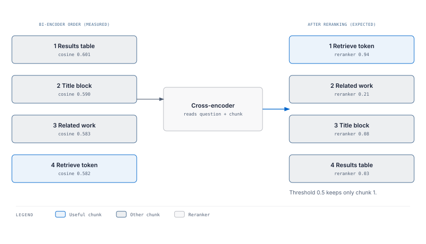
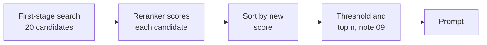

# 08. Reranking

In this note:

- What reranking is and where it sits
- Three kinds of rerankers: cross-encoder models, hosted rerank services, LLM rerankers
- How a cross-encoder reranker is trained (the BERT reranker loss)
- How ranking quality is measured: MRR, nDCG, MAP, with worked examples
- What the BERT reranker paper achieved
- Choosing a reranker for this project: quality, cost and latency
- Failure modes

## What reranking is

**Reranking** takes the candidate chunks returned by the first-stage search (note 06), scores each one again with a more accurate model, and sorts them by the new score. The top few go to the prompt; the rest are dropped.

The left side of the figure is a real Naive RAG ranking (note 07): the only useful chunk was last. The right side shows what a reranker is expected to do with the same four chunks; the reranker scores are illustrative until the implementation measures them.

## Kinds of rerankers

<table width="100%">
<thead><tr><th>Kind</th><th>Examples</th><th>How it scores</th><th>Strengths</th><th>Weaknesses</th></tr></thead>
<tbody>
<tr><td>Cross-encoder model (run yourself)</td><td>cross-encoder/ms-marco-MiniLM-L-6-v2, BAAI bge-reranker models, the BERT reranker of the paper</td><td>One transformer pass per (question, chunk) pair, outputs a relevance score</td><td>Accurate, no per-call fee, works offline, fast for small models</td><td>Adds a model dependency (PyTorch); CPU latency grows with the number of candidates</td></tr>
<tr><td>Hosted rerank service</td><td>Cohere Rerank, Azure AI Search semantic ranker, Jina Reranker, Voyage</td><td>Same idea, run by a provider behind an API</td><td>No model to host, strong multilingual models</td><td>Per-search fee, another external service, data leaves the system</td></tr>
<tr><td>LLM reranker</td><td>gpt-4o-mini prompted to score or order chunks; RankGPT (Sun et al. 2023)</td><td>Pointwise (score each chunk), pairwise (compare two) or listwise (order the whole list)</td><td>Uses the existing LLM, understands complex questions</td><td>Expensive in tokens, slower, scores can be inconsistent</td></tr>
</tbody>
</table>

### LLM reranking styles

<table width="100%">
<thead><tr><th>Style</th><th>Prompt</th><th>Calls for 20 chunks</th></tr></thead>
<tbody>
<tr><td>Pointwise</td><td>"Rate from 0 to 10 how well this passage answers the question"</td><td>20 small calls, or 1 call that returns 20 scores</td></tr>
<tr><td>Pairwise</td><td>"Which of these two passages answers the question better?"</td><td>Many comparisons (up to 190 pairs); rarely used in practice</td></tr>
<tr><td>Listwise</td><td>"Here are 20 numbered passages; return their numbers from most to least relevant"</td><td>1 large call (RankGPT uses sliding windows for long lists)</td></tr>
</tbody>
</table>

## How a cross-encoder reranker is trained

The BERT reranker (Nogueira and Cho 2019) treats reranking as **binary classification**: for each (query, passage) pair, predict relevant or not. The model outputs a probability s_j for passage j, trained with cross-entropy:

$$L = -\sum_{j \in J_{pos}} \log(s_j) - \sum_{j \in J_{neg}} \log(1 - s_j)$$

<table width="100%">
<thead><tr><th>Symbol</th><th>Meaning</th></tr></thead>
<tbody>
<tr><td>s_j</td><td>Predicted probability that passage j is relevant to the query</td></tr>
<tr><td>J_pos</td><td>Indexes of relevant passages</td></tr>
<tr><td>J_neg</td><td>Indexes of non-relevant passages among the top 1,000 retrieved by BM25</td></tr>
</tbody>
</table>

In words: push s_j towards 1 for relevant passages and towards 0 for the others. Taking negatives from the first-stage results (not random passages) is important: they are **hard negatives**, passages that look similar to the query but do not answer it, exactly the ones the reranker must learn to push down. Models like ms-marco-MiniLM are trained this way on MS MARCO, so they can be used directly without training.

## Measuring ranking quality

### MRR: mean reciprocal rank

For each question, find the rank of the **first** relevant result and take 1/rank (0 if none in the top k). Average over questions:

$$\text{MRR@}k = \frac{1}{|Q|} \sum_{q \in Q} \frac{1}{\text{rank}_q}$$

Example over three questions with the first relevant chunk at rank 1, rank 3 and not in the top 10:

$$\text{MRR@10} = \frac{1}{3}\left(\frac{1}{1} + \frac{1}{3} + 0\right) = 0.444$$

MRR rewards putting the right chunk **first**, which is what matters when only the top few chunks reach the prompt. The Naive RAG Self-RAG example above has reciprocal rank 1/4 = 0.25 before reranking and 1/1 = 1.0 after.

### nDCG: normalised discounted cumulative gain

nDCG uses graded relevance (for example 0, 1, 2) and discounts gains lower in the list:

$$\text{DCG@}k = \sum_{i=1}^{k} \frac{\text{rel}_i}{\log_2(i + 1)} \qquad \text{nDCG@}k = \frac{\text{DCG@}k}{\text{IDCG@}k}$$

where IDCG is the DCG of the ideal order. Example, top 3 with relevance [0, 1, 1]:

$$\text{DCG@3} = \frac{0}{1} + \frac{1}{1.585} + \frac{1}{2} = 1.131 \qquad \text{IDCG@3} = \frac{1}{1} + \frac{1}{1.585} = 1.631 \qquad \text{nDCG@3} = 0.693$$

### MAP: mean average precision

For each question, average the precision at every rank where a relevant result appears, then average over questions. TREC-CAR in the paper is scored with MAP.

<table width="100%">
<thead><tr><th>Metric</th><th>Rewards</th><th>Use when</th></tr></thead>
<tbody>
<tr><td>MRR@k</td><td>The first relevant result being high</td><td>One good chunk is enough (most RAG questions)</td></tr>
<tr><td>nDCG@k</td><td>The whole top k being in the right order, with graded relevance</td><td>Several chunks of different usefulness</td></tr>
<tr><td>MAP</td><td>All relevant results being high</td><td>Many relevant results per question</td></tr>
<tr><td>Context precision (our judge)</td><td>Share of chunks sent to the LLM that are useful</td><td>End-to-end RAG evaluation</td></tr>
</tbody>
</table>

## What the BERT reranker achieved

From Table 1 of the paper (details in the [paper notes](../02.%20Research%20Paper%20Explained/02.%20Passage%20Re-ranking%20with%20BERT/)):

<table width="100%">
<thead><tr><th>Method</th><th>MS MARCO MRR@10 (dev)</th><th>MS MARCO MRR@10 (eval)</th><th>TREC-CAR MAP (test)</th></tr></thead>
<tbody>
<tr><td>BM25 (Lucene, no tuning)</td><td>16.7</td><td>16.5</td><td>12.3</td></tr>
<tr><td>BM25 (Anserini, tuned)</td><td>-</td><td>-</td><td>15.3</td></tr>
<tr><td>IRNet (previous MS MARCO leader) / Co-PACRR (best TREC-CAR 2017 entry)</td><td>27.8</td><td>28.1</td><td>14.8</td></tr>
<tr><td>BERT Base reranker</td><td>34.7</td><td>-</td><td>31.0</td></tr>
<tr><td>BERT Large reranker</td><td>36.5</td><td>35.8</td><td>33.5</td></tr>
</tbody>
</table>

Reranking the BM25 top 1,000 with BERT-Large more than doubled MRR@10 over BM25 and beat the previous best by about 27 percent relative (35.8 against 28.1 on the evaluation set). The paper also shows that fine-tuning on only 100k question-passage pairs (less than 0.3 percent of the MS MARCO training data) already beats the previous state of the art by 1.4 MRR@10 points.

## Choosing a reranker for this project

The constraint from Naive RAG is a cost target under Rs 0.04 per question and an answer time under 3 seconds (note 02).

<table width="100%">
<thead><tr><th>Option</th><th>Cost per question (20 candidates)</th><th>Latency</th><th>Quality</th><th>Extra dependency</th></tr></thead>
<tbody>
<tr><td>Local cross-encoder (small, for example MiniLM-L-6)</td><td>No API cost</td><td>Tens to a few hundred ms on CPU</td><td>Strong on English passage ranking</td><td>sentence-transformers and PyTorch</td></tr>
<tr><td>LLM listwise rerank with gpt-4o-mini</td><td>About 5,000 input tokens: (5000 x 0.15 + 50 x 0.60) / 10^6 = $0.00078, about Rs 0.066</td><td>1 to 3 s</td><td>Good, sometimes inconsistent order</td><td>None</td></tr>
<tr><td>Hosted rerank service</td><td>Per-search fee</td><td>About 100 to 300 ms plus network</td><td>Strong</td><td>Another external API and key</td></tr>
</tbody>
</table>

The LLM reranker alone would cost about three times the whole Naive RAG question and break the Rs 0.04 target, because it has to read every candidate. A local cross-encoder adds no per-question cost. The plan is therefore:

1. implement a **local cross-encoder** as the default reranker, behind a small interface,
2. keep an **LLM reranker** as a second implementation of the same interface for comparison,
3. measure both on the test set (context precision, correctness, latency, cost) and document the decision in the API docs.

## Failure modes

<table width="100%">
<thead><tr><th>Problem</th><th>Why</th><th>Mitigation</th></tr></thead>
<tbody>
<tr><td>Recall ceiling</td><td>The reranker only reorders candidates; it cannot find a chunk that stage 1 missed</td><td>Enough candidates (note 06), query rewriting (note 03), hybrid search later</td></tr>
<tr><td>Domain shift</td><td>Models trained on web search questions may misjudge papers, tables or legal text</td><td>Evaluate on our test set; try a larger or domain-tuned reranker</td></tr>
<tr><td>Truncation</td><td>Cross-encoders read up to 512 tokens; long chunks are cut</td><td>Our chunks are about 250 tokens, well within the limit</td></tr>
<tr><td>Uncalibrated scores</td><td>Scores rank well but are not true probabilities across questions</td><td>Tune thresholds on the test set (note 09)</td></tr>
<tr><td>Latency on CPU</td><td>Cost grows with the number of candidates and model size</td><td>Small model, 20 candidates, batch all pairs in one call</td></tr>
</tbody>
</table>

## Key points

- Reranking re-scores the first-stage candidates with a more accurate model and keeps the best few.
- Rerankers: cross-encoder models, hosted services, or LLMs (pointwise, pairwise, listwise).
- The BERT reranker is a binary relevance classifier trained with cross-entropy on hard negatives; it more than doubled BM25's MRR@10 on MS MARCO.
- Measure ranking with MRR (first relevant result), nDCG (graded order) and MAP; end to end with context precision.
- For this project, a local cross-encoder fits the cost target; an LLM reranker is kept for comparison.

## Navigation

Previous: [07. Bi-Encoders vs Cross-Encoders](07.%20Bi-Encoders%20vs%20Cross-Encoders.md) | [Index](README.md) | Next: [09. Score Thresholds and Dynamic k](09.%20Score%20Thresholds%20and%20Dynamic%20k.md)
