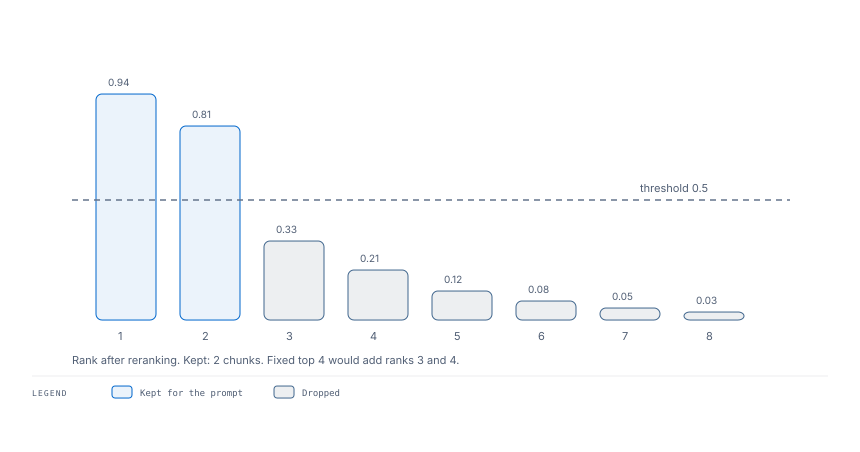
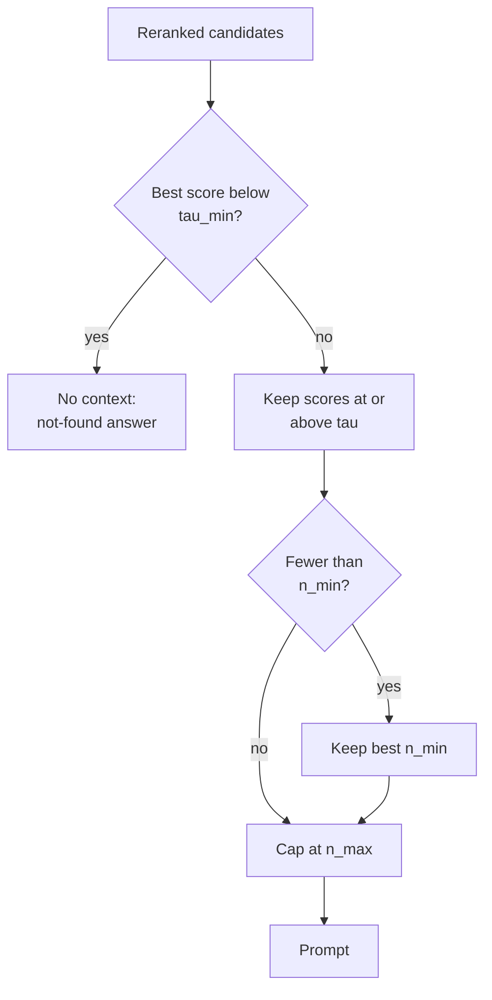

# 09. Score Thresholds and Dynamic k

In this note:

- Why a fixed number of chunks is wrong for most questions
- Absolute, relative and gap-based thresholds
- Which scores can be thresholded (cosine versus reranker scores)
- Minimum and maximum chunk counts, and when to send nothing
- An algorithm that combines them
- How to tune a threshold on the test set

## A fixed number of chunks is usually wrong

After reranking (note 08) the candidates are in a good order. The last decision is **how many to send**. Naive RAG always sent 4. The right number depends on the question:

<table width="100%">
<thead><tr><th>Question</th><th>Useful chunks in the index</th><th>Fixed 4 sends</th></tr></thead>
<tbody>
<tr><td>"How many sick days do employees get?"</td><td>1 (the HR file is one chunk)</td><td>1 useful + 3 noise: precision 0.25 even with a perfect answer</td></tr>
<tr><td>"What does the CRAG retrieval evaluator do?"</td><td>4 or 5 (several passages describe it)</td><td>4 useful: fine</td></tr>
<tr><td>"Who won the FIFA World Cup in 2018?"</td><td>0</td><td>4 noise chunks the model must ignore</td></tr>
</tbody>
</table>

The Naive RAG logs show the problem directly: for "What is the hotel limit per night?" the right chunk scored 0.524 and the other three scored about 0.14, yet all four were sent (Naive RAG API doc 21). **Dynamic k** means the number of chunks follows the scores instead of a constant.



## Three kinds of threshold

Let the reranked scores be s_1 >= s_2 >= ... >= s_N.

<table width="100%">
<thead><tr><th>Rule</th><th>Keep chunk i if</th><th>Good at</th><th>Weak at</th></tr></thead>
<tbody>
<tr><td>Absolute threshold</td><td>s_i >= tau (for example tau = 0.5)</td><td>Dropping clearly irrelevant chunks; detecting "nothing relevant"</td><td>Needs scores that mean the same thing across questions</td></tr>
<tr><td>Relative threshold</td><td>s_i >= s_1 - delta, or s_i >= r * s_1</td><td>Questions where all scores are low or all are high</td><td>Keeps noise when everything is noise (s_1 itself is low)</td></tr>
<tr><td>Largest gap (elbow)</td><td>i is before the biggest drop s_j - s_(j+1)</td><td>Clear "relevant group, then the rest" patterns, like 0.94, 0.81, then 0.33</td><td>Unstable when scores decrease smoothly</td></tr>
</tbody>
</table>

Worked example with the scores in the figure (0.94, 0.81, 0.33, 0.21, 0.12, ...):

- absolute tau = 0.5: keep 2 chunks;
- relative delta = 0.3 (keep if s_i >= 0.94 - 0.3 = 0.64): keep 2 chunks;
- largest gap: the drops are 0.13, 0.48, 0.12, 0.09, ...; the largest is after chunk 2: keep 2 chunks.

With the Naive RAG hotel example (0.524, 0.148, 0.144, 0.143) all three rules keep only the first chunk.

## Which scores can be thresholded

<table width="100%">
<thead><tr><th>Score</th><th>Range seen in practice</th><th>Safe to threshold?</th></tr></thead>
<tbody>
<tr><td>Cosine similarity of embeddings (stage 1)</td><td>In our Naive RAG logs from about 0.14 to 0.65; the absolute level depends on the model and the question</td><td>Only loosely: a good chunk for one question can score lower than a bad chunk for another. Use relative or gap rules, or a low safety floor</td></tr>
<tr><td>Cross-encoder probability (stage 2)</td><td>0 to 1, trained as P(relevant)</td><td>Yes, much better: the model was trained so that relevant pairs score high and irrelevant pairs low across queries. Still tune the value on the test set</td></tr>
<tr><td>LLM rerank scores (0 to 10)</td><td>Discrete, can drift between calls</td><td>With care: use temperature 0 and check consistency</td></tr>
</tbody>
</table>

Scores are **ranking signals first and probabilities second**: a reranker can order chunks well while its absolute values are not perfectly calibrated. That is why the threshold is tuned on the test set, not taken from a model card.

## Minimum, maximum and sending nothing

Two bounds make any threshold safe:

- **n_min** (for example 1): always send at least the best chunk, unless the "nothing relevant" rule applies.
- **n_max** (for example 5): never send more than this, to bound prompt length and cost.

And one optional rule:

- **Refuse when nothing is relevant:** if even the best chunk scores below tau_min (for example 0.1), send no context and return the fixed "I could not find this in the provided documents." answer without calling the generator. This saves a generation call for out-of-scope questions, but a tau_min that is too high causes false refusals, so it must be tuned and checked on the out-of-scope test case and on hard in-scope cases.

## The algorithm

```text
select_chunks(candidates sorted by reranker score s, tau, n_min, n_max, tau_min):
    if candidates is empty or s_1 < tau_min:
        return []                         # nothing relevant: fixed not-found answer
    kept = [c for c in candidates if s(c) >= tau]
    if len(kept) < n_min:
        kept = candidates[:n_min]         # keep the best one(s) anyway
    return kept[:n_max]
```



## Tuning the threshold

A threshold is a trade-off: raising tau raises precision and lowers recall. Tune it on the test set:

1. Run retrieval and reranking once per test question and **save all reranker scores** (no generation needed).
2. For each candidate tau (for example 0.1, 0.2, ..., 0.9), compute without new model calls:
   - hit rate at n (is the expected file still among the kept chunks?),
   - average number of kept chunks (a proxy for prompt cost),
   - precision of kept chunks, using the judge's relevant-chunk lists.
3. Pick the highest tau that keeps the hit rate at or above the target (95 percent here).
4. Run the full evaluation with that tau and confirm correctness and faithfulness did not drop.

<table width="100%">
<thead><tr><th>tau</th><th>Expected effect</th></tr></thead>
<tbody>
<tr><td>Too low (0.05)</td><td>Behaves like a fixed top n_max; little precision gain</td></tr>
<tr><td>Good range</td><td>One to three chunks for single-fact questions, more for broad ones; hit rate stays high</td></tr>
<tr><td>Too high (0.9)</td><td>Often only one chunk or none; hard questions lose their evidence, correctness drops</td></tr>
</tbody>
</table>

Re-tune whenever the reranker model, the chunk size or the documents change significantly.

## In this project

The Advanced RAG API will add RERANK_THRESHOLD, MIN_CHUNKS and MAX_CHUNKS settings (and an optional not-found floor), log every candidate with its score and whether it was kept, and return the kept and dropped chunks so the UI can show them. The threshold will be tuned with the procedure above and the chosen value documented with its test-set numbers.

## Key points

- The right number of chunks depends on the question; a fixed k wastes the prompt on noise.
- Thresholds: absolute (s >= tau), relative (close to the best score) or largest gap.
- Threshold reranker probabilities, not raw cosine scores; tune the value on the test set.
- Always bound the result with n_min and n_max; optionally send nothing when even the best chunk is weak.
- Tune by sweeping tau over saved scores and keeping the hit rate at the target.

## Navigation

Previous: [08. Reranking](08.%20Reranking.md) | [Index](README.md) | Next: 10. Context Compression and Filtering (next)
