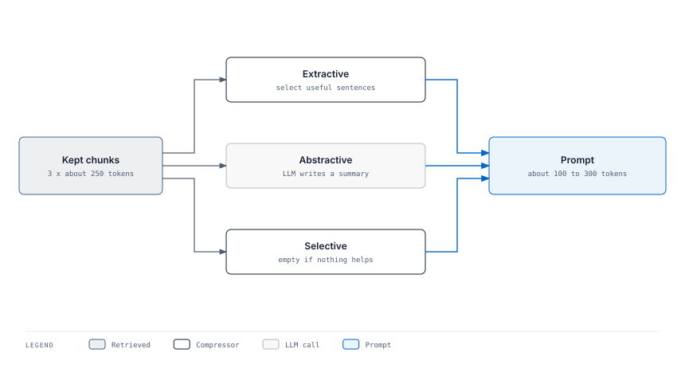

# 10. Context Compression and Filtering

In this note:

- Why even good chunks contain mostly unneeded text
- "Lost in the middle": why long contexts hurt
- Extractive compression: keep the useful sentences
- Abstractive compression: write a short summary
- Selective augmentation: return nothing when nothing helps
- Token pruning, in short
- Ordering the chunks in the prompt
- RECOMP (paper 3), in short
- The effect on citations, and the choice for this project

## Good chunks, mostly unneeded text

Reranking and thresholds (notes 08 and 09) decide **which** chunks reach the prompt. But a relevant 1000-character chunk usually answers the question in one or two sentences; the rest is surrounding text. For "How many sick days do employees get per year?" the HR chunk also contains the leave policy for new joiners. For paper chunks, a relevant passage may sit next to a table, a citation list or a different subsection.

**Context compression** shortens the selected chunks to the parts that matter for the question, before generation. **Filtering** is its coarse form: dropping whole chunks (already done by the threshold) or whole sentences.

## Why long contexts hurt

<table width="100%">
<thead><tr><th>Effect</th><th>Evidence</th></tr></thead>
<tbody>
<tr><td>Cost</td><td>Prompt tokens are most of the cost of a RAG answer (about 1,000 of 1,100 tokens per Naive RAG question)</td></tr>
<tr><td>Latency</td><td>Longer prompts take longer to process</td></tr>
<tr><td>Distraction</td><td>Irrelevant sentences can be copied into the answer or confuse the model</td></tr>
<tr><td>Lost in the middle</td><td>Liu et al. (2023, "Lost in the Middle: How Language Models Use Long Contexts") found that models use information at the start and end of a long context much better than information in the middle; accuracy drops when the relevant passage is placed in the middle of many passages</td></tr>
</tbody>
</table>

## Three ways to compress

### Extractive compression

Split each kept chunk into sentences, score each sentence against the question, keep the best ones (in their original order), drop the rest.

<table width="100%">
<thead><tr><th>Sentence scorer</th><th>How</th><th>Cost</th></tr></thead>
<tbody>
<tr><td>Embedding similarity</td><td>Embed each sentence, cosine with the question vector</td><td>Very low (embedding calls only)</td></tr>
<tr><td>Cross-encoder</td><td>Score (question, sentence) pairs with the reranker of note 08</td><td>Low, local</td></tr>
<tr><td>LLM selection</td><td>"Copy only the sentences that help answer the question"</td><td>One LLM call reading all kept chunks</td></tr>
<tr><td>Trained extractor (RECOMP)</td><td>A dual encoder trained to pick sentences that improve the reader's answer</td><td>Low at inference, needs training</td></tr>
</tbody>
</table>

The output is always **verbatim text from the documents**, so it cannot add facts, and quotes and page highlights still match the source.

### Abstractive compression

An LLM (or a small trained summariser) writes a short summary of the kept chunks **focused on the question**, combining information from several chunks into a few sentences.

- Strength: very short, can merge facts spread over several chunks.
- Weakness: the summary is new text. It can drop a qualifier, merge facts wrongly or add something not in the source, and it no longer points to exact sentences on exact pages. Faithfulness must be measured against the **original chunks**, not the summary.

### Selective augmentation

If the retrieved text does not help answer the question, the compressor returns an **empty string**: no context is added. RECOMP calls this **selective augmentation**. It is the compression-side version of the "send nothing" rule in note 09: out-of-scope questions then get the not-found answer without the model reading noise.

## Token pruning, in short

A different family removes individual **tokens** rather than sentences. LLMLingua and LongLLMLingua (Jiang et al. 2023) use a small language model to estimate which tokens carry little information and drop them, reaching high compression ratios. The compressed text is no longer fluent, which is fine for the LLM but makes it unsuitable for showing to users or highlighting in a PDF. It is most useful for very long contexts.

## Ordering the chunks

Even without compression, the **order** of chunks in the prompt matters because of the lost-in-the-middle effect.

<table width="100%">
<thead><tr><th>Order</th><th>How</th><th>When</th></tr></thead>
<tbody>
<tr><td>Best first (default)</td><td>Highest reranker score first</td><td>Short contexts (2 to 5 chunks)</td></tr>
<tr><td>Best at the edges</td><td>Best chunk first, second best last, weakest in the middle</td><td>Long contexts (10+ chunks)</td></tr>
<tr><td>Document order</td><td>Sort kept chunks by file and page</td><td>When chunks are consecutive parts of one section and reading order matters</td></tr>
</tbody>
</table>

With a threshold keeping 1 to 3 chunks, best first is enough; the lost-in-the-middle problem mostly disappears when the context is short, which is one more argument for reranking and thresholds.

## RECOMP (paper 3), in short

[RECOMP](../02.%20Research%20Paper%20Explained/03.%20RECOMP%20Compression%20and%20Selective%20Augmentation/) (Xu, Shi and Choi, ICLR 2024) compresses retrieved documents into textual summaries before they are prepended to the reader model's input:

<table width="100%">
<thead><tr><th>Part</th><th>What the paper does</th></tr></thead>
<tbody>
<tr><td>Extractive compressor</td><td>A dual encoder (initialised from Contriever) that scores sentences; trained so that the selected sentences improve the reader's end-task performance</td></tr>
<tr><td>Abstractive compressor</td><td>An encoder-decoder model initialised from T5-large (775M parameters), trained by distillation from summaries written by gpt-3.5-turbo and filtered by whether they help the reader</td></tr>
<tr><td>Selective augmentation</td><td>Both compressors can output an empty string when the documents are irrelevant or add nothing</td></tr>
<tr><td>Readers and tasks</td><td>Language modelling and open-domain QA (for QA the reader is Flan-UL2, 20B)</td></tr>
<tr><td>Headline result</td><td>A compression rate as low as 6 percent of the original tokens with minimal loss in performance, clearly better than off-the-shelf summarisers; summaries largely faithful to the retrieved documents</td></tr>
</tbody>
</table>

The key idea for this project: the compressor is judged by **whether the reader answers better**, not by how good the summary looks.

## Effect on citations

This project's main feature is that every claim cites a chunk and the UI opens the PDF at that page with the passage highlighted. Compression interacts with that:

<table width="100%">
<thead><tr><th>Method</th><th>Citations still point to the right chunk and page?</th><th>PDF highlighting still works?</th></tr></thead>
<tbody>
<tr><td>No compression</td><td>Yes</td><td>Yes</td></tr>
<tr><td>Extractive (sentences from one chunk)</td><td>Yes, sentences keep their chunk number and page</td><td>Yes, the sentences are verbatim</td></tr>
<tr><td>Abstractive summary</td><td>Only loosely; one summary may merge several chunks</td><td>No, the text does not exist in the PDF</td></tr>
<tr><td>Token pruning</td><td>Yes, per chunk</td><td>Partly; text no longer matches exactly</td></tr>
</tbody>
</table>

## Cost: is it worth it here?

After reranking and a threshold, a typical prompt holds 1 to 3 chunks (about 250 to 750 tokens of context) instead of Naive RAG's 4 chunks (about 1,000). Extractive compression to the best few sentences might bring it to 100 to 300 tokens. The saving per question is roughly 500 input tokens:

$$500 \cdot 0.15 / 10^6 = \$0.000075 \approx \text{Rs } 0.006$$

That is real but small, while an LLM-based compressor would cost about the same as it saves. So in this project compression is a **secondary** step: the threshold already removes most noise.

## In this project

- Default: **no compression**, best-first ordering, threshold from note 09.
- Optional, behind a setting: **extractive** sentence filtering with the reranker or embeddings, which keeps citations and PDF highlighting intact.
- Abstractive summaries are not used for answers, because they break verbatim citations; they may be tried only as an experiment, with faithfulness checked against the original chunks.
- The evaluation will measure the optional step on its own: tokens saved, cost, and any change in correctness and faithfulness.

## Key points

- Relevant chunks still contain mostly unneeded text; compression keeps what matters for the question.
- Long contexts cost more and suffer from "lost in the middle"; short, ordered contexts work best.
- Extractive keeps verbatim sentences (safe for citations); abstractive writes summaries (shorter, riskier); selective returns nothing when nothing helps.
- RECOMP trains both compressor types to improve the reader's answers and reaches about 6 percent of the original length with little loss.
- Here, reranking and thresholds do most of the work; extractive compression is an optional extra.

## Navigation

Previous: [09. Score Thresholds and Dynamic k](09.%20Score%20Thresholds%20and%20Dynamic%20k.md) | [Index](README.md) | Next: [11. Advanced RAG Architecture End to End](11.%20Advanced%20RAG%20Architecture%20End%20to%20End.md)
